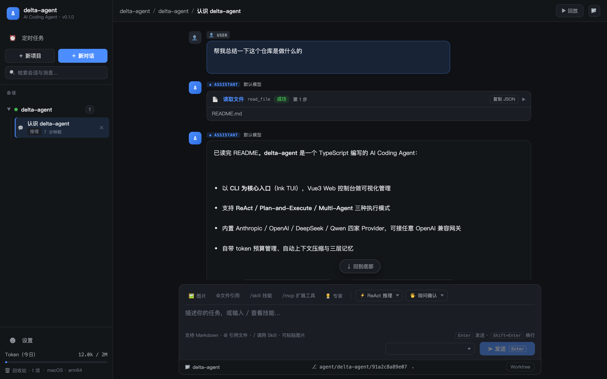
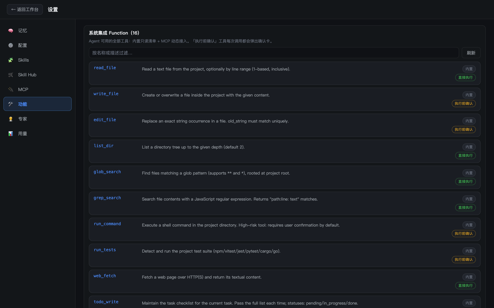
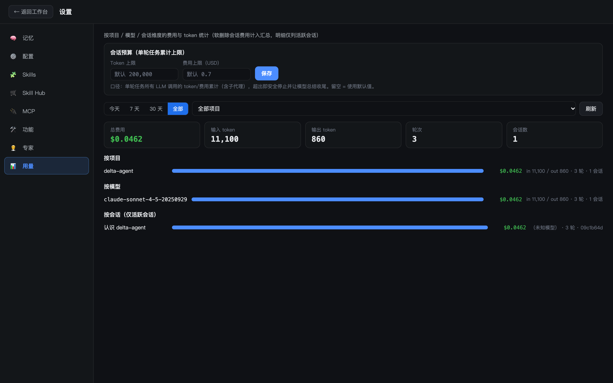

# delta-agent

delta-agent 是一个基于 TypeScript 的 AI Coding Agent，以 **CLI 为核心入口**、Vue Web 控制台为可视化前端。内置 **ReAct / Plan-and-Execute / Multi-Agent** 三种引擎，并可将任务委派给本机已安装的 **外部 CLI/ACP Agent**（Claude Code、CodeBuddy、Codex、Cursor 等）。工具层支持 **16 个内置 Function + MCP + Skills + 专家库**，通过 MCP 与插件体系扩展能力，在终端与浏览器中完成编码、调试、重构与多任务编排。

## 为什么叫 delta

**delta（Δ，德尔塔）是数学与工程中表示「变化量」的符号**——微积分里的 Δx、物理里的位移、工程里的增量，都由它标记。写代码的本质正是制造一连串受控的变化：一次编辑是一个 diff，一次提交是一组 delta，一次重构是成千上万行变化的累积。

delta-agent 的寓意即在于此：**它就是驱动代码变化的那股力量**。Agent 每读一个文件、每改一行代码、每跑一轮测试，都是在为你的项目写下下一个 delta；而 ReAct → Plan → Multi-Agent 的模式切换，本质也是按变化的规模选择「一步到位」还是「分而治之」。同时，Δ 在数学中还常表示「差分/极限趋近」，呼应本项目的迭代姿态——小步快跑、持续逼近更好。

## 核心特性

- **四种执行路径**：`react` / `plan-execute` / `multi-agent` 三内置引擎 + **外部 Agent**（`cli:*` / `acp:*`，如 `cli:codebuddy`）；Hub 按会话 `model` 分派，外部会话不走 delta 沙箱与内置工具，用量计入对方 CLI 订阅。
- **Router / Worker 委派（F-58）**：项目级 **Router 会话**派发用户级委派任务，每任务对应独立 **Worker 会话**；Web 工作台支持任务台、轻首页与进度订阅。
- **三种执行模式（内置）**：`--mode react | plan-execute | multi-agent` —— 快问快答用 ReAct，复杂任务用 Plan-and-Execute，大型工程用 Multi-Agent 子代理协作。
- **模型无关接入层**：Anthropic / OpenAI / DeepSeek / Qwen 及任意 OpenAI 兼容网关；API Key 本地加密；流式 SSE + **模型路由**（`delta models routing`）。
- **工具生态**：16 个内置工具（含 `task` 子代理、`run_in_background` / `task_output` 等）+ **MCP**（stdio/SSE）+ **Skills** 三层（builtin / user / project）+ **专家库 / 专家团**（F-39，`delta expert`）。
- **长对话不失控**：Token 预算 + 自动上下文压缩 + 三层记忆（会话内 / L2 SQLite / L3 静态 MEMORY.md）。
- **权限与 Git**：`plan`（只读）/ `default`（写需确认）/ `yolo`（双重确认）三档；`off | suggest | auto` 三档 git 策略。
- **沙箱执行**：macOS Seatbelt 为主，Docker 可选（`delta sandbox`）。
- **CLI + Web**：Ink TUI + Vue 3 控制台（`delta serve`）；支持 **Headless** `delta run -p "任务" --json`（CI / 脚本，F-29）。
- **插件宿主（P6–P7）**：`~/.delta/plugins` / 项目 `.delta/plugins`；六槽贡献（引擎 / 工具 / 服务 / 路由 / 命令 / 视图），内置实现已拆至 `packages/plugins/*`，由 `@delta/host` 聚合。
- **工程化配套**：桌面通知、项目引导、成本报告、定时任务（`delta cron`，`serve` 可托管调度）、F-52 市场、E2E 与 `delta doctor` 自检。

## 运行截图

**Web 控制台工作台**——ReAct 推理中的工具调用卡（读取文件）与 Markdown 回答：



**设置 → 功能**——系统集成的全部 Function（内置 16 个 + MCP 动态接入），含执行前确认标识：



**设置 → 用量**——会话预算配置与按项目 / 模型 / 会话三维度的费用统计：



## 仓库结构（pnpm monorepo）

```
delta-agent/
├── packages/
│   ├── cli/                 # @delta/cli —— CLI 入口（commander + Ink），bin：delta
│   ├── core/                # @delta/core —— 引擎、会话、工具、MCP、沙箱、Router、外部 Agent 适配
│   ├── shared/              # @delta/shared —— 跨包类型与协议
│   ├── host/                # @delta/host —— serve 运行时聚合（内置插件包 + createServeRuntime）
│   ├── web/                 # @delta/web —— Vue 3 控制台（Vite）
│   ├── desktop/             # Electron 壳（方案 B：main 进程内托管 core serve）
│   └── plugins/             # 内置贡献分包（builtin-engines/commands/routes/services/views）
├── e2e/                     # CLI 黄金路径 + Playwright Web 套件
├── docs/                    # PRD、各功能 prd-f* / design-f*、架构术语表、概念地图
├── prototype/
└── scripts/                 # 构建、冒烟、pre-push 钩子、Windows 安装等
```

## 环境要求

- Node.js >= 20
- pnpm 9.15.9（`packageManager` 字段已锁定，可用 corepack 启用）

## 快速开始

```bash
# 安装依赖（会安装 git pre-push 钩子：typecheck + 单测）
pnpm install

# 构建全部子包
pnpm build

# 配置模型 Provider（Key 加密存储于 ~/.delta/models.json）
node packages/cli/dist/index.js models add anthropic -k <API_KEY> --default
# 或使用 openai 兼容网关
node packages/cli/dist/index.js models add my-gateway -k <API_KEY> --base-url https://example.com/v1

# 启动交互式 TUI
node packages/cli/dist/index.js

# 或启动 Web 控制台（默认 127.0.0.1:7902，--dev 为 7900）
node packages/cli/dist/index.js serve
```

**外部 Agent（可选）**：PATH 上存在受支持 CLI 时自动探测；也可在 Web **设置 → 外部 Agent** 或 `delta agents templates` / `delta agents add` 手动注册。注册后模型列表会出现 `cli:*`，会话即走外部引擎。

## Windows 安装（F-51）

一条命令安装闭环：PowerShell 脚本自动装 Node（可选）→ npm 全局安装 → 验证 `delta --version`。

```powershell
# 在线安装（默认 npm 渠道 @delta/cli）
powershell -ExecutionPolicy Bypass -File scripts\install-windows.ps1

# 指定本地 tgz / 目录安装（离线包 / CI 工件场景）
powershell -ExecutionPolicy Bypass -File scripts\install-windows.ps1 -Package .\delta-cli-0.1.0.tgz

# 内网镜像场景
powershell -ExecutionPolicy Bypass -File scripts\install-windows.ps1 -Registry http://npm.internal.local/
```

脚本行为：

- Node 缺失或 < 20 时自动安装 LTS（依次尝试 winget → chocolatey → 官网 MSI 静默安装）；`-NoNodeInstall` 可禁用自动安装。
- npm 全局 bin 目录不在 PATH 时自动追加到用户 PATH（无需重启）。
- 退出码：0 成功 / 2 Node 缺失 / 3 npm 安装失败 / 4 验证失败。

另外两个安装途径：

- **NSIS 安装器**：CI（`windows-installer` job）用 `scripts/build-sea.mjs` 产出 SEA 单文件 `delta-win32-x64.exe`，再经 `scripts/installer-windows.nsi` 打出 `delta-win32-x64-installer.exe` 工件（按用户安装，免管理员权限，自动配置 PATH，带卸载器）。
- **安装后自检**：`delta doctor` 体检版本 / Node / 系统 / 配置目录 / Provider 配置 / 会话库完整性 / 外部 Agent 探测与能力声明 / 连通性，每项问题附「下一步」指令；`--offline` 跳过网络请求。

```powershell
delta doctor
```

## 常用命令

根命令 `delta`（开发阶段为 `node packages/cli/dist/index.js`）：

```bash
delta [options]                     # 启动交互式 TUI 会话
  -r, --resume [sessionId]          # 恢复指定会话（缺省恢复项目最近会话）
  -m, --model <model>               # 模型名（含 cli:codebuddy 等外部 id）
  -p, --provider <name>             # anthropic | deepseek | qwen | openai | …
  --mode <mode>                     # react | plan-execute | multi-agent（别名 plan / multi）
  --permission <mode>               # plan | default | yolo（yolo 需再叠加 --yolo）
  --git <mode>                      # off | suggest | auto
  --max-turns <n>                   # 单任务最大轮次（默认 50）
  --db <path>                       # SQLite 路径（默认 ~/.delta/agent.db）
```

子命令（节选）：

| 子命令 | 说明 |
|--------|------|
| `delta serve` | 启动 Web 控制台与 HTTP/SSE API。默认托管 **cron 调度器**（`--cron-scheduler off` 或 `DELTA_CRON_DISABLE_AUTOTICK=1` 关闭） |
| `delta run` | Headless 单次运行，`--json` 输出结构化报告与退出码协议（F-29，适合 CI） |
| `delta cron …` | 定时任务（`~/.delta/cron.json`）；`serve` 已内置调度时通常无需再跑 `delta cron daemon` |
| `delta models …` | Provider 配置；含 `routing` 系列子命令（模型路由） |
| `delta agents …` | 外部 Agent：模板列表、手动注册、改模型、移除（与 `~/.delta/external.json` 共用） |
| `delta expert …` | 专家库：list / import / export / trust 等（F-39） |
| `delta memory …` | L2 长期动态记忆 |
| `delta sandbox …` | 沙箱运维（Seatbelt / Docker） |
| `delta notify …` | 桌面通知 |
| `delta market …` | Skills / MCP 市场（F-52，`~/.delta/registry.json`） |
| `delta doctor` | 环境与配置自检 |
| `delta evals` / `usage` / `hooks` | 评测集、费用统计、钩子配置等 |

完整能力见 [docs/PRD.md](docs/PRD.md) 与各 `docs/prd-f*.md` / `docs/design-f*.md`。

## 开发

```bash
pnpm build        # 构建全部子包
pnpm test         # 运行全部单测（根目录脚本会确保 Node≥20 与 sqlite 原生绑定）
pnpm typecheck    # 类型检查（会先 build:deps 产出 shared/core 等 .d.ts）
pnpm smoke        # 冒烟（Web：pnpm smoke:web）
pnpm e2e          # E2E：CLI 黄金路径 + 插件 + Playwright（DELTA_FAKE_PROVIDER，零密钥）
pnpm clean        # 清理构建产物
```

> **推送前门禁**：`pnpm install` 注册的 `pre-push` 钩子会跑 `pnpm typecheck` + `pnpm test`。需 Node ≥ 20；`SKIP_CI=1 git push` 或 `--no-verify` 仅在有充分理由时使用。

> E2E：`pnpm e2e` 构建 core/web 后跑 `e2e/cli/e2e-cli.mjs`（退出码 0/1/2/3/4/5）、`e2e-plugins` 与 `e2e/web`。Web 可单独：`pnpm --filter @delta/e2e test`。

在单个子包内：

```bash
pnpm --filter @delta/core test
pnpm --filter @delta/cli build
```

## 文档

| 文档 | 说明 |
|------|------|
| [docs/architecture-glossary.md](docs/architecture-glossary.md) | **架构术语表**（Session / EngineMode / 委派 / 外部 Agent / 插件等唯一口径） |
| [docs/project-concepts.html](docs/project-concepts.html) | 交互式概念地图（源：[architecture.json](docs/project-concepts.architecture.json)） |
| [docs/PRD.md](docs/PRD.md) | 产品需求总览 |
| [docs/technical-design.md](docs/technical-design.md) | 总体技术设计 |
| [docs/agent-modes-design.md](docs/agent-modes-design.md) | 执行模式与 Worker 编排 |
| [docs/memory-design.md](docs/memory-design.md) / [docs/prompt-design.md](docs/prompt-design.md) | 记忆与提示词 |
| `docs/prd-f*.md` + `docs/design-f*.md` | 分功能 PRD 与设计（如 F-55 外部 Agent、F-58 委派、F-39 专家、F-52 市场…） |

## 配置与隐私

仓库不含密钥或本机配置，以下内容在本地生成（`.gitignore` 已忽略）：

| 路径 | 内容 |
|------|------|
| `~/.delta/models.json` | Provider 配置，Key AES-256-GCM 加密（0600） |
| `~/.delta/agent.db` | 会话、消息、用量、委派任务等 SQLite |
| `~/.delta/external.json` | 外部 Agent 探测缓存 + 手动注册（F-55/F-56） |
| `~/.delta/cron.json` | 定时任务 |
| `~/.delta/registry.json` | 市场订阅源（F-52） |
| `~/.delta/plugins/` / `plugin-trust.json` | 用户级插件与信任清单 |
| `<项目>/.delta/` | 项目级 MCP / hooks / sandbox / Skills / 专家包等 |

```bash
delta models add anthropic -k "$ANTHROPIC_API_KEY" --default
delta models add my-gateway -k "$GATEWAY_KEY" --base-url https://example.com/v1
```

## 许可证

[MIT](LICENSE)
