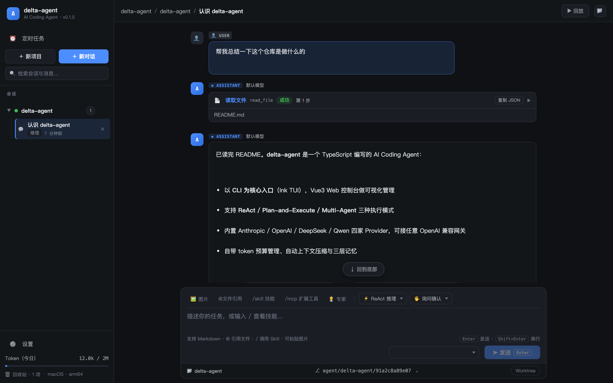
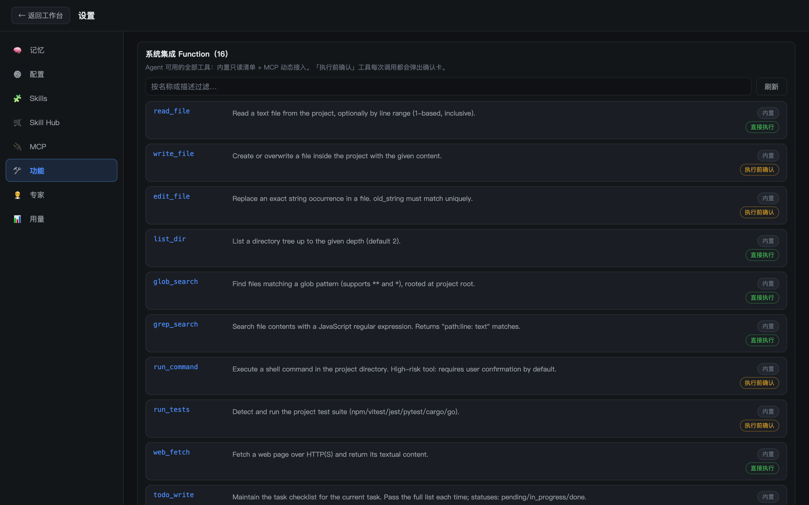
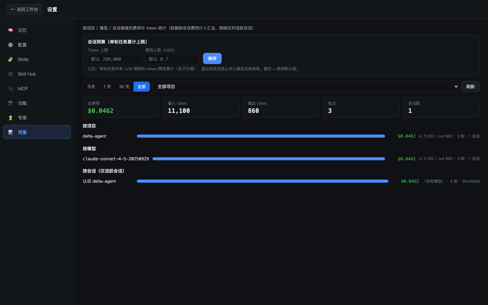

# delta-agent

delta-agent 是一个基于 TypeScript 的 AI Coding Agent，以 **CLI 为核心入口**、Vue Web 控制台为可视化前端，支持 **ReAct / Plan-and-Execute / Multi-Agent** 三种执行模式，通过 MCP 协议动态扩展工具能力，帮助开发者在终端与浏览器中完成编码、调试、重构等软件工程任务。

## 为什么叫 delta

**delta（Δ，德尔塔）是数学与工程中表示「变化量」的符号**——微积分里的 Δx、物理里的位移、工程里的增量，都由它标记。写代码的本质正是制造一连串受控的变化：一次编辑是一个 diff，一次提交是一组 delta，一次重构是成千上万行变化的累积。

delta-agent 的寓意即在于此：**它就是驱动代码变化的那股力量**。Agent 每读一个文件、每改一行代码、每跑一轮测试，都是在为你的项目写下下一个 delta；而 ReAct → Plan → Multi-Agent 的模式切换，本质也是按变化的规模选择「一步到位」还是「分而治之」。同时，Δ 在数学中还常表示「差分/极限趋近」，呼应本项目的迭代姿态——小步快跑、持续逼近更好。

## 核心特性

- **三种执行模式**：`--mode react | plan | multi` 按任务复杂度切换 —— 快问快答用 ReAct，复杂任务用 Plan-and-Execute，大型工程用 Multi-Agent 子代理协作。
- **模型无关接入层**：内置 Anthropic / OpenAI / DeepSeek / Qwen 四家 Provider，支持任意 OpenAI 兼容网关，API Key 加密存储于本地；支持流式输出与模型路由。
- **工具生态开放**：内置核心工具（文件读写 / exec / web / memory / skill / task）+ MCP Server 动态扩展 + Skills 技能包。
- **长对话不失控**：token 预算管理 + 自动上下文压缩 + 三层记忆（会话内 / 项目 L2 长期记忆 / 蒸馏沉淀）。
- **权限与 Git 策略**：`plan`（只读）/ `default`（写需确认）/ `yolo`（双重确认后全放行）三档权限；`off | suggest | auto` 三档 git 提交策略。
- **沙箱执行**：macOS Seatbelt 为主要后端，Docker 可选；提供状态查看、启用/关闭、镜像拉取与 GC 运维命令。
- **CLI + Web 双形态**：终端里干活（Ink TUI），浏览器里管理项目、会话与模型配置（Vite + Vue）。
- **工程化配套**：桌面通知（F-33）、项目引导（F-34）、成本报告（F-31）、evals 评测集运行。

## 运行截图

**Web 控制台工作台**——ReAct 推理中的工具调用卡（读取文件）与 Markdown 回答：



**设置 → 功能**——系统集成的全部 Function（内置 16 个 + MCP 动态接入），含执行前确认标识：



**设置 → 用量**——会话预算配置与按项目 / 模型 / 会话三维度的费用统计：



## 仓库结构（pnpm monorepo）

```
delta-agent/
├── packages/
│   ├── cli/      # @delta/cli —— CLI 入口与 Ink TUI，bin 命令 delta
│   ├── core/     # @delta/core —— 引擎核心：会话、LLM 接入、工具、MCP、沙箱、记忆
│   ├── shared/   # @delta/shared —— 跨包共享的类型与工具函数
│   ├── web/      # Web 控制台（Vite + Vue）
│   └── desktop/  # 桌面壳（Electron，方案 B：main 进程进程内托管 core serve 运行时）
├── docs/         # PRD、各功能 PRD（prd-f30~f40）与技术设计文档
├── prototype/    # 原型
└── scripts/      # 构建/冒烟/钩子安装脚本
```

## 环境要求

- Node.js >= 20
- pnpm 9.15.9（`packageManager` 字段已锁定，可用 corepack 启用）

## 快速开始

```bash
# 安装依赖
pnpm install

# 构建全部子包
pnpm build

# 配置模型 Provider（Key 加密存储于 ~/.delta/models.json）
node packages/cli/dist/index.js models add anthropic -k <API_KEY> --default
# 或使用 openai 兼容网关
node packages/cli/dist/index.js models add my-gateway -k <API_KEY> --base-url https://example.com/v1

# 启动交互式 TUI
node packages/cli/dist/index.js
```

## 常用命令

根命令 `delta`（开发阶段为 `node packages/cli/dist/index.js`）：

```bash
delta [options]                     # 启动交互式 TUI 会话
  -r, --resume [sessionId]          # 恢复指定会话（缺省恢复项目最近会话）
  -m, --model <model>               # 指定模型名
  -p, --provider <name>             # anthropic | deepseek | qwen | openai
  --mode <mode>                     # react | plan | multi
  --permission <mode>               # plan | default | yolo（yolo 需再叠加 --yolo）
  --git <mode>                      # off | suggest | auto
  --max-turns <n>                   # 单任务最大轮次（默认 50）
  --db <path>                       # SQLite 路径（默认 ~/.delta/agent.db）
```

子命令：

| 子命令 | 说明 |
|--------|------|
| `delta models add/list/remove` | 管理 Provider 配置（Key 加密存储） |
| `delta memory` | 管理 L2 长期动态记忆 |
| `delta sandbox status/enable/disable/pull/gc` | 沙箱运维（Seatbelt / Docker） |
| `delta notify status/enable/disable/test` | 桌面通知（macOS / Windows） |

另有 `usage`（费用统计）、`evals`（评测集）、onboarding（项目引导）等子命令，详见 `docs/PRD.md` 与各功能设计文档。

## 开发

```bash
pnpm build        # 构建全部子包
pnpm test         # 运行全部测试（core 使用 vitest）
pnpm typecheck    # 类型检查（会先产出 shared/core 的 .d.ts，故全新 clone 也能直接跑）
pnpm smoke        # 冒烟验证（web 冒烟：pnpm smoke:web）
pnpm clean        # 清理构建产物
```

> 注：`@delta/shared`、`@delta/core` 的类型入口指向各自的 `dist/*.d.ts`，因此 tsc 需要它们先构建过；`pnpm typecheck` 已内置这一步（`build:deps`），单独跑某个包的 `typecheck` 前需先 `pnpm build:deps`。

在单个子包内执行：

```bash
pnpm --filter @delta/core test
pnpm --filter @delta/cli build
```

## 文档

- [docs/PRD.md](docs/PRD.md) —— 产品需求文档总览
- [docs/technical-design.md](docs/technical-design.md) —— 总体技术设计
- `docs/prd-f30~f40*.md` / `docs/design-f30~f40*.md` —— 各功能（容器沙箱、费用报告、模型路由、桌面通知、项目引导、CLI TUI、桌面化）的 PRD 与设计
- [docs/design-f40-desktop.md](docs/design-f40-desktop.md) —— F-40 桌面化（Electron 方案 B）技术设计
- [docs/prompt-design.md](docs/prompt-design.md) —— 提示词设计
- [docs/memory-design.md](docs/memory-design.md) —— 三层记忆设计

## 配置与隐私

仓库里不含任何密钥或本机配置，以下内容全部由使用者在本地生成（已在 `.gitignore` 中忽略）：

| 路径 | 内容 |
|------|------|
| `~/.delta/models.json` | 模型 Provider 配置，API Key 以 AES-256-GCM 加密存储（文件权限 0600） |
| `~/.delta/agent.db` | 会话、消息、使用量等 SQLite 数据 |
| `<项目>/.delta/` | 项目级配置（`mcp.json` / `hooks.json` / `sandbox.json` / 评测基线等） |

接入模型只需一条命令，密钥只经环境变量或参数传入，不落代码：

```bash
delta models add anthropic -k "$ANTHROPIC_API_KEY" --default
delta models add my-gateway -k "$GATEWAY_KEY" --base-url https://example.com/v1
```

## 许可证

[MIT](LICENSE)

