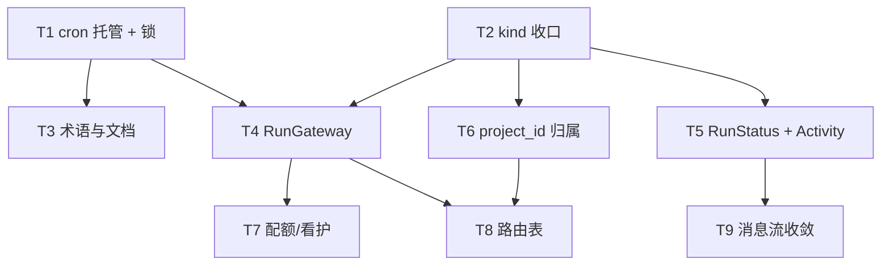

# 架构收口改造方案：多模式归一（P0–P2）

> 状态：**已评审通过（决策已裁决，待实施）** ｜ 日期：2026-11-09 ｜ 评审确认：2026-11-09  
> **交付边界：本仓库本轮只交付文档，不修改任何业务代码。** 下文 T1–T9 的代码改动在独立实施项目／仓库中进行；本文件是实施规格与验收依据，实施方按 §1 门禁逐任务验收。文中所有路径均相对 `delta-agent` 仓库根目录，实施仓库若目录结构不同需先做路径映射。  
> 适用分支：自 `main` 切 `refactor/architecture-consolidation`（实施仓库自行确定分支名）  
> 关联：`docs/design-f58-router-worker.md`（含 §19 裁决）、`docs/plans/2026-11-06-f58-router-worker.md`（实施格式基线）、`docs/design-f59-scope-cron-logs.md`、`docs/design-f22-cron.md`  
> 说明：本方案第 2 节「现状基线」即完整问题清单，可独立评审，不依赖其它文档；评审裁决见「评审裁决」章节。

**Goal:** 把「项目会话 / 定时任务 / 工作台 / 多智能体」四种被并列称呼的东西，收敛成**一条主干 + 四层明确职责**：统一运行前门禁、统一任务状态与进度、统一项目归属；同时补掉「只开 Web 控制台时定时任务不会自动触发」这个真实功能缺口。不重写引擎、不合并既有任务表、不改任何已裁决的设计约束。

**Architecture（收口后的目标态）:**

```
表现层  WorkbenchView（对话流 / 委派轻首页）—— 只是 UI 分支，不是运行模式
触发层  chat send · cron scheduler · router dispatch —— 全部先过 RunGateway
执行层  hub.send → 四路引擎分派（react / plan / multi / external）—— 保持不动
主干    sessions + messages + usage + AgentEvent —— 唯一权威数据
横切    RunGateway（权限/配额/scope/生命周期） · RunStatus（状态映射） · Activity（进度）
```

**核心判断：** 现有 `sessions` 表 + `AgentEvent` + `SessionHub` 是一条健康的主干，问题全部出在「每个新 F 编号都自带一套任务模型、状态机、权限校验和进度旁路」。因此本方案**不建新的执行单元、不建新的任务主表**，只做三件事：把入口收口、把语义映射统一、把归属从前端字符串匹配挪回数据模型。

---

## 1. 门禁与测试环境（每个任务收尾必跑，必读）

> 本节是**实施仓库**每个任务收尾的硬门禁。本仓库本轮只有文档变更、无代码改动，因此不执行这些命令；实施方在自己的仓库按此逐任务验收。

```bash
# 全量类型检查 + 单测（typecheck 内置 build:deps）
pnpm typecheck && pnpm test

# Web 单测：必须带 TMP 三件套，否则 WorkBuddy/Windows 下 vitest 缓存 EPERM
TMP="$PWD/.tmp-vitest" TEMP="$PWD/.tmp-vitest" TMPDIR="$PWD/.tmp-vitest" \
  pnpm --filter @delta/web test
# 首跑偶发 1 个 unhandled error + exit 1 是已确认的环境竞态，重跑一次即 14 文件 / 123 用例全绿，
# 不要误判为产品回归、不要为此改代码。

# 前端产物：delta serve 优先托管 packages/cli/dist/web，只构建 web 包页面不会更新
pnpm --filter @delta/web build && node scripts/copy-web-dist.mjs

# 冒烟 / 端到端
pnpm smoke && pnpm smoke:web && pnpm e2e
```

- 涉及 `packages/core/src/server/http.ts` 的任务，`pnpm smoke` / `pnpm smoke:web` 为硬门禁。
- 涉及会话列表 / 侧栏的任务，加跑 `pnpm --filter @delta/e2e test` 中 `sidebar.spec.ts` / `history.spec.ts` 两条。
- 涉及真 spawn 子进程的用例，Windows 上沿用 `skipIf(win32)` 口径（对齐 F-54）。
- 提交格式 `类型(模块): 描述`；docs 与代码分开提交（沿用 F-58 计划约定）。

---

## 2. 现状基线：问题 → 任务映射

| #  | 问题（可复核位置）                                                                                                                                      | 处理任务   | 阶段 |
| -- | ---------------------------------------------------------------------------------------------------------------------------------------------- | ------ | -- |
| 1  | `startCronScheduler` 全仓只在 `packages/cli/src/cron.ts:136` 调用；`server/runtime.ts` 只启动 F-58 的 60s tick → 只开 `delta serve` 定时任务不触发                 | **T1** | P0 |
| 2  | `cron.json` 的 `runningSince` 是软锁（读改写落盘、非原子），多实例会双触发                                                                                            | **T1** | P0 |
| 3  | `runner.ts:79` 写死 `24*60*60*1000`、`:138` 写死 `.slice(-20)`，`STALE_RUNNING_MS` / `MAX_RUN_HISTORY` 定义了没用                                         | **T1** | P0 |
| 4  | `sessions.kind = chat/router/worker` 同表，`GET /api/projects/:id/sessions`（`http.ts:983-990`）不过滤；Web `SessionRow`（`client.ts:16-31`）连 `kind` 都没有 | **T2** | P0 |
| 5  | `workspace.ts:72-76` 切项目不清 `chat.sessionId`，文件面板仍绑旧会话                                                                                          | **T2** | P0 |
| 6  | `task` / `worker` / `delegate` / `scope` 各有多义；F-49 编号冲突；`CronModal.vue` 文档存在但文件不存在；通知双路与文档矛盾                                                   | **T3** | P0 |
| 7  | 无统一执行前网关：权限校验散在 `registry.executeOne` / `http.ts` / CLI flag / `detect.ts` / `dispatcher`+`preflight`                                          | **T4** | P1 |
| 8  | 「任务」4 套状态机 4 套 id；结果回传 5 条旁路；3 套前端轮询 store 复制实现                                                                                                | **T5** | P1 |
| 9  | F-59 只是前端 `cwd` 前缀匹配（`utils/scope.ts`），后端 `/api/cron` `/api/logs` 全量返回；cron 调度行无 `sessionId`，开了作用域反而不可见                                        | **T6** | P1 |
| 10 | 配额 7 处、看护 5 套阈值互不感知；`isRunning` 带 `zombieReap` 副作用迫使新增 `peekRunning`                                                                           | **T7** | P2 |
| 11 | `http.ts` 1851 行手写 if/else，权限标注散落                                                                                                              | **T8** | P2 |
| 12 | 同一会话消息流被 `chat.ts` / `TaskDetailPanel.vue` / `ReplayView.vue` 渲染三遍且能力不一致                                                                       | **T9** | P2 |

---

## 3. 任务总表

| 任务     | 标题                                | 阶段 | 规模        | 依赖    | 关键交付                                  |
| ------ | --------------------------------- | -- | --------- | ----- | ------------------------------------- |
| **T1** | cron 调度托管 + 锁原子化                  | P0 | 中         | —     | Web 控制台自动调度；多实例不双跑                    |
| **T2** | 会话 `kind` 收口 + 项目切换隔离             | P0 | 中         | —     | 侧栏只列 chat；worker/router 归任务视图         |
| **T3** | 术语表 + 文档漂移治理                      | P0 | 小         | T1    | `docs/architecture-glossary.md`，零行为变更 |
| **T4** | `RunGateway` 统一运行前门禁              | P1 | 大（拆 3 提交） | T1、T2 | 4 个入口同一套权限/配额/scope                   |
| **T5** | `RunStatus` 映射 + 项目级进度通道          | P1 | 大（拆 2 提交） | T2    | 统一状态枚举 + 一条 SSE，轮询降级                  |
| **T6** | `project_id` 真归属（F-59 后端化）        | P1 | 中         | T2    | 后端过滤；cron 日志在项目作用域可见                  |
| **T7** | `QuotaStore` + `WatchdogRegistry` | P2 | 中         | T4    | 阈值单一来源                                |
| **T8** | `http.ts` 路由表（3 组试点）              | P2 | 中         | T4、T6 | 端点权限声明可测                              |
| **T9** | 会话消息流三套渲染收敛                       | P2 | 中         | T5    | 一套 tool-call 配对逻辑                     |

**依赖图：**



**可并行（已按 D3 裁决更新）：** T1 与 T2 **不再完全并行**——D3 已裁决启用 `GET /api/status`，两者都要改 `packages/core/src/server/http.ts`，该文件必须串行合入；其余文件（T1 的 `cron/` + `runtime.ts` + `cli/index.ts` ∥ T2 的 `session/` + Web）仍可并行开发与单独测试。  
**不能并行：** T4 与 T5 都要改 `http.ts` 与 Web store，必须串行；T6 依赖 T2 定下的 `project_id` 传参口径。

---

## 评审裁决（2026-11-09 确认：全按推荐）

> 用户确认口径：**D1–D4 全按推荐**；两处「可选／降级」按 B1 不拆、B2 启用；**本仓库本轮只改文档，代码实施在另一项目进行**。以下由「待拍板」转为「已裁决」，实施时不得擅自变更；变更需重新评审。T1/T2 中的待定措辞已按裁决固化（T5 的「轮询降级」是技术 fallback，不受本次裁决影响）。

### A. 四项主决策

| #      | 决策点                                    | 裁决                                                                                                                                  | 实施时必须遵守                                                                                                                                                  |
| ------ | -------------------------------------- | ----------------------------------------------------------------------------------------------------------------------------------- | -------------------------------------------------------------------------------------------------------------------------------------------------------- |
| **D1** | `delta serve` 是否默认托管 cron 调度器          | **是**：`cronScheduler:'auto'`，仅当宿主注入 `cronExecutor` 时生效；desktop 显式 `off`；提供 `--cron-scheduler off` 与 `DELTA_CRON_DISABLE_AUTOTICK=1` | 判据 1 保持「只开 serve 即自动触发」，不改写为「不自动跑但提示可见」；状态反馈由 D3 的 `/api/status` 提供；锁 check-and-set 见 B1，必须同迭代交付                                                         |
| **D2** | `sessions` 列表 `kind` 过滤缺省值             | **core 缺省全量（兼容旧客户端），Web 显式传 `kind=chat`**                                                                                           | 不得把 core 缺省改成 `chat`；`LogsView` / `SearchModal` / 用量 / 回收站 / CLI `--resume` 保持不带 `kind`                                                                  |
| **D3** | 是否启用 `GET /api/status` + Web「调度器未运行」提示 | **启用**（已确定为 T1 必做项，不再是可选）                                                                                                           | 端点必须叫 `/api/status`（`/api/cron/status` 会被 `GET /api/cron/:id` 当成 `id='status'` 先匹配而恒 404）；T1 与 T2 在 `http.ts` 上串行合入；判据 2 的 `cron.running === false` 为硬断言 |
| **D4** | 桌面端新建 cron 任务时无 `project_id` 怎么办       | **允许不传 = 全局任务，UI 标注「全部项目」**                                                                                                         | 桌面宿主 `registerProject:false` 且无 cwd，不强制绑定；不做「项目 id 透传进 `CronJobForm`」的额外工作量；T6 的 `POST /api/cron` 接受缺省 `project_id`                                      |

### B. 两处「可选／降级」裁决

| #      | 原待定项                                   | 裁决     | 实施时必须遵守                                                                                                          |
| ------ | -------------------------------------- | ------ | ---------------------------------------------------------------------------------------------------------------- |
| **B1** | T1 是否允许把锁 check-and-set 拆到 T1b         | **不拆** | check-and-set 必须与 T1 同迭代交付；判据 3（双实例只产生 1 条 `CronRunRecord`／1 次 executor）不得标 skip；T1 的「降级路径」段落仅作风险记录保留，**不采用**    |
| **B2** | T2 (d) 项目 `session_count` 是否按 `chat` 计 | **启用** | `GET /api/projects?session_kind=chat` 与 Web `refreshProjects` 传参为必做；判据 3「项目 `session_count` 显示 2」是硬断言，不再带「若启用」条件 |

### C. 本轮范围

| #      | 裁决                   | 说明                                                                                                                                                  |
| ------ | -------------------- | --------------------------------------------------------------------------------------------------------------------------------------------------- |
| **C1** | **只修改本文档，不修改任何业务代码** | T1–T9 的实施在独立项目／仓库完成。本文件是实施规格 + 验收清单；本仓库本轮无代码变更，因此不执行 §1 的门禁命令。T3 的 `docs/architecture-glossary.md` 也由实施仓库产出——术语表要求每个词带 `file:line` 指向权威定义，需在路径映射后编写 |

> 备选分支（当前**不采用**）：D1 若日后改选「默认不托管」，T1 主体会退化为文档改动 + 前端提示、P0 可提前收口，但功能缺口仍在且需在发布说明明示。

---

## T1：cron 调度托管 + 锁原子化

**依赖：** 无（第一个任务，P0 最高优先级，这是功能缺口不是重构）

**Files:**

- Modify: `packages/core/src/server/runtime.ts`  
  |  |  |  
  | --- | --- |
  - `ServeRuntimeOptions` 增 `cronScheduler?: 'auto' | 'off'`（缺省 `'auto'`）；语义写进注释：**auto = 仅当宿主同时注入了 `cronExecutor` 时，随 serve 启停一个进程内调度器**；desktop 未注入 executor 时自动不启用。
  - `createServeRuntime()` 内在现有 `dispatchTimer`（`:232-235`）旁装配 `startCronScheduler({ executor: opts.cronExecutor, tickMs: 30_000, logger })`；timer 同样 `unref()`；`dispose()`（`:271-293`）里先 `scheduler.stop()` 再走既有收尾。
  - 加进程内单例守卫 `let cronSchedulerActive = false`（模块级），二次 `createServeRuntime` 命中时只记日志不重复起 timer。  
    |  |  |  
    | --- | --- |
- Modify: `packages/cli/src/index.ts`（`serve` action `:668-705`）：新增 `--cron-scheduler <mode>`（`auto|off`，缺省 auto）；传 `cronScheduler` 给 `createServeRuntime`；启动日志打印调度状态。同时支持环境变量 `DELTA_CRON_DISABLE_AUTOTICK=1`（用户显式跑 `delta cron daemon` 时用来关内置调度）。
- Modify: `packages/desktop/src/main.ts`（`:68-76`）：显式传 `cronScheduler: 'off'` + 注释「桌面 v1 不注入 cronExecutor，调度器由 CLI serve 托管」，防止将来注入 executor 后行为悄然变化。
- Modify: `packages/core/src/cron/store.ts`：新增 `acquireCronLock(jobId, token, homeDir): boolean` / `releaseCronLock(jobId, token, homeDir): void`，锁值改成可区分归属的 token（`${pid}:${now}:${rand}`）而非裸 ISO 串。
- Modify: `packages/core/src/cron/runner.ts`：
  - (a) `:79` 改用 `STALE_RUNNING_MS`、`:138` 改用 `MAX_RUN_HISTORY`（对齐 `store.ts:84,106`）；
  - (b) 执行前用 `acquireCronLock()` 做「写锁 → 原子 rename → **重读文件 → 校验 `runningSince === token`**」的 check-and-set，失败即跳过本轮；
  - (c) 执行结束后**重新 `loadCronJobs()`**，把本轮 `CronRunRecord` 合并进最新对象再 `saveCronJobs()`，避免 last-writer-wins 覆盖另一进程的锁或记录（现有文件头 `:12-13` 的「全程同一份内存对象」不变量要同步改注释）。
- Modify（**D3 已裁决启用，必做**；T1/T2 在 `http.ts` 串行合入）：`packages/core/src/server/http.ts` 增 `GET /api/status` → `{ cron: { running, mode } }`；Web `CronView.vue` 在 `running=false` 时显示「调度器未运行」提示。
  - **端点命名坑**：不要叫 `/api/cron/status`——`parts[2]` 会被 `GET /api/cron/:id`（`http.ts:1630-1633`）当成 `id='status'` 先匹配，恒返回 404。同理，T5 的进度端点也不能叫 `/api/runs`（与 F-18 回放撞名）。
- Modify: `README.md`（定时任务相关段落）、`docs/design-f22-cron.md`（`:75-78` 调度器章节、`§不在本期` 的多机说明）
- Test: `packages/core/test/cron-runner.test.ts`（补并发锁用例）、`packages/core/test/serve-runtime.test.ts`（补 runtime 装配/dispose 用例）、`packages/core/test/cron-store.test.ts`（锁 token 归属）

**完成判据（验收点）:**

1. 隔离 `cronHomeDir` 下写一条每分钟到期的任务，只启动 `createServeRuntime({ port: 0, cronHomeDir, cronExecutor })`，注入 `tickMs=200` 的测试钩子后 ≤1s 内 `cron.json` 出现 `lastRun.trigger === 'schedule'`，**不启动 `delta cron daemon`**。
2. `cronScheduler: 'off'` 或 `DELTA_CRON_DISABLE_AUTOTICK=1` 时，同上条件 `lastRun` 保持 `undefined`；`GET /api/status` 返回 `cron.running === false`（D3 已裁决启用，此条为硬断言）。
3. **双实例不双跑**：两个 runtime 指向同一 `cronHomeDir` 同时 tick，一条到期任务最终只产生 **1 条** `CronRunRecord` 且只有 1 次 executor 调用（fake executor 计数断言）——这是对 check-and-set 的硬验收。
4. 崩溃残留：手工写入一个 25h 前的 `runningSince`，下一 tick 被 `STALE_RUNNING_MS` 清除并照常执行；把 `STALE_RUNNING_MS` 常量临时改小，runner 行为随之变化（证明不再写死字面量）。
5. `runtime.dispose()` 后 timer 全部停止，测试进程能正常退出；连续两次 `createServeRuntime` 不产生第二个 timer（spy `startCronScheduler` 调用次数）。
6. desktop 启动路径不调用 `startCronScheduler`、不 spawn 子进程。
7. 既有 `cron-runner.test.ts` / `cron-store.test.ts` / `serve-runtime.test.ts` 全绿；`delta cron daemon --once` 与 `delta cron run --id` 行为零变化；`pnpm smoke` 通过。

**红线:**

- 不改 `CronStoreFile.version`（保持 1，本任务只加可空锁 token 语义，不做文件迁移）。
- 不引入分布式调度 / leader election；多实例安全只做到「同机同文件不双跑」。
- 不改变 `CronExecutor` 注入接口与 headless 子进程语义（spawn `delta run --json` 保持）。
- `cronExecutor` 缺省时**绝不**启动调度器（否则 desktop 会 spawn 到不存在的 CLI 入口）。

**降级路径：不采用（B1 裁决）。** 原文保留作风险记录：若 P0 时间紧，曾考虑 T1 只做「装配 + 开关 + 单例守卫」，把锁 check-and-set 挪到 T1b，判据 3 在 T1b 前标 skip 并登记已知风险。评审已否决该拆分——双触发是全文最高风险（§5 风险 1），check-and-set 必须与 T1 同迭代交付，判据 3 不得跳过、不得静默略过。


**Commit:** `fix(core): cron 调度器随 serve 托管 + 运行锁 check-and-set` → `docs: F-22 调度托管与多实例口径回写`

---

## T2：会话 `kind` 收口 + 项目切换隔离

**依赖：** 无（可与 T1 并行开发；但 D3 已裁决启用 `GET /api/status`，两者在 `http.ts` 上必须串行合入同一文件）

**Files:**
- Modify: `packages/core/src/session/store.ts`
|  |  |  |
| --- | --- | --- |
  - `listSessions(projectId, opts?)` / `listSessionsPage(projectId, opts)` 的 opts 增 `kinds?: Array<'chat'|'router'|'worker'>`（`:193-228` 的 SQL 追加 `AND kind IN (...)`，分页两条 SQL 都要加，且 `args` 顺序对齐）。
  - `listProjects()` 的 `session_count` 子查询增可选参数 `chatOnly`（**B2 已裁决启用**：`GET /api/projects?session_kind=chat` 走此分支；不传时仍按全量计数，兼容旧客户端）。
- Modify: `packages/core/src/session/service.ts`：透传同名参数（不新增业务方法）。
|  |  |
| --- | --- |
- Modify: `packages/core/src/server/http.ts`（`:983-990`）：`GET /api/projects/:id/sessions` 解析 `?kind=chat|all`，缺省 `all`（**旧客户端兼容**）；`GET /api/projects` 解析 `?session_kind=chat`（**B2 已裁决启用，必做**）。
- Modify: `packages/web/src/api/client.ts`
|  |  |  |  |  |
| --- | --- | --- | --- | --- |
  - `SessionRow`（`:16-31`）补 `kind: 'chat'|'router'|'worker'`、`role_label: string|null`、`task_id: string|null`；
|  |  |
| --- | --- |
  - `listSessions` / `listSessionsPage`（`:896-903`）opts 增 `kind?: 'chat'|'all'`；`listProjects` 增 `sessionKind?`。
- Modify: `packages/web/src/stores/workspace.ts`：`refreshSessions` / `loadMoreSessions`（`:42-65`）传 `kind: 'chat'`；`refreshProjects` 传 `sessionKind: 'chat'`（**B2 已裁决启用，必做**）；`selectProject`（`:72-76`）清空 `chat.sessionId` / `chat.sessionMeta` 并触发面板 scope 复位。
- Modify: `packages/web/src/views/WorkbenchView.vue`：`selectProject`（`:341-344`）与 `syncPanelScope()`（`:223-233`）配合，切项目后文件面板作用域回到 `project` 级。
- **红线文件（只加注释，不改行为）**: `packages/web/src/views/LogsView.vue:29` —— 项目日志归属需要**全部**会话 id（含 worker/router），`listSessionsPage(pid, { limit: 500 })` 必须保持不带 `kind`。
- Test: `packages/core/test/session-service.test.ts`（kind 过滤 + 分页）、`packages/core/test/server.test.ts`（端点参数）、`packages/web/src/stores/workspace.test.ts`（切项目清态）、`e2e/web/sidebar.spec.ts`

**完成判据（验收点）:**
1. 造 1 个 `kind='router'` + 3 个 `kind='worker'` + 2 个 `kind='chat'`：`GET .../sessions?kind=chat` 恰好 2 条；不带 `kind` 恰好 6 条（旧口径）。
2. 分页 `?kind=chat&limit=1`：`has_more` / `next_cursor` 基于过滤后集合计算，第二页不为空、不重复、不漏项；`before` 游标跨过被过滤行时仍正确。
3. Web 侧栏只出现 2 个 chat 会话；项目 `session_count` 显示 2（B2 已裁决启用，此条为硬断言）。
4. 任务台点开某个 Worker 任务，`TaskDetailPanel` 仍能通过 `getSession` / `getMessagesPage` 正常渲染（证明详情链路不受列表过滤影响）。
5. **日志归属不回归**：mock `api.listSessionsPage` 断言 `LogsView` 的请求不含 `kind`；构造一条 worker 会话的日志，项目作用域下仍可见。
6. 切换项目后 `chat.sessionId === null`、文件面板 scope 为 `{kind:'project'}`；再切回可正常打开该项目会话。
7. CLI `delta -r` / `--resume`、回收站、用量统计、搜索行为零变化（这些路径不带 `kind`）；`pnpm e2e` CLI 黄金路径（退出码 0–5）全绿；`sidebar.spec.ts` / `history.spec.ts` 全绿。

**红线:**
- `sessions.kind` 仍不可变（`store.ts:266-276` 裁决 Q1）：**不新增任何 PATCH / 客户端写入口**。
- core 缺省全量，过滤只由 Web 显式发起；不得把默认值改成 `chat`，否则 CLI `--resume` 会找不到 router/worker 会话。
- 不动 `sessions` 表结构（零迁移）；不删 `router`/`worker` 会话，只改可见性。

**Commit:** `feat(core): 会话列表支持 kind 过滤（缺省全量兼容）` → `fix(web): 侧栏只列 chat 会话 + 切项目清理当前会话`

---

## T3：术语表 + 文档漂移治理

**依赖：** T1（常量修复先落地，避免文档写完又被改）

**Files:**
- Create: `docs/architecture-glossary.md` —— 唯一术语表，至少覆盖并给出「是什么 / 不是什么 / 代码位置」：
|  |  |  |
| --- | --- | --- |
  `Session`（含 `chat` / `router` / `worker` 三类 `kind`）、`EngineMode`（`react|plan-execute|multi-agent`）、`PlanTaskNode`（`tasks` 表）、`Delegation`（`worker_tasks`）、`ScheduledJob`（`cron.json`）、`BackgroundCommand`（内存 `Map`）、`ExternalAgent`（`cli:*`/`acp:*` 第 4 引擎）、`Expert` / `ExpertTeam`（Prompt 层）、`Workbench`（UI 分支）、`scope`（列出 4 处同名异义并指明唯一权威来源）。
- Modify（仅注释/类型别名，零行为）：`packages/core/src/session/tasks.ts`（导出别名 `PlanTaskStore`，保留 `TaskStore`）、`packages/core/src/router/types.ts`、`packages/web/src/stores/tasks.ts`、`packages/web/src/stores/bgTasks.ts` 顶部各加 2–3 行「本模块的 Task 指的是 X，不是 Y，见 glossary」。
- Modify: `docs/design-f41-f53-next-round.md` / `docs/roadmap-f41-f53.md` 头部加**状态标注**：「本文 F-49 `jobs` 队列 / `JobsView` / `CronJob.target=queue` 均为规划，未实现；F-49 编号在现行代码中指会话分享导出（`session/export.ts`），勿混淆」。
- Modify: `docs/design-f22-cron.md`（`:22-23` 执行器路径已下移 `core/cron/spawn-executor.ts`；`:108-111` 的 `CronModal.vue` 实为 `views/CronView.vue`；`:120-121` 桌面通知「不接入」与 `headless-run.ts:408-418` 已接入 `notifyDone` 的矛盾改成「两路并存」）。
- Modify: `docs/design-f59-scope-cron-logs.md` 头部标注「前端可见性过滤，非权限边界；T6 将后端化」。

**完成判据（验收点）:**
1. `pnpm typecheck && pnpm test` 全绿，且 `git diff --stat` 中 `packages/` 下的改动**只有注释与类型别名**（无任何可执行语句变化）——这条用 review 断言，防止「顺手重构」混入。
2. `grep -rn "F-49" docs/` 的每一处都能读到明确的状态标注（未实现 / 编号占用）。
3. `grep -rn "CronModal" docs/` 不再把不存在的文件描述为现行实现。
4. 术语表中每个词都带至少一个 `file:line` 指向权威定义。

**Commit:** `docs: 架构术语表 + F-22/F-49/F-59 文档漂移回写`

---

## T4：`RunGateway` 统一运行前门禁（拆 3 提交）

**依赖：** T1、T2

**Files:**
|  |  |  |  |  |
| --- | --- | --- | --- | --- |
- Create: `packages/core/src/gateway/types.ts`（`RunOrigin = 'chat'|'worker'|'router'|'cron'|'external'`、`RunRequest`、`RunPolicy`、`GateResult`）
- Create: `packages/core/src/gateway/index.ts`（`authorizeRun(req, deps): GateResult`，纯策略编排：workRoot 解析 → permission → quota → scope → lifecycle 注册）
- Create: `packages/core/test/gateway.test.ts`
- Modify: `packages/core/src/server/hub.ts`（`send()` `:584-606` 入口，在 `running.set` **之前**调 `authorizeRun`；拒绝时沿用现有 `run_error` 发布路径，与 `:599-604` 的 Router 防御同构）
- Modify: `packages/cli/src/headless-run.ts` + `packages/core/src/headless.ts`（cron 子进程入口接同一模块）
- Modify: `packages/core/src/cron/spawn-executor.ts`（`:28-36` 的 `--permission yolo --yolo` 双 flag 改由 `RunPolicy` 序列化产出，不再各自拼字符串）
- Modify: `packages/core/src/router/dispatcher.ts`（`claimSlot` `:161-190` 调 `authorizeRun`）、`packages/core/src/router/preflight.ts`（4 门禁收敛为 gateway 的一个 step，保留 `preflight` 作为外部 adapter 探测的私有实现）
- Modify: `packages/core/src/tools/permissions.ts`（导出可被 gateway 复用的 `checkPermissionMode()` 纯函数，`PermissionState.check()` 内部仍走原逻辑，避免破坏 `registry.executeOne`）
- Modify: `packages/core/src/tools/builtin/dispatch.ts`（`:63-69` 外部 executor 的 `permission_mode` 校验改读 `RunPolicy`）
- Test: `packages/core/test/router-preflight.test.ts`（回归）、`packages/core/test/router-hub.test.ts`（回归）、`packages/core/test/cron-spawn-executor.test.ts`（回归）

**拆 3 次提交：**
- **T4a** gateway 纯模块 + 类型 + 单测（零接入，可独立合并）
- **T4b** `hub.send` 接入（chat / worker / router 三条路径）
- **T4c** headless + cron spawn + dispatcher 接入（跨进程侧）

**完成判据（验收点）:**
1. 4 类 origin（`chat`、`worker`、`cron`、`external`）各 1 个用例：门禁返回 `ok:false` 时 **LLM 调用数为 0、spawn 进程数为 0、不写任何 message**（用 fake provider / fake executor 计数断言）。
2. 权限一致性：同一 `plan` 档会话分别从 Web 与 cron 两条路径触发，两者的工具能力判定结果一致；`yolo` 仍要求双 flag 且由 gateway 单点产出。
3. `external` 的 `plan_unsupported` 判定与 `preflight.ts` 原有 4 门禁结果一一对应（把既有用例改成同时断言 gateway 与 legacy 结果相同）。
4. `authorizeRun` 是**无状态纯策略模块**：不持有 DB 连接、不持有内存注册表、不 import `server/`；serve 进程与 headless 子进程各自实例化后对同一 `RunRequest` 产出相同 `GateResult`（这条是跨进程可用的硬约束）。
5. `router-watchdog.test.ts` 的「L1 不得在 30 分钟处杀掉活 Worker」回归仍绿；`pnpm smoke` / `pnpm smoke:web` 全绿。

**红线:**
- **不改 `hub.ts:894-902` 的四路引擎分派**（gateway 是「运行前」层，不是引擎选择层）。
- **不改 `registry.executeOne` 的工具级管线**：gateway 管一次 run 的准入，registry 管一次 tool call 的准入，两层并存；文档必须写清边界，不允许把权限逻辑从一处复制到另一处。
- `gateway/` 不 import `server/` / `router/`（依赖经 deps 注入），否则与 F-58 的「router 不 import server」纪律一起形成环。
- 不新增 DB 表、不改 `sessions` 列。

**Commit:** `feat(core): RunGateway 运行前门禁纯模块` → `feat(core): hub.send 接入统一门禁` → `feat(core): headless/cron/dispatcher 接入统一门禁`

---

## T5：`RunStatus` 映射 + 项目级进度通道（拆 2 提交）

**依赖：** T2

**Files:**
|  |  |  |  |  |  |  |
| --- | --- | --- | --- | --- | --- | --- |
- Modify: `packages/shared/src/index.ts`（新增 `CanonicalRunStatus = 'pending'|'queued'|'running'|'needs_input'|'succeeded'|'failed'|'canceled'`，**仅新增类型，不改 `AgentEvent`**）
|  |  |  |  |  |  |
| --- | --- | --- | --- | --- | --- |
- Create: `packages/core/src/run-status.ts`（4 个纯映射函数：`fromPlanTask` / `fromWorkerTask` / `fromCronRun` / `fromBgTask`，含 `completed|done → succeeded`、`failed|error|timeout|budget_exhausted|max_turns → failed` 等规则表）
- Create: `packages/core/test/run-status.test.ts`
- Modify: `packages/core/src/server/http.ts` 新增 `GET /api/projects/:id/activity` 与 `GET /api/projects/:id/activity/stream`（SSE）
  - **端点命名红线**：不得叫 `/api/runs`——`GET /api/sessions/:id/runs`（`:1075-1080`）已被 F-18 回放占用。
  - 聚合 4 类实体，返回 `{ entity, id, status, updated_at, session_id? }`，状态一律走 canonical 枚举。
- Create: `packages/web/src/composables/usePollingResource.ts`（抽 `watch → stop → refresh + interval + 切 id 清态 + 过期响应丢弃`，供 `stores/tasks.ts` / `stores/bgTasks.ts` 复用）
- Modify: `packages/web/src/stores/tasks.ts`、`packages/web/src/stores/bgTasks.ts`（改用 composable；订阅 `activity/stream` 后轮询间隔从 2s 放宽到 10s 作为**降级**，断线自动回 2s）
- Create: `packages/web/src/composables/useActivityStream.ts` + 对应单测
- Test: `packages/core/test/server.test.ts`、`packages/web/src/stores/tasks.test.ts`、`packages/web/src/stores/bgTasks.test.ts`

**拆 2 次提交：** T5a 状态映射 + 聚合端点（后端，可 TDD）；T5b Web 订阅与轮询降级（前端，需 `smoke:web`）。

**完成判据（验收点）:**
1. 映射表覆盖 4 套状态机的**每一个**枚举值（4×N 条用例），无 `undefined` / 无落到 `unknown` 的值。
2. `GET /api/projects/:id/activity` 在同时存在 Plan 节点 / Worker 任务 / cron 运行记录 / 后台命令时返回 4 类实体，全部 `status ∈ CanonicalRunStatus`。
3. 任一实体状态变化后 ≤1s 内 SSE 收到 `activity_changed`（payload 只含标识与状态，不含消息正文）；断线后 10s 内轮询仍能收敛到正确状态。
4. `GET /api/sessions/:id/runs`（F-18 回放）响应形状零变化，`e2e/web/replay.spec.ts` 全绿。
5. 两个 store 的「切项目重置 / 过期响应丢弃 / 失败静默」既有用例全部保留并通过；`pnpm smoke:web` 全绿。

**红线:**
- **不合并 `tasks` / `worker_tasks` 两张表**（`migrations.ts:190-193` 与 design-f58 §7.3 明令禁止），映射层只做读时归一。
- 不删除既有轮询端点（兼容旧客户端与 CLI）；轮询只是降级，不是被替换。
- 不改 `AgentEvent` 联合类型（避免牵动所有消费端）。

**Commit:** `feat(core): CanonicalRunStatus 映射 + 项目级 activity 端点` → `feat(web): activity SSE 订阅 + 轮询降级`

---

## T6：`project_id` 真归属（F-59 后端化）

**依赖：** T2（定下 `project_id` 的传参口径）

**Files:**
- Modify: `packages/core/src/cron/store.ts`
  - `CronJob`（`:36-64`）增 `projectId?: string`；`addCronJob` / `updateCronJob` 入参透传；`cronJobToJson` 输出 `project_id`。
  - `normalizeJob()` 对旧文件（无 `projectId`）按 `cwd` 前缀**惰性回填**：仅在内存对象中补值，不改写磁盘，直到用户下一次编辑该任务才落盘。
  - **`CronStoreFile.version` 仍保持 1**（新增可空字段，不是 schema 迁移）。
- Modify: `packages/core/src/cron/runner.ts` / `cron/spawn-executor.ts`：`CronRunRecord` 与 logger 上下文携带 `projectId`；`http.ts:1717-1720` 的调度行把 `project_id` 传进 `RunLog.append`。
- Modify: `packages/core/src/logging/logger.ts`
  - `LogEntry`（`:19-28`）增 `projectId?: string`；`RunLog.append(level, source, message, sessionId?, projectId?)` **保持前 4 参顺序不变**，所有既有调用零改动；`RunLogSink` 同步扩参。
- Modify: `packages/core/src/server/http.ts`
  - `GET /api/cron`（`:1617-1627`）/ `GET /api/logs`（`:383-385`）支持 `?project_id=`，**后端过滤**；不带参数仍全量（旧客户端兼容）；`GET /api/logs/stream` SSE 同步按订阅参数过滤。
  - `POST /api/cron`（`:1635-1665`）接受 `project_id` 并校验其存在于 `projects` 表，不存在返回 400。
- Modify: `packages/web/src/components/CronJobForm.vue`（新建时带上当前 `activeProjectId`；**D4 裁决**：桌面端无 `activeProjectId` 时不传 `project_id` = 全局任务，UI 标注「全部项目」）、`packages/web/src/views/CronView.vue`（`projectScoped` 从前端 `cwdInRoot` 切换为后端参数）、`packages/web/src/views/LogsView.vue`（同上）、`packages/web/src/api/client.ts`（新参数）
- Modify: `packages/web/src/utils/scope.ts` / `scope.test.ts`（保留函数但标注 legacy；新增 `projectIdMatches()` 纯函数及其单测）
- Test: `packages/core/test/cron-store.test.ts`（惰性回填）、`packages/core/test/cron-server.test.ts`（后端过滤）、`packages/web/src/utils/scope.test.ts`、`packages/core/test/server.test.ts`（日志 projectId）


**完成判据（验收点）:**
1. 后端 `GET /api/cron?project_id=P1` 只返回 `projectId==='P1'` 的任务；不带参数返回全部（兼容断言）。
2. 前端切到「全部项目」时才发全量请求；选中项目时的请求 URL 带 `project_id`（用 e2e/mock 断言，不再依赖 `cwdInRoot` 的字符串前缀）。
3. **修复当前不可见问题**：项目作用域开启时，`/logs` 能看到该项目的 cron 调度行（`source='cron'`，此前因无 `sessionId` 被过滤掉）。
4. 旧 `cron.json`（无 `projectId`）加载不报错、warnings 不增加；任务列表按 `cwd` 惰性回填后在 UI 正确归属；仅当用户编辑该任务时 `projectId` 才写入磁盘。
5. 项目被删除 / `cwd` 移到别处后，任务归属仍以 `projectId` 为准（不再因前缀失配而丢失），并有 1 条针对「移动目录」的回归用例。
6. `LogEntry` 前 4 参调用方（hub / serve / terminal 等）行为零变化；`pnpm smoke` / `pnpm smoke:web` 全绿。

**红线:**
- 不改 `cron.json` 的 `version`；不做一次性批量重写用户配置文件。
- 不把 `projectId` 变成外键（cron 配置是用户级文件，可能跨项目复用）。
- `utils/scope.ts` 暂不删除（保留兼容与单测），仅在 T8 路由表收口后再评估下线。

**Commit:** `feat(core): cron/日志绑定 project_id 并支持后端过滤` → `fix(web): 定时/日志作用域改走后端参数`

---

## T7：`QuotaStore` + `WatchdogRegistry`

**依赖：** T4（gateway 已提供统一 quota 调用点）

**Files:**
- Create: `packages/core/src/quota/store.ts`（统一 7 处配额：会话预算、子代理预留、记忆淘汰、Worker 并发、`run_command` 并发、后台任务上限、cron 历史上限）
- Create: `packages/core/src/watchdog/registry.ts`（单一阈值表：15s 心跳 / 60s 租约 / 15min 命令 / 20min L2c / 30min zombieReap / 24h cron 锁）
- Modify: `packages/core/src/context/budget.ts`、`packages/core/src/session/memory.ts`、`packages/core/src/router/store.ts`、`packages/core/src/tools/registry.ts`、`packages/core/src/session/background-tasks.ts`、`packages/core/src/router/watchdog.ts`、`packages/core/src/server/hub.ts`（`zombieReap`）、`packages/core/src/session/tasks.ts`（租约）
- Test: 新增 `packages/core/test/quota-store.test.ts`、`packages/core/test/watchdog-registry.test.ts`；回归 `packages/core/test/router-watchdog.test.ts`

**完成判据（验收点）:**
|  |  |  |
| --- | --- | --- |
1. 阈值表改一处，`grep -rn "20 \* 60 \* 1000\|30 \* 60 \* 1000\|60_000" packages/core/src` 不再出现散落的业务阈值常量（只允许出现在 registry 一处）。
2. `router-watchdog.test.ts` 的「L1 不得在 30 分钟处杀掉活着的 Worker」回归仍绿；`peekRunning` 纯读语义零变化。
3. 并发上限从 registry 调整后，Worker 派单与 `run_command` 槽位的行为同时变化（各 1 条用例）。
4. 配额拒绝统一由 gateway 产出同一 `GateResult.reason`，不再出现 4 种不同错误文案。

**红线:** 不改 `isRunning` / `zombieReap` 的判定语义（design-f58 §19 Q4）；只把阈值变成可配置来源。

---

## T8：`http.ts` 路由表（3 组试点）

**依赖：** T4、T6

**Files:**
- Create: `packages/core/src/server/routes.ts`（`{ method, pattern, handler, auth, permission }` 声明式数组 + 轻量匹配器）
- Modify: `packages/core/src/server/http.ts`：先搬 `cron` / `sessions` / `worker-tasks` 三组；其余 `if/else` 保持原样，渐进迁移
- Test: `packages/core/test/server.test.ts`、`packages/core/test/router-http.test.ts`、`packages/core/test/cron-server.test.ts`

**完成判据（验收点）:**
1. 搬迁前后 3 组端点的状态码 / 响应体逐条对比一致（写一张对照表用例）。
2. 新增路由若未声明 `auth`，`createWebServer()` 启动时直接抛错（可测断言，这是「权限标注不散落」的核心收益）。
3. `pnpm smoke` / `pnpm smoke:web` / `pnpm e2e` 全绿；`/ws/terminal` 的独立 upgrade 路径不受影响。

**红线:** 一次性只搬 3 组，禁止「顺手全量重写」；`http.ts` 与 T4/T6 的改动串行合入。

---

## T9：会话消息流三套渲染收敛

**依赖：** T5

**Files:**
- Create: `packages/web/src/composables/useSessionTranscript.ts`（消息 → tool-call 卡配对、SSE 增量、只读/可交互两种模式）
- Modify: `packages/web/src/stores/chat.ts`、`packages/web/src/components/TaskDetailPanel.vue`、`packages/web/src/views/ReplayView.vue`
- Test: 新增 composable 单测；回归 `packages/web/src/stores/chat.test.ts`、`e2e/web/tool-card.spec.ts`、`e2e/web/replay.spec.ts`

**完成判据（验收点）:**
1. 三处共用同一配对函数，删掉 `TaskDetailPanel.vue` 里自建的 `msgs/toolCards/streamingText` 状态与 SSE 六类事件分支。
2. 同一个 Worker 会话在主对话流与任务详情里，工具卡数量与顺序一致（用同一份 fixture 断言两处渲染结果）。
3. 详情面板对 `confirm_request` / `plan` 要么完整支持、要么明确给出统一禁用提示，**不允许静默吞掉**。
4. `tool-card.spec.ts` / `replay.spec.ts` 全绿。

---

## 4. 收尾验收核对

> 由**实施仓库**逐项勾选；本仓库本轮只有文档变更，不代勾。

- [ ] **P0** `delta serve` 单独运行时定时任务自动触发；关闭开关后不触发；双实例不双跑
- [ ] **P0** 侧栏只列 chat 会话；worker/router 会话仍可从任务台打开；日志归属不回归
- [ ] **P0** 切换项目后当前会话与文件面板作用域复位
- [x] **P0** 术语表落地，F-49 / CronModal / 通知双路三处文档漂移已回写（2026-11-10 增 §15 内置工具数 + technical-design / PRD / README 回写）
- [ ] **P1** 4 类 origin 的运行前门禁走同一 `RunGateway`，拒绝时零 LLM 调用、零子进程
- [ ] **P1** 4 套状态机全部映射到 `CanonicalRunStatus`；项目级 activity SSE 生效且断线降级可用
- [ ] **P1** cron / 日志后端按 `project_id` 过滤；项目作用域下 cron 调度行可见
- [ ] **P2** 阈值单一来源、路由表权限声明可测、消息流三处共用配对逻辑
- [ ] `pnpm typecheck && pnpm test && pnpm smoke && pnpm smoke:web && pnpm e2e` 全绿
- [ ] `git diff --stat` 中无 `sessions` 迁移文件变更（本方案零 DB migration）

---

## 5. 风险与前置检查

1. **T1 双触发是最高风险。** 开启内置调度后，`delta serve` 与用户手动跑的 `delta cron daemon` 会同时读同一份 `cron.json`。`runningSince` 现状是「读内存对象 → 改 → 落盘」，两进程可同时认为自己拿到锁。判据 3 的并发用例**不允许「看代码觉得对」就合并**；必须在 T1 同迭代补 check-and-set。
2. **T2 的过滤不能泄漏到日志归属。** `LogsView.vue` 依赖「项目全部会话 id 集合」，其中必须包含 worker/router 会话；`SearchModal` / 用量 / 回收站同样依赖全量。所有非侧栏调用点逐一核对，遗漏一个就会静默丢日志。
3. **零迁移承诺。** 本方案不改 `sessions` 表、不改 `cron.json` 的 `version`、不建 `jobs` 表。若实施中发现必须改 schema，停下来重新评审——`migrations.ts` 的 v7 已发布，发布后不得修改其 SQL（沿用 F-58 计划风险 2）。
4. **gateway 的跨进程边界。** cron 走独立 headless 子进程，gateway 不能持有内存态或 DB 连接句柄；否则 serve 里通过、子进程里恒失败。判据 4 是这条的护栏。
5. **同一文件串行。** `http.ts` 被 T1（`GET /api/status`，D3 已裁决必做）、T2、T4、T5、T6、T8 反复修改；`hub.ts` 被 T4、T7 修改。按依赖图串行合入，不要靠 rebase 解决冲突（沿用 F-58 计划风险 7）。
6. **前端产物链路。** `delta serve` 优先托管 `packages/cli/dist/web`；只跑 `pnpm --filter @delta/web build` 页面不会更新，必须补 `node scripts/copy-web-dist.mjs`（服务流式读文件，复制后无需重启）。
7. **测试环境。** Web vitest 必须带 `TMP/TEMP/TMPDIR`；首跑偶发 1 个 unhandled error 属已确认竞态，重跑一次即可，不要为此改产品代码或改测试断言。
8. **desktop 形态。** 桌面宿主不注入 `cronExecutor`、无 `cwd` 概念；T1 必须显式 `cronScheduler:'off'`，T6 新建 cron 任务时桌面端若无法确定 `project_id`，按 **D4 裁决**沿用「不传 = 全局任务」语义并在 UI 标注「全部项目」。

---

## 6. 明确不做（范围红线）

- **不合并 `tasks` / `worker_tasks` 两张表**，不迁移历史任务数据（design-f58 §7.3 / `migrations.ts:190-193`）。
- **不引入 `jobs` 表 / `JobsView` / `CronJob.target=queue`**（F-49 规划，未落地，T3 只做状态标注）。
- **不新增 `sessions` 列、不改 `sessions.kind` 的可变性**（裁决 Q1）。
- **不改 `hub.ts:894-902` 的四路引擎分派**，不动 `react.ts` / `plan-execute.ts` / `orchestrator.ts` / `external.ts` 的任何执行逻辑。
- **不改 `isRunning` / `zombieReap` / `runningSessionIds` 的运行态语义**（裁决 Q4）。
- **不做分布式 / 多机调度**；T1 只保证同机同文件不双跑。
- **不重命名现有文件 / 目录**（T3 只加注释与类型别名），避免大范围 diff 掩盖行为变更。
- **不改 `AgentEvent` 联合类型**，不新增第二条主 SSE 取代既有 `/api/sessions/:id/events`（T5 的项目级 SSE 是补充通道）。
