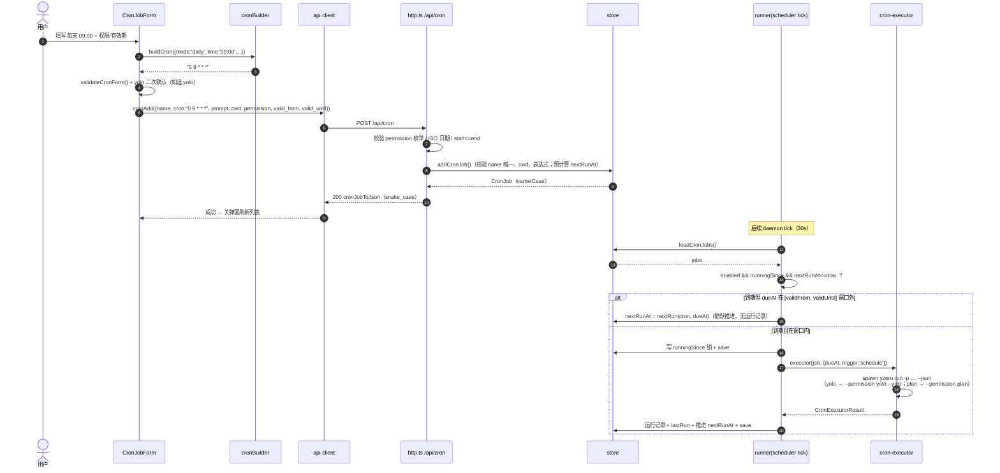

# F-22b 定时任务 Web 面板 WorkBuddy 化改版 —— 增量设计与任务分解

> 状态：架构设计 v1 · 2026-06 · 依赖 F-22（design-f22-cron.md）· 基于 PRD docs/prd-f22b-cron-workbuddy-ui.md
> 本文为**增量设计**，只描述变更；F-22 已交付的解析内核 / 存储 / 执行框架 / API 骨架不再重复。
> 总监已拍板 4 项决策（有效期语义 / 工作空间候选 / version 保持 1 / yolo 二次确认）全部采纳，见各节标注。

## 1. 增量方案概述

### 1.1 数据模型增量（core/store.ts，version 保持 1）

`CronJob` 新增 3 个 **optional** 字段，全部缺省安全，旧 cron.json 零迁移（决策 3）：

```ts
export interface CronJob {
  // ...既有字段不变...
  /** 任务级权限模式：缺省 'default'（标准确认）。yolo 写入前由 Web 端二次确认 */
  permission?: 'plan' | 'default' | 'yolo';
  /** 有效期起点（ISO 本地时区语义）；缺省 = 长期有效（无下界） */
  validFrom?: string;
  /** 有效期终点（ISO）；缺省 = 长期有效（无上界）。Web 端提交「当日」时落 23:59:59 */
  validUntil?: string;
}
```

**默认值语义**（读路径 normalizeJob 增量）：

| 字段 | 缺省语义 | normalize 规则 |
|---|---|---|
| `permission` | `'default'`（标准确认，不传 spawn flag） | 值 ∉ {plan, default, yolo} 时**丢弃该字段**（按 default 处理），不视为非法条目 |
| `validFrom` | 无下界（永久） | 非 ISO 可解析字符串时丢弃该字段 |
| `validUntil` | 无上界（永久） | 非 ISO 可解析字符串时丢弃该字段 |

字段级降级（而非整条跳过）是有意的：单字段损坏不应让整个任务消失，与 F-22「读路径永不 throw」口径一致。

新增纯函数（供 runner 与单测共用）：

```ts
/** 到期时刻是否落在有效期窗口内（含两端）。缺省字段 = 无界 */
export function isInValidWindow(job: Pick<CronJob, 'validFrom' | 'validUntil'>, dueAt: Date): boolean;
```

写路径增量：

- `AddCronJobInput` / `updateCronJob` 的 patch 类型追加 `permission` / `validFrom` / `validUntil`；
- **清除语义**：PATCH 传 `null` 表示清除该字段（恢复长期有效 / 默认权限）；`undefined` 表示不动。否则 Web 端把「自定义起止」改回「长期有效」将无法表达；
- `saveCronJobs` 无需改动（新字段随对象序列化，version 恒为 1）；
- `cronJobToJson` 增量：`permission`、`valid_from`、`valid_until`（存在才输出，沿用既有条件展开惯例）。

### 1.2 runner 有效期判定（core/runner.ts）—— 决策 1

**语义（总监拍板，覆盖 PRD 验收 6 中「不推进 nextRunAt」的旧表述）**：`nextRunAt` 始终正常推进、永不冻结；到期但窗口外 → **静默跳过**（不执行、不写运行记录、不算失败），并推进到下一次 cron 命中。

判定伪代码（`runDueCronJobs` 候选过滤后、执行前）：

```ts
for (const job of candidates) {
  const dueAt = job.nextRunAt ? new Date(Date.parse(job.nextRunAt)) : now;
  // ① 有效期窗口检查（新增）：仅调度触发检查，手动补跑（onlyJobId）不受限
  if (!opts.onlyJobId && !isInValidWindow(job, dueAt)) {
    job.nextRunAt = nextRunSafe(job.cron, dueAt); // 静默推进到下一次命中（保持 cron 相位）
    job.updatedAt = now.toISOString();
    saveCronJobs(jobs, opts.homeDir);
    log(`⏭ ${job.name} 在有效期窗口外，跳过本次调度`); // 仅日志，无运行记录
    continue;
  }
  // ② 既有执行流程不变：写锁 → executor → 运行记录 → 推进 nextRunAt
}
```

要点：

- 以 **dueAt（计划到期时刻）** 而非 now 做窗口判定：补跑场景下语义正确（判定「这一班是否该跑」，而非「补跑那一刻是否在窗口内」）；
- 从 dueAt（而非 now）推进 nextRunAt，保持 cron 相位不被补跑延迟拉偏；
- 窗口整体已过（validUntil 很久以前）的任务：每个 tick 推进一步（30s 一次，成本可忽略），语义简单、无需特殊分支；
- 手动「立即运行」（POST /api/cron/:id/run、`cron run --id`）**完全不受有效期限制**（PRD 要求保留强制试跑能力）。

### 1.3 executor spawn args 增量（cli/cron-executor.ts）

```ts
const args = ['run', '-p', job.prompt, '--json'];
if (job.maxCostUsd !== undefined) args.push('--max-cost', String(job.maxCostUsd));
// F-22b 新增：任务级权限透传（沿用 F-23 resolvePermissionMode 语义）
if (job.permission === 'yolo') args.push('--permission', 'yolo', '--yolo'); // 双 flag 防单 flag 降级告警
else if (job.permission === 'plan') args.push('--permission', 'plan');
// 'default' 或缺省：不传任何 permission flag（沿用 CLI 默认）
```

验收口径（PRD 验收 5）：yolo → args 含 `--permission yolo --yolo`；plan → `--permission plan`；default → 无 permission flag。

### 1.4 API 请求 / 响应增量（core/server/http.ts）

**GET /api/cron** 响应增量（决策 2：`workspaces` 由服务端返回）：

```jsonc
{
  "jobs": [ /* 既有字段 + permission / valid_from / valid_until */ ],
  "warnings": [ /* 不变 */ ],
  "workspaces": ["/serve/启动目录", "/既有任务cwd（按首次出现去重）"]
}
```

理由：候选的两个来源里「serve 启动目录」只有服务端知道（`process.cwd()`），前端无从推导；既有任务 cwd 虽可前端从 jobs 推导，但拆两处来源会让候选排序/去重口径分裂。服务端一次算好（serve 目录优先、jobs cwd 按首次出现去重）成本为零（GET 本就 load 全量 jobs），且未来若加「最近会话目录」也只改服务端一处。**不新增端点**。

**POST /api/cron** 请求增量：接受 `permission` / `valid_from` / `valid_until`（同时兼容 `validFrom` / `validUntil` camelCase，见 §7 共享知识）；校验失败 400：

| 校验 | 失败 message |
|---|---|
| `permission` ∉ 枚举 | `permission must be one of: plan / default / yolo` |
| 日期不可解析（`Number.isNaN(Date.parse(v))`） | `valid_from / valid_until must be a valid ISO date` |
| 两者均存在且 start > end | `valid_from must be <= valid_until` |

**PATCH /api/cron/:id** 请求增量：同上三字段，额外支持 **`null` = 清除**（恢复长期有效 / 默认权限）。

既有不一致顺手修复：现网 POST/PATCH 读 `body.maxCostUsd` 而 Web client 发的是 `max_cost_usd`（snake_case 口径不一致，Web 端费用上限实际从不生效）。本期统一为 **服务端同时读 `body.max_cost_usd ?? body.maxCostUsd`**，Web 端保持发送 snake_case。

### 1.5 前端增量总览

- **列表页**：顶部 Tab 筛选（全部 N / 已启用 N / 已暂停 N，计数随数据实时变化）；卡片重排为「标题行 = 名称 + toggle 开关｜正文 = prompt 两行截断｜底部行 = 🔁 人话化调度描述（左）+ N 小时后执行倒计时（右）｜操作 = ▶ 立即运行 / ✎ 编辑 / … 更多（删除·历史）」；批量模式（P1）多选 + 底部浮动操作栏。
- **新建/编辑弹窗**（新建与编辑共用同一表单组件，编辑态回填）：详见 §3。
- **倒计时**：next_run_at 相对当前时间「N 分钟/N 小时/明天/N 天后执行」，30s 定时刷新；nextRunAt 已过（daemon 停机）显示「待补跑」；已过 validUntil 的卡片调度描述旁加「已过期」灰色徽标。

## 2. 文件清单

| 文件（相对仓库根） | NEW/改 | 变更内容 |
|---|---|---|
| `packages/core/src/cron/store.ts` | 改 | CronJob/AddCronJobInput/patch 类型 + `isInValidWindow` 纯函数 + normalizeJob 字段级降级 + cronJobToJson 增量 + 清除语义 |
| `packages/core/src/cron/runner.ts` | 改 | 执行前窗口检查分支（§1.2 伪代码），仅调度触发生效 |
| `packages/core/src/server/http.ts` | 改 | GET workspaces / POST+PATCH 新字段与校验 / null 清除 / max_cost_usd 口径修复 |
| `packages/core/test/cron-store.test.ts` | 改 | 新字段 CRUD / normalize 降级 / isInValidWindow 三态（窗口前/内/后）/ null 清除 |
| `packages/core/test/cron-runner.test.ts` | 改 | 窗口外静默跳过且推进 nextRunAt / 手动补跑不受窗口限制 / 旧文件（无新字段）行为不变 |
| `packages/core/test/cron-server.test.ts` | 改 | workspaces 候选 / 非法 permission 与 start>end 400 / PATCH null 清除 |
| `packages/cli/src/cron-executor.ts` | 改 | permission → spawn args（yolo 双 flag / plan / default 不传） |
| `packages/cli/test/cron-executor.test.ts` | NEW | spawn args 断言（三态 + maxCost 组合） |
| `packages/web/src/api/client.ts` | 改 | CronJobView/CronJobInput 增字段、GET 响应加 workspaces、cronUpdate patch 类型扩展 |
| `packages/web/src/utils/cronHuman.ts` | NEW | `describeCron` 人话化描述 + `countdownText` 倒计时（纯函数，可单测） |
| `packages/web/src/utils/cronBuilder.ts` | NEW | RepeatMode 表单态 ↔ cron 双向转换 + `validateCronForm` 校验（纯函数，可单测） |
| `packages/web/src/utils/cronBuilder.test.ts` | NEW | 双向转换往返（roundtrip）与校验单测 |
| `packages/web/src/components/CronModal.vue` | 改（重写） | 容器：Tab 筛选 + 卡片列表 + 批量模式 + 打开表单弹窗 + 30s 倒计时刷新 |
| `packages/web/src/components/CronJobCard.vue` | NEW | 单任务卡片（toggle / prompt 预览 / 人话调度 + 倒计时 / 操作 / 历史展开 / 多选框） |
| `packages/web/src/components/CronJobForm.vue` | NEW | 新建/编辑弹窗表单（§3.2）含 yolo 二次确认 |
| `packages/web/src/components/ModalShell.vue` | 不改 | 复用（表单弹窗宽度由 CronJobForm 自行传 560） |
| `packages/web/src/views/WorkbenchView.vue` | 不改 | CronModal 入口已存在，无需变更 |

## 3. 前端组件结构与纯函数设计

### 3.1 组件结构

```
CronModal.vue（容器，ModalShell width 760）
├─ Tab 筛选：全部 N / 已启用 N / 已暂停 N（enabled=false 即「已暂停」）
├─ 工具行：+ 新建任务 / 批量管理 / 刷新 / 运行中指示
├─ CronJobCard.vue × N
│   ├─ 标题行：任务名 + toggle 开关（PATCH enabled，失败回滚 + toast）
│   ├─ 正文：prompt 两行截断（title 悬停全文）
│   ├─ 底部行：🔁 {describeCron}（原样代码样式 if 未识别）+ 「已过期」徽标 ｜ {countdownText}（右对齐）
│   ├─ 操作：▶ 立即运行 / ✎ 编辑 / … 更多（删除·二次确认 / 历史 N 条展开）
│   └─ 批量模式：左侧多选框（进入批量模式时显示）
├─ 批量浮动栏（批量模式且选中 > 0）：启用 / 停用 / 删除（二次确认）—— 循环调既有 PATCH/DELETE
└─ CronJobForm.vue（新建/编辑共用，ModalShell 子弹窗）
```

### 3.2 CronJobForm 字段与控件（对齐 PRD §5.2）

| 控件 | 行为 |
|---|---|
| 任务名称 | 单行必填；后端重名 400 message 直接内联展示 |
| prompt | 大号多行，必填（trim 非空） |
| 工作空间下拉 | 候选 = `GET /api/cron` 的 `workspaces` + 手动输入路径兜底（下拉含「手动输入…」项切换为文本框）；必填、提示须绝对路径（后端沿用既有目录校验兜底） |
| 权限下拉 | 标准确认=default（默认）/ 允许完全访问=yolo / 只读=plan；选 yolo 时旁挂黄色提示「该任务将无需确认执行所有操作」，**提交时二次确认**（决策 4）：首次点确定弹行内确认条「确认允许该任务无需确认执行所有操作？」→ 再点确认才真正提交；切回非 yolo 时确认态重置 |
| 重复下拉 | 每小时 / 每天 / 每周 / 每月 / 自定义（§3.3 规则表） |
| 有效期 | 长期有效（默认）/ 自定义起止日期：两个 `<input type="date">`，start→当日 00:00、end→当日 23:59:59（本地时区转 ISO）；start<=end 前端校验；end 早于当前时间提交前警告「任务创建后立即过期」 |
| 更多设置（折叠） | maxCostUsd 单次费用上限（P2 透传，本期不重点做） |

**编辑态回填**：`parseCronToForm(job.cron)` 识别为标准模式 → 回填对应下拉；未识别（如 `*/15 8-18 * * 1-5`、别名）→ 自动切「自定义」并原值回填（PRD 验收 3/G3）。`permission` / `valid_from` / `valid_until` 直接回填（缺省映射为 default / 长期有效）。

### 3.3 cron 生成规则表（cronBuilder.ts）

| RepeatMode | 附加控件 | 生成 cron | 反向识别（严格正则） |
|---|---|---|---|
| `hourly` | 无 | `0 * * * *` | `^0 \* \* \* \*$`（另 `@hourly`） |
| `daily` | HH:MM | `MM HH * * *` | `^(\d{1,2}) (\d{1,2}) \* \* \*$`（另 `@daily`） |
| `weekly` | HH:MM + 星期多选（至少 1 项） | `MM HH * * D,D`（D = JS getDay 0–6，升序去重） | `^(\d{1,2}) (\d{1,2}) \* \* ([0-7](,[0-7])*)$`（另 `@weekly`） |
| `monthly` | HH:MM + 1–31 日单选 | `MM HH D * *` | `^(\d{1,2}) (\d{1,2}) (\d{1,2}) \* \*$`（另 `@monthly`） |
| `custom` | 5 字段文本框 | 原样提交（后端 parseCron 为准） | 其余一切（含步进/区间/@别名 → custom） |

外加一条常见步进识别：`^\*/(\d{1,2}) \* \* \* \*$` → 描述「每 N 分钟」（仅 describe 用，表单态仍回填 custom，避免 UI 复杂化）。

函数签名：

```ts
export type RepeatMode = 'hourly' | 'daily' | 'weekly' | 'monthly' | 'custom';
export interface CronFormSchedule {
  mode: RepeatMode; time: string;        // 'HH:MM'，hourly 忽略
  weekDays: number[]; monthDay: number | null; customExpr: string;
}
export function buildCron(s: CronFormSchedule): string | null;        // 非法组合返回 null（weekly 未选星期等）
export function parseCronToForm(expr: string): CronFormSchedule;      // 未识别 → mode='custom'
export function validateCronForm(f: /* 表单全集 */): Record<string, string>; // 字段名 → 错误文案，空 = 通过
```

### 3.4 人话化与倒计时（cronHuman.ts，纯函数）

```ts
export function describeCron(expr: string): { text: string; standard: boolean };
// 标准模式：'每天 09:00' / '每周一、周五 09:00'（0=周日…6=周六 中文映射，多选顿号连接）
//          / '每月 1 日 09:00' / '每小时（整点）' / '每 15 分钟'；未识别 → { text: expr, standard: false }
export function countdownText(nextRunAt: string | undefined, now: Date): string;
// <1h → 'N 分钟后执行'；当天 → 'N 小时后执行'；跨日 ≤7 天 → '明天 HH:MM 执行' / 'N 天后执行'；
// >7 天 → 'YYYY-MM-DD 执行'；nextRunAt 缺失或早于 now → '待补跑'
```

两个函数均为 `(输入, now?) => string` 纯函数，用固定 `now` 即可单测，不依赖组件生命周期。倒计时自刷新由 CronModal 持一个 `nowTick` ref（`setInterval` 30s）注入，组件卸载清理。

## 4. 时序图（新建任务 → 生成 cron → POST → 调度命中窗口判定）



## 5. 任务列表（有序 · 含依赖 · 验收要点）

| # | 任务 | 涉及文件 | 依赖 | 验收要点 |
|---|---|---|---|---|
| T01 | core：数据模型有效期字段 + runner 窗口判定 | `core/src/cron/store.ts`、`core/src/cron/runner.ts`、`core/test/cron-store.test.ts`、`core/test/cron-runner.test.ts` | — | ① isInValidWindow 三态单测（窗口前/内/后）② 窗口外到期：不执行、无运行记录、nextRunAt 推进到下次命中 ③ 手动补跑（onlyJobId）不受窗口限制 ④ 旧文件（无新字段）= 长期有效 + default，读写不丢字段 ⑤ normalize 字段级降级（非法 permission/日期丢弃不整条跳过）⑥ 既有 36 例全绿 |
| T02 | executor：permission 透传 spawn args | `cli/src/cron-executor.ts`、`cli/test/cron-executor.test.ts` | T01 | yolo → `--permission yolo --yolo`；plan → `--permission plan`；default/缺省 → 无 flag（单测断言 args）；F-23 resolvePermissionMode 语义不变 |
| T03 | server：API 增量字段与校验 | `core/src/server/http.ts`、`core/test/cron-server.test.ts` | T01 | ① GET 返回 workspaces（serve 目录优先 + jobs cwd 去重）② 非法 permission / 非 ISO 日期 / start>end → 400 带可读 message ③ PATCH null 清除 ④ max_cost_usd 口径修复（snake_case 生效）⑤ 既有 6 例全绿 |
| T04 | web：API client 类型扩展 | `web/src/api/client.ts` | T03 | CronJobView/CronJobInput 增 permission/valid_from/valid_until（PATCH 支持 null）；GET 响应类型加 workspaces；类型与后端 snake_case 口径逐字段对齐 |
| T05 | web：cron 纯函数工具（双向转换 + 人话 + 倒计时） | `web/src/utils/cronBuilder.ts`、`web/src/utils/cronHuman.ts`、`web/src/utils/cronBuilder.test.ts` | T04 | ① 规则表五模式生成 ↔ 解析往返一致（'0 9 * * *' → daily → '0 9 * * *'）② `*/15 8-18 * * 1-5` 等非标准回填 custom 且原值保留 ③ describeCron 未识别原样 + standard=false ④ countdownText 用固定 now 单测（分钟/小时/明天/待补跑）⑤ weekly 未选星期 buildCron 返回 null |
| T06 | web：组件改版（Tab + 卡片 + 表单弹窗 + 批量） | `web/src/components/CronModal.vue`、`CronJobCard.vue`（NEW）、`CronJobForm.vue`（NEW） | T04、T05 | ① Tab 计数实时且筛选即时 ② 卡片布局：名称+toggle / prompt 两行截断 / 人话描述+倒计时（30s 刷新）/「已过期」徽标 ③ yolo 二次确认（切回重置）④ 每周/每月缺选内联红字不提交 ⑤ 编辑回填标准/自定义模式正确 ⑥ 批量启用/停用/删除（删除二次确认）状态与 cron.json 一致 ⑦ toggle 失败回滚 + toast ⑧ `pnpm build` 与既有测试全绿 |

## 6. 依赖包列表

**无需新增**，确认即可：core/CLI 仅用 node 内建模块（fs/path/child_process）；web 侧纯函数用原生 JS（日期格式化手写 pad2，不引 dayjs）；UI 沿用既有全局 CSS 变量 + scoped style，不引组件库。测试沿用各包既有 vitest 设施。

## 7. 共享知识（跨文件约定）

1. **命名口径**：传输层 snake_case（`valid_from` / `valid_until` / `permission`），core 内部 camelCase（`validFrom` / `validUntil`），转换只在 `cronJobToJson` 一处；服务端读 body 时兼容 `valid_from ?? validFrom` 双写法（存量 camelCase 调用方容错）。
2. **既有 bug 修复口径**：`max_cost_usd` 历史上 POST/PATCH 读 `body.maxCostUsd` 而 Web 发 snake_case，本期统一为服务端双读，Web 端不改。
3. **version 保持 1**：新字段全部 optional；`null` 仅在 PATCH 中有意义（清除），存储 JSON 中字段缺省即清除态，不落 null。
4. **cron 生成/人话函数放 web 本地**（`web/src/utils/`），不进 core：core 保持零依赖与最小口径，人话化是纯 Web 关注点；若未来 CLI `cron list` 需要中文描述，再把 cronBuilder 提升进 core（届时单独评审）。
5. **有效期判定基准是 dueAt（计划时刻）不是 now**；窗口含两端 `[validFrom, validUntil]`；Web 端把用户选择的「日」转为 start 00:00 / end 23:59:59 的本地时区 ISO 再提交。
6. **yolo 语义链**：Web 二次确认（UI 层）→ cron.json `permission: 'yolo'` → executor `--permission yolo --yolo` 双 flag（缺一会被 F-23 resolvePermissionMode 降级告警）→ 子进程 headless 语义。
7. **手动补跑豁免**：`POST /api/cron/:id/run` 与 `cron run --id` 均无视有效期窗口，trigger=manual、不推进 nextRunAt（沿用 F-22）。
8. **测试基线**：既有 36（parse/store/runner）+ 6（server）例必须保持绿色；新增用例与被测逻辑同文件追加。

## 8. 待明确事项

1. **PRD 验收 6 与决策 1 的表述冲突**：PRD 写「validUntil 已过的任务不推进 nextRunAt」，总监决策为「始终正常推进、静默跳过」。本设计按**决策 1** 执行（ runner 伪代码以推进为语义），已在上文标注，实现时以本文档为准；如需回改 PRD 措辞请产品侧同步。
2. **每 N 分钟步进**仅做人话化描述（`*/15 * * * *` → 「每 15 分钟」），表单不提供步进控件（PRD P2 范围，自定义模式可覆盖）。
3. 其余无——工作空间候选（服务端 workspaces 数组）、version=1、yolo 二次确认均已定案。
