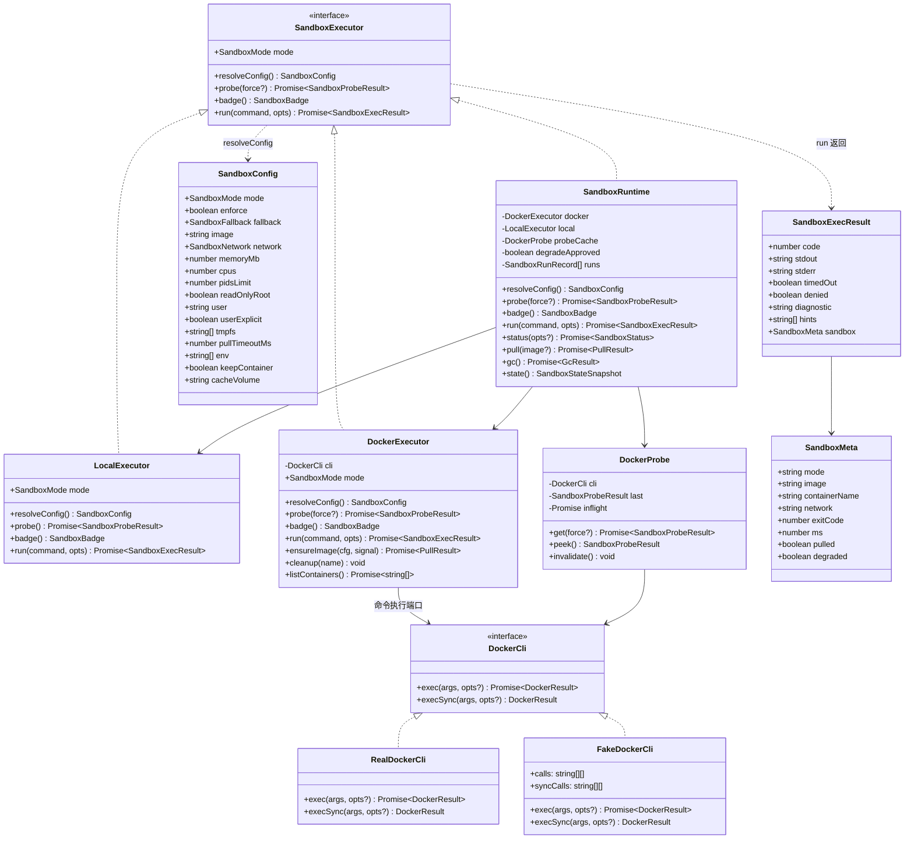
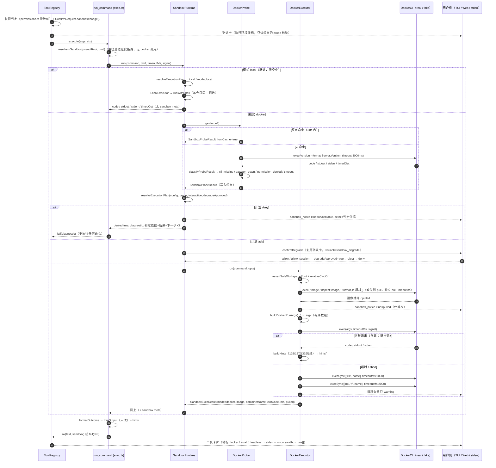
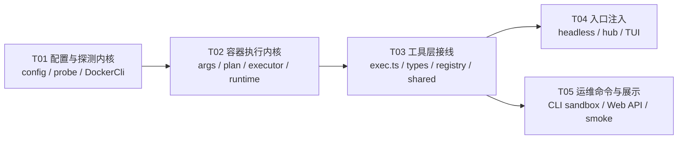

# F-30 容器级沙箱 —— 增量技术设计

> 版本：v1.0 ｜ 日期：2026-10-23 ｜ 对应 PRD：docs/prd-f30-container-sandbox.md（§9 的 3 个待确认项已由主理人拍板：默认镜像 `node:22-bookworm-slim`、`fallback=deny`、`network=none`）
> 上游：docs/technical-design.md §4（工具体系）、§9（跨平台）、§10（关键时序）；F-29 headless 退出码协议；F-31 用量口径（本特性**不接入**）
> 落盘位置约定：容器相关代码统一放在**新目录 `packages/core/src/sandbox/`**，不放进 `tools/`——避免与既有文件 `tools/sandbox.ts`（路径沙箱）产生 `./sandbox.js` 与 `./sandbox/` 的同名歧义，也让「路径沙箱（逻辑）」与「容器沙箱（物理）」在目录上就分开。

---

## 1. 实现方案总览与框架决策

### 1.1 总体思路

本特性是**纯增量**，只动「命令在哪里跑」这一件事，分四层落地：

1. **配置层**（`sandbox/config.ts`）：两级 JSON（`~/.y-zero/sandbox.json` < `.y-zero/sandbox.json`）逐字段 merge + 会话/单次覆盖，非法值降级告警、敏感键硬拒、`enforce` 只能更严。
2. **探测层**（`sandbox/docker-cli.ts` + `sandbox/probe.ts`）：**可注入的命令执行端口 `DockerCli`** + `docker version --format {{.Server.Version}}` 的四类原因判定 + 30s 会话缓存 + 单飞（single-flight）。
3. **执行层**（`sandbox/args.ts` + `sandbox/executor.ts` + `sandbox/runtime.ts`）：参数组装器产出**有序 argv 数组**，`LocalExecutor` / `DockerExecutor` 两个实现，`SandboxRuntime` 负责降级决策编排。
4. **接线层**：`exec.ts` 的两个工具改调后端；`ToolContext.sandbox` 可选注入；三端（CLI/TUI/Web/headless）各自注入 runtime 并提供降级确认与通知出口。

### 1.2 关键决策

| # | 决策 | 理由 |
|---|------|------|
| D1 | **零新依赖**。只用 `node:child_process`（`spawn` + `spawnSync`）、`node:crypto`（随机容器名）。不引 dockerode / testcontainers | PRD §10 已定；dockerode 直连 socket 会把 daemon 攻击面搬进进程内，testcontainers 引入一整套重型测试框架。现有代码已有 `spawn` 跨平台封装惯例（`engine/shell.ts`、`hooks/manager.ts`） |
| D2 | **策略与机制分离**：`SandboxExecutor`（怎么跑：local/docker）+ `SandboxRuntime`（跑不跑：probe + fallback + 降级确认 + 通知）**实现同一个接口** | `exec.ts` 只需 `ctx.sandbox.run(...)`；测试既可以注入裸 `DockerExecutor`（断言 argv），也可以注入 `SandboxRuntime`（断言降级决策）。两者同接口 → `ToolContext.sandbox?: SandboxExecutor` 一处类型即可 |
| D3 | **注入点走 `ToolContext`（而非构造函数）**：`toolContext.sandbox?: SandboxExecutor` | 内置工具是模块级单例（`export const runCommandTool`），构造注入不存在；`ToolContext` 已有的 `permissions`/`changes`/`hooks`/`skills`/`memory` 全是「可选注入、缺省退化为历史行为」，本特性完全同构（PRD §10） |
| D4 | **测试可注入的是 `DockerCli`（命令执行端口），不是 HTTP/fs**。默认实现 `realDockerCli` 走真实 `spawn('docker', args)` | 这是本设计唯一需要「假实现」的边界。所有容器逻辑（探测判定、argv 组装、清理序列、降级决策）都跑在 `DockerCli` 之上 → **没有 Docker daemon 的机器上可 100% 单测** |
| D5 | **清理路径用 `spawnSync`（同步、短超时）**，不用 await | PRD §4.9「finally 必须用同步可控的短超时调用，不能因清理阻塞退出」。`spawnSync('docker', ['rm','-f',name], {timeout: 2000})` 语义确定、不会被事件循环中的挂起 Promise 拖住 |
| D6 | 容器内 shell 固定 `/bin/sh`，且通过 `--entrypoint /bin/sh <image> -c <command>` 传入 | `--entrypoint` 覆盖镜像自带 ENTRYPOINT，避免自定义镜像的 ENTRYPOINT 吞掉命令；命令作为**单个 argv 元素**交给 `-c`，全程无字符串拼接、无 shell 解释（宿主侧 `spawn` 用 `shell:false`） |
| D7 | `SandboxExecutor` 增加 `badge()`：确认卡与工具卡片徽标**只读缓存、绝不触发探测** | 确认卡在命令执行前渲染，若此处探测会给每次确认加 200ms；用 `probe.peek()`（缓存只读）即可满足 G2「不存在静默降级」且零额外延迟 |
| D8 | `sandbox_notice` 进 `AgentEvent`（shared），但**由入口的 sink 发出，引擎零改动** | 工具执行时拿不到事件流（`ToolContext` 无 event channel）。runtime 的 `onNotice` 由入口注入：TUI 转 `addItem`、hub 转 `publish`（SSE 天然透传）、headless 转 stderr。事件类型仍进 shared，保证三端渲染契约统一、Web 不需要额外端点 |
| D9 | 降级确认**复用 `ConfirmRequest`/`ConfirmDecision` 协议与 TUI 确认卡组件与 Web 回填端点，但走独立通道**（`SandboxRuntimeDeps.confirmDegrade`），不复用 `ctx.confirm` | 复用 `ctx.confirm` 有副作用：`allow_session` 会让 registry 调 `perms.allowSession('run_command')`，把「本次允许本地执行」误记成「本会话免确认 run_command」。用独立通道 + `variant:'sandbox_degrade'` 判别字段，Web 侧仍复用 `POST /api/sessions/:id/confirm`（hub 的 `waiters` 是通用 `requestId` 映射，无需新端点） |
| D10 | 生效模式枚举只有 `local`/`docker`；`auto`/`off` 不落盘 | PRD §2.2 #3 |
| D11 | `run_tests` 的 `ok` 判定**保持现状 `code === 0`**（不改成 `code===0 && !timedOut`） | 这是现有代码的既存差异（`exec.ts:88/103/116` 只判 `code`）。本特性承诺「口径完全沿用」，顺手统一会改掉既有行为，超范围 |
| D12 | **不提供 `mounts` / `volumes` 配置项**；JSON 里出现此类敏感键即硬拒该层配置 | PRD §6「挂载不可配」与 §2.3「不做任意挂载点配置」是本特性的核心承诺；F-30.4 提到的 `mounts` 校验语义用「敏感未知键硬拒」等价实现（见 §3.5、R2） |

### 1.3 「默认零影响」的四个保证点（AC-30-1）

| # | 保证点 | 位置 |
|---|--------|------|
| Z1 | `ToolContext.sandbox === undefined` → `exec.ts` 执行与今日**完全相同的语句序列**（`runShell` → `trimOutput` → `ok(text)`），不构造 runtime、不 spawn docker、`meta` 不传 | `tools/builtin/exec.ts` §4.1 |
| Z2 | 入口构造 runtime **不做任何 Docker 探测**；`loadSandboxConfig` 对不存在的文件只做 `fs.existsSync`（2 次 stat），不 `readFile`/不 parse | `sandbox/config.ts`、`sandbox/runtime.ts` |
| Z3 | `mode === 'local'` 且 `explicit === false` → `LocalExecutor` 直接复用 `runWithShell`（**同一函数**，不复制截断逻辑），返回结果不带 `sandbox`/`hints` 字段 | `sandbox/executor.ts` |
| Z4 | TUI/Web 徽标仅在 `result.meta?.sandbox` 存在时渲染；headless `--json` 的 `sandbox` 段仅在沙箱显式启用时输出 | `cli/src/ui/app.tsx`、`headless.ts` |

> 因此：不配置任何沙箱 → 输出文本逐字节一致、无 docker 进程、无探测延迟、JSON 报告不新增字段。**Z1 是唯一必须逐字符保真的路径**，T03 用 golden 断言锁死。

---

## 2. 抽象分层与接口



### 2.1 接口签名（`packages/core/src/sandbox/executor.ts`）

```ts
export interface RunOptions {
  /** 宿主绝对路径 cwd，调用方已过 resolveInSandbox */
  cwd: string;
  timeoutMs: number;
  signal: AbortSignal;
}

export interface SandboxExecResult {
  code: number | null;
  stdout: string;
  stderr: string;
  timedOut: boolean;
  /** true = 策略层拒绝执行（未产生任何 docker run）。exec.ts 直接用它渲染 diagnostic，不走 trimOutput */
  denied?: boolean;
  /** denied 时的完整可诊断文案（判定依据 + 后果 + ≥2 个可执行动作） */
  diagnostic?: string;
  /** 附加诊断（127/137/126、网络不可达），由 exec.ts 追加在结果末尾 */
  hints?: string[];
  /** 有值才写进 ToolResult.meta.sandbox（local 未显式配置时不出现，见 Z3） */
  sandbox?: SandboxMeta;
}

export interface SandboxExecutor {
  readonly mode: SandboxMode;
  /** 生效配置（构造期解析一次，运行期只读；含逐字段来源） */
  resolveConfig(): SandboxConfig;
  /** Docker 可用性探测（local 实现：不 spawn，恒返回 {available:false, reason:'not_applicable'}） */
  probe(force?: boolean): Promise<SandboxProbeResult>;
  /** 徽标（确认卡用）：只读缓存，绝不触发探测 */
  badge(): SandboxBadge;
  /** command → 单个字符串（不做任何转义处理；转义由 argv 数组承担） */
  run(command: string, opts: RunOptions): Promise<SandboxExecResult>;
}
```

- `LocalExecutor.run()`：`runWithShell(command, cwd, timeoutMs, signal)` → 原样包装成 `SandboxExecResult`。
- `DockerExecutor.run()`：`ensureImage()`（拉取不计入命令超时）→ `spawn('docker', buildDockerRunArgs(...))` → 超时/中断 → `cleanup()`。
- `SandboxRuntime.run()`：`resolveExecutionPlan()` → `local` / `docker` / `deny` / `ask`（见 §7）。

### 2.2 `DockerCli` —— 可测试性架构的核心（`packages/core/src/sandbox/docker-cli.ts`）

```ts
export interface DockerResult {
  code: number | null;
  stdout: string;
  stderr: string;
  timedOut: boolean;
}

export interface DockerInvokeOptions {
  timeoutMs?: number;
  signal?: AbortSignal;
  /** 子进程 env；缺省 process.env。用于显式拒绝 DOCKER_HOST 远端（PRD §2.3） */
  env?: NodeJS.ProcessEnv;
  /** stderr 逐行回调（拉取进度旁路到用户侧，不进模型上下文） */
  onStderrLine?: (line: string) => void;
}

export interface DockerCli {
  /** 异步执行（探测、inspect、pull、docker run 本体） */
  exec(args: string[], opts?: DockerInvokeOptions): Promise<DockerResult>;
  /**
   * 同步执行：**清理路径专用**。spawnSync + 强制短超时 + 绝不抛异常。
   * 无异步等待 → finally 里不会被挂起的 Promise 拖住（PRD §4.9）。
   */
  execSync(args: string[], opts?: { timeoutMs?: number }): DockerResult;
}

/** 默认实现：spawn('docker', args, { shell: false }) —— 注意 shell 恒为 false */
export const realDockerCli: DockerCli;
```

**注入点与默认值（确定性方案，无「可考虑」）**：

| 注入点 | 签名 | 默认值 |
|--------|------|--------|
| 构造函数（执行器） | `new DockerExecutor(cli, opts)` | 由 `SandboxRuntime` 传 `realDockerCli` |
| 工厂函数（入口唯一出口） | `createSandboxRuntime({ …, cli?: DockerCli })` | `cli ?? realDockerCli` |
| `ToolContext`（工具侧） | `toolContext.sandbox?: SandboxExecutor` | **`undefined`**（= 今日行为，Z1） |

测试用法（`packages/core/test/helpers/fake-docker.ts`）：

```ts
export class FakeDockerCli implements DockerCli {
  readonly calls: string[][] = [];              // exec 的参数向量（按调用顺序）
  readonly syncCalls: string[][] = [];          // execSync 的参数向量（清理序列）
  constructor(private readonly script: Record<string, DockerResult | ((a: string[]) => DockerResult>) = {}) {}

  async exec(args: string[], opts?: DockerInvokeOptions): Promise<DockerResult> {
    this.calls.push(args);
    const h = this.script[args[0] ?? ''] ?? this.script['*'];
    return typeof h === 'function' ? h(args) : h ?? { code: 0, stdout: '', stderr: '', timedOut: false };
  }
  execSync(args: string[]): DockerResult {
    this.syncCalls.push(args);
    return { code: 0, stdout: '', stderr: '', timedOut: false };
  }
}
```

断言形态（T02/T03 验收）：

```ts
// 参数向量（逐元素断言，不比对字符串，避免引号/空格歧义）
expect(cli.calls[0]).toEqual(['version', '--format', '{{.Server.Version}}']);
// 清理调用序列（顺序敏感：kill 必须先于 rm -f）
expect(cli.syncCalls).toEqual([['kill', name], ['rm', '-f', name]]);
// AC-30-4：路径逃逸必须在 docker 之前被拒
expect(cli.calls).toHaveLength(0);
```

### 2.3 `run_tests` 三条分支如何共用后端

现状 `runTestsTool` 有三条各自 `runShell` 的分支（package.json / pytest.ini / Cargo.toml）。改造为**一个内部函数 `execViaBackend()`**，三条分支只保留「探测到哪种 runner」的逻辑：

```ts
// exec.ts 内部
interface Outcome {
  code: number | null; stdout: string; stderr: string; timedOut: boolean;
  denied?: boolean; diagnostic?: string; hints: string[]; meta?: SandboxMeta;
}

async function execViaBackend(
  command: string, cwd: string, timeoutMs: number, ctx: ToolContext,
): Promise<Outcome> {
  if (!ctx.sandbox) {                                   // Z1：零影响路径
    const r = await runShell(command, cwd, timeoutMs, ctx.signal);
    return { ...r, hints: [] };
  }
  return ctx.sandbox.run(command, { cwd, timeoutMs, signal: ctx.signal });
}

function formatOutcome(o: Outcome): { text: string; ok: boolean } {
  if (o.denied) return { text: o.diagnostic ?? '[sandbox] 命令未执行', ok: false };
  const text =
    trimOutput({ code: o.code, stdout: o.stdout, stderr: o.stderr, timedOut: o.timedOut }) +
    (o.hints && o.hints.length > 0 ? '\n' + o.hints.join('\n') : '');
  return { text, ok: o.code === 0 && !o.timedOut };
}
```

- `run_command`：`const f = formatOutcome(await execViaBackend(...)); return f.ok ? ok(f.text, metaOf(o)) : fail(f.text);`
  `metaOf(o)` 返回 `o.meta ? { sandbox: o.meta } : undefined`（Z1/Z3）。
- `run_tests` 三分支：`ok` 判定沿用现存的 `code === 0`（D11），格式化同样走 `formatOutcome`，只是 `ok` 取自 `o.code === 0`。
- `trimOutput` 与 `DEFAULT_CMD_TIMEOUT_MS` / `MAX_CMD_OUTPUT` 常量**一字不改**；超时上限仍是 `Math.min(600_000, args.timeout ?? ctx.defaultTimeoutMs ?? 120_000)`。

---

## 3. 配置体系（`packages/core/src/sandbox/config.ts`）

### 3.1 类型

```ts
export type SandboxMode = 'local' | 'docker';
export type SandboxNetwork = 'none' | 'bridge';
export type SandboxFallback = 'deny' | 'ask' | 'local';
export type SandboxConfigSource = 'user' | 'project' | 'session';
export const DEFAULT_SANDBOX_IMAGE = 'node:22-bookworm-slim';

export interface SandboxConfig {
  mode: SandboxMode;            // local ｜ docker
  enforce: boolean;             // 仅项目级生效
  fallback: SandboxFallback;    // deny ｜ ask ｜ local（headless 下 ask ≡ deny）
  image: string;
  network: SandboxNetwork;      // none ｜ bridge
  memoryMb: number;             // 2048
  cpus: number;                 // 2
  pidsLimit: number;            // 512
  readOnlyRoot: boolean;        // true
  user: string | null;          // '1000:1000'；自定义镜像默认 null（用镜像默认用户）
  userExplicit: boolean;        // 派生：是否有人在任一显式层写了 user
  tmpfs: string[];              // ['/tmp', '/home/node']
  pullTimeoutMs: number;        // 300000
  env: string[];                // 宿主 env 名称白名单（默认 []，即零继承）
  keepContainer: boolean;       // false
  cacheVolume: string | null;   // P2 预留：本期解析但忽略（warning）
}

export const DEFAULT_SANDBOX_CONFIG: SandboxConfig = { /* 上表默认值 */ };

/** 单层配置：undefined = 未声明（继承下层）。null 仅在 user / cacheVolume 上有语义 */
export type SandboxConfigLayer = Partial<Omit<SandboxConfig, 'userExplicit'>>;

export interface SandboxConfigWarning { source: SandboxConfigSource | 'cli'; field?: string; message: string }
export interface SandboxConfigError   { source: SandboxConfigSource | 'cli'; message: string }

export interface ResolvedSandboxConfig {
  config: SandboxConfig;
  /** 每个字段最终由谁决定（status 展示「来源」用） */
  provenance: Record<keyof Omit<SandboxConfig, 'userExplicit'>, SandboxConfigSource | 'default'>;
  warnings: SandboxConfigWarning[];
  /** 硬拒（该层整体不生效）；非空时该层字段全部不参与 merge */
  errors: SandboxConfigError[];
  /** 是否显式配置过（false = 纯默认：不显示徽标、headless 不输出 sandbox 段、无 meta） */
  explicit: boolean;
}

export interface SandboxSessionOverrides {
  mode?: SandboxMode; image?: string; network?: SandboxNetwork; fallback?: SandboxFallback;
}
```

### 3.2 逐字段 merge 算法（undefined vs null）

```ts
const MERGE_FIELDS = [
  'mode','enforce','fallback','image','network','memoryMb','cpus','pidsLimit',
  'readOnlyRoot','user','tmpfs','pullTimeoutMs','env','keepContainer','cacheVolume',
] as const;

export function mergeSandboxLayers(
  layers: Array<{ source: SandboxConfigSource; layer: SandboxConfigLayer }>,
): { config: SandboxConfig; provenance: ResolvedSandboxConfig['provenance'] } {
  const config = { ...DEFAULT_SANDBOX_CONFIG };
  const provenance = {} as ResolvedSandboxConfig['provenance'];
  for (const f of MERGE_FIELDS) provenance[f] = 'default';
  for (const f of MERGE_FIELDS) {
    for (const { source, layer } of layers) {          // user → project → session（后者覆盖前者）
      const v = layer[f];
      if (v !== undefined) { (config as any)[f] = v; provenance[f] = source; }
    }
  }
  // 派生字段：user 与 image 的联动
  const userExplicit = layers.some((l) => l.layer.user !== undefined);
  config.userExplicit = userExplicit;
  config.user = userExplicit
    ? config.user
    : (config.image === DEFAULT_SANDBOX_IMAGE ? DEFAULT_SANDBOX_CONFIG.user : null);
  return { config, provenance };
}
```

语义要点：

| 写法 | 语义 | 处理 |
|------|------|------|
| 字段缺省 / `undefined` | 未声明 → 继承下层 | 不参与 merge（`provenance` 保持不变） |
| `user: null` | 显式「用镜像默认用户」 | 参与 merge（`userExplicit = true`，`user = null`） |
| `cacheVolume: null` | 显式「不要缓存卷」 | 参与 merge（本期恒为 null，无实际效果） |
| 其它字段 `null` | 非法（配置写错） | `normalizeSandboxLayer()` 阶段：**丢弃该字段 + warning**，等价于未声明 |
| 未知字段 | 见 §3.5 | 普通未知键：warning 忽略；敏感未知键：**整层硬拒** |

### 3.3 加载、非法值降级与告警通道

```ts
export function loadSandboxConfig(opts: {
  projectRoot: string;
  homeDir?: string;                 // 缺省 os.homedir()
  session?: SandboxSessionOverrides;// CLI flag / Web 会话设置
}): ResolvedSandboxConfig;

/** 单层归一化：非法值降级为「未声明」+ warning；敏感键 → error（该层整体不生效） */
export function normalizeSandboxLayer(
  raw: unknown, source: SandboxConfigSource,
  warnings: SandboxConfigWarning[], errors: SandboxConfigError[],
): SandboxConfigLayer;
```

- **坏 JSON 不致命**：`JSON.parse` 抛错 → `errors.push`（该层不生效）+ 继续；对齐 `hooks/manager.ts:readHookFile` 的既有惯例。
- **文件缺失零成本**：先 `fs.existsSync` 再 `readFileSync`（Z2）。
- **逐字段校验规则**：

| 字段 | 规则 | 违规处理 |
|------|------|----------|
| `mode` | ∈ {local, docker} | 降级（丢弃字段）+ warning |
| `enforce` | boolean，**且仅在 project 层生效** | 非 boolean → 丢弃；user/session 层出现 → 丢弃 + warning「enforce 仅在项目级生效」 |
| `fallback` | ∈ {deny, ask, local} | 降级 + warning |
| `image` | 非空、无空白、**不以 `-` 开头**（防被当成 docker flag） | 不以 `-` 开头违规 → **error（整层硬拒）**；其它 → 丢弃 + warning |
| `network` | ∈ {none, bridge} | 降级 + warning |
| `memoryMb` | 整数 ∈ [128, 65536] | 降级 + warning |
| `cpus` | number ∈ [0.1, 64] | 降级 + warning |
| `pidsLimit` | 整数 ∈ [16, 65536] | 降级 + warning |
| `readOnlyRoot` | boolean | 降级 + warning |
| `user` | `null` 或 `/^\d+:\d+$/` | 降级为默认 + warning |
| `tmpfs` | 字符串数组，每项 `/^\/[A-Za-z0-9._\/@-]+$/` | 非法项丢弃 + warning |
| `pullTimeoutMs` | 整数 ∈ [5_000, 3_600_000] | 降级 + warning |
| `env` | 数组，每项 `/^[A-Za-z_][A-Za-z0-9_]*$/`（只允许名字，禁止 `NAME=value`） | 非法项丢弃 + warning |
| `keepContainer` | boolean | 降级 + warning |
| `cacheVolume` | null 或字符串；本期恒 warning「P2 未实现，已忽略」 | warning |

- **告警通道**（三条，缺一不可）：
  1. `ResolvedSandboxConfig.warnings/errors` 结构化返回；
  2. 入口在启动时各打一行 `console.error`：`⚠ sandbox 配置（project）: fallback 非法值 "sometimes"，已用默认 deny`；
  3. `yzero sandbox status` 的 `warnings/errors` 段（同一数据源）。

### 3.4 `enforce` 的「只能更严」判定（可测纯函数）

```ts
export interface EnforceViolation {
  field: keyof SandboxSessionOverrides;
  projectValue: unknown;
  overrideValue: unknown;
  message: string;   // 「项目策略已强制容器执行：不能用 --sandbox local 降低隔离强度」
}

export function checkEnforce(
  projectLayer: SandboxConfigLayer,
  override: SandboxSessionOverrides,
): EnforceViolation[];
```

**偏序关系表**（`<` 表示「更宽松」，判定算法的唯一事实来源）：

| 字段 | 偏序 | `enforce` 下允许的覆盖方向 | 违例判定 |
|------|------|--------------------------|----------|
| `mode` | `local < docker` | 只允许 `local → docker` | `project=docker && override=local` → 违例 |
| `network` | `bridge < none` | 只允许 `bridge → none` | `project=none && override=bridge` → 违例 |
| `fallback` | `local < ask < deny` | 只允许收紧到 `deny` | 任意 `override !== 'deny'` → 违例 |
| `readOnlyRoot` | `false < true` | 只允许 `false → true` | `project=true && override=false` → 违例 |
| `memoryMb` | 小更严 | `override <= project` | `override > project` → 违例 |
| `cpus` | 小更严 | `override <= project` | 同上 |
| `pidsLimit` | 小更严 | `override <= project` | 同上 |
| `image` | 不可比 | **允许**（不削弱四条第线保证） | 仅过合法性校验（不以 `-` 开头） |
| `user`/`tmpfs`/`env`/`keepContainer`/`cacheVolume` | 不可比 | **允许** | 同上 |

实现要点：

1. `enforce: true` 时 `fallback` **强制为 `deny`**：即使项目文件写了 `{enforce:true, fallback:'ask'}`，也强制 deny + warning（不 throw，保持「配置写错不该让 agent 起不来」）；`session` 层试图给非 deny 的 `--sandbox-fallback` → `checkEnforce` 报违例。
2. 违例的处置：**CLI 入口直接报错并 `process.exitCode = 1`，不启动引擎**（PRD §4.4「违者拒绝并说明」）；TUI/Web 侧等价于「该覆盖不生效 + 一行 system 提示」。
3. 不可比字段（image 等）允许覆盖，理由写进代码注释：`enforce` 的承诺是「容器 + 断网 + 只读根 + 资源上限」这四条不可被会话削弱；换镜像不削弱任何一条，且团队换基础镜像是正常需求。只有**可比的安全序字段**才做「只能更严」。

### 3.5 安全硬拒（唯一「宁可失败」的地方）

`normalizeSandboxLayer()` 命中以下任一条 → `errors.push` + **该层配置整体不生效**（其它层仍生效）：

```ts
/** 敏感未知键：出现即硬拒（PRD §6「挂载不可配」+ §2.3「不做任意挂载点配置」） */
const SENSITIVE_KEYS = [
  'mounts', 'mount', 'volumes', 'volume', 'privileged', 'cap_add', 'cap-add',
  'devices', 'security_opt', 'security-opt', 'pid', 'ipc', 'network_mode', 'network-mode',
];
```

以及**工作区根目录守卫**（在 docker 执行前调用，`assertSafeWorkspaceRoot`）：

| 条件 | 处理 |
|------|------|
| `realRoot` 是文件系统根（`/`、`C:\`） | 硬拒：「容器会把整个文件系统挂进 /workspace」 |
| `realRoot` === `realpath(os.homedir())` | 硬拒：「home 目录包含 `~/.ssh` 与 `~/.y-zero`，隔离失效；请在具体项目目录运行，或 `--sandbox local`」 |
| `realRoot` === `realpath(os.tmpdir())` | 硬拒：同上（共享临时目录会挂进他人的临时文件） |
| `path.join(realRoot, 'docker.sock')` 存在（含符号链接）或 `realRoot` 路径字符串含 `docker.sock` | 硬拒：「挂 docker.sock = 容器内 root ≈ 宿主 root」 |

> 这些拒绝都发生在**任何 docker 调用之前**（AC-30-4 的断言点：`expect(cli.calls).toHaveLength(0)`），并且文案里必须出现「sandbox 配置不允许」字样（PRD F-30.6）。

---

## 4. 探测与缓存（`packages/core/src/sandbox/probe.ts`）

```ts
export type SandboxProbeReason =
  | 'cli_missing' | 'daemon_down' | 'permission_denied' | 'timeout'
  | 'image_unavailable'   // 仅由 runtime 合成（镜像拉取失败），probeDocker() 永不产出
  | 'not_applicable';     // local 实现的 probe() 恒为此值

export interface SandboxProbeResult {
  available: boolean;
  serverVersion?: string;
  reason?: SandboxProbeReason;
  /** 判定依据（进错误文案第一行）：如「docker version 退出码 1」 */
  detail: string;
  probedAt: number;
  fromCache: boolean;
}

export const PROBE_TIMEOUT_MS = 3_000;
export const PROBE_TTL_MS = 30_000;

/** 单次探测：docker version --format {{.Server.Version}}（必须打 Server） */
export async function probeDocker(cli: DockerCli, opts?: { timeoutMs?: number; now?: () => number }): Promise<SandboxProbeResult>;

/** 结果分类（纯函数，便于表驱动单测） */
export function classifyProbeResult(r: DockerResult, timedOutFromCli: boolean): Omit<SandboxProbeResult, 'probedAt' | 'fromCache'>;

export class DockerProbe {
  constructor(cli: DockerCli, opts?: { ttlMs?: number; now?: () => number });
  get(force?: boolean): Promise<SandboxProbeResult>;   // 30s 缓存 + 单飞
  peek(): SandboxProbeResult | null;                  // 只读缓存（徽标用）
  invalidate(): void;                                 // "启动好了，重试" 入口
}
```

### 4.1 四类 `reason` 的判定算法（按优先级，命中即返回）

| 序 | 条件（判定依据） | `reason` | `detail` 文案 |
|----|------------------|----------|---------------|
| 1 | `timedOut === true`（`docker version` 超过 3s） | `timeout` | `docker version 3s 未返回（daemon 疑似无响应）` |
| 2 | `code === -1` 或 `stderr` 匹配 `/ENOENT\|not found\|not recognized/i` 且指向 docker | `cli_missing` | `未找到 docker 命令（PATH 中不存在）` |
| 3 | `stderr` 匹配 `/permission denied\|EACCES\|Got permission denied while trying to connect/i` | `permission_denied` | `访问 daemon socket 被拒（需加入 docker 组或修 socket 权限）` |
| 4 | `code === 0` 且 `stdout.trim()` 匹配 `/^\d+\.\d+/` | — | 可用，`serverVersion = stdout.trim()` |
| 5 | `code === 0` 但 stdout 为空 | `daemon_down` | `Server 版本为空（只拿到了 Client 信息）` |
| 6 | `stderr` 匹配 `/Cannot connect to the Docker daemon\|Is the docker daemon running\|error during connect\|connection refused\|dockerDesktopLinuxEngine\|The system cannot find the file specified/i` | `daemon_down` | `daemon 未运行（docker version 退出码 ${code}）` |
| 7 | 其余非 0 | `daemon_down`（兜底） | `docker version 退出码 ${code}：${stderr 首行截断 200 字}` |

> 顺序不可调换：先超时、再找不到 CLI，最后才判 daemon（`ENOENT` 也可能以 `exit 127` + "not found" 出现）。**本机现状（CLI 28.5.1 装好、daemon 未运行）必须落在第 6 条 → `daemon_down`，这是 AC-30-6 的核心用例。**

### 4.2 缓存与强制刷新

- 缓存键：单实例（每个 runtime 一个），TTL `30_000ms`；`peek()` 不看 TTL（只给徽标用，过期值也只是"上次已知"）。
- **单飞**：并发 `get()` 共享同一个 `inflight` Promise，避免一轮多工具并行时打出多个 200ms 探测。
- 强制刷新入口三个：`probe(true)`、`DockerProbe.invalidate()`、降级确认卡上的「已经启动了，重试」选项（TUI/Web 均复用该选项文案）。
- 探测**不在启动/首屏做**（PRD F-30.2）：只有 `mode === 'docker'` 的执行路径与 `status` 命令才会触发。
- `docker run` 因 daemon 中途挂掉失败（`detail` 含 connect 类关键字）→ `invalidate()`，让下一次立即重探而不是用 30s 内的旧结论。

---

## 5. 参数组装器（`packages/core/src/sandbox/args.ts`）

### 5.1 接口

```ts
export interface DockerRunSpec {
  config: SandboxConfig;
  /** 已 realpath 的宿主项目根 */
  projectRoot: string;
  /** 相对项目根的 cwd，POSIX 分隔符，'' 表示根 */
  relativeCwd: string;
  command: string;
  containerName: string;
  labels: { session: string; project: string; created: string };
  /** 宿主 env：仅用于判断白名单变量是否存在 + 取 TZ 值 */
  hostEnv?: NodeJS.ProcessEnv;
  platform?: NodeJS.Platform;
}

/** 产出 docker run 的**有序 argv 数组**（不含 'docker' 本身），绝不产出字符串 */
export function buildDockerRunArgs(spec: DockerRunSpec): string[];

/** '' → '/workspace'；'a/b' → '/workspace/a/b'；含 '..' → throw */
export function containerWorkdir(relativeCwd: string): string;

/** 跨平台挂载源：win32 把 `\` 归一为 `/`、盘符大写；含 , " 换行 → throw */
export function normalizeMountSource(p: string, platform?: NodeJS.Platform): string;

/** yzero-<sid 前 8 位>-<随机 6 位>（crypto.randomBytes(3).toString('hex')） */
export function containerName(sessionId: string, rand?: string): string;

/** `-e NAME=VALUE` → `-e NAME=***`（--debug 打印前的兜底打码） */
export function redactArgv(argv: string[]): string[];
```

### 5.2 完整参数清单（对照 PRD §7 基线）

生成顺序**固定**（顺序即契约，测试逐元素断言）：

| # | argv 片段 | 来源 | 可配 |
|---|-----------|------|------|
| 1 | `run` | 固定 | 否 |
| 2 | `--rm` | `keepContainer === false` | 是（`keepContainer`） |
| 3 | `--name` `<name>` | `yzero-<sid8>-<rand6>` | 否 |
| 4 | `--label` `yzero.session=<sid>` | 会话 id | 否 |
| 5 | `--label` `yzero.project=<pid>` | 项目 id | 否 |
| 6 | `--label` `yzero.created=<ISO>` | `new Date().toISOString()` | 否 |
| 7 | `--read-only` | `readOnlyRoot` | 是 |
| 8 | `--cap-drop` `ALL` | 硬编码 | **否** |
| 9 | `--security-opt` `no-new-privileges` | 硬编码 | **否** |
| 10 | `--network` `none`\|`bridge` | `network` | 是 |
| 11 | `--memory` `${memoryMb}m` + `--memory-swap` `${memoryMb}m` | `memoryMb` | 是 |
| 12 | `--cpus` `${cpus}` | `cpus` | 是 |
| 13 | `--pids-limit` `${pidsLimit}` | `pidsLimit` | 是 |
| 14 | `--mount` `type=bind,source=<normalizeMountSource(root)>,target=/workspace` | `projectRoot`（唯一挂载） | **否** |
| 15 | `--tmpfs` `<item>`（逐项） | `tmpfs` | 是 |
| 16 | `--user` `<user>` | `user`（null 则整段省略） | 是 |
| 17 | `-e` `LANG=C.UTF-8` | 固定 | 否 |
| 18 | `-e` `TZ=<tz>` | `hostEnv.TZ ?? Intl…timeZone ?? 'UTC'` | 否 |
| 19 | `-e` `<NAME>`（逐项，**只给名字不给值**） | `env` 白名单中在宿主确实存在的变量 | 是（P1，本期已实现，成本 5 行） |
| 20 | `--workdir` `/workspace[/rel]` | `containerWorkdir(relativeCwd)` | 否 |
| 21 | `--entrypoint` `/bin/sh` | 固定（覆盖镜像 ENTRYPOINT） | 否 |
| 22 | `<image>` | `image` | 是 |
| 23 | `-c` | 固定 | 否 |
| 24 | `<command>` | 命令原文，**单个 argv 元素** | 否 |

示例（可直接作为测试快照）：

```jsonc
["run","--rm","--name","yzero-1a2b3c4d-9f8e7d",
 "--label","yzero.session=1a2b3c4d-….","--label","yzero.project=…","--label","yzero.created=2026-10-23T02:10:11.000Z",
 "--read-only","--cap-drop","ALL","--security-opt","no-new-privileges",
 "--network","none",
 "--memory","2048m","--memory-swap","2048m","--cpus","2","--pids-limit","512",
 "--mount","type=bind,source=/Users/lwl/work/project/y-zero-agent,target=/workspace",
 "--tmpfs","/tmp","--tmpfs","/home/node",
 "--user","1000:1000",
 "-e","LANG=C.UTF-8","-e","TZ=Asia/Shanghai",
 "--workdir","/workspace",
 "--entrypoint","/bin/sh",
 "node:22-bookworm-slim","-c","pnpm test --coverage"]
```

### 5.3 引号策略（关键，不做任何字符串拼接）

- 宿主侧：`spawn('docker', argv, { shell: false })` → Node 直接按 POSIX argv 语义传给 `docker`（Windows 走 CreateProcess 的引号规则，`windowsVerbatimArguments` 保持默认 `false`）。
- 容器侧：`--entrypoint /bin/sh` + `-c` + `command` 三个独立 argv 元素。`command` **永远是数组里的一个元素**，其中的引号、`$()`、`&&`、反引号全部由容器内的 `sh` 解释——这正是期望语义（与原 `runShell` 的 `-c command` 一致），且宿主侧无任何二次解释。
- **禁止**出现 `argv.join(' ')`、模板字符串拼命令、`shell: true`。T01/T02 的 lint 点：`args.ts` 与 `executor.ts` 中不得出现 `shell: true`（grep 断言）。

### 5.4 跨平台挂载源

| 平台 | 处理 |
|------|------|
| macOS | `resolveInSandbox` 已 `fs.realpath(projectRoot)`（`/var/folders/...` → `/private/var/...`），调用方只需再 `fs.realpath` 一次拿到最终根；原样传入 |
| Linux | 原样传入（PRD §7 说明 Linux 属主差异不在 F-13 承诺范围，不做适配） |
| Windows | `normalizeMountSource`：`\` → `/`，盘符大写（`c:/Users/x` → `C:/Users/x`），其余不变。Docker Desktop 推荐正斜杠，也避免 `:` 与 `,` 的语义冲突 |
| 通用拒绝 | 路径含 `,`、`"`、换行 → `throw new SandboxConfigError('工作区路径包含 docker --mount 不支持的字符（逗号/引号/换行），请将项目移动到不含这些字符的路径')` |

> 用 `--mount type=bind,source=…,target=…` 而非 `-v`：`-v C:\a\b:/workspace` 在 Windows 上会被驱动盘符冒号切分，`--mount` 的 `source=` 语义无歧义。

---

## 6. 执行、超时、中断与清理（`packages/core/src/sandbox/executor.ts`）

### 6.1 `DockerExecutor.run()` 主流程

```ts
async run(command: string, opts: RunOptions): Promise<SandboxExecResult> {
  const cfg = this.config;
  assertSafeWorkspaceRoot(this.projectRoot);                        // §3.5，早于任何 docker 调用
  const relCwd = relativeCwdOf(this.projectRoot, opts.cwd);         // 含 '..' → throw
  const name = containerName(this.sessionId);
  const started = this.now();

  const pulled = await this.ensureImage(cfg, opts.signal);          // 独立 pullTimeoutMs，不计入命令超时

  const argv = buildDockerRunArgs({ /* config, projectRoot, relativeCwd: relCwd, command, containerName: name, labels */ });
  this.opts.onDebugArgv?.(redactArgv(argv));                        // --debug 输出（已打码）

  const r = await this.cli.exec(argv, { timeoutMs: opts.timeoutMs, signal: opts.signal });

  /* 超时 / 中断 / daemon 抖动 */
  if (r.timedOut || opts.signal.aborted) this.cleanup(name);        // kill → rm -f（同步）

  const hints = buildHints(r, cfg, command);                        // 127/137/126 + 网络
  return {
    code: r.code, stdout: r.stdout, stderr: r.stderr, timedOut: r.timedOut,
    hints,
    sandbox: { mode: 'docker', image: cfg.image, containerName: name, network: cfg.network,
               exitCode: r.code, ms: this.now() - started, pulled },
  };
}
```

### 6.2 `ensureImage()`：拉取不计入命令超时

```ts
// 1) docker image inspect <image> --format {{.Id}}   （timeout 5s）
// 2) 缺失则 docker pull <image>                       （timeout cfg.pullTimeoutMs，默认 300s）
//    进度行经 onStderrLine → onPullProgress（用户侧一行，不进模型上下文）
// 3) 失败 → 本会话标记该 image 不可用（this.imageFailed.add(image)），
//    返回 { ok: false, detail }，runtime 把它合成为 probe={available:false, reason:'image_unavailable'}
```

- 已失败过的镜像**本会话不再重试**（PRD §5.2 最后一行：不重复拉取）。
- 首次 `pull` 完成 → `onNotice({kind:'pulled', detail:'镜像 node:22-bookworm-slim 已就绪（≈150MB）'})`。

### 6.3 清理序列（顺序即契约）

```
超时/中断：
  1) child.kill('SIGKILL')                        // 断开 docker CLI（容器不会因此停止）
  2) cli.execSync(['kill', name],   {timeoutMs: 2_000})   // 停容器
  3) cli.execSync(['rm', '-f', name], {timeoutMs: 2_000}) // --rm 在 kill 后不保证删除
正常退出：--rm 自删；keepContainer=true 时不带 --rm，也不做 finally 清理（供 inspect）
```

- 三步全部包在 `try/catch` 里，**清理失败只 warning（`onNotice({kind:'unavailable', …})` 之外的 stderr 一行），绝不改变命令结果、绝不上抛**（AC-30-7「清理失败只警告不阻塞」）。
- `finally` 语义用 `spawnSync` 保证「同步可控短超时」（D5），即使 `signal` 已 abort、即使上层 `Promise` 还在挂起，清理也会执行完。
- `timedOut` 与 abort 的区分沿用 `runWithShell` 的现状：`timedOut=true` 只由计时器设置；abort → `timedOut=false`、`code=null`（`trimOutput` 会打 `[exit code: null]`，与本地路径一致）。

### 6.4 `gc` 与残留

```ts
// 列出：docker ps -a --filter label=yzero.created --format {{.Names}}
// 清理：逐条 cli.exec(['rm','-f', name])（并发 4 条，失败跳过并计数）
async gc(): Promise<{ removed: number; names: string[] }>;
async listContainers(): Promise<string[]>;   // 前缀过滤兜底：name ^yzero-
```

- `status()`：探测 + `listContainers()`；`residues.length > 0` → 展示 + 一行 `gc` 提示。
- **首次执行提示**：runtime 每个实例在第一次真正进 docker 前做一次残留检查（`residueChecked` 位，整会话 ≤1 次额外 docker 调用），非空 → `onNotice({kind:'gc_suggest', detail:'发现 N 个残留容器…'})`（PRD F-30.9 崩溃兜底）。
- SIGKILL 场景：宿主进程被杀 → 无 finally → 下次 `status`/首次执行时由上述检查发现（这是「兜底」而非「保证」，文案如实说明）。

### 6.5 诊断增强（127 / 137 / 126 / 网络）

`buildHints(result, cfg, command): string[]`（纯函数，可单测）：

| 触发 | hint 文案（追加在 result 末尾） |
|------|-------------------------------|
| `code === 127` | `[sandbox] 命令在镜像 ${image} 中不存在（容器内只有 node/pnpm/npm 等）。如需该命令：换 sandbox.image，或本次用 --sandbox local` |
| `code === 137` | `[sandbox] 疑似超出内存上限（${memoryMb}MB）被 OOM kill；可调 sandbox.memoryMb` |
| `code === 126` | `[sandbox] 权限不足（只读根文件系统或 --user 限制）；调试可临时设 readOnlyRoot=false` |
| `network==='none'` 且 `stderr` 匹配 `/ENOTFOUND\|ECONNREFUSED\|EAI_AGAIN\|network\|registry\|getaddrinfo/i` | `[sandbox] network=none 下网络不可达。若该命令确需联网：加 --sandbox-network bridge，或设置 .y-zero/sandbox.json {"network":"bridge"}` |

> 「安装类命令」的预判拦截**不做**（PRD F-30.7 明确：预判会误杀离线本地包）。只在**失败后**按 stderr 关键字补 hint。

---

## 7. 降级链（`packages/core/src/sandbox/plan.ts`）

### 7.1 纯函数签名

```ts
export type ExecutionAction = 'local' | 'docker' | 'deny' | 'ask';
export type ExecutionReason =
  | 'mode_local'            // 配置 local：不探测、零开销
  | 'docker_ready'
  | 'fallback_deny'
  | 'enforced_deny'         // enforce 下不可用：唯一允许的动作
  | 'fallback_ask'          // 交互式：等用户点头
  | 'fallback_ask_headless' // 非交互：ask ≡ deny
  | 'fallback_local'        // 用户显式接受降级
  | 'degrade_approved';     // ask 已获准（本会话记忆）

export interface ExecutionPlan { action: ExecutionAction; reason: ExecutionReason }

export function resolveExecutionPlan(input: {
  config: SandboxConfig;
  /** null = 尚未探测（mode=local 的常态；不得在此函数内触发探测） */
  probe: SandboxProbeResult | null;
  interactive: boolean;
  degradeApproved: boolean;
}): ExecutionPlan;
```

### 7.2 与 PRD §5.2 决策表逐格对齐

| # | 生效 mode | Docker | fallback | 入口 | `resolveExecutionPlan` 输出 | 备注 |
|---|-----------|--------|----------|------|---------------------------|------|
| 1 | local | — | — | 任意 | `{local, mode_local}` | `probe` 传 `null`；**断言不探测** |
| 2 | docker | 可用 | — | 任意 | `{docker, docker_ready}` | |
| 3 | docker | 不可用 | deny | 任意 | `{deny, fallback_deny}` | headless + 显式 flag → 入口前置退出码 1（见 R5） |
| 4 | docker | 不可用 | ask | TUI/Web | `{ask, fallback_ask}` | 用户允许 → 记 `degradeApproved` → 下一行 |
| 5 | docker | 不可用 | ask | headless | `{deny, fallback_ask_headless}` | 与 #3 行为等价，reason 不同便于文案区分 |
| 6 | docker | 不可用 | local | 任意 | `{local, fallback_local}` | + `sandbox_notice{kind:'degraded'}` + 报告 `degraded=true` |
| 7 | docker | 可用但启动失败 | 任意 | 任意 | 同 #3/#4/#5/#6（`probe` 由 runtime 合成为 `{available:false, reason:'image_unavailable'}`） | 本会话不再重试该镜像 |
| 8 | docker + enforce | 不可用 | 任意 | 任意 | `{deny, enforced_deny}` | `fallback` 已在配置阶段强制 deny；此处双保险 |
| 9 | docker | 不可用 | ask + 已获准 | TUI/Web | `{local, degrade_approved}` | `degradeApproved` 为 runtime 会话状态 |

> `degradeApproved` 是 `SandboxRuntime` 实例内状态（每次运行新建 → 跨运行自然重置），语义对齐 `PermissionState.sessionAllowed`。

### 7.3 `ask` 的确认通道（复用形态与边界）

```
runtime.run()
  └─ plan.action === 'ask'
       └─ deps.confirmDegrade({ id, reason: <诊断文案>, badge })   ← 独立通道（D9）
            ├─ TUI : addItem({kind:'confirm', request:{variant:'sandbox_degrade', …}}) → ConfirmCard（只渲染 允许/拒绝）
            ├─ hub : publish({type:'confirm_request', request}) + waiters.set(id, {kind:'confirm', resolve})
            │        Web 复用既有 POST /api/sessions/:id/confirm 回填（零新端点）
            └─ headless: undefined → interactive=false → 从不到达 ask 分支
```

- 决策映射：`allow` / `allow_session` → 允许本次及本会话本地执行（`degradeApproved = true`）；`reject` → deny；`edit` → 忽略（降级卡无参数可编辑）。
- **不复用 `ctx.confirm` 的原因**：`allow_session` 在 registry 里会触发 `perms.allowSession('run_command')`，把「允许降级」误记成「本会话免确认执行命令」——这是权限语义污染（D9）。
- 无 `confirmDegrade` 注入（例如 `yzero serve` 未接 Web 交互）→ 等价 deny，绝不静默降级。

### 7.4 错误文案（三条信息缺一不可，`buildUnavailableMessage()` 纯函数）

```ts
export function buildUnavailableMessage(input: {
  reason: SandboxProbeReason; detail: string; fallback: SandboxFallback;
  image: string; enforced: boolean; interactive: boolean;
}): string;
```

示例（`fallback=deny`、`reason=daemon_down`）：

```text
[sandbox] Docker 不可用：daemon 未运行（docker version 退出码 1）
  命令未执行——容器隔离在本次不可用，已按 fallback=deny 拒绝。
  下一步任选其一：
    1) 启动 Docker Desktop 后重试（可用 yzero sandbox status 复查）
    2) 本次临时改用本地执行：yzero run ... --sandbox local
    3) 长期允许降级并询问：.y-zero/sandbox.json → {"fallback":"ask"}
```

`enforced=true`（项目策略强制容器）时，第 2/3 条改为一条真正可执行的替代项：`2) 联系项目维护者调整 .y-zero/sandbox.json（enforce:true 下会话无法降级）`，绝不给出「设置 fallback:'ask'」这种在 enforce 下必然被拒的假动作。

---

## 8. 事件、meta 与调试打码

### 8.1 `sandbox_notice`（`packages/shared/src/index.ts`）

```ts
// AgentEvent 追加
| { type: 'sandbox_notice'; kind: 'degraded' | 'pulled' | 'unavailable' | 'gc_suggest'; detail: string }

// ConfirmRequest 追加（可选字段，老消费端忽略即可）
export interface SandboxBadge {
  mode: 'local' | 'docker';
  image?: string;
  network?: 'none' | 'bridge';
  /** 缓存中的探测结论（undefined = 未知；false 时卡片加一行「当前不可用，将按 fallback 处理」） */
  available?: boolean;
}
export interface ConfirmRequest {
  id: string; tool: string; args: Record<string, unknown>; reason: string;
  sandbox?: SandboxBadge;                          // exec 类工具有值
  variant?: 'permission' | 'sandbox_degrade';      // 缺省 = permission（历史行为）
}
```

- `sandbox_notice` **不落库、不进消息历史、不进模型上下文**：只走事件流（TUI `addItem` / Web SSE toast / headless stderr）。
- 发出者是入口注入的 `onNotice`（D8），`engine/react.ts` **零改动**。

### 8.2 `meta.sandbox`

```ts
export interface SandboxMeta {
  mode: 'local' | 'docker';
  image?: string;
  containerName?: string;
  network?: 'none' | 'bridge';
  exitCode: number | null;
  ms: number;
  pulled: boolean;
  degraded?: boolean;
  /** P1：透传的 env 变量个数（只给数量，不列名字） */
  passthroughEnv?: number;
}
```

出现条件：`runtime.explicit === true` 或 `mode === 'docker'`（Z3/Z4）。写入点只有 `exec.ts` 的 `metaOf(o)`，复用现有 `ok(text, meta)` 通道（`tools/types.ts:92` 已支持 `Record<string, unknown>`，无需改签名）。

**不进用量**：`session/usage.ts`、`BudgetManager`、`buildHeadlessReport().usage` 全部零改动；容器耗时/镜像/退出码只出现在 `meta`、`sandbox_notice`、`--json` 的 `sandbox` 段。

### 8.3 `--debug` 参数向量与打码

```ts
// DockerExecutorOptions.onDebugArgv → 入口打印：
// [sandbox] docker 参数向量：
//   ["run","--rm","--name","yzero-…","--mount","type=bind,source=/…,target=/workspace", …,"-e","TZ=Asia/Shanghai",…]
```

- **设计上不可能泄漏 Key**：env 透传使用 `-e NAME`（只给名字，值由 docker CLI 子进程的 env 继承），因此 argv 里天然没有密钥值。
- **兜底打码**：`redactArgv()` 把 `-e NAME=VALUE` 形式统一改成 `-e NAME=***`（防止未来有人改成 `=value` 形式）；测试覆盖 `redactArgv(['-e','FOO=secret','-e','BAR'])` → `['-e','FOO=***','-e','BAR']`。
- 只打印 argv，**不打印子进程 env 的任何值**（若必须，只打印变量名列表）。

---

## 9. 三端接线（入口 → 调用链 → 落点文件）

| 入口 | 调用链 | 落点文件 | 优先级 |
|------|--------|----------|--------|
| `yzero`（TUI 启动） | `loadSandboxConfig` → `createSandboxRuntime({interactive:true, confirmDegrade:→ConfirmCard, onNotice:→addItem})` → `App props.sandbox` → `RunContext.toolContext.sandbox` | `cli/src/index.ts`（构造）→ `cli/src/ui/app.tsx`（注入 + 徽标 + `/sandbox`）→ `cli/src/ui/confirm.tsx`（`variant` 裁剪 + 徽标行） | P0 |
| `yzero run`（headless） | 同上但 `interactive:false, confirmDegrade:undefined` → `runHeadless({…, sandboxState})` → `buildHeadlessReport` 附 `sandbox` 段 | `cli/src/headless-run.ts` → `core/src/headless.ts` | P0 |
| `yzero sandbox status\|pull\|gc\|enable\|disable` | `loadSandboxConfig` → `runtime.status/pull/gc` → `formatSandboxStatus()` | `cli/src/sandbox.ts`（**新增**）→ `cli/src/index.ts`（注册 + `KNOWN_SUBCOMMANDS`） | P0（status/pull 在 PRD 里 status=P0、pull/gc/enable=P1，本期一并做，成本已摊在 T02） |
| `yzero --sandbox docker …` | root/`run` 子命令 flag → `SandboxSessionOverrides` → `checkEnforce` | `cli/src/index.ts`（flag 声明 + 违例 exit 1） | P0 |
| TUI `/sandbox` | `runtime.status()` → system 行 | `cli/src/ui/app.tsx`（`handleCommand` case） | P0 |
| Web `GET /api/sandbox/status?refresh=1` | `ServeOptions.sandbox.status()` | `core/src/server/http.ts` + `cli/src/index.ts`（serve 构造 provider） | P1 |
| Web `POST /api/sandbox/pull` | `ServeOptions.sandbox.pull(image)` | 同上 | P1 |
| Web 设置区块 / 会话徽标 | `web/src/api/client.ts` 新方法；`SettingsView.vue` 区块；`ChatView.vue` 头部徽标 | `web/src/api/client.ts`、`web/src/views/SettingsView.vue`、`web/src/views/ChatView.vue` | P1（本期只给接线点，不做完整 UI） |
| `yzero serve` 会话内执行 | `SessionHubDeps.sandbox?: SandboxFactory` → 每次运行造 runtime（与 `BudgetManager`/`PermissionState` 同位置） | `core/src/server/hub.ts` | P0（徽标/降级卡） |

**Commander 注意（踩过的坑，别踩回去）**：

```ts
// cli/src/index.ts
program.enablePositionalOptions();                  // 已有：子命令同名选项由子命令解析

program
  .option('--sandbox <mode>', 'F-30 执行环境：local | docker（受 enforce 约束）')
  .option('--sandbox-image ', 'F-30 覆盖镜像')
  .option('--sandbox-network <mode>', 'F-30 网络：none | bridge')
  .option('--sandbox-fallback <mode>', 'F-30 降级策略：deny | ask | local')
  .option('--sandbox-debug', 'F-30 打印 docker 参数向量（env 打码）');

// run 子命令重复声明同名 flag（enablePositionalOptions 保证 `yzero run "任务" --sandbox docker` 归 run 解析）
// KNOWN_SUBCOMMANDS 必须补 'sandbox'，否则 `yzero sandbox status` 会被裸任务路由改写成 `yzero run sandbox status`
const KNOWN_SUBCOMMANDS = new Set(['run','models','memory','migrate','search','serve','hooks','evals','usage','sandbox','help']);
```

---

## 10. 文件清单

| 文件（相对路径） | 性质 | 说明 |
|------------------|------|------|
| `packages/core/src/sandbox/types.ts` | **新增** | 配置/探测/计划/meta/notice 全部类型与默认常量 |
| `packages/core/src/sandbox/config.ts` | **新增** | 两层加载、逐字段 merge、校验降级、`checkEnforce`、`assertSafeWorkspaceRoot` |
| `packages/core/src/sandbox/docker-cli.ts` | **新增** | `DockerCli` 接口 + `realDockerCli`（spawn / spawnSync） |
| `packages/core/src/sandbox/probe.ts` | **新增** | `probeDocker` / `classifyProbeResult` / `DockerProbe`（TTL + 单飞） |
| `packages/core/src/sandbox/args.ts` | **新增** | `buildDockerRunArgs` / `containerWorkdir` / `normalizeMountSource` / `containerName` / `redactArgv` |
| `packages/core/src/sandbox/plan.ts` | **新增** | `resolveExecutionPlan` + `buildUnavailableMessage`（纯函数） |
| `packages/core/src/sandbox/executor.ts` | **新增** | `SandboxExecutor` 接口、`LocalExecutor`、`DockerExecutor`、`buildHints` |
| `packages/core/src/sandbox/runtime.ts` | **新增** | `SandboxRuntime`（降级编排、状态、pull/gc、`createSandboxRuntime` 工厂） |
| `packages/core/src/sandbox/index.ts` | **新增** | barrel 导出 |
| `packages/core/src/tools/types.ts` | 修改 | `ToolContext.sandbox?: SandboxExecutor`（可选，缺省=今日行为） |
| `packages/core/src/tools/builtin/exec.ts` | 修改 | `execViaBackend` + `formatOutcome`；`run_command`/`run_tests` 三支改后端；`trimOutput` 不动 |
| `packages/core/src/tools/registry.ts` | 修改 | 构造 `ConfirmRequest` 时附 `sandbox: ctx.sandbox?.badge()` |
| `packages/shared/src/index.ts` | 修改 | `AgentEvent` 增 `sandbox_notice`；`ConfirmRequest` 增 `sandbox?`/`variant?`；`SandboxBadge` |
| `packages/core/src/index.ts` | 修改 | 导出 sandbox 模块公共 API 与类型 |
| `packages/core/src/headless.ts` | 修改 | `HeadlessDeps.sandboxState?`、`HeadlessOutcome.sandbox?`、`HeadlessJsonReport.sandbox?` |
| `packages/cli/src/sandbox.ts` | **新增** | `sandboxStatusCommand` / `pull` / `gc` / `enable` / `disable` + overrides 解析 |
| `packages/cli/src/index.ts` | 修改 | 注册 `sandbox` 子命令族；root/`run` 的 `--sandbox*` flags；`KNOWN_SUBCOMMANDS` 补 `sandbox`；`enforce` 违例 exit 1 |
| `packages/cli/src/headless-run.ts` | 修改 | 注入 runtime、`sandbox_notice` → stderr、前置探测与退出码、报告 `sandbox` 段 |
| `packages/cli/src/ui/app.tsx` | 修改 | 注入 runtime；工具卡片徽标；`/sandbox` 命令；`/help` 补一行 |
| `packages/cli/src/ui/confirm.tsx` | 修改 | 执行环境徽标行；`variant==='sandbox_degrade'` 时只渲染 允许/拒绝 |
| `packages/core/src/server/hub.ts` | 修改 | `SessionHubDeps.sandbox?` 工厂；每次运行构造；`onNotice` → `publish('sandbox_notice')`；降级卡复用 `waiters` |
| `packages/core/src/server/http.ts` | 修改 | `GET /api/sandbox/status`、`POST /api/sandbox/pull` |
| `packages/web/src/api/client.ts` | 修改 | `getSandboxStatus()` / `pullSandboxImage()` + 类型 |
| `packages/web/src/views/SettingsView.vue` | 修改（P1） | 「执行沙箱」区块：状态卡 + 检测/预热按钮 + 字段表单 |
| `packages/web/src/views/ChatView.vue` | 修改（P1） | 会话头部执行环境徽标（读 `state.sandbox`） |
| `packages/core/test/helpers/fake-docker.ts` | **新增** | `FakeDockerCli`（记录 `calls` / `syncCalls`）与 `makeSandboxRuntime()` 测试工厂 |
| `packages/core/test/sandbox-config.test.ts` | **新增** | merge / 校验降级 / enforce 偏序 / 硬拒 / 安全根 |
| `packages/core/test/sandbox-probe.test.ts` | **新增** | 四类 reason 判定 / TTL / 单飞 / force |
| `packages/core/test/sandbox-args.test.ts` | **新增** | 完整 argv 快照 / 跨平台路径 / workdir / 打码 |
| `packages/core/test/sandbox-plan.test.ts` | **新增** | §7.2 表逐格（9 行）+ 文案要素 |
| `packages/core/test/sandbox-executor.test.ts` | **新增** | `DockerExecutor` 超时/中断/清理序列/gc/pull 失败 |
| `packages/core/test/sandbox-exec.test.ts` | **新增** | `run_command`/`run_tests` 接线、Z1 golden、AC-30-4 无 docker 调用 |
| `packages/core/test/sandbox-docker.integration.test.ts` | **新增** | `YZERO_TEST_DOCKER=1` 才跑的真实容器用例 |
| `scripts/smoke.mjs` | 修改 | 补 1 例：`yzero sandbox status` 在无 daemon 时输出含「daemon 未运行」且退出码 0 |
| `scripts/smoke-web.mjs` | 修改 | 补 1 例：`GET /api/sandbox/status` 200 + 字段齐全 |

---

## 11. 关键时序：`run_command` 走容器（含探测/降级/清理）



---

## 12. 任务列表（5 个，按依赖排序）

> 粒度标准：一个人一次能写完并自测（≤6 个文件、可独立跑 `pnpm --filter @y-zero/core test <file>`）。T04/T05 相互独立，可并行。

| Task | 任务名 | Source Files | 依赖 | 优先级 |
|------|--------|--------------|------|--------|
| **T01** | 沙箱配置与探测内核 | `core/src/sandbox/types.ts`（新）、`core/src/sandbox/config.ts`（新）、`core/src/sandbox/docker-cli.ts`（新）、`core/src/sandbox/probe.ts`（新）、`core/src/sandbox/index.ts`（新，先只导出本任务内容）、`core/src/index.ts`、`test/helpers/fake-docker.ts`（新）、`test/sandbox-config.test.ts`（新）、`test/sandbox-probe.test.ts`（新） | — | P0 |
| **T02** | 容器执行内核 | `core/src/sandbox/args.ts`（新）、`core/src/sandbox/plan.ts`（新）、`core/src/sandbox/executor.ts`（新）、`core/src/sandbox/runtime.ts`（新）、`core/src/sandbox/index.ts`（补导出）、`test/sandbox-args.test.ts`（新）、`test/sandbox-plan.test.ts`（新）、`test/sandbox-executor.test.ts`（新） | T01 | P0 |
| **T03** | 工具层接线与协议契约 | `core/src/tools/types.ts`、`core/src/tools/builtin/exec.ts`、`core/src/tools/registry.ts`、`shared/src/index.ts`、`core/src/headless.ts`、`test/sandbox-exec.test.ts`（新） | T02 | P0 |
| **T04** | 运行入口注入（headless / hub / TUI） | `cli/src/headless-run.ts`、`core/src/server/hub.ts`、`cli/src/ui/app.tsx`、`cli/src/ui/confirm.tsx` | T03 | P0 |
| **T05** | 运维命令与三端展示 | `cli/src/sandbox.ts`（新）、`cli/src/index.ts`、`core/src/server/http.ts`、`web/src/api/client.ts`、`web/src/views/SettingsView.vue`（P1）、`web/src/views/ChatView.vue`（P1）、`scripts/smoke.mjs`、`scripts/smoke-web.mjs` | T03（与 T04 无依赖，可并行） | P0（CLI/status）/ P1（Web 面板） |

**各任务验收方式**

- **T01**
  - `--config`：只有项目文件时全局默认仍生效（AC-30-8 前半）；`{memoryMb:1024}` 全局 + 项目只设 `image` → `memoryMb` 仍 1024 且 `provenance.memoryMb==='user'`；坏 JSON / 非法枚举 / 负数 / `image:"--privileged"` / `mounts:[...]` 各自命中预期分支（warning vs 硬拒）；`user` 与 `image` 联动（自定义镜像 → `user===null`，显式 `user` → 保留）。
  - `--enforce`：§3.4 偏序表 8 个方向各 1 例（`docker→local` 违例、`bridge→none` 允许、`none→bridge` 违例、`fallback:'ask'` 违例、`memoryMb` 放大违例、`image` 覆盖允许…）。
  - `--probe`：`cli_missing`（code -1/ENOENT）、`daemon_down`（本机真实 `docker version` 输出样本）、`permission_denied`、`timeout`（fake cli 返回 `timedOut:true`）四类各 1 例；30s 内二次 `get()` 不发第二次 `exec`（`cli.calls.length === 1`）；并发 `get()` 单飞；`force`/`invalidate` 生效。
  - **全程无真实 docker**：所有用例注入 `FakeDockerCli`。

- **T02**
  - `--args`：完整 argv 逐元素快照（§5.2 表 24 段）；`keepContainer=true` 去掉 `--rm`；`readOnlyRoot=false` 去掉 `--read-only`；`user=null` 去掉 `--user`；`network=bridge` 生效；`env` 白名单只对宿主存在的变量产出 `-e NAME`（值不进 argv）；Windows 源路径 `C:\a\b` → `C:/a/b`；含逗号路径抛错且文案可读；`redactArgv` 打码。
  - `--plan`：§7.2 决策表 9 行逐格（表驱动 `it.each`）。
  - `--executor`：超时（fake cli 返回 `timedOut:true`）→ `syncCalls === [['kill',n],['rm','-f',n]]` 顺序断言；abort 同；正常退出 → `syncCalls` 为空；`keepContainer` → 不清理；清理失败（fake `execSync` 抛/非 0）不影响返回结果；`image inspect` 失败 → 走 pull → pull 失败 → 本会话第二次调用不再 `pull`（`cli.calls` 计数断言）；`gc` 按 label 列出并逐条 `rm -f`。
  - 断言 `args.ts`/`executor.ts` 源码中无 `shell: true`（读文件 + 正则，防回归）。

- **T03**
  - **Z1 golden（AC-30-1）**：`ctx.sandbox === undefined` 时 `run_command`/`run_tests` 的 `result.content` 与改造前的固定字符串逐字符一致（用 `echo`/`false` 等确定性命令 + 固定 `code` 断言），且 `result.meta` 为 `undefined`；`children` 无 docker（注入 `FakeDockerCli` 于 runtime 但**不注入** ctx → `calls.length === 0`）。
  - **AC-30-4**：`cwd: '../..'`、绝对路径、软链逃逸三种入参 → `result.ok === false` 且 `FakeDockerCli.calls.length === 0`。
  - **接线**：注入 fake runtime 时 `run_command` 与 `run_tests` 三条分支（package.json / pytest.ini / Cargo.toml，用 tmp 目录 fixture）**都**落到 `runtime.run`（计数断言 = 1）。
  - **denied**：`runtime.run` 返回 `{denied:true, diagnostic}` → `result.content === diagnostic`（不走 `trimOutput`）。
  - **meta**：`explicit=true` → `meta.sandbox.mode === 'docker'`；`explicit=false && mode==='local'` → `meta === undefined`。
  - 既有全量 `pnpm --filter @y-zero/core test` 全绿（`permissions.test.ts` / `registry.test.ts` 不回归）。

- **T04**
  - TUI：`/sandbox` 输出含「mode / 镜像 / daemon 状态 / 残留数」；工具卡片在 `meta.sandbox.mode==='docker'` 时带 `[docker]`，否则与今日渲染一致（快照对比）；`variant='sandbox_degrade'` 的确认卡只有 2 个选项。
  - hub：`SessionHubDeps.sandbox` 未注入 → `toolContext.sandbox === undefined`（零影响）；注入后 `onNotice` 经 SSE 推出 `sandbox_notice`；降级卡走 `POST /confirm` 回填后 `degradeApproved` 生效（同一会话第二次调用不再询问）。
  - headless：`fallback:'ask'` + 不可用 → 行为与 `deny` 完全一致（同一断言两跑）；`sandbox` 段在显式启用时存在、默认时缺省；`usage.cost_usd` 与未启用完全一致（AC-30-10 后半）。
  - **R5**：`yzero run "x" --sandbox docker` + 无 daemon → 退出码 1、stderr 含判定依据与 ≥2 个动作、**不启动引擎**（用 `--json` 断言 stdout 为空）。

- **T05**
  - `yzero sandbox status` 在 daemon 停止时准确报 `daemon_down` + `mode` 来源 + `enforce` 状态 + 残留数（AC-30-6 / US-30-6 推荐行）；`sandbox enable/disable` 只改 `mode`，保留文件内其它字段（写前读、tmp+rename 原子写）。
  - `yzero sandbox gc` 清空残留并报数量；无残留 → 友好空态。
  - `POST /api/sandbox/pull` 与 `sandbox status` **同一数据源**（同一 `SandboxStatusProvider`），字段一致。
  - `pnpm smoke:web` 通过（含新增 1 例）；`node scripts/smoke.mjs` 通过（含新增 1 例）。
  - Web 面板 P1：状态卡 + 「检测 Docker」「预热镜像」按钮可用；不引入新依赖（纯 CSS）。

### 任务依赖图



---

## 13. 依赖包

**零 npm 新增**（PRD §10 已定）。

| 需要的能力 | 现成来源 |
|-----------|----------|
| 子进程 | `node:child_process`（`spawn` / `spawnSync`，现有 `engine/shell.ts`、`hooks/manager.ts` 已用） |
| 随机容器名 | `node:crypto`（`randomBytes`） |
| 路径/平台归一 | `node:path`、`node:os`、`process.platform` |
| 配置 JSON | `node:fs` + `JSON.parse`（对齐 `hooks/manager.ts`） |
| 测试 | 现有 `vitest`（`describe.skipIf(!process.env.YZERO_TEST_DOCKER)`） |

对照否决项：`dockerode`（直连 `/var/run/docker.sock`，把 daemon 攻击面搬进进程，且 pull 进度/tty 语义需要自己拼）→ 不可接受；`testcontainers`（重型、自带 node 版本约束、只用于测试却要进 devDependencies 并影响 CI 时长）→ 收益不抵成本。

---

## 14. 测试策略

| 层 | 依赖真实 daemon | 落点文件 | 预估用例 | 覆盖 AC |
|----|-----------------|----------|----------|---------|
| 配置/校验/enforce/硬拒 | 否（纯函数 + tmp 目录） | `sandbox-config.test.ts` | 24 | AC-30-8, AC-30-4(配置侧) |
| 探测判定/缓存 | 否（`FakeDockerCli`） | `sandbox-probe.test.ts` | 12 | AC-30-6 |
| argv 组装 / 跨平台路径 / 打码 | 否（纯函数） | `sandbox-args.test.ts` | 16 | F-30.3, §7 基线 |
| 降级链决策表 + 文案 | 否（纯函数） | `sandbox-plan.test.ts` | 14（9 行表 + 5 文案） | AC-30-5, AC-30-6 |
| 执行器清理/gc/pull 失败 | 否（`FakeDockerCli` 记录调用序列） | `sandbox-executor.test.ts` | 14 | AC-30-7 |
| 工具接线（Z1 golden / 三分支 / meta） | 否（fake runtime） | `sandbox-exec.test.ts` | 12 | AC-30-1, AC-30-4, AC-30-12(hints) |
| 真实容器（pwd/`ls ~`/env/127/137/126/超时无残留） | **是**（`YZERO_TEST_DOCKER=1`） | `sandbox-docker.integration.test.ts` | 8（默认全 skip） | AC-30-2, AC-30-3, AC-30-7, AC-30-12 |
| 端到端冒烟 | 否 | `scripts/smoke.mjs`（+1）、`scripts/smoke-web.mjs`（+1） | 2 | US-30-4, US-30-6 |

- 合计：**约 106 例纯单测 + 8 例可选集成**（无 daemon 机器上 8 例 skip，总耗时增量 <2s）。
- 单测铁律：任何会走到 `DockerExecutor` 的用例**必须**注入 `FakeDockerCli`；用一条全局断言「测试结束后 `realDockerCli` 从未被调用」来防漏（在 `test/helpers/fake-docker.ts` 暴露 `__realCliCalls` 计数 + `afterEach` 断言 0）。
- 本地跑测：`NODE_OPTIONS= pnpm --filter @y-zero/core test`（F-31 §9 已知的 WorkBuddy `NODE_OPTIONS` shim 问题）。

---

## 15. 共享知识（跨文件约定）

1. **单真值源**：生效执行模式只有 `SandboxConfig.mode`（`local|docker`）。不要新增 `enabled`/`auto`；`auto` 仅存在于 `resolveExecutionPlan` 的内部概念里。
2. **零影响开关**：`ctx.sandbox === undefined` ⇒ 历史行为；`runtime.explicit === false && mode === 'local'` ⇒ 不产出 `meta.sandbox`、不输出 `--json.sandbox`、UI 不显示徽标。
3. **argv 即契约**：`buildDockerRunArgs` 的**元素顺序**是公开契约（测试逐元素断言），任何新增参数只能追加在 `--entrypoint` 之前，且必须同步 §5.2 表。
4. **无字符串拼接**：禁止 `shell: true`、禁止 `argv.join(' ')`、禁止把命令拼进 `-c` 之外的任何位置；命令永远是数组最后一个元素的前一个位置（`['-c', command]`）。
5. **清理必须同步**：`finally` 路径只用 `DockerCli.execSync`（`spawnSync` + 2s 超时 + 不抛），清理失败只 warning。
6. **权限与沙箱正交**：`permissions.ts` 零改动，容器不参与 allow/deny/confirm 判定；唯一强制新增是确认卡/卡片徽标。
7. **不进用量口径**：`session/usage.ts`、`BudgetManager`、`usage.*` 零改动；容器信息只走 `meta.sandbox`、`sandbox_notice`、`--json.sandbox`。
8. **配置容错**：坏 JSON / 非法值 ⇒ 降级 + warning，永不 throw（除非命中 §3.5 硬拒或 §3.4 enforce 违例）。
9. **文案标准**：任何「不可用/拒绝」都必须含三段：**判定依据 + 后果 + ≥2 个可执行动作**（`buildUnavailableMessage` 单点生成，禁止各处手写）。
10. **时区/时间**：`label yzero.created`、`meta.ms` 用本地时钟；容器内 `TZ` 取宿主 `process.env.TZ`，缺省 `Intl.DateTimeFormat().resolvedOptions().timeZone`，再缺省 `UTC`。

---

## 16. 风险、内部矛盾与裁决

| # | 问题（PRD 与代码的冲突或漏洞） | 影响 | 我的裁决 |
|---|---|---|---|
| **R1** | **PRD F-30.1 声称「现有 22 例 exec 单测」，实际仓库里 `run_command`/`run_tests` **没有任何真实执行用例**（`registry.test.ts` 12 例只覆盖注册与确认流；`permissions.test.ts` 只把字符串当输入）。 | AC-30-1 的「逐字符一致」缺乏既有基线，「不回归」无从验证 | 基线改由 T03 新建：用确定性命令（`echo yz-shell-ok` / `false`）在 `ctx.sandbox === undefined` 下断言 `result.content` 的**完整字符串**（含 `[exit code: N]` 尾巴）与改造前手抄值逐字符相等；并在 PR 描述里贴出改造前后两次运行的实际输出对比。AC-30-1 的可验证性由这一条承担 |
| **R2** | PRD F-30.4 写「`mounts` 若包含 `docker.sock` 或工作区外源路径 → 整体拒绝加载」，但 §6 与 §2.3 明确「挂载不可配、不做任意挂载点配置」——`mounts` 字段到底存不存在自相矛盾 | 若实现 `mounts`，等于自己开了 PRD 明令禁止的配置面 | **不提供 `mounts` 字段**。把 §4.4 的安全语义落到两处：① §3.5 的 `SENSITIVE_KEYS`（写了 `mounts`/`volumes`/`privileged` 等 → 该层硬拒）；② §3.5 的 `assertSafeWorkspaceRoot`（工作区本身是 `/`、home、tmpdir、含 `docker.sock` → 拒绝执行）。语义等价、攻击面更小 |
| **R3** | PRD F-30.6 的反例列表（`/`、`~`、`/var/run/docker.sock`）是以「用户可配 mounts」为前提写的；本特性不可配 mounts，但**用户可以在 `~` 或 `/tmp` 里启动 yzero**——此时 `projectRoot` 本身就是危险挂载源 | 隔离承诺失效：`~` 挂进去就等于暴露 `~/.ssh`、`~/.y-zero/models.json`（正是 PRD 背景里最担心的东西） | **新增硬拒**（PRD 未明说，我加）：`realRoot` 为文件系统根 / home 本身 / `os.tmpdir()` / 含 `docker.sock` → 拒绝容器执行并给出「请在具体项目目录运行，或 `--sandbox local`」的文案。属于加强隔离、不削弱可用性（逃生路径明确） |
| **R4** | AC-30-1「逐字节一致、无额外延迟」与 G2「100% 的 exec 调用都带执行环境标识」彼此冲突 | 二者不可同时字面满足 | 用 `runtime.explicit` 裁决：**默认用户（无任何沙箱配置）不显示徽标、不产出 meta、JSON 不多字段**（保 AC-30-1 与 G3「未启用感知不到」）；一旦存在配置或 flag，三端 100% 带标识（保 G2）。文档同步在 CLI `--help` 与 `sandbox status` 里说明 |
| **R5** | PRD §5.2 与 US-30-5 对「显式 `--sandbox docker` 且不可用」的退出码给了两个值（「配置错误 1 或 2」） | CI 判定不稳定 | 定为 **1**：这是「环境/配置错误」（与 F-29「1 = provider 未配置、会话不存在等引擎启动前错误」同族），**在任何工具执行前由入口判定并退出**（前置探测），绝不进入引擎。mid-run 才降级为 deny 的情况**不改退出码**（工具失败 ≠ 任务失败，对齐 F-29），但 `--json.sandbox.denied_runs > 0` 供 CI 判定 |
| **R6** | `env` 名称白名单标为 P1，但实现成本极低（`-e NAME` 形态还要额外做打码） | 若延到 P2，「凭据不泄漏」只剩「零继承」 | **本期实现**：只透传宿主确实存在的变量，且用 `-e NAME`（值不进 argv）→ 顺便让 `--debug` 的参数向量天然无密钥 |
| **R7** | PRD §7 承认 macOS bind mount 慢（`pnpm install` 20s→90s）与 Linux 属主差异，但把这归为「文档说明」 | 用户误判「沙箱很慢」 | `status` 与 `/sandbox` 输出固定追加一行：`ℹ macOS 上 bind mount I/O 明显慢于本地（首次 pnpm install 可能 60–120s），这是 Docker Desktop 的已知特性`。文案单点生成在 `formatSandboxStatus()`，三端同源 |
| **R8** | `meta.sandbox` 不落库（`messages` 表无 meta 列），Web 历史回看拿不到徽标 | AC-30-10「三端留痕」在 Web **历史**视图无法满足 | 本期：Web **实时** SSE 事件里带 `result.meta`，前端在流式期间按 `callId` 展示徽标；**历史回看不显示**（明确写入文档与 UI 说明）。加 `messages.meta` 列属 F-24/F-31 级别的 schema 变更，超范围，留待反馈 |
| **R9** | `run_tests` 现存 `ok` 判定只看 `code === 0`（忽略 `timedOut`），与 `run_command` 的 `code===0 && !timedOut` 不一致 | 统一会改既有行为 | 保留差异（D11），在 `exec.ts` 注释里写明「历史口径，勿顺手统一」，并由 T03 用例锁死两条判定 |
| **R10** | 并发：`registry.ts` 只对 `run_command` 限流（`CMD_CONCURRENCY=2`），`run_tests` 未限流；容器模式下每个容器独立随机名 | 可能出现 3 个并发容器 | 保持现状（PRD F-30.1「容器模式无需另设上限」）。不引入新的容器级并发闸，避免改变既有工具行为 |
| **R11** | `sandbox_notice` 只能在入口层发出（工具无事件通道） | 若将来引擎需要感知（如自动重试）需新增通道 | 本期明确：`AgentEvent.sandbox_notice` 是**渲染契约**，发出者是入口 sink（D8）；引擎零改动。若后续需要引擎感知，再在 `ToolContext` 加 `emit?`，不在本期预埋 |
| **R12** | `pull` 期间用户看到长时间无输出（数百 MB） | 首次体验像卡住 | `pullTimeoutMs` 独立（默认 300s）+ `onStderrLine` 每 2 秒最多一行进度到用户侧（`[sandbox] 拉取 node:22-bookworm-slim … 38%`），**不进模型上下文**；`status` 展示镜像是否已在本地 |

### 待明确（需产品/主理人后续确认，不阻塞本期实现）

1. `sandbox status` 的**输出格式**是否需要 `--json`（当前设计只做人类可读 + 内部 `SandboxStatus` 结构；Web 直接消费结构体，CLI 暂不加 `--json`）。成本极低，若需要可在 T05 顺带加。
2. `yzero sandbox enable` 写**全局**还是可 `--project` 写项目（PRD §4.10 只提「改写全局配置」）。当前按 PRD 只写全局；若团队想要「把项目策略提交进仓库」，应手工编辑 `.y-zero/sandbox.json`（避免工具替用户改仓库文件）。
3. 一次性网络放行（P1）、`cacheVolume`（P2）、命令级 override（P2）均已在设计中预留位（`tmpfs`/`env` 同构的配置面、`onNotice` 通道、`SandboxSessionOverrides` 可扩展），本期不实现。

## 17. §19 方案 C 补充：Seatbelt 主后端（2026-10-23 决策）

主理人裁定：**默认隔离后端改为 macOS 原生 Seatbelt（sandbox-exec），Docker 保留为可选后端**。
动机：不走 Docker —— 免安装、免 daemon、冷启动毫秒级，覆盖本机开发（macOS）90% 场景。

### 17.1 模式枚举扩展

`SandboxMode = 'local' | 'seatbelt' | 'docker'`（`seatbelt` 新增；默认值仍为 `local`，
AC-30-1「默认零影响」不破坏——未配置用户行为逐字节不变）。

隔离强度偏序：`local(0) < seatbelt(1) < docker(2)`（enforce 下会话覆盖只能沿序收紧）。

### 17.2 SeatbeltExecutor（packages/core/src/sandbox/seatbelt.ts）

- **profile**：`(deny default)` + 白名单 —— 读全放行、写仅限 项目工作区 + `tmpdir()`（均 realpath）+ `/dev/{null,urandom,random}`；`network=none` → `(deny network*)`。内存/CPU/pids 上限 Seatbelt 不支持（与 docker 的能力差异，status 文案说明）
- **硬约束（本机实测发现）**：macOS `/tmp`、`/var` 是软链（→ `/private/...`），Seatbelt 按**真实路径**匹配 —— 所有写入 subpath 必须 `realpathOr()`，否则限制静默失效
- **cwd 透传**：docker 的 cwd 由容器 workdir 承担；seatbelt 直接在宿主跑，`DockerInvokeOptions` 新增可选 `cwd`，spawn 时透传
- **探测**：平台判断 + `existsSync('/usr/bin/sandbox-exec')`（rootless 系统组件，存在即可用），30s TTL 缓存，不 spawn
- **复用**：执行端口与 `DockerCli` 同形状（`exec`/`execSync` + timeout + AbortSignal），测试注入 `FakeDockerCli` 即可；`relativeCwdOf`/`assertSafeWorkspaceRoot` 守卫语义与 docker 后端完全一致（AC-30-4）
- profile 落盘：`<profileRoot>/<sha256(projectRoot+network) 前 12 位>/profile.sb`（0600），每会话一份

### 17.3 决策表与文案

`resolveExecutionPlan` 第 2 行泛化：`probe.available → { action: config.mode, reason: '<mode>_ready' }`。
`buildUnavailableMessage` 新增可选 `backend` 入参（缺省 docker，既有文案与测试不变）；
seatbelt 不可用时第一行动作指向 docker 后端切换。

### 17.4 三后端能力对照

| 维度 | local | seatbelt（macOS） | docker |
|---|---|---|---|
| 文件写范围 | 全盘 | 项目区 + tmpdir + /dev | 仅挂载区 + tmpfs |
| 网络 | 全通 | 可关（deny network*） | 可关（network=none） |
| 资源上限 | 无 | 不支持 | memory/cpus/pids |
| 依赖 | 无 | macOS 自带 | Docker daemon |
| 冷启动 | 0 | ~10ms | 秒级（镜像热）/ 分钟级（首次 pull） |
| HOME 隔离 | 无 | 只读 | 不挂载 |

### 17.5 验证

- 单测 21 例（`sandbox-seatbelt.test.ts`）：profile 生成 / argv 形状 / 探测三分支 / 决策表 / runtime 路由（含路径逃逸零调用 AC-30-4）/ config 偏序
- 真机冒烟（macOS 13，realSeatbeltCli）：项目内写 ✓、项目外写 EPERM ✓、断网 curl exit 6 + hint ✓、node 子进程 ✓
