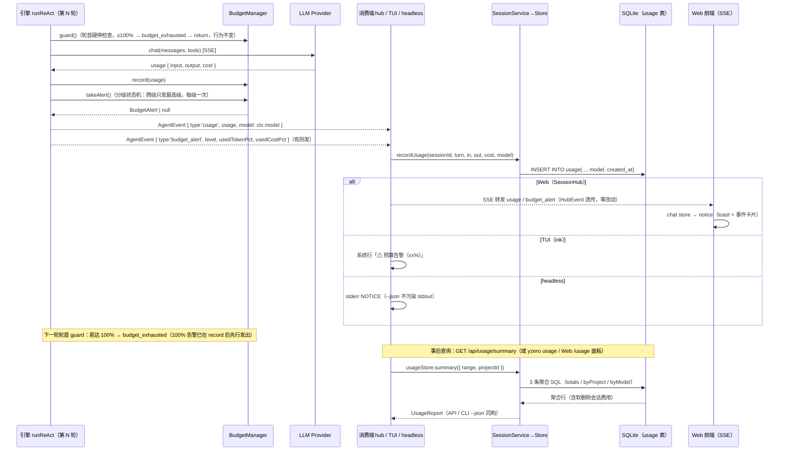

# F-31 成本与用量报告 —— 增量技术设计

> 版本：v1.0 ｜ 日期：2026-10-23 ｜ 对应 PRD：docs/prd-f31-cost-report.md（5 个开放问题均已按推荐默认裁决）
> 上游：docs/technical-design.md §8（会话与存储）、§10（关键时序）；迁移框架 F-35

---

## 1. 实现方案总览与框架决策

### 1.1 总体思路

本特性是**纯增量**：数据已在 `usage` 表逐轮落库，预算已在 `BudgetManager` 生效，本设计只补三件事——

1. **数据补全**：v3 迁移给 `usage` 补 `model` / `created_at` 两列并回填，写入链路透传模型名；
2. **读取出口**：新增 `UsageStore` 聚合查询层（纯 SQL GROUP BY），上接 HTTP API / CLI / Web 三端；
3. **告警升级**：`shouldWarn()`（≥80% 每轮重复）升级为 50/80/100 分级一次性状态机，事件协议 `budget_warning` → `budget_alert`。

### 1.2 关键决策

| # | 决策 | 理由 |
|---|------|------|
| D1 | **零新依赖**。聚合用 better-sqlite3 同步 SQL，无 ORM、无图表库（Web 占比条用纯 CSS） | 对齐 PRD 非目标与现有技术栈 |
| D2 | 聚合层落**新文件 `packages/core/src/session/usage.ts`**（`UsageStore`，构造器收 db 句柄），不改 `store.ts` | 对齐 `TaskStore`/`MemoryStore`/`FileChangeStore`/`SearchStore` 的既有挂载模式（`service.tasks/memory/changes/search`），避免 store.ts 继续膨胀；`service.usage` 暴露 |
| D3 | `recordUsage()` 尾部追加可选参数 `model = ''`，时间戳由 store 内部写（不进签名） | 旧调用点可渐进迁移，签名兼容编译期受控（四处调用点全部本期改齐） |
| D4 | 引擎 `usage` 事件增加 `model?: string` 字段（引擎填 `ctx.model`），三个落库调用点读 `ev.model`，缺省回退各自已知的会话模型 | `usage` 事件当前不带模型；与其让三端各自猜测当前模型（TUI 的 session.model 可能被 `--model` 覆盖、hub 的 defaultModel 兜底链重复三份），不如由引擎在事件源头一次填对 |
| D5 | **hub 落库粒度由「每任务一条（turn=0）」改为逐轮落库**（对齐 headless/TUI） | PRD §6 明确「写入频率不变（每轮一条）」，且 FR-2 的「轮次 = usage 行数」要求三端口径一致；现状 hub 在 done 时一次性写 turn=0，Web 会话的轮次统计会失真。行为变更点，需回归 hub 相关测试 |
| D6 | 事件 `budget_warning` **直接移除**，替换为 `budget_alert`，不保留旧名兼容 | 事件流不落库（回放/回看读 messages 表而非事件流），无持久化兼容负担；旧事件消费端共 4 处且全部在 monorepo 内同版本发布（headless-run / TUI app / web chat store / 引擎自身），保留双事件徒增消费端歧义 |
| D7 | 告警判定时机：`record(usage)` 之后立即 `takeAlert()`（本轮用量→本轮告警），guard 硬停检查保持轮首不变 | 纯轮首判定存在死角：最后一轮才跨过阈值时循环已结束，告警永不发出；record 后判定同时保证「100% 告警先于 budget_exhausted」（下一轮轮首 guard 才触发耗尽） |
| D8 | 软删除口径：totals / byProject / byModel **不过滤** `sessions.deleted_at`（沉没成本计入）；bySession 明细列表 `deleted_at IS NULL` | PRD FR-2 / 裁决 #4 |

### 1.3 事件协议变更点（shared/index.ts）

```typescript
export type AgentEvent =
  // ...
  // 移除：{ type: 'budget_warning'; usedPct: number }
  // 新增：
  | { type: 'budget_alert'; level: 0.5 | 0.8 | 1.0; usedTokenPct: number; usedCostPct: number }
  // usage 事件增加 model（可选，引擎填充；老消费端可忽略）
  | { type: 'usage'; usage: Usage; model?: string }
  // ...
```

---

## 2. Schema v3 迁移与写入链路

### 2.1 迁移 SQL 草案（migrations.ts 末尾追加）

```typescript
/** v3：F-31 用量报告——usage 补 model / created_at 并回填 */
const MIGRATION_V3_F31_USAGE_REPORT = `
ALTER TABLE usage ADD COLUMN model TEXT NOT NULL DEFAULT '';
ALTER TABLE usage ADD COLUMN created_at TEXT;
CREATE INDEX IF NOT EXISTS idx_usage_created_at ON usage(created_at);

-- 回填（幂等：重跑结果相同）。usage.session_id 关联 sessions.id（无外键约束，历史数据可能孤儿行，COALESCE 兜底）
UPDATE usage SET created_at = COALESCE(created_at,
  (SELECT s.created_at FROM sessions s WHERE s.id = usage.session_id));
UPDATE usage SET model = CASE WHEN model = ''
  THEN COALESCE((SELECT s.model FROM sessions s WHERE s.id = usage.session_id), '')
  ELSE model END;
`;

export const MIGRATIONS: Migration[] = [
  { version: 1, name: 'baseline-core-tables', sql: MIGRATION_V1_BASELINE },
  { version: 2, name: 'f17-search-indexes', sql: MIGRATION_V2_F17_SEARCH },
  { version: 3, name: 'f31-usage-report', sql: MIGRATION_V3_F31_USAGE_REPORT },
];
```

要点：
- `created_at TEXT` 可空——孤儿行（session 已物理删除但 usage 残留，理论上 hard delete 会级联清理，兜底不报错）与回填失败不阻塞迁移；对齐 projects/sessions 的 ISO 8601 UTC 存法。
- `ALTER TABLE` 无 `IF NOT EXISTS`，幂等性由迁移框架的 `user_version` 守卫保证（每版本只执行一次，框架既有契约）；两条 UPDATE 天然幂等。
- 回填近似误差（会话开始时间而非逐轮真实时间）为 PRD 裁决 #1 已接受项。

### 2.2 recordUsage 签名变更

```typescript
// store.ts —— model 追加为最后一个可选参数；created_at 由 store 内部生成
recordUsage(sessionId: string, turn: number, inputTokens: number, outputTokens: number,
            costUsd: number, model = ''): void {
  this.db.prepare(
    'INSERT INTO usage (session_id, turn, input_tokens, output_tokens, cost_usd, model, created_at) VALUES (?, ?, ?, ?, ?, ?, ?)',
  ).run(sessionId, turn, inputTokens, outputTokens, costUsd, model, new Date().toISOString());
}
```

四个调用点的 model 来源（引擎 `usage` 事件统一带 `ev.model`，缺省回退各端已知值）：

| 调用点 | model 来源 | turn 来源 |
|--------|-----------|----------|
| `hub.ts` send() | `ev.model ?? ctx.model`（ctx.model = session.model ‖ defaultModel 兜底链，已有局部量） | **改为逐轮**：`usage` 事件计数器（每轮 +1）；删除 done 分支的 turn=0 整轮落库（D5） |
| `headless.ts:219` | `ev.model ?? ctx.model`（RunContext.model） | 既有 turnCount 不变 |
| `cli/ui/app.tsx:382` | `ev.model ?? props.session.model`（index.ts 启动时已把 `--model` 合入 session） | 既有 turnCount 不变 |

连带：`service.recordUsage` / `HeadlessService.recordUsage`（headless.ts:72 接口）同步加参；`headless.test.ts` 的 fake `recordUsage() {}` 少参兼容，无需改签名。

---

## 3. 聚合查询层（UsageStore）

### 3.1 接口定义（packages/core/src/session/usage.ts，新增）

```typescript
export type UsageRange = 'today' | '7d' | '30d' | 'all';

export interface UsageFilter { range?: UsageRange; projectId?: string }

/** 聚合行（SQL 结果直出，snake_case 对齐现有 API/CLI --json 约定） */
export interface UsageTotals {
  input_tokens: number; output_tokens: number; cost_usd: number;
  turns: number;      // usage 行数
  sessions: number;   // COUNT(DISTINCT session_id)
}
export interface UsageProjectRow extends UsageTotals { project_id: string | null; project_name: string }
export interface UsageModelRow   extends UsageTotals { model: string }
export interface UsageSessionRow extends UsageTotals {
  session_id: string; project_id: string; title: string; model: string;
}

export interface UsageReport {
  range: UsageRange;                 // 回显实际生效范围（非法输入已归一化为 all）
  totals: UsageTotals;
  byProject: UsageProjectRow[];
  byModel: UsageModelRow[];
}

export class UsageStore {
  constructor(db: Database.Database);
  /** 汇总 + 按项目 + 按模型（一次调用，三个查询；API 与 CLI --json 共用） */
  summary(filter: UsageFilter = {}): UsageReport;
  /** 逐会话明细（仅活跃会话，软删除口径见 D8） */
  bySession(filter: UsageFilter = {}): UsageSessionRow[];
}

/** 范围 → UTC ISO 下界（all → null 表示不过滤）；today 用本地时区 0 点 */
export function rangeCutoff(range: UsageRange): string | null;
/** 非法值归一化为 'all'（API/CLI 共用） */
export function normalizeRange(input: string | null | undefined): UsageRange;
```

`SessionService` 挂载：构造器中 `readonly usage = new UsageStore(this.store.db)`（与 tasks/memory/changes/search 同模式）；core/src/index.ts 导出上述类型。

### 3.2 SQL 草案

参数绑定 `:cutoff`（ISO 字符串或 NULL）、`:project`（项目 id 或 NULL）。

```sql
-- totals：usage 直查（不过滤软删除，沉没成本计入；孤儿 usage 行也计入）
SELECT COALESCE(SUM(input_tokens), 0)  AS input_tokens,
       COALESCE(SUM(output_tokens), 0) AS output_tokens,
       COALESCE(SUM(cost_usd), 0)      AS cost_usd,
       COUNT(*)                        AS turns,
       COUNT(DISTINCT session_id)      AS sessions
FROM usage
WHERE (:cutoff IS NULL OR created_at >= :cutoff)
  AND (:project IS NULL OR session_id IN
        (SELECT id FROM sessions WHERE project_id = :project));

-- byProject：LEFT JOIN 保留孤儿行（归入「未知项目」）；不过滤 deleted_at
SELECT s.project_id                                    AS project_id,
       COALESCE(p.name, '（未知项目）')                AS project_name,
       COALESCE(SUM(u.input_tokens), 0)  AS input_tokens,
       COALESCE(SUM(u.output_tokens), 0) AS output_tokens,
       COALESCE(SUM(u.cost_usd), 0)      AS cost_usd,
       COUNT(*)                          AS turns,
       COUNT(DISTINCT u.session_id)      AS sessions
FROM usage u
LEFT JOIN sessions s ON s.id = u.session_id
LEFT JOIN projects p ON p.id = s.project_id
WHERE (:cutoff IS NULL OR u.created_at >= :cutoff)
  AND (:project IS NULL OR s.project_id = :project)
GROUP BY s.project_id, p.name
ORDER BY cost_usd DESC;

-- byModel：空 model（回填失败的历史行）归入「未知」
SELECT COALESCE(NULLIF(u.model, ''), '（未知）')       AS model,
       /* 聚合列同上，含 COUNT(DISTINCT u.session_id) AS sessions */
FROM usage u
LEFT JOIN sessions s ON s.id = u.session_id
WHERE (:cutoff IS NULL OR u.created_at >= :cutoff)
  AND (:project IS NULL OR s.project_id = :project)
GROUP BY model
ORDER BY cost_usd DESC;

-- bySession：仅活跃会话（软删除口径 D8）
SELECT u.session_id AS session_id, s.project_id, s.title, s.model,
       /* 聚合列同上 */
FROM usage u
JOIN sessions s ON s.id = u.session_id
WHERE s.deleted_at IS NULL
  AND (:cutoff IS NULL OR u.created_at >= :cutoff)
  AND (:project IS NULL OR s.project_id = :project)
GROUP BY u.session_id
ORDER BY cost_usd DESC;
```

> 口径说明：totals 计入孤儿 usage 行（session 已消失），byProject 以「未知项目」承接，bySession 因 INNER JOIN 天然排除孤儿——三者仅在孤儿行上存在微小差异，属可接受的数据完整性兜底（正常路径 hard delete 会级联清理 usage，不会产生孤儿）。

### 3.3 时间边界

- 存储：一律 `toISOString()`（UTC，对齐 projects/sessions/messages 现有存法）。
- `today`：**本地时区**当天 0 点（`new Date()` → `setHours(0,0,0,0)` → `toISOString()`），与用户「今天」的感知对齐；`7d`/`30d`：`now - N×86400s`；`all`：不过滤。
- 验收用例需覆盖「今天 0 点边界」与「7 天前恰好落界」两条。

---

## 4. HTTP API（server/http.ts 手写路由追加）

路由置于 `/api/search` 之前的位置无强依赖（前缀 `api/usage` 不与现有资源冲突），沿用 `parts[]` 匹配模式：

### 4.1 `GET /api/usage/summary?range=<today|7d|30d|all>&project=<id>`

```jsonc
// 200 OK
{
  "range": "7d",              // 回显实际生效范围（非法值归一化为 "all"）
  "project": "uuid | null",   // 回显过滤项目 id（未传为 null）
  "totals": { "input_tokens": 0, "output_tokens": 0, "cost_usd": 0.0, "turns": 0, "sessions": 0 },
  "by_project": [
    { "project_id": "…", "project_name": "…", "input_tokens": 0, "output_tokens": 0, "cost_usd": 0.0, "turns": 0, "sessions": 0 }
  ],
  "by_model": [
    { "model": "claude-sonnet-4-5-20250929", "input_tokens": 0, "output_tokens": 0, "cost_usd": 0.0, "turns": 0, "sessions": 0 }
  ]
}
```

### 4.2 `GET /api/usage/sessions?range=&project=`

```jsonc
// 200 OK —— 逐会话明细（仅活跃会话）
{
  "range": "all",
  "project": null,
  "items": [
    { "session_id": "…", "project_id": "…", "title": "…", "model": "…",
      "input_tokens": 0, "output_tokens": 0, "cost_usd": 0.0, "turns": 0, "sessions": 1 }
  ]
}
```

- `range` 非法 → 归一化 `all` 并在响应回显（PRD FR-3 验收点）；`project` 只接受项目 id（Web 下拉持有 id；CLI 负责 name→id 解析，见 §8 T04）。
- 无鉴权增量，仍仅 127.0.0.1 监听（F-12 形态）。
- **同构约束**：CLI `--json` 与 API 响应字段一一对应（同一 `UsageStore` 方法产出，仅 CLI 外层不再包装）。

---

## 5. 预算分级告警（BudgetManager 状态机 + 三端消费）

### 5.1 BudgetManager 改造（context/budget.ts）

```typescript
export const BUDGET_ALERT_LEVELS = [0.5, 0.8, 1.0] as const;   // PRD 裁决 #3：硬编码，不暴露配置
export type BudgetAlertLevel = (typeof BUDGET_ALERT_LEVELS)[number];

export interface BudgetAlert { level: BudgetAlertLevel; usedTokenPct: number; usedCostPct: number }

export class BudgetManager {
  /** 已发出告警的最高级别（0 = 从未告警）；一次性语义的状态位 */
  private alertedLevel: BudgetAlertLevel | 0 = 0;

  /**
   * 分级告警判定（替代 shouldWarn，一次性语义）：
   * 取 token/费用两维度的更高级别；仅当高于历史已告警级别时返回告警并推进状态位，
   * 否则返回 null。跨级跳变（40%→90%）只发 0.8 一条。
   */
  takeAlert(): BudgetAlert | null {
    const usedTokenPct = this.usedTokenPct();
    const usedCostPct = this.usedCostPct();
    const pct = Math.max(usedTokenPct, usedCostPct);
    let level: BudgetAlertLevel | 0 = 0;
    for (const l of BUDGET_ALERT_LEVELS) if (pct >= l) level = l;
    if (level === 0 || level <= this.alertedLevel) return null;
    this.alertedLevel = level;
    return { level, usedTokenPct, usedCostPct };
  }
  // guard() / record() / summarize() 完全不动（100% 硬停 + 退出码 4 协议不变）
  // shouldWarn() 删除
}
```

### 5.2 引擎消费点（react.ts）

```typescript
const { text, toolCalls, usage } = round;
ctx.budget.record(usage);                     // 既有
// ── F-31：record 后立即判定（D7：覆盖最后一轮跨阈值的死角；100% 告警先于下一轮轮首的 budget_exhausted）──
const alert = ctx.budget.takeAlert();
yield { type: 'usage', usage, model: ctx.model };
if (alert) yield { type: 'budget_alert', ...alert };
```

轮首 guard 块保持原样（`exceeded → budget_exhausted → return`），`shouldWarn()` 分支删除。子代理（F-26）与父运行共享同一 `BudgetManager` 实例（hub/headless 注入），`alertedLevel` 状态位天然共享——子代理回写用量同样计入分级判断且不会重复告警，无需独立通道，对齐 PRD FR-6。

### 5.3 三端消费改造

| 端 | 文件 | 改动 |
|----|------|------|
| Web | `stores/chat.ts:106` | `budget_warning` 分支改 `budget_alert`：`notice(⚠ 预算已用 xx%（token/cost 取高）)`，notice 列表即现有 toast/事件卡片渲染通道；SSE 桥（hub.publish → http.ts events 端点）零改动，事件类型自然透传 |
| TUI | `ui/app.tsx:340` | 分支改名，文案带 level：`⚠ 预算告警（${level*100}%）：token xx% / 费用 yy%` |
| headless | `headless-run.ts:225` | stderr 一行 NOTICE：`⚠ 预算告警：${level*100}%（token xx% / 费用 yy%）`；`--json` 模式下仍走 stderr 不污染 stdout |

### 5.4 兼容性决策（D6 复述）

不保留 `budget_warning`：事件流不持久化，回放/回看不受影响；全部消费端在本 monorepo 内同步升级，无双端版本错配。`budget_exhausted` 事件与 headless 退出码 4 协议（F-29）不动。

---

## 6. 文件清单

| 文件（相对路径） | 性质 | 说明 |
|-----------------|------|------|
| `packages/core/src/session/migrations.ts` | 修改 | 追加 v3 迁移（§2.1） |
| `packages/core/src/session/store.ts` | 修改 | `recordUsage` 加 `model` 参数、写入 `created_at` |
| `packages/core/src/session/usage.ts` | **新增** | `UsageStore` 聚合查询层 + `rangeCutoff`/`normalizeRange` + 报告类型 |
| `packages/core/src/session/service.ts` | 修改 | 挂载 `service.usage`；`recordUsage` 透传 model |
| `packages/core/src/index.ts` | 修改 | 导出 UsageStore 与报告类型 |
| `packages/core/src/server/hub.ts` | 修改 | usage 逐轮落库（替代 done 一次性）+ model 透传 |
| `packages/core/src/headless.ts` | 修改 | `HeadlessService.recordUsage` 接口加参 + 落库带 model |
| `packages/core/src/context/budget.ts` | 修改 | `takeAlert()` 分级状态机；删 `shouldWarn()`；常量与类型 |
| `packages/core/src/engine/react.ts` | 修改 | usage 事件带 model；record 后发 `budget_alert`；删轮首 shouldWarn 分支 |
| `packages/shared/src/index.ts` | 修改 | AgentEvent：`budget_alert` 替换 `budget_warning`；`usage` 事件加 `model?` |
| `packages/cli/src/ui/app.tsx` | 修改 | recordUsage 传 model；`budget_alert` 消费 |
| `packages/cli/src/headless-run.ts` | 修改 | `budget_alert` stderr NOTICE |
| `packages/cli/src/usage.ts` | **新增** | `yzero usage` 渲染逻辑（文本表格 + `--json` 同构输出） |
| `packages/cli/src/index.ts` | 修改 | 注册 `usage` 子命令；KNOWN_SUBCOMMANDS 补 `'usage'`（裸任务路由白名单） |
| `packages/core/src/server/http.ts` | 修改 | `/api/usage/summary`、`/api/usage/sessions` 两个 GET 端点 |
| `packages/web/src/api/client.ts` | 修改 | usage API 封装 + 响应类型 |
| `packages/web/src/views/UsageView.vue` | **新增** | 用量面板（范围切换 / 项目筛选 / 总览卡 / 三分组表格 + CSS 占比条 / 空态） |
| `packages/web/src/router.ts` | 修改 | `/usage` 路由 |
| `packages/web/src/App.vue` | 修改 | 顶部 nav 加「用量报告」入口 |
| `packages/web/src/stores/chat.ts` | 修改 | `budget_alert` notice |
| `packages/core/test/usage.test.ts` | **新增** | 迁移三路径（空库 / v2 历史库 / 重复打开）、recordUsage 写入、聚合（多项目/多模型/时间边界/软删除口径/空数据）、API 端点（supertest 式自起 createWebServer 或直调 handler） |
| `packages/core/test/budget.test.ts` | 修改 | `shouldWarn` 用例改 `takeAlert`（一次性 / 跨级跳变 / 双维度取高） |
| `packages/core/test/react.test.ts` | 修改 | 事件流断言：budget_alert 一次发出、usage 事件带 model |
| `scripts/smoke-web.mjs` | 修改 | 补 2 例：usage summary/sessions 端点连通 + 非法 range 回显 |

---

## 7. 关键时序：usage 落库 → 预算判定 → 告警三端消费



---

## 8. 任务列表（按依赖排序，共 5 个）

| Task ID | 任务名 | Source Files | 依赖 | 优先级 |
|---------|--------|--------------|------|--------|
| **T01** | Schema v3 迁移 + usage 写入链路（model/created_at） | `core/src/session/migrations.ts`、`store.ts`、`service.ts`、`server/hub.ts`、`headless.ts`、`shared/src/index.ts`、`core/src/engine/react.ts`（usage 事件加 model）、`cli/src/ui/app.tsx`、`core/test/usage.test.ts`（迁移与写入用例） | — | P0 |
| **T02** | 聚合查询层 UsageStore | `core/src/session/usage.ts`（新增）、`service.ts`（挂载）、`core/src/index.ts`（导出）、`core/test/usage.test.ts`（聚合用例） | T01 | P0 |
| **T03** | 预算分级告警 | `core/src/context/budget.ts`、`core/src/engine/react.ts`（alert 发出）、`shared/src/index.ts`、`cli/src/headless-run.ts`、`cli/src/ui/app.tsx`、`web/src/stores/chat.ts`、`core/test/budget.test.ts`、`core/test/react.test.ts` | T01（react.ts 串行编辑） | P0 |
| **T04** | HTTP API + CLI `yzero usage` | `core/src/server/http.ts`、`cli/src/usage.ts`（新增）、`cli/src/index.ts`、`core/test/usage.test.ts`（API 用例）、`scripts/smoke-web.mjs` | T02 | P0（API）/ P1（CLI） |
| **T05** | Web 用量面板 UsageView | `web/src/views/UsageView.vue`（新增）、`web/src/router.ts`、`web/src/App.vue`、`web/src/api/client.ts` | T04 | P0 |

**各任务验收方式**

- **T01**：`NODE_OPTIONS= pnpm test` 全绿；迁移单测覆盖「空库」「v2 历史库（含存量 usage 回填断言）」「重复打开」三路径，回填后 `model`/`created_at` 与 sessions 一致；新落库行带 model 与 ISO 时间戳；hub 改为逐轮落库后其行为用例（如有快照）回归通过。
- **T02**：聚合结果与逐行手算一致；today/7d/30d 边界正确（本地时区 0 点）；空数据返回零值结构不报错；软删除会话费用计入 totals/byProject、bySession 列表排除；多项目/多模型/跨范围用例通过。
- **T03**：50→80→100 严格各告警一次；跨级跳变（一轮 40%→90% 只发 0.8）与双维度取高（token 50% / cost 80% → 发 0.8）单测通过；未超阈值零告警；100% 后退出码 4 与优雅终止摘要与现状完全一致（headless.test.ts 既有断言不回归）。
- **T04**：非法 `range` 回退 `all` 且响应回显；`/api/usage/summary` 与 `yzero usage --json` 输出 JSON 同构（同一查询层）；CLI `--project` 支持 id 与名称；空数据空态友好；`jq` 可直接消费 `--json`；smoke-web 新增 2 例通过。
- **T05**：`pnpm smoke:web` 通过（构建 + 端点冒烟）；范围切换与项目筛选正确刷新、空项目/空范围有空态提示；占比条为纯 CSS、无新依赖。

---

## 9. 共享知识（跨文件约定）

1. **时间**：所有落库时间为 `new Date().toISOString()`（ISO 8601 UTC）；`today` 范围的边界按**本地时区** 0 点计算后转 ISO 存储。
2. **JSON 字段命名**：报告/API/CLI `--json` 一律 **snake_case**（`input_tokens` / `cost_usd` / `by_project`），对齐 `buildHeadlessReport` 与 SQLite 列名的既有约定；TypeScript 内部类型（`UsageReport` 等）与 SQL 列名保持同名，减少映射层。
3. **事件协议**：`AgentEvent` 是三端唯一契约（packages/shared），`budget_warning` 自 F-31 起不复存在；消费端 switch 分支须同步改名。事件不落库，回放读 messages。
4. **recordUsage 调用约定**：`model` 为可选尾参（缺省 `''`），`created_at` 由 store 生成，调用方禁止自传；hub 逐轮落库，headless/TUI 维持逐轮（turn 来自 `turn_start`）。
5. **告警一次性语义**：`alertedLevel` 是 BudgetManager 实例内状态——每轮运行由 hub/headless-run/TUI 新建 BudgetManager，跨运行自然重置；同一运行内父子代理共享实例（F-26 注入同一对象），去重免费获得。
6. **口径**：「轮次」= usage 行数；费用为 Provider 层已算好的 `cost_usd` 直加，不做二次计价；软删除会话费用计入聚合、不出现在明细列表。
7. **测试环境**：本地跑 vitest 用 `NODE_OPTIONS= pnpm test`（WorkBuddy NODE_OPTIONS shim 会令 vitest 段错误）；CI 不受影响。

---

## 10. 待明确事项

1. **hub 落库粒度行为变更（D5）**：存量数据中 hub 写入的 turn=0 整轮行在新报告里按「1 轮」计，与该任务真实轮数不符（历史口径问题，迁移不修复）；新数据三端一致。如需历史精确轮次，只能依赖 messages 表推导——本期不做，留待反馈。
2. **plan-execute / multi-agent 主循环**：告警发出点位于 runReAct；编排模式（plan-execute/orchestrator）的节点执行内部复用 runReAct，子任务级告警会透传到父事件流。若编排主循环存在独立 budget 消费路径（当前 grep 仅 react.ts 一处），需在 T03 实现时复核一遍两个引擎文件。
3. **项目名展示**：byProject 用 projects.name 直读；项目软删除后名称仍展示（无「（已删除）」标记）——如 Web 侧需要区分，属一行判断，实现时顺手处理即可，不阻塞。
