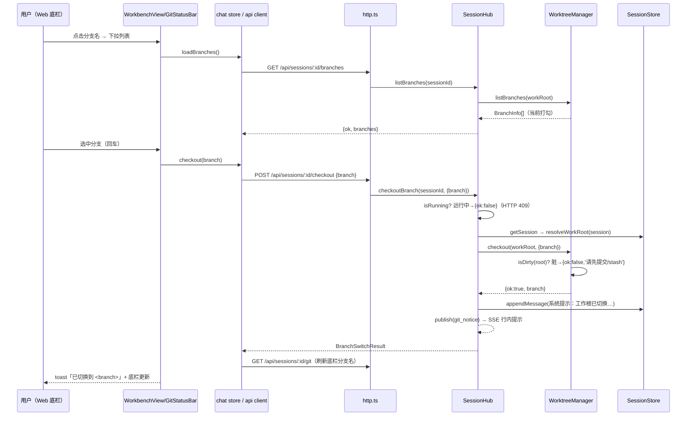
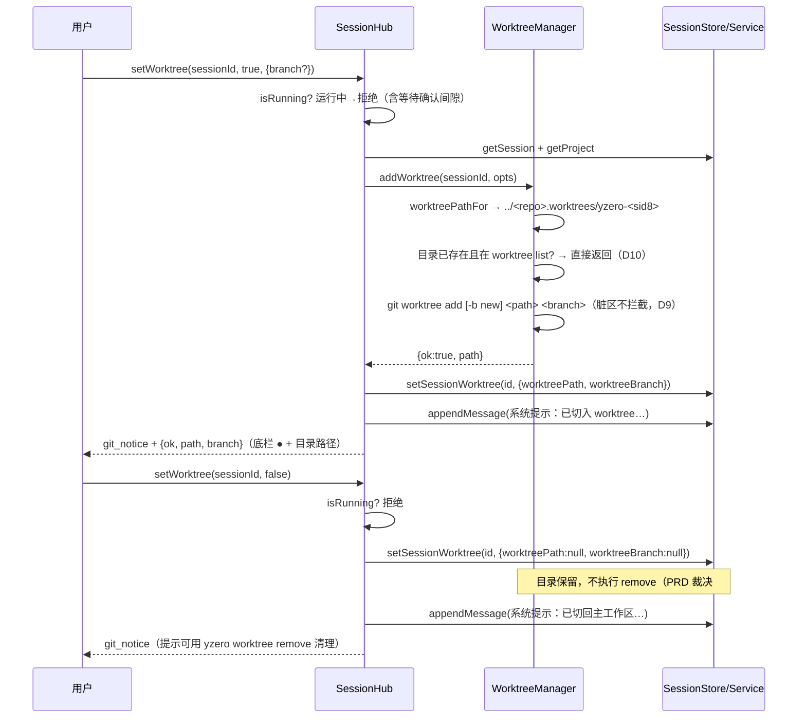
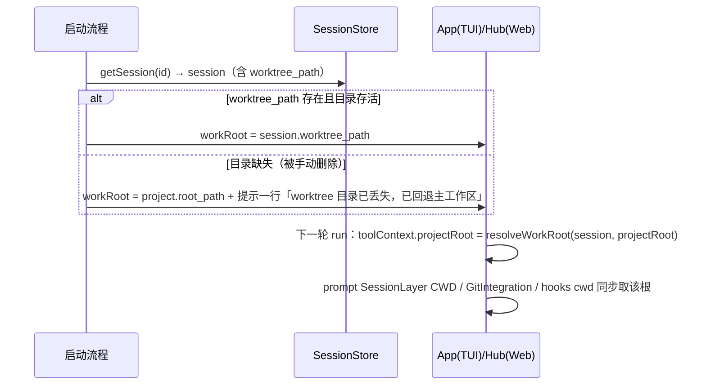
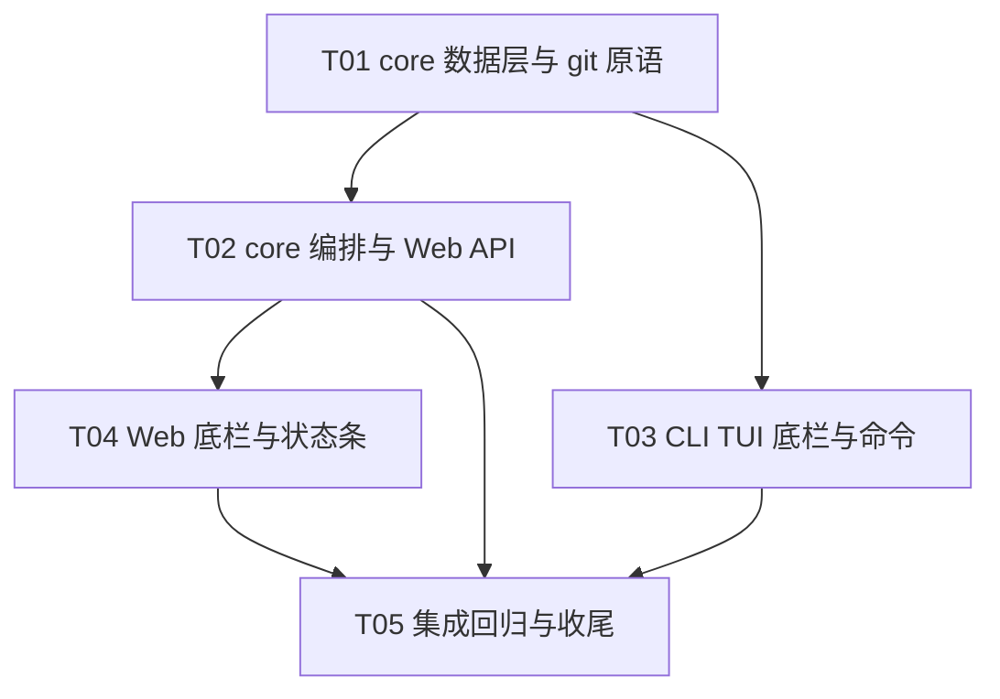

# F-37 git 分支切换 + Worktree 会话级隔离 —— 技术设计

> 日期：2026-10-24 ｜ 关联：docs/prd-f37-git-worktree.md ｜ 样例沿用：F-30/F-33/F-34（成对文档 / 失败静默 / 入口层接线）、F-24（GitIntegration / FileChangeStore 基准）、F-35（v4 迁移）

## 0. 已定决策遵循声明

以下决策在 PRD §7 已落定，本设计不再讨论：worktree 目录固定 `../<repoName>.worktrees/<会话目录>`（P2 才配置化）；主工作区脏一律阻止 checkout、不自动 stash；切回主工作区时 worktree 目录保留；「运行中禁切」含等待确认间隙（hub.running 已天然覆盖）。

## 1. 决策表

| # | 决策 | 理由与备选 |
|---|------|-----------|
| D1 | 纯 git 操作落 **core 新模块 `git/worktree.ts`（WorktreeManager）**；切换编排（守卫 + 落库 + 注入提示 + 事件推送）落 **core 的 SessionHub**（hub 本就在 core 包内，满足 G3 单点沉淀）；CLI/Web 只做交互壳 | 备选「编排也下沉 SessionService」会引入 hub 依赖反转（事件推送/运行态在 hub）；备选「编排放 UI 层」违反 G3。git 调用全部复用 `runWithShell`（跨平台已验证），**零新增 npm 依赖** |
| D2 | 工作根重绑定 = **会话持久化字段 + 每次 run 前解析**，而非运行中改写内存对象。`toolContext.projectRoot`、prompt CWD、GitIntegration、Git hooks cwd 均在 run 组装期从 `resolveWorkRoot(session)` 取值 | 切换只允许在「非运行中」发生（PRD 硬规则），运行中不存在并发改写问题 → 不需要把 projectRoot 改成响应式可变对象，增量最小、无竞态。恢复会话（CLI `-r` / Web 重开）天然还原绑定 |
| D3 | sessions 表加两列：`worktree_path TEXT DEFAULT NULL`（NULL = 主工作区）、`worktree_branch TEXT DEFAULT NULL`（切入时分支，恢复校验/展示用）。迁移走 F-35 机制追加 v4 `f37-worktree-binding` | 主工作区切换分支不落库（分支是仓库状态，恢复时以实际为准）；只有 worktree 绑定需要跨进程还原。历史会话两列为 NULL，行为与现状一致 |
| D4 | `GitIntegration.projectRoot` 从 `readonly` 构造参数改为**可变私有字段 + `updateRoot(root)`**；行为零改动 | PRD §6 明确「构造参数改为 getter 或 update 方法」；CLI（app.tsx gitRef 常驻实例）与 hub（done 时新建实例传当前工作根）两条链路都能低成本跟随 |
| D5 | 切换成功后向会话注入一条 `role:'user'` 消息：`（系统提示：[环境] 工作根已切换：<分支> @ <目录>…）`，走既有 `appendMessage`；TUI 同步 addItem 一行 system 提示 | 沿用引擎熔断器的「（系统提示：…）」user 消息惯例，模型在下一轮自然感知；不新增 AgentEvent 类型、不改动消息 schema |
| D6 | 提示词 CWD 重组装：CLI `assemblePrompt` 的 `projectRoot` 参数改为 **`getRoot: () => string` getter** 并暴露 `rebuild()`（重读 README/agent.md + 重拼 static/dynamic 两段）；hub `buildPrompt` 每次 send 已按参数重拼，只需传入当前工作根 | L7 SessionLayer（运行环境，PRD 语境的「L2 Environment」）的 CWD 在动态段，getter 后每轮刷新自动跟随；静态段在切换后 `rebuild()` 一次，成本低（两个文件读取）。备选「只换动态段」会在 README 差异场景（worktree 半成品）留旧路径，不取 |
| D7 | Web 端切换走 hub 新方法 + 4 个 HTTP 端点（见 §4）；结果复用既有 `git_notice` HubEvent 做行内反馈，前端动作响应即刷新 | 不新增 HubEvent 类型（state 事件已有 running 字段供置灰判断）；toast/下拉刷新由前端拿端点响应完成 |
| D8 | 沙箱语义：`resolveInSandbox(ctx.projectRoot)` 的根 = 当前工作根（工具层零改动，自动跟随）；若运行时启用了 SandboxExecutor（Seatbelt/Docker 在构造期固化 projectRoot），**切换后下一轮以新工作根重建执行器**（`createSandboxRuntime({ projectRoot: workRoot })`） | worktree 是用户显式创建的合法沙箱根，不视为逃逸；Docker 唯一挂载 /workspace 与 Seatbelt profile 的项目路径都以构造参数为准，必须重建实例而非原地改（现有实现字段为 readonly，重建是唯一安全路径） |
| D9 | 脏区检查作用于「当前工作根」：主工作区 checkout 查主工作区，worktree 内 checkout 查 worktree（模型可能已在 worktree 里改文件，规则一致性优先）；worktree 创建（add 新目录）与切回主工作区不做脏检查 | PRD F-37-3 ①②③ 的自然延伸；切回主工作区不发生 checkout（主工作区分支未被移动），无需检查 |
| D10 | 会话已有 worktree 绑定时的重复勾选：目录存在且在 `git worktree list` 中 → 直接重绑不重复 add；目录存在但已脱管（被手动删除注册）→ 返回结构化失败；目录不存在 → 重新 add | 勾选/取消/再勾选往返（US-37-3）必须幂等；`git worktree add` 对已存在路径会报错，需先查列表 |

## 2. 抽象分层

```
packages/core/src/git/worktree.ts     WorktreeManager：列分支/checkout/worktree add·list·remove·prune/
                                      脏检查/当前分支查询（全部 runWithShell + 15s，结构化失败不 throw）
packages/core/src/git/repo.ts         GitIntegration 增 updateRoot()（D4），其余行为不变
packages/core/src/session/migrations.ts   v4：sessions 加 worktree_path / worktree_branch
packages/core/src/session/store.ts    SessionRow 扩展两列 + setSessionWorktree()
packages/core/src/session/service.ts  resolveWorkRoot(session, projectRoot) + setSessionWorktree 包装
packages/core/src/hooks/manager.ts    rebindRoot(root)：hook 命令 cwd 跟随当前工作根
packages/core/src/server/hub.ts       listBranches / checkoutBranch / setWorktree / worktreeState
                                      （运行中守卫 → WorktreeManager → 落库 → 注入系统提示 → git_notice）
packages/core/src/server/http.ts      4 个 REST 端点（§4）
packages/cli/src/prompt.ts            getRoot getter + rebuild()（D6）
packages/cli/src/ui/worktree-bar.tsx  TUI 底栏三段式（项目名｜分支｜Worktree 开关）
packages/cli/src/ui/branch-card.tsx   分支选择卡（方向键/回车/n 新建/Esc，与 ConfirmCard 同风格）
packages/cli/src/ui/app.tsx           workRootRef（含 resume 还原）、toolContext/gitRef/rollback 接线、
                                      /branch /worktree 命令、底栏挂载
packages/web/src/api/client.ts        4 个端点封装
packages/web/src/stores/chat.ts       gitState + listBranches/checkout/toggleWorktree 动作
packages/web/src/components/GitStatusBar.vue   Web 底栏三段式（分支下拉 + Worktree checkbox）
packages/web/src/views/WorkbenchView.vue       底栏挂载 + toast 反馈 + 运行中置灰
```

## 3. 数据结构与接口（core）

```ts
// ── packages/core/src/git/worktree.ts ──────────────────────────────────────
export interface GitOutcomeLike {
  ok: boolean;
  /** ok=false 时的可展示原因（git stderr 已提炼） */
  reason?: string;
}
export interface BranchInfo { name: string; current: boolean }
export interface WorktreeInfo {
  path: string;              // 绝对路径
  branch: string | null;     // detached HEAD 时 null
  head: string;              // 短 hash
}

export class WorktreeManager {
  /** mainRoot = 仓库主工作区（项目 root_path）；worktree 目录容器 = path.join(dirname(mainRoot), `${repoName}.worktrees`) */
  constructor(mainRoot: string, signal?: AbortSignal);

  isRepo(): Promise<boolean>;
  /** 仓库目录名（worktree 容器命名用）；非 repo 返回 path.basename(mainRoot) */
  repoName(): string;

  /** 当前根的分支；detached HEAD 返回短 hash（底栏显示口径） */
  currentBranch(root?: string): Promise<string | null>;
  /** 当前根是否脏（D9：主/worktree 一视同仁） */
  isDirty(root?: string): Promise<boolean>;

  /** 本地分支列表（字母序，当前打勾标识）；非 repo → { ok:false } */
  listBranches(root?: string): Promise<{ ok: true; branches: BranchInfo[] } | { ok: false; reason: string }>;

  /**
   * 会话工作根内 checkout（D9：脏区阻止，不 stash）。
   * branch 与 newBranch 二选一：newBranch = 就地 `checkout -b`。
   */
  checkout(root: string, opts: { branch?: string; newBranch?: string }): Promise<GitOutcomeLike & { branch?: string }>;

  /** 会话 worktree 目录约定路径：../<repoName>.worktrees/yzero-<sessionId 前 8 位> */
  worktreePathFor(sessionId: string): string;

  /**
   * 创建并返回 worktree 绝对路径（D10 幂等：路径已在 worktree list → 直接返回）。
   * opts 三选一语义：branch（从既有分支检出）/ newBranch（-b 新建）/ 缺省（从当前 HEAD）。
   * 目录存在但已脱管 → { ok:false, reason }（不静默删除用户目录）。
   */
  addWorktree(sessionId: string, opts?: { branch?: string; newBranch?: string }):
    Promise<GitOutcomeLike & { path?: string }>;

  listWorktrees(): Promise<{ ok: true; worktrees: WorktreeInfo[] } | { ok: false; reason: string }>;
  /** 显式移除（P1）；目录有未提交改动时拒绝（--force 不暴露给一期） */
  removeWorktree(wtPath: string): Promise<GitOutcomeLike>;
  /** 清理孤儿（目录已不存在的注册项） */
  prune(): Promise<GitOutcomeLike>;
}

// ── packages/core/src/session/store.ts（增量）──────────────────────────────
export interface SessionRow {
  // …既有字段不变…
  worktree_path: string | null;    // v4；NULL = 主工作区
  worktree_branch: string | null;  // v4；切入 worktree 时的分支
}
// SessionStore 新增：
setSessionWorktree(id: string, patch: { worktreePath?: string | null; worktreeBranch?: string | null }): void;
// （UPDATE sessions SET worktree_path=?, worktree_branch=?, updated_at=? —— 两列同语句原子更新）

// ── packages/core/src/session/service.ts（增量）────────────────────────────
/** 会话当前工作根：worktree 绑定存在且目录存活 → worktree 路径；否则项目根（D2 每轮 run 前调用） */
export function resolveWorkRoot(session: SessionRow, projectRoot: string): string;
// SessionService 新增薄包装：setSessionWorktree(id, patch)（校验会话存在，转发 store）

// ── packages/core/src/git/repo.ts（增量）───────────────────────────────────
export class GitIntegration {
  // private projectRoot: string;（去 readonly）
  updateRoot(root: string): void;   // 切换后跟随；行为零改动（D4）
}

// ── packages/core/src/hooks/manager.ts（增量）──────────────────────────────
export class HookManager {
  rebindRoot(root: string): void;   // 后续 hook 命令 cwd 用新根（配置清单不重扫）
}
```

### 3.1 SessionHub 编排方法（core 单点，D1/D7）

```ts
export interface SessionGitState {
  isRepo: boolean;
  projectName: string;         // path.basename(project.root_path)
  branch: string | null;       // 当前工作根分支（detached → 短 hash）
  worktree: { enabled: boolean; path: string | null; branch: string | null };
  running: boolean;            // 前端置灰判断的权威来源
}
export interface BranchSwitchResult extends GitOutcomeLike { branch?: string; path?: string }

export class SessionHub {
  /** GET 语义：底栏状态（不产生副作用） */
  async worktreeState(sessionId: string): Promise<SessionGitState>;
  /** 分支列表（worktreeState 已知 isRepo；非 repo 前端不发起） */
  async listBranches(sessionId: string): Promise<{ ok: true; branches: BranchInfo[] } | { ok: false; reason: string }>;
  /**
   * 会话级 checkout：守卫（isRunning → {ok:false,'会话运行中…'}；脏区 WorktreeManager 内拦截）
   * → checkout → （成功）注入系统提示 + git_notice 推送。不落分支到会话表（D3）。
   */
  async checkoutBranch(sessionId: string, opts: { branch?: string; newBranch?: string }): Promise<BranchSwitchResult>;
  /**
   * Worktree 开关（enabled=true：addWorktree → 落库两列 → 注入提示 → git_notice；
   * false：清空两列（目录保留）→ 注入提示 → git_notice。运行中一律拒绝）
   */
  async setWorktree(sessionId: string, enabled: boolean, opts?: { branch?: string; newBranch?: string }): Promise<BranchSwitchResult>;
}
```

注入文案常量（两端一致，D5）：

```ts
// 切分支成功
（系统提示：[环境] 工作根已切换：分支 <branch> @ <root 绝对路径>；后续文件读写与命令执行均以该目录为基准）
// 勾选 worktree
（系统提示：[环境] 工作根已切换：分支 <branch> @ <worktree 路径>（独立 worktree，主工作区改动不受影响））
// 取消 worktree
（系统提示：[环境] 已切回主工作区：<project root>；worktree 目录已保留（<path>），可用 yzero worktree remove 清理）
```

### 3.2 HTTP 端点（packages/core/src/server/http.ts）

| 方法与路径 | 语义 | 成功/失败 |
|-----------|------|----------|
| `GET /api/sessions/:id/git` | `worktreeState` → SessionGitState | 200 / 404 |
| `GET /api/sessions/:id/branches` | `listBranches` | 200 / 400（非 repo / 失败原因） |
| `POST /api/sessions/:id/checkout` | body `{branch}` 或 `{newBranch}` | 200 BranchSwitchResult / 409 运行中 / 400 失败原因 |
| `POST /api/sessions/:id/worktree` | body `{enabled, branch?, newBranch?}` | 200 BranchSwitchResult / 409 运行中 / 400 失败原因 |

运行中一律 409（与既有 `session is running` 同口径）；core 结构化失败（脏区/非 repo 等）200 返回 `{ok:false, reason}`，由前端 toast 展示——**区分「状态拒绝」与「git 失败」两类语义**。

## 4. 程序调用流程

### 4.1 Web：分支切换（checkout）



### 4.2 开关 worktree（勾选 / 取消）



### 4.3 会话恢复还原绑定（CLI `-r` / Web 重开）



## 5. Anything UNCLEAR（含假设）

| # | 不明确点 | 假设 / 处理 |
|---|---------|------------|
| 1 | PRD 目录名示例 `yzero-a1b2c3d4` 与「`<sessionId 前 8 位>`」并存 | 按「容器 `../<repoName>.worktrees/`，其下会话目录 `yzero-<sid8>`」实现（示例口径），共享知识 §8 固化 |
| 2 | worktree 内 checkout 的脏区口径 PRD 只写了主工作区 | 按 D9 一致应用到当前工作根（更安全，拒绝成本仅一次提示） |
| 3 | 交互运行（TUI/Web）当前未注入 `ctx.sandbox`（仅 headless/evals 链路有） | 本期不改变注入现状；D8 规则作为「若启用则必须重建」的接线约定写入 hub/toolContext 组装处注释，防止未来接线时踩坑 |
| 4 | 切换是否需要写会话时间线（F-37-9，P1） | 本期仅注入系统提示消息（天然进回放时间线），独立的事件样式行留 P1 |
| 5 | `yzero worktree list/remove/prune` 子命令组（F-37-8，P1） | 接口已在 WorktreeManager 备齐，子命令接线列为 T05 可选收尾（不阻塞 P0 验收） |
| 6 | Web 端 `/rollback` 的 projectRoot 基准 | Web 当前未暴露 rollback 端点；CLI 侧 `changes.rollbackTo` 第二参改为 workRootRef（T03），快照绝对路径辅助字段沿用既有 file_changes 表结构（不改表） |

## 6. Required Packages

**零新增 npm 依赖**（对齐 F-36 D1 零依赖取向）：

- git 调用：复用 `runWithShell`（engine/shell.ts，跨平台 ShellAdapter 已含 win32 降级）
- 目录探测：`node:fs`、`node:path` 内置
- 既有依赖不变：better-sqlite3 / ink / vue 等

## 7. 任务列表（有序，按依赖）

| Task ID | 任务名 | Source Files | 依赖 | 优先级 |
|---------|--------|--------------|------|--------|
| T01 | core 数据层与 git 原语：WorktreeManager + 可变根 + v4 迁移 + 会话字段 + hooks rebind。含 core 单测（临时目录建真实 git 仓库：列分支/脏区拦截/add 幂等/移除拒绝脏目录/prune；迁移 v3→v4；resolveWorkRoot 回退） | `packages/core/src/git/worktree.ts`(新)、`git/repo.ts`、`session/migrations.ts`、`session/store.ts`、`session/service.ts`、`hooks/manager.ts`、`src/index.ts`(导出)、`packages/core/test/worktree.test.ts`(新) | — | P0 |
| T02 | core 编排与 Web API：hub 四方法（运行中守卫/落库/注入系统提示/git_notice）、http 4 端点、hub.send 改用 resolveWorkRoot（toolContext.projectRoot、buildPrompt cwd、done 时 GitIntegration 根）。自测：node 起服务 curl 四端点 + 运行中 409 | `packages/core/src/server/hub.ts`、`server/http.ts` | T01 | P0 |
| T03 | CLI TUI：assemblePrompt getRoot/rebuild、app.tsx workRootRef（resume 还原绑定 + 丢失回退）、toolContext/gitRef//rollback 接线、底栏 worktree-bar、分支卡 branch-card、`/branch` `/worktree` 命令与行内反馈、`/help` 补条目。自测：`yzero` 双会话并行改文件互不可见、切回后主工作区状态不变 | `packages/cli/src/prompt.ts`、`cli/src/index.ts`、`cli/src/ui/app.tsx`、`cli/src/ui/worktree-bar.tsx`(新)、`cli/src/ui/branch-card.tsx`(新) | T01 | P0 |
| T04 | Web 双端一致：api client + chat store 动作 + GitStatusBar.vue（三分段/分支下拉/新建分支/Worktree checkbox/运行中 disabled/loading）+ WorkbenchView 挂载与 toast + 会话列表 🌿 标识。自测：pnpm dev 对接 yzero serve 走通 4 端点 | `packages/web/src/api/client.ts`、`stores/chat.ts`、`components/GitStatusBar.vue`(新)、`views/WorkbenchView.vue` | T02 | P0 |
| T05 | 集成回归与收尾：auto commit 跟随 worktree（worktree 内提交即 worktree 改动）、suggest 文案与底栏联动、会话恢复双端还原、并发会话同分支冲突提示、`yzero worktree list/remove/prune` 子命令接线（P1 顺手件）、设计偏差回填 | `packages/cli/src/index.ts`、`cli/src/worktree.ts`(新，P1 子命令)、`packages/core/src/server/hub.ts`(回归修正) | T02, T03, T04 | P0（P1 部分可选） |

## 8. 共享知识（跨文件约定）

```
1. worktree 目录约定：容器 = <仓库父目录>/<repoName>.worktrees/；会话目录 = yzero-<sessionId 前 8 位>；
   绝对路径 = 容器/yzero-<sid8>。一会话一目录，会话删除不自动删目录（P1 提示策略）。
2. 会话记录字段名：sessions.worktree_path / sessions.worktree_branch（v4 迁移 f37-worktree-binding），
   NULL = 主工作区。工作根解析唯一入口 = resolveWorkRoot(session, projectRoot)，禁止各端自行判断。
3. API 路径前缀：/api/sessions/:id/git | /branches | /checkout | /worktree（均为 session 作用域，
   与既有 /permission 同级同风格）。
4. 注入消息格式：role='user'，content 以「（系统提示：[环境] 工作根已切换：…）」开头（沿用引擎惯例，
   严禁改成 role='system'——会破坏历史消息 sanitize 与网关校验）。
5. GitIntegration 超时口径 15s（GIT_TIMEOUT_MS），WorktreeManager 沿用；失败一律 {ok:false, reason}
   结构化返回，不 throw、不中断 UI。
6. 沙箱根 = 当前工作根：resolveInSandbox(ctx.projectRoot) 的 ctx.projectRoot 必须来自
   resolveWorkRoot；SandboxExecutor 构造期固化 projectRoot，切换后须重建实例（D8）。
7. 「运行中」判定唯一来源：SessionHub.isRunning（含等待确认间隙与僵尸判定），UI 置灰与 core 守卫共用。
8. 分支名经 shellQuote 转义后拼入 git 命令（沿用 repo.ts 既有 helper 口径，禁止裸拼）。
```

## 9. 任务依赖图



## 10. 风险与裁决

| 风险 | 裁决 |
|------|------|
| 两个会话 checkout 同一分支 / 同分支两个 worktree | git 原生拒绝（cannot force update the branch… checked out at），reason 原样透传给 UI，不做前端仲裁（PRD §8：一仓库一项目假设） |
| worktree 目录在仓库外 → Seatbelt/Docker 构造期 projectRoot 失配 | D8：切换后重建执行器；交互链路本期未注入 sandbox，属预防性约定 |
| 会话恢复时 worktree 目录被手动删除 | resolveWorkRoot 回退主工作根 + 底栏 git state 不显示 worktree；不自动重建目录（用户数据不可臆造） |
| worktree 内 node_modules 缺失导致工具连环失败 | P1 F-37-10 提示；一期靠引擎既有熔断（同工具连败 3 次注入换思路提示）兜底，不额外处理 |
| CLI assemblePrompt 签名变更破坏 headless/evals 调用点 | getRoot 改为可选：`projectRoot?: string | (() => string)`，传 string 走旧路径（headless 不受影响），TUI 传 getter |
| 切换后动态提示段缓存前缀变化 | SessionLayer 本就属动态段（每轮重组装），无缓存前缀影响；静态段 rebuild 一次性成本可忽略 |
