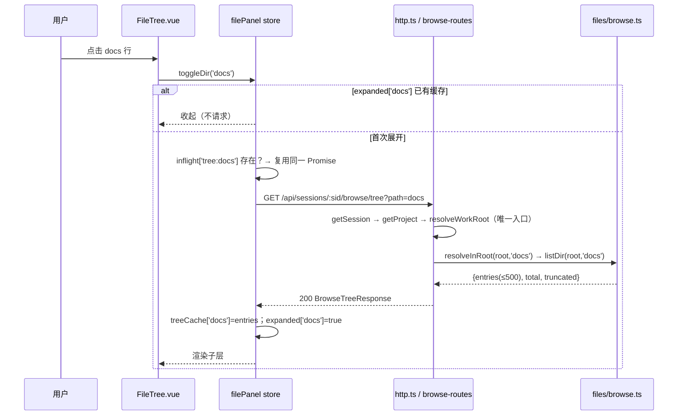
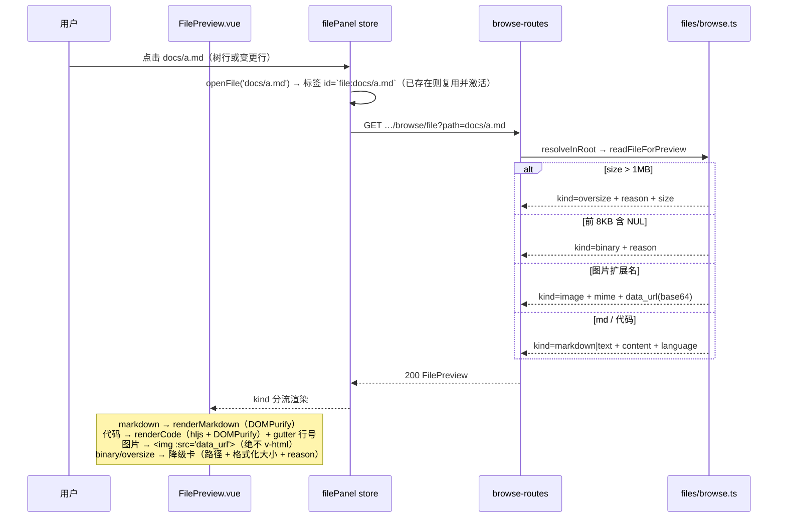
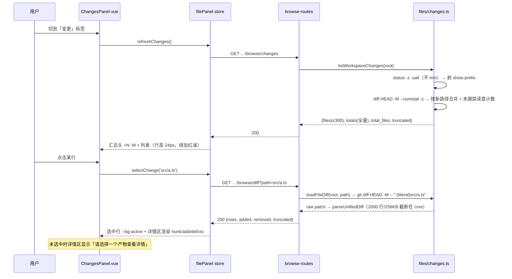

# F-38 项目文件浏览器 + 变更文件面板 —— 技术设计

> 日期：2026-10-24 ｜ 关联：`docs/prd-f38-project-file-panel.md` ｜ 风格沿用：`docs/design-f37-git-worktree.md`（决策表 → 分层 → 数据结构 → 端点 → 时序 → 任务）
> 交付面：`packages/core`（只读端点 + 文件/git 原语）+ `packages/web`（右侧面板）；CLI/TUI 本期不动。

## 0. 一句话方案与 PRD 映射

**一句话**：在 core 新增纯只读的 `files/` 能力层（根内路径解析 + 单层目录枚举 + 工作区变更统计 + unified diff 解析），经 `server/browse-routes.ts` 以「session 作用域为主、project 作用域回落」两套路由暴露 5 个端点；Web 侧新增 `filePanel` store + 5 个组件，以 `侧栏 + 主区 + 面板` 三栏接入 WorkbenchView，全链路无写操作。

| PRD 编号 | 本设计落点 |
|---|---|
| F-38-1 容器/开关/宽度记忆 | D11、§3 store（`open`/`width`）、§7 T05 |
| F-38-2 标签条 | §3 `PanelTab`、§7 T04（FilePanel 内含标签条；`+` 按 Q4 隐藏） |
| F-38-3 空态动作区 | §4.5 reveal 端点、§3 store `openTab`、T04/T05（「打开终端」不渲染） |
| F-38-4 文件树 | D5/D6、§4.1 tree 端点、T01/T04（FileTree） |
| F-38-5 文件预览 | D9/D10/D14、§4.2 file 端点、T01/T04（FilePreview） |
| F-38-6 变更清单 | D7、§4.3 changes 端点、T02/T04（ChangesPanel） |
| F-38-7 单文件 diff | D8/D9、§4.4 diff 端点、T02/T04（FileDiffView） |
| F-38-8 状态与错误态 | §4.6 错误码表、§6 边界表、T03/T04（store 三态字段） |
| F-38-9 只读后端能力 | D1/D2/D3/D4、§4 全部端点均为只读（唯一 POST 为 OS reveal，不写项目文件） |
| F-38-10 与工作根/项目联动 | D13、§3 `setScope/invalidateAll`、T05（watch 落点） |

## 1. 决策表（D1–D13）

| # | 决策 | 理由 | 备选与不取原因 |
|---|---|---|---|
| **D1** | 端点作用域 = **两套路由族**：`/api/sessions/:sid/browse/*`（主）+ `/api/projects/:pid/browse/*`（无会话回落）。两者内部共用同一 handler 与同一 `resolveRoot`（session → `resolveWorkRoot(session, project.root_path)`；project → `project.root_path`） | 数据根必须跟随会话工作根（Q3），而 `resolveWorkRoot` 需要 session+project 二元组；作用域与根解析一一对应，不存在「project 作用域里塞 sessionId」的错根风险；与既有 `/api/sessions/:id/git\|branches` 同族同风格 | B) project 路由 + `?sessionId=`：① 会话不属于该 project 时无天然校验点，会静默显示错根；② 单入口把两种作用域的 404 语义混在一起。不取 |
| **D2** | 资源段用 **`browse`** 而非 `files`：`/browse/{tree,file,changes,diff,reveal}` | 既有 `GET /api/projects/:id/files` 是 Composer「@ 引用」候选（**跳过所有点号目录**），与面板树语义相反；同名子路径会让维护者误以为同一能力，`browse` 明确区分 | 用 `/files/tree` 子路径：与 legacy 端点同前缀，读者极易复用错实现。不取 |
| **D3** | 4 个读能力**不合并**，各自 GET + `path` 查询参数；新增第 5 个**动作**端点 `POST /browse/reveal`（只在系统文件管理器中打开目录，不写任何项目文件） | tree 返回条目数组、file 返回内容/降级标记，合并会得到联合类型响应，TS 契约与错误码都变模糊；F-38-3「打开浏览器」、F-38-5「⋯ 在文件管理器中显示」都需要对**工作根**（可能是不在项目根内的 worktree）reveal，既有 project 作用域 reveal 无法表达 | ① 复用 `POST /api/projects/:id/reveal`：worktree 会话下打开错目录。② 放弃文件级 reveal（只开根）：F-38-5 明确要求该菜单项。均不取 |
| **D4** | core 新增目录 `packages/core/src/files/`：`browse.ts`（根内路径解析 + 单层枚举 + 预览读取 + 忽略清单）、`patch.ts`（unified diff 解析/截断纯函数）、`changes.ts`（git 变更统计，复用 `patch.ts`）；路由抽到 `server/browse-routes.ts`，`http.ts` 只加一行分发 | 让 http.ts（已 1000 行手写路由）不再膨胀；`browse/patch` 无 SessionService 依赖，可直接单测；`files/changes.ts` 与既有 `session/changes.ts` 同名不同层，注释需写明「git 口径 vs 快照口径」 | 全塞 `http.ts`：路由与解析混在一处，无法单测解析逻辑。不取 |
| **D5** | 忽略清单抽为共享常量 `BROWSE_IGNORED_DIRS`（14 项，含 `.git`，**不含** `.idea/.vscode`）导出 `isBrowseIgnored()`；`http.ts` 现有 `IGNORED_DIRS` 改为引用它 | 单一来源，避免两处清单漂移；composer 端本来还有 `name.startsWith('.')` 兜底，故从集合里去掉 `.idea/.vscode` **行为零变化** | 复制一份清单：必然漂移（PRD §6 明确要求架构师指出落点）。不取 |
| **D6** | `listDir` 只枚举**单层**：目录优先 → 名称字典序（`toLowerCase()` 比较，同名再比原串，避免 `localeCompare` 跨环境差异）；符号链接条目**不返回**；单层上限 500 + `truncated`/`total` | 懒加载逐层请求天然限深；`toLowerCase` 比较跨平台稳定；符号链接沿用既有 `isSymbolicLink()` 跳过策略 | 递归整树：与懒加载冲突、大仓库超时。返回符号链接条目但置灰：多一套状态且无收益。不取 |
| **D7** | 变更统计 = **`git status --porcelain=v1 -z -uall`（清单与类型）+ `git diff HEAD -M --numstat -z`（行数）**，按**新路径**合并；未跟踪文件读盘数行；二进制 `-` → 0；删除行数取自 numstat；改名取 numstat 的**真实增删**而非 0/0 | `git diff HEAD` 天然等于「工作区 vs HEAD」且**一次覆盖已暂存 + 未暂存**（无需 `--cached` 再求和）；numstat 对 `D` 记录给出真实删除行数（实测 `0 1 sub/a.txt`）；rename+modify 时 numstat 有真实增删，按 0/0 会漏报 | ① `--cached` + 无参 `diff` 两侧求和：两个进程 + 合并冲突边界更多。② 改名按 0/0：丢改动量。不取 |
| **D8** | 单文件 diff = `git diff HEAD -M -- ":(literal)<rel>"`；未跟踪文件**服务端合成**「全新增」行；无 HEAD 的仓库退化为 `git diff --cached` | `:(literal)` 关闭 pathspec 通配，路径含 `*`/`?` 不会被误匹配；`--no-index` 退出码为 1（被我们「失败不 throw」口径视为失败）、且不受 1MB/二进制上限保护；合成全新增可复用同一套上限与解析 | 用 `--no-index /dev/null <path>`：退出码与上限都难处理。不取 |
| **D9** | unified diff 的**解析 + 截断都在 core**（`patch.ts`，`DIFF_MAX_ROWS=2000` / `DIFF_MAX_BYTES=256KB`），Web 只渲染结构化行 | ① 截断在服务端完成，浏览器不会拿到 300KB 原文再丢掉；② 行号由服务端一次算好（多 hunk 非连续，前端算 CSS counter 会错）；③ 纯函数在 core 可直接单测；后续 CLI 可复用 | 前端解析（`web/src/utils/diffParse.ts`）：解析逻辑双端各写一遍 + 大 patch 白传。不取（PRD §7 提到「web 纯函数测试含 diff 行分类」→ 改为 core 侧测试，见 §9） |
| **D10** | 图片预览走 **JSON base64 `data_url`**（不上二进制流端点） | ① 不新增流端点，就无需第二套 content-type/缓存/路径安全实现；② 仅 loopback + 1MB 上限 ⇒ 单响应 ≤ ~1.4MB 可接受；③ `` 无 blob URL 生命周期（撤销/泄漏）问题 | 独立 `GET /browse/raw` 流端点：多一处安全实现点。blob URL：需 revoke 管理。不取 |
| **D11** | 窄屏（`<1200px`）**默认收起**；宽度 `clampPanelWidth(raw, vw) = clamp(raw, 320, min(720, round(vw*0.6), vw-268-480))`（下界若与上界倒挂则取 320） | 覆盖式浮层要额外处理遮罩、Esc 关闭、焦点陷阱、与 tooltip/菜单的 z-index 冲突，成本远高于收益；本产品是桌面工作台，窄屏属于降级场景，「默认收起 + 点击可用」足够 | 覆盖式浮层：本期收益低、缺陷面大。不取 |
| **D12** | 前端切分：`FilePanel.vue`（容器 + 标签条 + 分隔条）+ `FileTree.vue` + `FilePreview.vue` + `ChangesPanel.vue` + `FileDiffView.vue`；状态全部在 `stores/filePanel.ts`；树缓存 key = **relPath**（根为 `''`，统一 `/`）；标签 id = `files` / `changes` / `file:<rel>`；同一 key 的飞行请求用 `Map<string, Promise>` 合并 | 容器只管布局与联动，四个子组件各自只吃 store 的切片；relPath 作 key 天然去重且与后端参数同形；Promise 合并满足 PRD「同一路径在飞行请求合并」 | 组件内各自持状态：联动失效（切根要清多处）。不取 |
| **D13** | 联动刷新：**切会话 / 切项目 / 分支变化 / worktree 变化** → `invalidateAll()`（清树缓存 + 关全部动态标签 + 重拉 changes）；**`chat.running` true→false** → 300ms 去抖后 `refreshChanges()` + 重载当前激活的预览/diff（树缓存保留）；面板关闭时 `v-if` 卸载组件，重新打开即全量重拉 | 前者是「根变了」，旧内容一定错；后者是「内容变了」，树结构多数不变，保留用户展开态更友好；组件卸载即无 watcher，避免后台空转 | running→false 也清树缓存：会丢掉用户展开的目录。不取 |

## 2. 抽象分层清单

```
packages/core/src/files/browse.ts        【新】BROWSE_IGNORED_DIRS / isBrowseIgnored / resolveInRoot / listDir /
                                          readFileForPreview / MAX_DIR_ENTRIES=500（根内路径解析唯一实现点）
packages/core/src/files/patch.ts         【新】parseUnifiedDiff / buildAllAddedRows / DIFF_MAX_ROWS / DIFF_MAX_BYTES（纯函数）
packages/core/src/files/changes.ts       【新】listWorkspaceChanges / readFileDiff（git 口径：status + numstat + HEAD diff；
                                          git 调用一律 runWithShell 15s、**stdout 不 trim**、失败 {ok:false,reason}）
packages/core/src/server/browse-routes.ts【新】handleBrowseRoute：两套作用域 × 5 端点 → 解析根 → 调 files/* → 错误码映射
packages/core/src/server/http.ts         【改】顶部加一行 `if (await handleBrowseRoute(ctx)) return;`；
                                          IGNORED_DIRS 改为引用 BROWSE_IGNORED_DIRS（D5，行为不变）
packages/core/src/index.ts               【改】导出 files/* 的公开类型与函数
packages/web/src/api/client.ts           【改】BrowseEntry / BrowseTreeResponse / FilePreviewResponse /
                                          ChangeFile / ChangesResponse / DiffRow / DiffResponse + 5 个 api 方法
packages/web/src/stores/filePanel.ts     【新】面板全部状态与动作（见 §3.2）
packages/web/src/utils/fileIcon.ts       【新】classifyFile(name) → {kind,label,color}（纯函数）
packages/web/src/utils/panelSize.ts      【新】clampPanelWidth / readPanelWidth / PANEL_DEFAULT_WIDTH=420（纯函数）
packages/web/src/utils/fileIcon.test.ts  【新】类型图标分类测试
packages/web/src/utils/panelSize.test.ts 【新】宽度 clamp 测试
packages/web/src/components/FilePanel.vue    【新】容器：标签条 / 内容路由 / 空态动作区 / 左边缘拖拽 / 窄屏判定
packages/web/src/components/FileTree.vue     【新】递归树行（24px、12px 缩进、chevron、类型图标、skeleton、空/错误态）
packages/web/src/components/FilePreview.vue  【新】预览头（复制/更多）+ Markdown/代码/图片/降级四分流
packages/web/src/components/ChangesPanel.vue 【新】上下分栏：汇总头 + 清单（选中行）+ 详情区壳
packages/web/src/components/FileDiffView.vue 【新】diff 行渲染（hunk/add/del/ctx + 行号 gutter）
packages/web/src/render.ts               【改】新增 renderCode(text, lang)：hljs 高亮 + DOMPurify（复用同一消毒链路）
packages/web/src/views/WorkbenchView.vue 【改】顶栏 📁 开关；`.app` 三栏；挂 <FilePanel>；watch 联动
packages/core/test/files-browse.test.ts  【新】路径穿越/符号链接/点号目录/500 截断/1MB/二进制/图片/diff 解析与截断
packages/core/test/files-api.test.ts     【新】端点级：两套作用域、400/403/404、非 git、300 截断、改名与未跟踪行数
```

## 3. 数据结构与接口

### 3.1 core（`files/`）

```ts
// ── files/browse.ts ───────────────────────────────────────────────────────
export const BROWSE_IGNORED_DIRS: readonly string[];   // node_modules/.git/dist/build/out/coverage/target/
                                                       // __pycache__/.venv/venv/.next/.nuxt/bin/obj
export function isBrowseIgnored(name: string): boolean;
export const MAX_DIR_ENTRIES = 500;

export type RootResolve =
  | { ok: true; abs: string; rel: string }        // rel 统一 POSIX 分隔符，根 → ''
  | { ok: false; code: 'invalid_path' | 'outside_root' | 'symlink' | 'not_found' | 'denied'; message: string };

/** 路径安全唯一实现点：绝对路径/driveless 拒绝 → resolve → realpath 根内判定 → lstat 末端符号链接拒绝。 */
export function resolveInRoot(root: string, relPath: string | null | undefined): Promise<RootResolve>;

export interface BrowseEntry { name: string; type: 'dir' | 'file'; size?: number }   // size 仅 file
export interface DirListing { ok: true; path: string; entries: BrowseEntry[]; total: number; truncated: boolean }
export function listDir(root: string, relPath: string): Promise<DirListing | Extract<RootResolve, { ok: false }>>;

export type PreviewKind = 'markdown' | 'text' | 'image' | 'binary' | 'oversize';
export interface FilePreview {
  ok: true; path: string; name: string; size: number; kind: PreviewKind; modified_at: string;  // ISO 8601
  content?: string;                 // markdown | text（原文）
  language?: string;                // text 的 hljs 语言标识（扩展名映射，未知 → 'plaintext'）
  mime?: string; data_url?: string; // image
  reason?: string;                  // binary | oversize 的中文降级文案（D14）
}
export function readFileForPreview(root: string, relPath: string): Promise<FilePreview | Extract<RootResolve, { ok: false }>>;
```

```ts
// ── files/patch.ts（纯函数，零 IO）──────────────────────────────────────────
export type DiffRowType = 'hunk' | 'add' | 'del' | 'ctx';
export interface DiffRow { type: DiffRowType; old_no: number | null; new_no: number | null; text: string }
export interface ParsedPatch { rows: DiffRow[]; truncated: boolean; added: number; removed: number }
export const DIFF_MAX_ROWS = 2000;
export const DIFF_MAX_BYTES = 256 * 1024;
/** unified diff → 结构化行；多余头部（diff --git / index / --- / +++）丢弃；超 256KB 或 2000 行置 truncated。 */
export function parseUnifiedDiff(raw: string): ParsedPatch;
/** 未跟踪文件：把全文合成「全新增」行（hunk 头 @@ -0,0 +1,N @@）；二进制 → rows 空 + binary=true。 */
export function buildAllAddedRows(text: string): ParsedPatch;
```

```ts
// ── files/changes.ts（git 口径；与 session/changes.ts 的快照口径无关）──────
export type ChangeStatus = 'added' | 'modified' | 'deleted' | 'renamed' | 'untracked' | 'conflict';
export interface ChangeFile {
  path: string;                              // 工作根相对（POSIX）；改名取新路径
  status: ChangeStatus;
  added: number; removed: number; binary: boolean;
  orig_path: string | null;                   // 改名前的路径（P0 UI 不展示，留 P1）
}
export interface ChangesResult {
  ok: boolean; reason?: string; is_repo: boolean; files: ChangeFile[];
  totals: { added: number; removed: number };   // 全量合计（含被 300 截断的部分）
  total_files: number; truncated: boolean;      // truncated = files.length > 300
}
export const MAX_CHANGE_FILES = 300;
export function listWorkspaceChanges(root: string, signal?: AbortSignal): Promise<ChangesResult>;

export interface FileDiffResult {
  ok: boolean; reason?: string;
  path: string; status: ChangeStatus; binary: boolean; truncated: boolean;
  added: number; removed: number; rows: DiffRow[];
  head_missing?: boolean;      // 无 HEAD 的仓库（首个提交前）
}
export function readFileDiff(root: string, relPath: string, signal?: AbortSignal): Promise<FileDiffResult>;
```

### 3.2 Web store（`stores/filePanel.ts`）

```ts
export interface BrowseScope { kind: 'session' | 'project'; id: string }
export type PanelTab =
  | { id: 'files'; kind: 'files' }
  | { id: 'changes'; kind: 'changes' }
  | { id: string; kind: 'file'; path: string };      // id === `file:${path}`

export interface FilePanelState {
  open: boolean; width: number; viewportWidth: number; scope: BrowseScope | null; rootName: string;
  tabs: PanelTab[]; activeTabId: string;                 // 'files' | 'changes' | `file:<rel>`
  expanded: Record<string, boolean>;                     // relPath → 展开态
  treeCache: Record<string, BrowseEntry[]>;              // relPath → 单层条目（'' = 根）
  treeTruncated: Record<string, number>;                 // relPath → 原始总数（>500 时提示）
  treeLoading: Record<string, boolean>; treeError: Record<string, string>;
  changes: ChangeFile[]; changesLoading: boolean; changesError: string; changesReason: string;
  changeTotals: { added: number; removed: number }; changeTotalFiles: number; changesTruncated: boolean;
  selectedChangePath: string;
  previews: Record<string, FilePreview>; previewLoading: Record<string, boolean>; previewError: Record<string, string>;
  diffs: Record<string, FileDiffResult>; diffLoading: Record<string, boolean>; diffError: Record<string, string>;
}

// actions
setOpen(v: boolean): void;                       // 写 yz.filePanel
togglePanel(): void;
setWidth(w: number): void;                       // clamp 后写 yz.filePanelWidth
setScope(scope: BrowseScope | null): void;       // 变根 → invalidateAll()
openTab(kind: 'files' | 'changes'): void;
openFile(rel: string): void;                     // 复用已有标签或新建（上限 8 个，超出关最早）
closeTab(tabId: string): void;
activateTab(tabId: string): void;
toggleDir(rel: string): Promise<void>;           // 首次展开才拉子层；in-flight 合并
ensureTree(rel: string): Promise<void>;
refreshChanges(force?: boolean): Promise<void>;  // force = 点 ⟳
selectChange(rel: string): Promise<void>;        // 选中行 + 拉 diff
loadPreview(rel: string, force?: boolean): Promise<void>;
invalidateAll(): void;                           // 清 treeCache/previews/diffs + 关动态标签 + 重拉 changes
```

### 3.3 API client 增量（`api/client.ts`）

```ts
const browseBase = (s: BrowseScope) =>
  s.kind === 'session' ? `/api/sessions/${s.id}` : `/api/projects/${s.id}`;

browseTree:     (s: BrowseScope, path = '')      => request<BrowseTreeResponse>('GET', `${browseBase(s)}/browse/tree?path=${encodeURIComponent(path)}`),
browseFile:     (s: BrowseScope, path: string)  => request<FilePreviewResponse>('GET', `${browseBase(s)}/browse/file?path=${encodeURIComponent(path)}`),
browseChanges:  (s: BrowseScope)                => request<ChangesResponse>('GET', `${browseBase(s)}/browse/changes`),
browseDiff:     (s: BrowseScope, path: string)  => request<DiffResponse>('GET', `${browseBase(s)}/browse/diff?path=${encodeURIComponent(path)}`),
browseReveal:   (s: BrowseScope, path = '')     => request<{ ok: boolean }>('POST', `${browseBase(s)}/browse/reveal`, { path }),
```

## 4. REST 契约

所有响应字段 **snake_case**；错误体沿用 `http.ts` 既有 `err()` 形状 `{"error": "<message>"}`；`path` 一律是**工作根相对路径**（`/` 分隔，省略 = 根）。

### 4.1 `GET {base}/browse/tree?path=<rel>`
```json
{ "ok": true, "path": "docs", "root_name": "my-app",
  "entries": [ { "name": "assets", "type": "dir" }, { "name": "prd-f38.md", "type": "file", "size": 12345 } ],
  "total": 42, "truncated": false }
```
`total` = 过滤后条目总数；`truncated:true` 时 `entries` 只含前 500（目录优先排序后的前 500）。

### 4.2 `GET {base}/browse/file?path=<rel>`
```json
{ "ok": true, "path": "docs/a.md", "name": "a.md", "size": 1234, "kind": "markdown",
  "language": "markdown", "content": "# 标题\n…", "modified_at": "2026-10-24T09:00:00.000Z" }
```
图片：`{ "ok": true, "path": "docs/logo.png", "name": "logo.png", "size": 20480, "kind": "image", "mime": "image/png", "data_url": "data:image/png;base64,iVBOR…" }`
降级：`{ "ok": true, "path": "a.bin", "name": "a.bin", "size": 1500000, "kind": "oversize", "reason": "该文件为二进制或超过 1MB 上限，无法预览" }`（`kind:"binary"` 同形，reason 换「二进制文件」）

### 4.3 `GET {base}/browse/changes`
```json
{ "ok": true, "is_repo": true, "root_name": "my-app",
  "files": [
    { "path": "docs/a.md", "status": "modified", "added": 12, "removed": 3, "binary": false, "orig_path": null },
    { "path": "src/new.ts", "status": "untracked", "added": 40, "removed": 0, "binary": false, "orig_path": null }
  ],
  "totals": { "added": 1583, "removed": 10 }, "total_files": 8, "truncated": false }
```
非 git：`{ "ok": true, "is_repo": false, "files": [], "totals": {"added":0,"removed":0}, "total_files": 0, "truncated": false, "reason": "当前目录不是 git 仓库，无法查看变更" }`
git 失败/超时：`{ "ok": false, "is_repo": true, "files": [], …(全零), "reason": "git 超时（15s）" }`（仍 200，前端走错误态卡片）

### 4.4 `GET {base}/browse/diff?path=<rel>`
```json
{ "ok": true, "path": "src/a.ts", "status": "modified", "binary": false, "truncated": false,
  "added": 12, "removed": 3,
  "rows": [
    { "type": "hunk", "old_no": null, "new_no": null, "text": "@@ -1,3 +1,4 @@" },
    { "type": "ctx",  "old_no": 1, "new_no": 1, "text": "const a = 1;" },
    { "type": "del",  "old_no": 2, "new_no": null, "text": "const b = 2;" },
    { "type": "add",  "old_no": null, "new_no": 2, "text": "const b = 3;" }
  ] }
```
- 未跟踪：`status:"untracked"`，rows 全为 add，首行 hunk `@@ -0,0 +1,N @@`
- 二进制：`{ "ok": true, "binary": true, "rows": [], "reason": "二进制文件无法显示 diff" }`
- 截断：`truncated:true` + `reason:"diff 过大已截断，建议在终端查看"`，rows 保留前 2000 行
- 无 HEAD：`head_missing:true`，rows 来自 `git diff --cached`（新增语义）

### 4.5 `POST {base}/browse/reveal` body `{"path":"docs"}`（省略 = 根）
`200 {"ok": true}`；`400` 目录不存在 / 路径非法。内部复用既有 `spawn(open|explorer|xdg-open)` 写法 + `unref()`。

### 4.6 错误码表

| 场景 | 状态码 | 体 |
|---|---|---|
| session / project 不存在 | 404 | `{"error":"session not found"}` / `{"error":"project not found"}` |
| 绝对路径 / driveless / `..` 越界 / 末端符号链接 | 400 | `{"error":"路径非法或超出根目录范围"}`（**不回显任何绝对路径**） |
| 目标不存在（含已被删除） | 404 | `{"error":"文件已不存在，可能已被删除或移动"}` |
| EACCES / EPERM | 403 | `{"error":"无权限读取该路径"}` |
| 非 git 仓库 / git 失败 / 超时 | 200 | `{ok:false 或 is_repo:false, reason}`（业务态，不抛错，满足 PRD「不报错崩溃」） |
| 未预期异常 | 500 | `{"error":"<message>"}`（`http.ts` 最外层 catch） |

### 4.7 变更统计合并伪代码（`files/changes.ts`）

```
status  = git 'status --porcelain=v1 -z -uall'          // stdout 不 trim！' M a' 的首空格是数据
prefix  = git 'rev-parse --show-prefix'                  // 根是仓库子目录时必需
hasHead = git 'rev-parse --verify HEAD'
numstat = hasHead ? git 'diff HEAD -M --numstat -z' : git 'diff --cached -M --numstat -z'

parseStatus(stdout): 按 '\0' 切片：
  token 形如 /^(..) (.+)$/（两位 XY + 空格 + 路径）
  若 X 或 Y 为 'R'/'C' → 紧随的下一个 token 是旧路径（-z 下 **新路径在前、旧路径在后**）
  其余单 path
  path 先剥 prefix（不以 prefix 开头 → 跳过，属于根外改动）

parseNumstat(stdout): 按 '\0' 切片：
  token 命中 /^(\d+|-)\t(\d+|-)\t(.*)$/：
    第三段非空 → {path, add, del}
    第三段为空 → 紧随两个 token = {旧路径, 新路径}（numstat **旧在前、新在后**，与 status 相反！）
  '-' → binary=true, add=del=0

merge:
  num = Map<新路径, {add, del, binary}>            // 改名记录以新路径为 key
  for s of status（保持 status 顺序，再按 path 字典序排序）:
     st    = normalize(s.xy)                       // ?? →untracked；A*→added；R*→renamed；D*→deleted；U*→conflict；其余 modified
     hit   = num.get(s.path)
     stats = hit ?? (st === 'untracked' ? countUntracked(root, s.path) : {add:0, del:0, binary:false})
     push {path: s.path, status: st, added: stats.add, removed: stats.del, binary: stats.binary, orig_path: s.origPath}
  totals = Σ(全部条目)；files = 前 300；total_files = 全部条目数；truncated = 总数 > 300

countUntracked: stat.size > MAX_SNAPSHOT_BYTES → {0,0,binary:true}；前 8KB 含 NUL → binary；
                否则 content.split('\n')，结尾有 \n 则减一，得 added（removed 恒 0）
```
> 常量复用：1MB 上限用 `session/changes.ts` 的 `MAX_SNAPSHOT_BYTES`，二进制判定沿用其「前 8KB 含 NUL」口径（不复用 `readSnapshot` 本身——它把 binary 与 oversized 合成一个标记，无法区分两种降级文案）。

## 5. 关键流程

### 5.1 展开目录（懒加载 + 去重）



### 5.2 打开文件预览



### 5.3 看变更 + diff



## 6. 安全边界落地表

| 边界（PRD §6） | 实现点 | 测试点（`core/test`） |
|---|---|---|
| `..` 越界 / 绝对路径 / driveless（`C:foo`） | `browse.resolveInRoot`：`path.isAbsolute` + `/^[a-zA-Z]:/` + `path.resolve` 后 `startsWith(root + path.sep)` | `files-browse.test.ts`：`../etc/passwd`、`/etc/passwd`、`C:\\x`、`..\\..\\x` 全 400 |
| 根外符号链接不跟随 | `resolveInRoot`：realpath 后二次根内判定 + `lstat(abs).isSymbolicLink()` 拒绝；`listDir` 不返回 symlink 条目 | 造 `link → /tmp/out` 与 `link → 根内` 均 400；树里不出现该条目 |
| 不返回根外绝对路径 | 响应只给相对 `path` + `root_name`（basename）；错误文案固定中文不含路径 | 断言 4xx 体不含根绝对路径片段 |
| 1MB 上限 + 二进制（前 8KB 含 NUL） | `readFileForPreview`：`size > MAX_SNAPSHOT_BYTES` → `oversize`（不读）；否则读 buf 判 NUL → `binary` | 1_000_001 字节 → oversize 无 content；含 `\0` 的 10 字节 → binary |
| 单层 500 条目上限 | `listDir`：排序后 `slice(0, 500)` + `truncated` + `total` | 造 505 个文件 → entries=500、truncated=true、total=505 |
| 变更 300 上限 | `listWorkspaceChanges` | 造 305 个改动 → files=300、total_files=305、truncated=true |
| diff 2000 行 / 256KB | `parseUnifiedDiff` | 3000 行 patch → rows=2000、truncated=true；>256KB 原文 → 同样截断 |
| 名称含通配符的路径 | `git diff HEAD -M -- ":(literal)path"` + `shellQuote` | 文件名 `a*.ts` 不误匹配 `a1.ts` |
| 只读保证 | 端点仅 GET（+ reveal POST 只调 OS），无 file write / git add / commit 调用 | 代码审查 + 断言 `files/*` 无 `fs.write*` / `git add\|commit\|checkout` |
| 端到端耗时 | git 15s 超时（`runWithShell`）→ `{ok:false, reason:'git 超时（15s）'}`；不返回 500 | mock 长任务不做，改为断言超时分支映射 200 业务态 |

## 7. 任务列表（有序，按依赖）

| ID | 任务 | 涉及文件 | 依赖 | 优先级 | 验收口径 |
|---|---|---|---|---|---|
| **T01** | core 文件原语 + diff 解析纯函数 | `files/browse.ts`(新)、`files/patch.ts`(新)、`src/index.ts`、`test/files-browse.test.ts`(新) | — | P0 | `resolveInRoot` 三类越界全拒；`listDir` 显示 `.github/.workbuddy`、隐藏 `node_modules/.git`、目录优先排序、500 截断；`readFileForPreview` 五分流（md/text/image/binary/oversize）正确；`parseUnifiedDiff` 行号/hunk 正确 + 2000 行与 256KB 截断；`vi test files-browse` 全绿 |
| **T02** | core 变更统计 + HTTP 只读端点 | `files/changes.ts`(新)、`server/browse-routes.ts`(新)、`server/http.ts`、`test/files-api.test.ts`(新)、`test/composer-api.test.ts`(回归不改) | T01 | P0 | 两套作用域各 5 端点 200；`../`/绝对路径/symlink → 400；不存在 → 404；非 git → 200 `is_repo:false` + 中文 reason；改名取新路径+真实增删；未跟踪 `+N -0`；删除文件 `+0 -N`；二进制 0/0 + `binary:true`；300 截断；`composer` 端点行为不回归（点号目录仍不出现）；`http.ts` 仅新增一行分发 + IGNORED_DIRS 引用共享常量 |
| **T03** | Web 数据层 + 纯函数工具 | `api/client.ts`、`stores/filePanel.ts`(新)、`utils/fileIcon.ts`(新)、`utils/panelSize.ts`(新)、`utils/fileIcon.test.ts`(新)、`utils/panelSize.test.ts`(新) | T02（契约以 §4 为准，可提前并行编码） | P0 | `pnpm -C packages/web typecheck` 通过；`fileIcon` 覆盖 PRD §5.7 七类且**不含绿/红**；`clampPanelWidth` 覆盖 320 下界、720 上界、`vw*0.6`、主区 480 保底四组用例；store 的 6 个 action 均有 loading/error 字段 |
| **T04** | 面板 5 组件 | `components/FilePanel.vue`、`FileTree.vue`、`FilePreview.vue`、`ChangesPanel.vue`、`FileDiffView.vue`(均新)、`render.ts`（加 `renderCode`） | T03 | P0 | 标签条 36px（固定两标签 + 动态标签可关、`+` 不渲染）；空态三动作（无「打开终端」）；树 24px 行高/12px 缩进/chevron/骨架屏/空态/错误卡；预览四分流 + 复制 + ⋯ 菜单两项；变更汇总头 + 300 截断提示 + 未选中「请选择一个产物查看详情」；diff hunk/add/del 配色与行号 |
| **T05** | 布局接线与联动 | `views/WorkbenchView.vue`（顶栏开关、`.app` 三栏、挂载、watch）；必要时微调 T04 组件 | T04 | P0 | 顶栏 📁 开合；左边缘拖拽 320–720 + 双击复位 + 刷新保持（`yz.filePanel`/`yz.filePanelWidth`）；面板展开时主区 `min-width:480px`；`<1200px` 默认收起；切项目/切会话/切分支/勾 worktree → 树与变更重拉且动态标签全关；`chat.running` true→false → 300ms 去抖刷新变更并重载当前预览；`pnpm -r build` + `typecheck` 通过 |

**可并行**：T01 完成后 T02 可立即开始；T03 只依赖**契约**（§3/§4），T02 编码期间即可并行；T04 依赖 T03 的 store 签名，不可更早。

## 8. 共享知识（跨文件约定）

```
1. 端点族：/api/sessions/:sid/browse/{tree,file,changes,diff,reveal} 与 /api/projects/:pid/browse/…；
   根解析唯一入口 = session 作用域走 resolveWorkRoot(session, project.root_path)，project 作用域走
   project.root_path。禁止任何地方自行拼 worktree 路径。
2. 错误体只有一种形状：{ "error": "<message>" }（沿用 http.ts 的 err()）；业务态失败用 200 + ok:false
   + reason，绝不混用。状态码口径：400 路径边界 / 403 权限 / 404 不存在 / 200 业务失败 / 500 未预期。
3. path 参数一律工作根相对路径，响应内统一 POSIX '/'；入参容忍 '\\'（先归一化再判断 isAbsolute）。
4. 响应字段 snake_case（对齐项目既有 API）；内部 TS 类型用小写+snake 字段名，不做自动 camel 转换。
5. git 调用全部经 runWithShell（engine/shell.ts），超时 15_000ms，失败不 throw、返回 {ok:false, reason}。
   **-z 解析时禁止 trim stdout**：porcelain 的 ' M a.txt' 前导空格是字段；trim 会把 M 变成 index 状态。
6. porcelain v1 的路径是「仓库根相对」（即使 cwd 是子目录），使用前必须按 rev-parse --show-prefix 剥前缀，
   不匹配 prefix 的条目直接丢弃（属于根外改动）。
7. 改名两个来源顺序相反：status -z = 新→旧；numstat -z = 旧→新（且字段一为空串）。合并统一以新路径为 key。
8. 常量复用：MAX_SNAPSHOT_BYTES(1_000_000) 取 session/changes.ts；二进制探测 = 前 8192 字节含 0x00；
   不复用 readSnapshot（它合并 binary/oversize 两种语义）。
9. 零新增 npm 依赖：后端只用 node:fs / node:path / 既有依赖；前端只用已装 vue / pinia / markdown-it /
   highlight.js / dompurify。高亮与 Markdown 必须走 render.ts（DOMPurify 链路），禁止直出 innerHTML。
10. CSS 只用 theme.css 令牌（--bg/--bg-panel/--bg-elevated/--bg-hover/--bg-active/--border/--text/
    --text-dim/--text-faint/--accent/--green/--red/--orange/--mono）；类型图标色板写组件局部 CSS 变量，
    不改 theme.css；--green/--red 只表达增删，不用于装饰。
11. localStorage：yz.filePanel（'1'/'0'，缺省 '0'）、yz.filePanelWidth（数字，缺省 420）；读取失败或非法值
    一律回落缺省、不抛错（对齐既有 yz.preferredModel 写法）。
12. 树缓存 key = relPath（根 = ''）；标签 id = 'files' / 'changes' / `file:<rel>`；in-flight 合并 key =
    `tree:<rel>` / `file:<rel>` / `diff:<rel>`。
13. 面板内错误一律内联卡片，不用 chat.notice 全局 toast（F-38-8）；面板是只读观察窗，不得出现任何
    编辑/保存/暂存/提交/回滚入口。
14. 降级文案由服务端 reason 下发，前端原样展示，避免两端文案漂移。
```

## 9. 待明确事项

1. **PRD §7 把「diff 行分类」列为 Web 纯函数测试**，本设计把 diff 解析/截断放在 core（D9）。折中：分类测试落在 `core/test/files-browse.test.ts`，Web 侧纯函数测试改为「类型图标分类 + 宽度 clamp + 行渲染无副作用」两项。若必须保留 Web 侧解析测试，则 D9 需回退为「core 返回 raw patch、Web 解析」——需主理人确认。
2. **`POST /browse/reveal`（D3）是 PRD 能力清单之外的第 5 个端点**，但 F-38-3「打开浏览器」与 F-38-5「⋯ 在文件管理器中显示」都需要它，且必须是工作根（worktree）语义。若判定超范围，可降级为「文件级 reveal 只打开根」，同时删除该端点与 store 对应 action，不影响其它设计。
3. **PRD §10 验收 5「> 1MB 文件与 PNG 图片分别给出降级提示」与 F-38-5「图片直接渲染」措辞张力**：本设计取「1MB 上限优先，<1MB 图片照常渲染，>1MB 图片与其它超大文件同样走降级卡」。即常见 1–2MB 截图不可预览，属 PRD 硬上限的必然结果（如需要放宽，建议单列图片上限，不在本期）。
