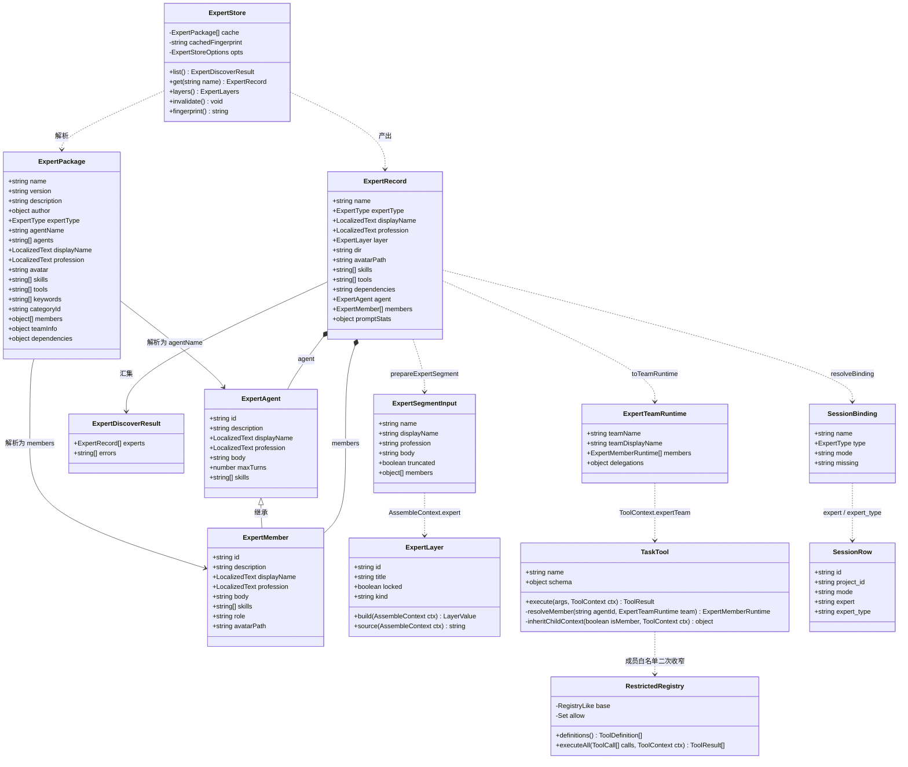
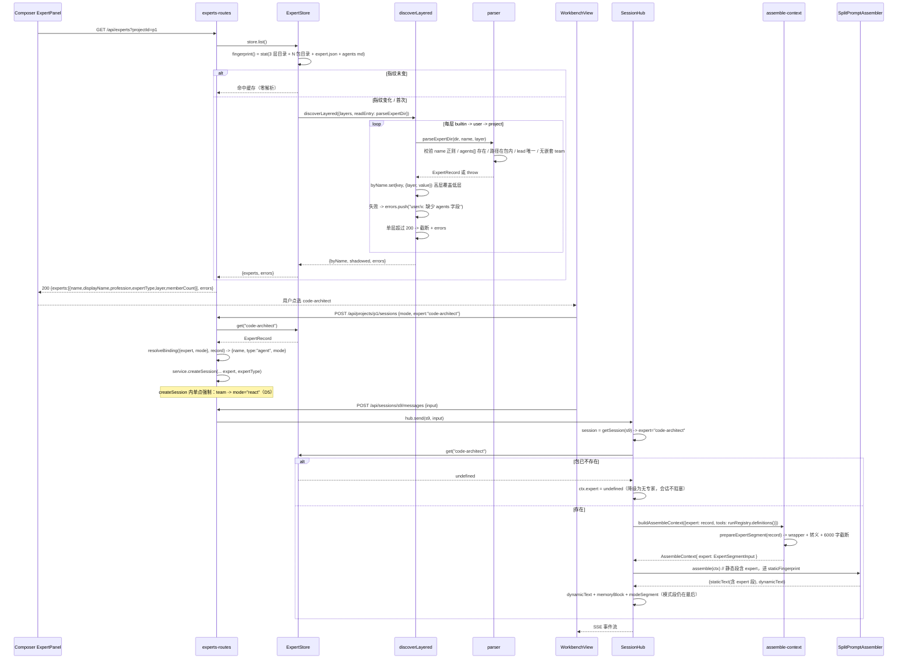
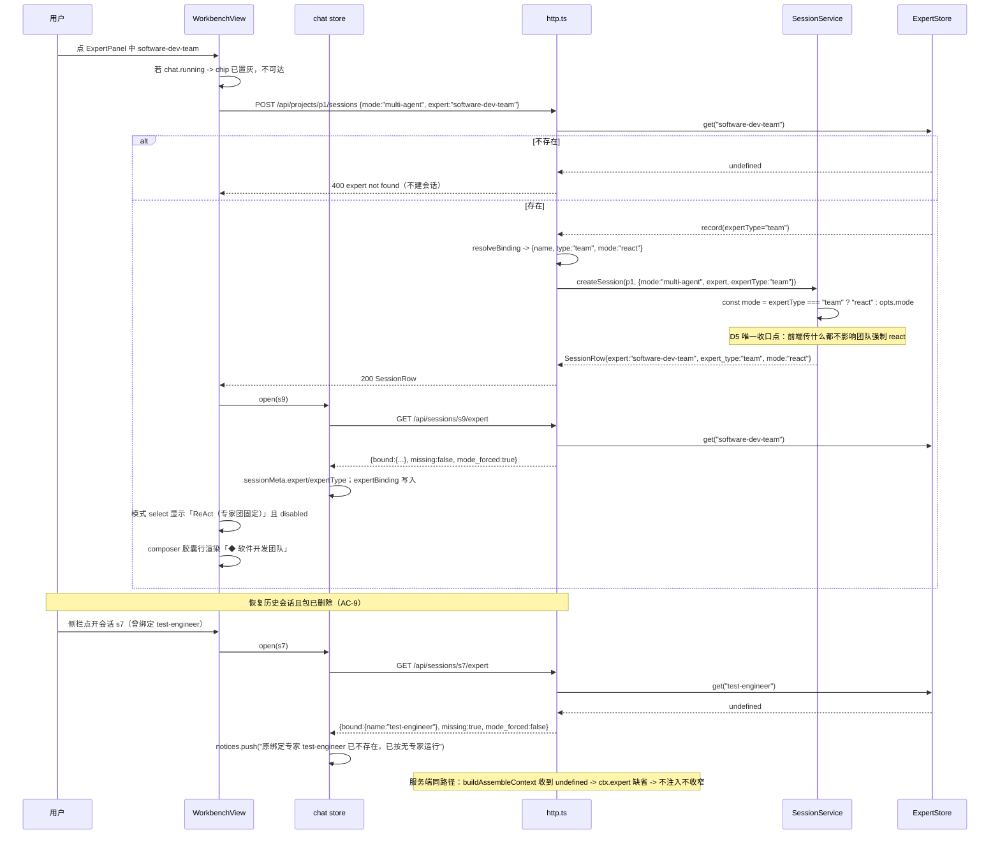
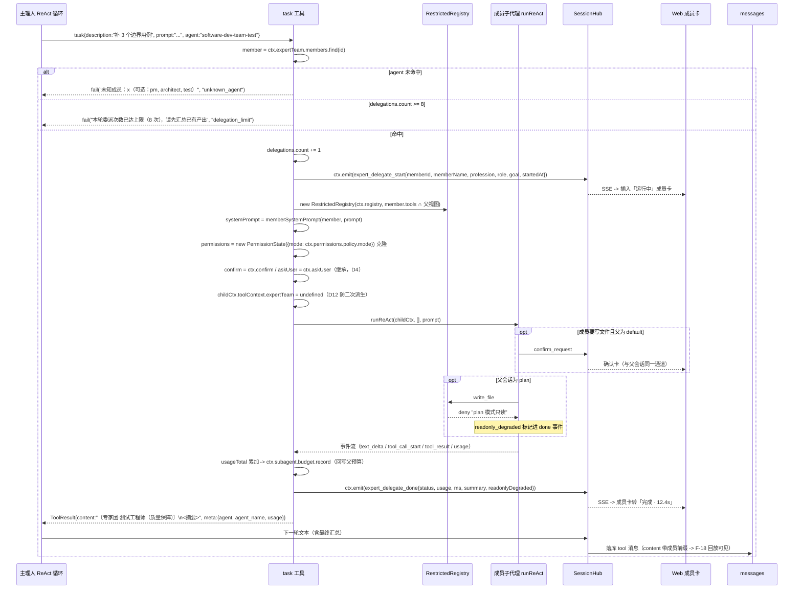
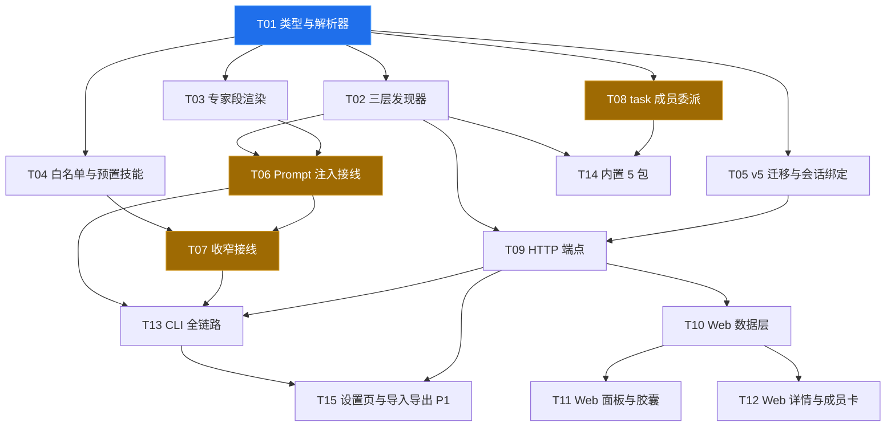

# F-39 专家 / 专家团 —— 技术设计与任务分解

> 日期：2026-10 ｜ 关联：`docs/prd-f39-experts.md`（14 章 / 25 条需求池 / 11 条待确认）｜ 风格沿用：`docs/design-f38-project-file-panel.md`（决策表 → 分层 → 数据结构 → 端到端 → 任务）
> 交付面：`packages/core`（发现/解析/注入/白名单/委派）+ `packages/cli`（`--expert` / `/expert` / `yzero expert`）+ `packages/web`（Composer 面板、详情弹层、成员卡、设置页 Tab）
> **本文只做设计与任务分解，不含业务代码。**

---

## 0. 一句话方案与 PRD 映射

**一句话**：在 core 新增 `src/experts/` 能力层（**纯函数解析** → **三层发现器** → **静态 Prompt 段** → **注册表收窄** → **`task` 成员委派**），专家绑定作为 `sessions` 的第 3 个「创建时字段」（继 `mode` / `worktree_*` 之后，v5 迁移），CLI 与 Web **复用同一个 `buildAssembleContext()`**，工具边界**复用既有 `RestrictedRegistry`** 不另造强制点，专家团 P0 **只扩 `task` 一个可选参数**、不接 multi-agent 引擎。

| PRD 编号 | 本设计落点 |
|---|---|
| F-39-1 包协议 `expert.json` | §4.1 `ExpertPackage`、§6.1 `parser.ts`（宽容解析 + `errors[]`）、T01 |
| F-39-2 三层覆盖发现 | §6.2 `ExpertStore` + `discoverLayered()`、T02 |
| F-39-3 Composer `🧑‍💼 专家` chip + 二级面板（**P0 不做「＋」一级菜单**，P2 F-39-3 备注） | §6.8 `ExpertPanel.vue`（入口解耦 props/emits 契约）、T11 |
| F-39-4 会话绑定与切换 | §6.5 v5 迁移 + `resolveBinding()`、§5.2、T05 |
| F-39-5 专家 Prompt 注入 | §1-D1 位置裁定、§6.3 `ExpertLayer`、T03/T06 |
| F-39-6 工具白名单（代码强制） | §1-D3 交集口径、§6.4 `restrictRegistry()`、T04/T07 |
| F-39-7 预置技能 | §6.4 `seedExpertSkills()`、T04（已知限制见 §16-1） |
| F-39-8 主理人调度 + `task` 委派 | §6.6 逐行改动、T08 |
| F-39-9 成员可视化 | §4.3 事件 payload、§6.7、T12（Web）/ T13（CLI） |
| F-39-10 专家详情页 | §1-D2 Modal 裁定、§6.8、T12 |
| F-39-11 CLI/TUI 入口 | §6.9、T13 |
| F-39-12 首批内置 5 个包 | §7 文件清单、T14 |
| P1 F-39-13/14/15 | §8 T15（设置页 + 导入导出 + 创建引导） |

---

## 1. 决策表（D1–D14）

| # | 决策 | 理由 | 备选与不取原因 |
|---|---|---|---|
| **D1** | 专家段的正确落点是**静态段内、`tools` 层之后**（新层 id `expert`，插在 L4 与 L5 之间）。**PRD §6.1 F-39-5② 的「静态段末尾、动态段与记忆段之后」是自相矛盾的措辞，本设计明确修正** | ① `formatPrompt()`（`assembler.ts:94-104`）**按 kind 分组**：static 全在前、dynamic 全在后，「跨 kind 的相对位置」由分组决定而非数组位置——一条 static 段无论放数组哪一位都排在所有 dynamic 段之前，「动态段之后」物理不可能；② 模式段是 `assembled` **之后**由运行时追加的（`hub.ts:522` `[dynamicText, memoryBlock, modeSegment(...)]`），因此「tools 之后 ⇒ 模式段之前」自动成立；③ 只有放进静态段才能进 `staticFingerprint()`（`split-assembler.ts:120-127` 只对 `kind==='static'` 求 hash），才满足 PRD 的「会话内 hash 恒定、不破坏前缀缓存」 | 放在动态段末尾：能实现「动态段之后、模式段之前」的字面要求，但**违反 PRD 自己的第③条**（不进缓存前缀，每轮 hash 变化，破坏 F-09 命中率）。不取 |
| **D2** | 专家详情页用 **`ModalShell.vue` 居中 Modal（520px）**，内容与容器分离为 `ExpertDetail.vue`（容器）+ `ExpertDetailBody.vue`（内容） | ① 项目已 5 处复用 `ModalShell`，无 Drawer 组件；手写 Drawer 需自造遮罩/Esc/焦点陷阱，且新增 `z-index` 竞争者；② Drawer 的价值是「边看边改」，详情页是**纯只读信息卡 + 1 个主按钮**，没有并置诉求；③ 内容高度约 520–640px，`ModalShell` 的 `max-height: calc(100vh-80px)` 已覆盖，成员 ≤6 人可在 body 内滚动；④ 右侧已被 F-38 `FilePanel`（320–720px 可拖拽）占据，再叠 Drawer 会出现「两层右侧栏」 | Drawer：P1「导入/创建专家」表单（长表单、需要边看列表边填）确实更适合 Drawer，届时**只换容器**（`ExpertDetailBody.vue` 零改动）。故本期取 Modal、结构上预留 |
| **D3** | 白名单「三处取交集」在实现上分**两层**：**名称级交集 = 专家白名单 ∩ `registry.definitions()`**（2 处）；**执行级否决 = `PermissionState`**（第 3 处，既有实现）。效果等价于三处交集，但**权限模式不参与 `definitions()` 过滤** | PRD 把「权限模式允许集」写成名称集合，但代码里 `PermissionState`（`tools/permissions.ts`）**只做执行期判定**（plan 拒 write/exec），从不裁剪工具清单。若强行在 `definitions()` 里按 plan 过滤，模型将**看不到** `write_file` 的 schema，既无法解释「为什么不能写」，也让「plan 模式下给出修改建议但不落盘」这条 PRD 主路径失效。故：名称级只做 2 处交集，plan 的否决留在执行层（`deny`），二者叠加即 PRD 要的「任何一处禁止即不可用」 | 三处都在名称级取交集：工具清单在 plan 模式下塌缩，`AC-1/AC-2` 的「模型收到拒绝错误并自愈说明」失去前提。不取 |
| **D4** | **Q6 裁决：采纳 PRD 默认——成员写操作继承父会话确认通道**，配三条硬边界 | 技术上「继承」是**删代码而非加代码**：`task.ts:91` 的 `toolContext: { ...ctx }` 已经天然继承 `confirm`/`askUser`/`permissions`，当前实现是**显式覆盖**它们（L95/L97/L98）。改回继承 = 把三行覆盖改为条件表达式，风险远低于自造成员级审批。三条边界：① **P0 串行委派**（一次一个成员），父子是 `await` 关系，同一时刻最多 1 个挂起确认 → 与前端单槽位 `pendingConfirm`（`chat.ts:27`）兼容；② 成员白名单**由包显式声明**，未声明写工具就根本调不到；③ 父为 `plan` → 成员自动只读降级（`permissions.policy.mode === 'plan'` 时 `PermissionState` 原生拒绝 write/exec），成员卡标注「只读降级」 | 「P0 成员强制只读」：会让「测试工程师补用例并跑测试」这条内置团队主路径失效，F-39-12 的团队包变成纯讨论组。不取。**但必须记录**：P1 并行委派（F-39-17）落地前，**必须先**把前端确认卡改为队列（`pendingConfirm` 单槽位 → 数组），否则多成员并发确认会互相覆盖丢卡（§15-R3） |
| **D5** | **Q7 收口点：团队专家 → `mode='react'` 的唯一实现在 `SessionService.createSession()`（`session/service.ts:136`），一行三元表达式** | 该方法是 CLI（`index.ts:582`）、HTTP（`http.ts:541`）**唯一**的会话创建入口。收在 service 层，两端 UI/路由都不需要知道这条规则，天然单点、不可能漂移（PRD §7.2 明确要求「不要散落到两端 UI」）。测试只需一个断言：传 `expertType:'team'` + `mode:'multi-agent'` → 落库 `react` | 在 `http.ts` 与 `cli/index.ts` 各写一次：两处必然漂移。在 `resolveBinding()` 里做：Web 前端也能绕过（前端 `newSession()` 直接传 mode） |
| **D6** | 专家段 wrapper 的**层标题固定为 `专家角色与职责`**（不含专家名），专家名只出现在正文首行 | `formatPrompt` 渲染成 `## <title>\n\n<value>`；若 title 含专家名，则 title 与 PRD 要求的正文首行 `# 专家：<displayName>` 重复成两个标题。固定 title 同时让 `--debug-prompt` 的段清单在跨会话对比时对齐 | title 用 `专家：<displayName>` 且正文去掉 `#` 行：违反 PRD F-39-5④ 的固定 wrapper 逐字要求。不取 |
| **D7** | **`ASSEMBLER_VERSION` 从 `'m3.1'` bump 到 `'m3.2'`** | 新增一个 static 层会改变**所有会话**的 fingerprint 计算基数（`staticFingerprint` 逐段 update，空段也会写入 `\nexpert:\n`）。不 bump 会让「同 version 不同层结构」的两个指纹空间混用；bump 后语义清晰、历史 `promptSectionsLog.staticHash` 可区分 | 不 bump：指纹撞车风险低但语义脏，且排查时无法区分版本。不取（成本 1 行） |
| **D8** | 委派事件**不落库**，改用 **`tool` 消息 content 前缀**承载回放所需信息：`〔专家团·测试工程师（质量保障）〕\n<摘要>` | 事实约束：`hub.ts:624` 落库时**只写 `content` 与 `toolCallId`，丢弃 `result.meta`**。而 F-18 回放读的是 `messages`（`store.getMessagesDetailed`），事件流不落库。因此要让回放「能定位到具体成员」，唯一零 schema 变更的办法是把成员标识写进 content。结构化 payload 只服务实时 SSE（Web 成员卡 / CLI 单行） | 扩展 `ChatMessage` 增加 `toolMeta` 字段：`content_json` 是整条消息 JSON，加字段即变相改持久格式，回放/检索/压缩全链路需回归；且 P0 只需「哪个成员产出什么」一行信息。不取 |
| **D9** | 成员子代理**不接收独立的「上游摘要」参数**，上游信息由主理人写进 `prompt` 参数本身 | PRD F-39-8② 列了「成员 md 正文 + 父目标 + 上游产出摘要」三段。但上游产出就在主理人的上下文里，让它拆成两个参数传（`prompt` + `upstream`）等于把同一段信息传两遍，schema 与 token 双膨胀。成员提示词模板保留 `## 本轮目标（含上游摘要）` 一个锚点 | 新增 `upstream` 必填参数：schema 膨胀且主理人易漏填。不取 |
| **D10** | **`discoverLayered<T>()` 抽到 `skills/layered.ts`，`discoverSkills` 与 `ExpertStore` 共用**；但 `discoverSkills` 的切换以「既有 skills 单测零改动全绿」为门禁，漂移即回退 | PRD §6.1 F-39-2 与 task-lead 均要求抽公共遍历而非复制。`discoverSkills`（`loader.ts:51-85`）的循环体确实几乎通用。风险在 F-16 回归，故设门禁：`test/skills-*.test.ts` 全部不改一字仍全绿才保留重构 | 直接复制一份到 `experts/store.ts`：三层遍历 + 覆盖 + errors 三处语义必然漂移（`loader.ts` 注释明确此风险）。不取 |
| **D11** | **QA6=Q6 已裁**；此处记录**委派上限的两个不同归属**：成员数 ≤6 属**包协议校验**（解析期拒绝，计入 `errors`）；单轮委派 ≤8 属**运行时计数**（`ToolContext.expertTeam.delegations.count`） | 成员超限若静默截断，主理人会按「不完整的团队」工作且不自知（SOP 里写了会调 PM + 架构师 + 测试，实际只有 2 个），属于**错误的降级**；单轮委派上限是防 token 放大，截断/拒绝都合理，取拒绝并给出「请先汇总」引导 | 两者都运行时计数：成员超限的团队包会一直「看起来能用」但每轮都被拒。不取 |
| **D12** | **`ctx.expertTeam` 显式不传给成员子代理**（`childCtx.toolContext.expertTeam = undefined`） | `MAX_SUBAGENT_DEPTH=1` 的 depth 检查已能拦住二次派生，但成员的工具白名单来自包作者，若误写 `task`，错误会在**运行时**才暴露且以「委派失败」形式出现（难归因）。显式剔除 = 编译期/配置期的第二道防线 | 只靠 depth：错因隐晦。不取 |
| **D13** | 头像**不内联进列表与详情响应**，单独 `GET /api/experts/:name/avatar` 返回 `{ data_url: string \| null }`，前端按 name 缓存 | 5 个内置 + N 个用户包 × 512×512 PNG（≤500KB）= 列表响应可达数 MB，而列表行只需 24px 方块。按需拉取 + store 缓存（`Map<name, string\|null>`）= 首屏零成本、详情页一次请求 | 全内联（仿 F-38 D10）：F-38 是**单文件预览**（一次一个），列表是 N 个，不可类比 |
| **D14** | 会话元数据读取 `expert`/`expert_type` 走 **`GET /api/sessions/:id/expert`** 专用端点，而非让前端 join `GET /api/experts` | 该端点同时是**降级判定的权威来源**：`{ bound, missing, mode_forced }`。「包已删除」这件事只有服务端能可靠判断（前端列表可能是缓存的旧数据，会把已删专家显示为正常）。前端 join 会把「判定逻辑」放到 UI，与 D5 的单点原则矛盾 | 前端 join：缓存过期即误判。把 `missing` 塞进 session 响应：会话响应已被 4 处 SELECT 复用（D-§9），耦合过深 |

---

## 2. 对 PRD 的修正与澄清

### 2.1 【修正 1】专家段位置（PRD F-39-5②）

- **PRD 原文**：「位置 = 静态段**末尾**、动态段与记忆段**之后**、**模式段之前**」。
- **矛盾**：`formatPrompt()` 按 `kind` 分组输出（static 块整体在前、dynamic 块整体在后），一条 static 段**永远**排在所有 dynamic 段之前。因此「在动态段与记忆段之后」与「属静态段（③）」二者不可能同时成立。
- **裁定**：落点 = **静态段内、`tools` 层之后**，即新的 `expert` 层插在 `ToolsLayer` 与 `SkillsLayer` 之间。
  - 「在记忆段/动态段之后」→ **删除**（物理不可实现，且与 ③ 冲突）。
  - 「模式段之前」→ **自动成立**：模式段由运行时在 `assemble()` 之后追加（`hub.ts:522`），永远排在静态段之后。
  - 「静态段末尾」→ **成立**：expert 是静态段最后一个 section（静态段顺序变为 identity → environment → project → tools → **expert**）。
- **连带**：`ASSEMBLER_VERSION` bump 到 `m3.2`（D7）。

### 2.2 【修正 2】白名单「三处取交集」的实现口径（PRD F-39-6）

- **PRD 原文**：「最终可用工具 = 专家白名单 ∩ 会话可用工具（内置 16 + MCP）∩ **权限模式允许集**；三处取交集」。
- **澄清**：`PermissionState` 只做执行期 `allow/confirm/deny`，**从不参与工具清单裁剪**；若把它做成第三处名称级交集，`plan` 模式下 `write_file` 会从模型可见的工具表里消失，`AC-1`（只读专家被拒后能自愈说明）与「plan 模式给修改建议但不落盘」都失去前提。
- **实现口径**：名称级交集**两处**（专家白名单 ∩ 注册表实际工具），权限模式作为**执行级第三道否决**。对外效果仍是「任何一处禁止即不可用」，且 `yolo` 也放不开角色边界（`AC-2` 成立：`RestrictedRegistry.executeAll` 在白名单外直接返回 `tool_not_allowed`，不经 `PermissionState`）。
- 内置工具实测为 **16 个**：`read_file / list_dir / glob_search / grep_search / write_file / edit_file / run_command / run_tests / web_fetch / todo_write / ask_user / task / load_skill / unload_skill / save_memory / recall_memory` → 详情页「限制 N/16」的 16 即此数，**须由常量 `BUILTIN_TOOL_COUNT = 16` 提供**，且加单测断言其等于 `TOOL_CAPABILITY` 的键数，防止将来加工具时 UI 说错话。

### 2.3 【澄清 3】「同一会话内专家段 hash 恒定」的成立条件

`staticFingerprint()` 覆盖静态段**全部** section 的 `renderValue`，而 `SessionLayer`（动态）、`SkillsLayer`（动态）、`MemoryLayer`（动态）不参与。专家段内容只依赖 `ExpertStore` 解析出的 md 正文 + wrapper，与会话时间/CWD/记忆无关 → 会话内恒定成立。

**但必须记录两个边界**：
1. **无专家会话的 hash 会变一次**：expert 层返回 `''` 时文本层面被 `formatPrompt` 的空段过滤跳过（**Prompt 文本逐字节不变**），但 `staticFingerprint` 会把 `\nexpert:\n` 计入 → 指纹值与升级前不同。因为指纹只存在进程内 LRU（`SplitPromptAssembler.cache`），影响是「升级后本进程首轮多一次 miss」，**零用户可见变化**。
2. **Web 侧静态缓存目前从不命中**：`hub.buildPrompt()` 每轮 `new SplitPromptAssembler()`（`hub.ts:730`），LRU 随调用销毁。这是既有缺陷，与本功能无关，但它使 PRD §10「绑定专家不应增加缓存未命中轮次」在 Web 侧无法验证。**处置**：T06 顺手把 `SplitPromptAssembler` 提升为 `SessionHub` 的构造期字段（P1 级、5 行改动、风险低），并在任务验收里写明「若评审认为超范围，可单独回退该 5 行，不影响专家功能」。

### 2.4 【澄清 4】内置专家目录与 Skills 目录同构

`defaultBuiltinSkillsDir()` = `path.resolve(dirname(import.meta.url), '../../skills')`（`loader.ts:43-45`，src 与 dist 下均向上两级）。专家目录取**完全同构**的 `packages/core/experts/` + `defaultBuiltinExpertsDir()` = `'../../experts'`。**不需要**改 `package.json` 的 `files`（Skills 已被打包机制涵盖，专家同层同构）。

### 2.5 【澄清 5】专家团的 md 正文体积约束（PRD §10「成员 md 不进主会话」）

PRD 只说「成员 md 正文绝不进主会话 Prompt」，未说明**主要风险是解析期就把它读进来**。设计明确：
- `ExpertRecord.agent.body` = **主 agent（团队=主理人）正文**，是唯一进主会话的正文；
- `ExpertMember.body` 也解析并保留（委派需要），但**组装 `ExpertSegmentInput` 时只取 `members` 的 `id/name/profession/role`**（4 个字段，无 body）。`ExpertSegmentInput` 类型层面就不含成员 body → 结构性保证，不靠自觉。
- 主会话的专家段对团队专家的额外内容 = 成员清单（≤6 行 × ~20 字 ≈ 120 tokens）。**须有单测**：团队专家段的总 token 不超过「主理人正文 3k + 成员清单 200」预算。

### 2.6 【修正 6】召唤提示走既有 `chat.notice()`（对话区 event-card 常驻），不新建 composer 提示条（PRD §8.2/§8.3）

- **PRD 原文**：`§8.3`「在同一排版位置**新增独立的 `notice` ref**（与 `error` 并列，不要复用 `error`）…11.5px；成功态 `--accent`、失败态 `--red`；**3.5 秒 定时清除**」。
- **代码事实（已逐行核验）**：
  1. 项目**已有** notice 机制：`stores/chat.ts:30` 的 `notices` + `:105` 的 **`notice(text)`**（**不是** `push*` 类的臆测名）+ `WorkbenchView.vue:1230-1233` 渲染成 **对话区 `event-card`**（`ℹ` + 文本，**常驻不消失**，超 20 条 `shift()`）；
  2. 该 `notices` 在 `close()` 里被清空（`chat.ts:91`），而 `open()` 首行就调 `close()`（`:47`）；
  3. `error` 渲染在**侧栏会话列表区**（`WorkbenchView.vue:984`），**不在 composer** —— PRD 说的「与 `error` 并列同一排版位置」在现状下不存在一处 composer 内提示区。
- **裁定**：召唤提示**复用既有 `chat.notice()`**，因此落在**对话区 `event-card`、常驻不消失**；放弃 PRD 的「composer 内 + 11.5px + 3.5 秒 自动消失」三点。**已同步 PM 修订 PRD §8.2/§8.3 指向本节。**
- **理由（一致性优先于局部体验）**：① 项目内**所有** session 级状态变更提示（`已切换会话权限`、`⎇ 已切换到 <branch>`、`上下文已压缩`、`本任务 token`）都走这条通路，专家召唤是同类动作，另开 composer 私有通道会让「设置类提示」分裂成两处；② 零新增基建、零定时器、零卸载清理；③ 不为单一来源给共享数组加优先级例外（`notices` 已被 4 处复用，加例外等于引入隐式契约）。
- **职责分工（一句话，写进 §6.8.3）**：**提示不承担持久化职责**——`notices` 不入库、刷新即失是**可接受**的；专家绑定的持久可见性由**胶囊**承担（数据源 `chat.sessionMeta.expert`，来自后端会话字段），提示只负责「解释这次动作发生了什么」。
- **仍然禁止**：把提示写进 `error`（`openSession()` 首行 `error.value = ''` 会立刻清掉，且渲染在侧栏）；另造全局 toast 体系；为专家提示单独加「不被 20 条挤掉」的例外；写失败计数仪表（P0 的失败可见性已足够：`newSession()` 失败走既有 `error` + 返回 `null` 时调用方直接 `return`，不推提示）。

### 2.7 其余 PRD 未闭合点（已裁决，无 TBD）

| # | 未闭合点 | 裁定 |
|---|---|---|
| a | `agents[]` 与 `members[]` 的关系未说明谁为准 | **`agents[]` 是文件清单（安全边界），`members[]` 是成员视图（UI/委派）**。校验：每个 `members[].id` 必须能在 `agents[]` 里找到同名 md；`teamInfo.memberAgents` 与 `members[].id` 一一对应（双向）；`expertType==='agent'` 时出现 `members` 字段 → 忽略（宽容） |
| b | `avatar` 的 512×512 / 500KB 约束谁校验 | P0 **只校验体积 ≤500KB 与扩展名**（png/jpg/webp），不做像素尺寸探测（避免引入 image-size 依赖）；超限 → `avatarPath = null`（UI 首字色块）+ `errors` 警示，**不废整包** |
| c | 专家 `skills[]` 与成员 `skills[]` 的「并集」在何处生效 | 包级 `skills[]` 进主会话（主 agent）；成员 `skills[]` 只在**该成员委派时**通过成员的 md 正文引用（P0 不跨会话装载到共享 `SkillBuffer`，因为 buffer 是进程级共享的，见 §16-1）。即：**P0 只实现包级 skills 自动装载** |
| d | `expert_type` 是否允许第三值 | 只允许 `'agent' \| 'team' \| NULL`。SQL 不加 CHECK（`ALTER ADD COLUMN + CHECK` 对历史行有风险），**在 `SessionStore.createSession` 入参处校验**，非法值抛 `invalid expert_type` |
| e | 运行中（`chat.running`）点了专家怎么办 | 前端置灰（PRD）；**服务端也要有一道**：`POST /api/projects/:id/sessions` 是新建会话端点、与会话运行态无关，故无需门禁；但 `PATCH /api/sessions/:id/expert`（P1 就地改绑）**必须** `if (hub.isRunning) return 409` |
| **a'** | **「空会话是否就地改绑」PRD 内部三处互相矛盾** | **以需求池 F-39-4 为准收口。** PRD 现状：① F-39-4（需求池 P0）写「**P0 恒定新建，即使当前会话为空**——空会话留在侧栏，由 P1 F-39-16① 优化为就地改绑」；② §8.3「切换结果明细」最后两行写空会话 = 就地解绑；③ §8.3 另一处 / T13 ④ 写 CLI「空会话 `/expert` 就地绑定」。**裁定**：<br/>• **Web P0 一律新建会话**（含空会话、含点胶囊 `✕` 解绑）—— 走就地改绑需额外 `PATCH /api/sessions/:id/expert` 端点 + 会话 UPDATE 逻辑 + 测试，收益只是少一个空会话；更关键的是 `sessions.expert` 一旦支持中途 UPDATE，就引出「已发消息会话能否改绑」的边界，把 P1 的 F-39-16 整块提前拖进 P0。§8.3 最后两行**标注**：`（P0 不实现：以 F-39-4 为准一律新建，本条与 F-39-16① 一并推迟到 P1）`。<br/>• **CLI 保留 T13 ④ 的空会话就地绑定**——TUI 里 `/expert` 是「在当前上下文里改配置」的心智，且 CLI 无侧栏空会话可见性问题（新建一个空会话是纯噪声）；Web 的召唤是「开新对话」的心智。**这是端间刻意差异，已在 §6.9 显式登记，不是隐性漂移。** |

---

## 3. 总体架构

```mermaid
flowchart TD
    subgraph DISK["磁盘：三层专家库"]
        B["packages/core/experts<br/>builtin 只读"]
        U["~/.y-zero/experts<br/>user"]
        P["project/.y-zero/experts<br/>project"]
    end

    subgraph CORE_EXP["core/src/experts（新增）"]
        PARSE["parser.ts<br/>纯函数：json + md 解析校验"]
        STORE["store.ts<br/>ExpertStore 三层发现 + mtime 指纹缓存"]
        EPMT["prompt.ts<br/>prepareExpertSegment<br/>wrapper/截断6000/标记转义"]
        POLICY["policy.ts<br/>restrictRegistry + seedExpertSkills"]
        BIND["session-binding.ts<br/>resolveBinding 纯函数"]
        TEAM["team.ts<br/>成员提示词 + 委派校验"]
        IO["io.ts P1<br/>zip 导入导出"]
    end

    subgraph CORE_LINK["core 既有（改造点）"]
        PT["prompt/types.ts<br/>LayerId + AssembleContext.expert"]
        PL["prompt/layers.ts<br/>ExpertLayer"]
        PA["prompt/{assembler,split-assembler}<br/>m3.2 + staticFingerprint"]
        MIG["session/migrations.ts<br/>v5"]
        SESS["session/store.ts + service.ts<br/>expert 列 + team 强制 react"]
        TASK["tools/builtin/task.ts<br/>新增 agent 参数"]
        ROLES["engine/roles.ts<br/>RestrictedRegistry 复用不改"]
        HTTP["server/experts-routes.ts<br/>+ http.ts 5 端点"]
        SP["skills/layered.ts<br/>discoverLayered 公共遍历"]
    end

    subgraph CLI["packages/cli"]
        C1["--expert / yzero expert<br/>index.ts + expert.ts"]
        C2["/expert 选择卡<br/>ui/expert-card.tsx"]
        C3["底栏第 4 段<br/>ui/worktree-bar.tsx"]
        C4["单一构建函数调用方<br/>prompt.ts"]
    end

    subgraph WEB["packages/web"]
        W1["ExpertPanel.vue<br/>入口解耦二级面板"]
        W2["ExpertDetail.vue + Body"]
        W3["ExpertMemberCard.vue<br/>+ ToolCallCard 标注"]
        W4["stores/experts.ts<br/>+ api/client.ts"]
        W5["settings/ExpertsPanel.vue P1"]
    end

    B --> STORE
    U --> STORE
    P --> STORE
    STORE --> PARSE
    STORE --> BIND
    STORE --> EPMT
    STORE --> POLICY
    STORE --> TEAM
    EPMT --> PT
    PT --> PL
    PL --> PA
    BIND --> SESS
    MIG --> SESS
    POLICY --> ROLES
    TEAM --> TASK
    STORE --> HTTP
    STORE --> SP
    PA --> C4
    PA --> HTTP
    C4 --> C1
    HTTP --> W4
    W4 --> W1
    W4 --> W2
    W4 --> W3
    C1 --> C2
    C1 --> C3
    IO --> W5

    style CORE_EXP fill:#1a2634,stroke:#58a6ff
    style DISK fill:#1c1c1c,stroke:#8b949e
```



**边界纪律**：
- `experts/*` **不 import** `session/`、`server/`、`engine/`；只 import `@y-zero/shared`、`prompt/types.js`（类型）、`skills/loader.js`（`parseFrontmatter`）。发现器与渲染器因此可纯单测。
- `tools/builtin/task.ts` **不 import** `experts/*`；成员运行时通过 `ToolContext.expertTeam`（结构类型，定义在 `tools/types.ts`）注入 → 无循环依赖、`task` 工具在非专家会话下零感知。
- `cli/prompt.ts` 与 `core/server/hub.ts` **都调用** `core/experts/assemble-context.ts` 的 `buildAssembleContext()` → 双端唯一 Prompt 上下文来源。

---

## 4. 数据结构与接口

### 4.1 包协议与解析结果（`experts/types.ts`）

```ts
// packages/core/src/experts/types.ts
export type ExpertLayer = 'builtin' | 'user' | 'project';
export type ExpertType = 'agent' | 'team';

export interface LocalizedText { en: string; zh: string }

/** expert.json 的作者字段（宽容解析后的形状；未知字段丢弃） */
export interface ExpertPackage {
  name: string;
  version: string;
  description: string;
  author: { name: string; email?: string };
  expertType: ExpertType;
  /** 单人专家：唯一 agent id；团队：主理人 id */
  agentName: string;
  /** md 相对路径清单，如 ["agents/code-architect.md"] */
  agents: string[];
  displayName: LocalizedText;
  profession: LocalizedText;
  avatar?: string;
  skills?: string[];
  /** 工具白名单（只减不增）；缺省 = 不收窄 */
  tools?: string[];
  keywords?: string[];
  categoryId?: string;
  members?: Array<{
    id: string;
    name: LocalizedText;
    profession: LocalizedText;
    avatar?: string;
    role: 'lead' | 'member';
  }>;
  teamInfo?: { leadAgent: string; memberAgents: string[] };
  dependencies?: { mcpServers?: string[] };
}

/** agent md 解析结果（frontmatter + 正文） */
export interface ExpertAgent {
  id: string;               // = md 文件名（不含扩展名），必须等于 frontmatter.name
  description: string;
  displayName: LocalizedText;
  profession: LocalizedText;
  /** 正文（已剥离 frontmatter，未截断未转义；截断发生在 prepareExpertSegment） */
  body: string;
  maxTurns?: number;
  skills: string[];
}

/** 成员运行时视图（含正文，供委派用；正文绝不进主会话） */
export interface ExpertMember extends ExpertAgent {
  role: 'lead' | 'member';
  avatarPath: string | null;
}

/** 发现结果（运行时记录） */
export interface ExpertRecord {
  name: string;
  version: string;
  description: string;
  author: { name: string; email?: string };
  expertType: ExpertType;
  displayName: LocalizedText;
  profession: LocalizedText;
  /** 三层覆盖后的胜出层（对齐 SkillMeta.layer） */
  layer: ExpertLayer;
  /** 包目录绝对路径（仅「打开目录」与日志用，UI 不展示给用户） */
  dir: string;
  /** 头像绝对路径；缺失/超限/超体积 → null */
  avatarPath: string | null;
  skills: string[];
  /** null = 不收窄 */
  tools: string[] | null;
  keywords: string[];
  categoryId: string | null;
  dependencies: { mcpServers: string[] };
  /** 主 agent：单人专家 = 唯一 agent；团队 = 主理人 */
  agent: ExpertAgent;
  /** 团队成员（expertType==='agent' 时恒为空数组；不含 lead） */
  members: ExpertMember[];
  /** 正文规模（详情页「提示词 N 行 / 已截断」与 debug 用；解析期算一次） */
  promptStats: { chars: number; tokens: number; truncated: boolean };
}

export interface ExpertDiscoverResult {
  experts: ExpertRecord[];
  /** "user/my-expert: 缺少 agents 字段" 形态，对齐 discoverSkills.errors */
  errors: string[];
}

/**
 * 列表 DTO（`GET /api/experts` 的单项；**不含** body/avatar 内容，见 D13）。
 * Web 侧 `ExpertPanel` 的 `@select` 传的就是它 —— 需要 `expertType` 才能决定文案与 mode。
 */
export interface ExpertListItem {
  name: string;
  displayName: LocalizedText;
  profession: LocalizedText;
  expertType: ExpertType;
  layer: ExpertLayer;
  description: string;
  keywords: string[];
  categoryId: string | null;
  /** 团队成员数（expertType==='agent' 时为 0） */
  memberCount: number;
  /** 声明了但当前未启用的 MCP 依赖（面板「⚠ 缺 MCP 依赖」数据源；仍可召唤） */
  missingMcp: string[];
  /** 是否已有头像（前端据此决定是否拉 `/avatar`；不内联内容） */
  hasAvatar: boolean;
}
```

### 4.2 发现器接口（`experts/store.ts`）

```ts
export interface ExpertStoreOptions {
  /** 项目根（扫描 <root>/.y-zero/experts）；缺省跳过项目层 */
  projectRoot?: string;
  /** 用户主目录（扫描 <home>/.y-zero/experts）；缺省跳过用户层 */
  homeDir?: string;
  /** 内置目录；缺省 defaultBuiltinExpertsDir() */
  builtinDir?: string;
  /** 单层包数上限，默认 200（超出截断并推 errors） */
  maxPerLayer?: number;
  /** 停用清单（P1 读 ~/.y-zero/experts.json 的 disabled[]）；P0 恒为空 */
  disabled?: readonly string[];
}

export interface ExpertLayers {
  byLayer: Record<ExpertLayer, ExpertRecord[]>;
  errors: string[];
}

export class ExpertStore {
  constructor(opts?: ExpertStoreOptions);

  /** 三层发现 + 同名覆盖（命中 mtime 指纹缓存时零解析） */
  list(): Promise<ExpertDiscoverResult>;
  /** 单查（走缓存；未命中返回 undefined，不抛错） */
  get(name: string): Promise<ExpertRecord | undefined>;
  /** 按层原始视图（设置页分组 / expert list --verbose 显示被覆盖项） */
  layers(): Promise<ExpertLayers>;
  /** 强制失效（导入/导出/删除/创建后调用） */
  invalidate(): void;
  /** 当前指纹（调试与测试用） */
  fingerprint(): Promise<string>;
}

/** 内置专家默认目录：packages/core/experts/（与 defaultBuiltinSkillsDir 同构） */
export function defaultBuiltinExpertsDir(): string;
```

公共遍历工具（新增 `skills/layered.ts`，`discoverSkills` 与 `ExpertStore` 共用）：

```ts
export type LayerName = 'builtin' | 'user' | 'project';

export interface LayeredDir { layer: LayerName; dir?: string }

export interface LayeredOutcome<T> {
  /** 覆盖合并后的条目（Map 迭代顺序 = 首次出现顺序，即 builtin → user → project） */
  byName: Map<string, { layer: LayerName; name: string; value: T }>;
  /** 每层被覆盖的低层项（设置页「已被用户级覆盖」用；list() 不返回） */
  shadowed: Array<{ layer: LayerName; name: string; value: T }>;
  errors: string[];
}

export async function discoverLayered<T>(opts: {
  layers: LayeredDir[];
  maxPerLayer?: number;
  /** 目录名 → 解析结果；抛错 = 该条目失败（计入 errors，不影响其他） */
  readEntry: (dir: string, entryName: string, layer: LayerName) => Promise<T>;
  /** 条目名（默认 = 目录名），决定覆盖键 */
  keyOf?: (entryName: string, value: T) => string;
}): Promise<LayeredOutcome<T>>;
```

### 4.3 事件与运行时（`@y-zero/shared` + `tools/types.ts`）

```ts
// packages/shared/src/types.ts —— AgentEvent 追加两个成员（不改既有成员）
| {
    type: 'expert_delegate_start';
    memberId: string;
    memberName: string;       // zh 展示名
    profession: string;       // zh 职业
    role: 'lead' | 'member';
    /** 目标摘要（≤120 字，来自 task 的 description，缺省取 prompt 前 120 字） */
    goal: string;
    startedAt: number;        // epoch ms
  }
| {
    type: 'expert_delegate_done';
    memberId: string;
    memberName: string;
    status: 'ok' | 'failed' | 'canceled';
    usage: Usage;             // 成员独立预算累计（已回写父预算）
    ms: number;
    /** 产出摘要（≤400 字，成员最终汇报的截断） */
    summary: string;
    /** 父会话为 plan 模式时的只读降级标记（成员卡角标） */
    readonlyDegraded?: boolean;
  }

// packages/shared/src/types.ts —— ChatMessage 追加一个 UI 本地字段（与 ts/ok/durationMs 同族）
agentName?: string;
```

```ts
// packages/core/src/tools/types.ts —— ToolContext 追加两个可选字段
/** 专家团成员运行时（由会话装配层注入；非专家团会话缺省 → task 的 agent 参数报 unknown_agent） */
export interface ExpertMemberRuntime {
  id: string;
  name: { en: string; zh: string };
  profession: { en: string; zh: string };
  role: 'lead' | 'member';
  /** 成员 md 正文（已剥离 frontmatter；截断在 team.ts 内做） */
  body: string;
  /** 成员工具白名单；空数组 = 沿用父视图 */
  tools: string[];
  maxTurns?: number;
  skills: string[];
}
export interface ExpertTeamRuntime {
  teamName: string;                  // expert.name
  teamDisplayName: string;           // expert.displayName.zh
  /** 成员（不含 lead） */
  members: ExpertMemberRuntime[];
  /** 单轮委派计数器（task 工具内自增；run 级共享同一对象） */
  delegations: { count: number };
}

export interface ToolContext {
  // …既有字段…
  /** F-39：专家团运行时（仅 team 专家会话注入） */
  expertTeam?: ExpertTeamRuntime;
  /** F-39：事件发射器（task 工具发 expert_delegate_* 用；缺省 = 不发事件） */
  emit?: (ev: import('@y-zero/shared').AgentEvent) => void;
}
```

### 4.4 Prompt 侧类型扩展（`prompt/types.ts`）

```ts
/** 层 id 追加 'expert'（插在 tools 与 skills 之间） */
export type LayerId =
  | 'identity' | 'environment' | 'project' | 'tools'
  | 'expert'                                    // ← 新增（静态段，L4 之后）
  | 'skills' | 'memory' | 'session';

/** 专家段输入：已由 experts/prompt.ts 完成 剥离/转义/截断/包装前处理 */
export interface ExpertSegmentInput {
  name: string;
  displayName: string;      // zh
  profession: string;       // zh
  /** 已剥离 frontmatter、已转义保留标记、已按 6000 字截断的正文 */
  body: string;
  truncated: boolean;
  /** 团队专家的成员清单（只有 4 个字段，结构性保证成员正文不进主会话） */
  members?: Array<{ id: string; name: string; profession: string; role: 'lead' | 'member' }>;
}

export interface AssembleContext {
  // …既有字段…
  /** F-39：专家段（缺省 = 无专家会话，ExpertLayer 返回空串） */
  expert?: ExpertSegmentInput;
}

/** PromptSection 追加可选来源标注（--debug-prompt 用） */
export interface PromptSection {
  // …既有字段…
  /** 来源标注，如 "expert:code-architect" */
  source?: string;
}

/** PromptLayer 追加可选来源方法（其余 7 层不实现，零影响） */
export interface PromptLayer {
  // …既有字段…
  source?(ctx: AssembleContext): string | undefined;
}
```

### 4.5 类图



---

## 5. 核心流程

### 5.1 专家发现 + 首轮注入



### 5.2 会话绑定 / 切换（含团队强制 react 与降级）



### 5.3 专家团委派与成员卡事件流



---

## 6. 关键模块设计

### 6.1 `experts/parser.ts` — 包解析（纯函数、零 IO）

**职责**：把「一个包目录的原始内容」变成 `ExpertRecord`，或不带异常地失败。**不做文件读取**（由 `store.ts` 读好后传入），因此 100% 可单测。

```ts
// 签名（全部同步纯函数）
export interface ParseInput {
  dir: string;                          // 包目录绝对路径
  layer: ExpertLayer;
  name: string;                         // 目录名（覆盖键）
  expertJson: string;                   // expert.json 原文
  /** agents 目录下的文件名 → 原文（仅包含 expert.json 声明过的 md） */
  agentFiles: Map<string, { raw: string; absPath: string }>;
  /** 头像绝对路径（已由 store 做体积/扩展名校验）；null = 无 */
  avatarPath: string | null;
}

export function parseExpertPackage(input: ParseInput): ExpertRecord;   // 失败 throw Error（消息即 errors 文案）
export function validateExpertName(name: string): string | null;        // 合法返回 null，非法返回原因
export function escapeReservedMarkers(text: string): string;           // <static>/<dynamic>/# L1 → 纯文本
```

**校验链（顺序固定，任一失败即整包失败）**：
1. `name` 匹配 `^[a-z][a-z0-9-]{1,39}$`；
2. `expertType ∈ {'agent','team'}`；
3. `agents[]` 存在且非空；每个相对路径 `resolveInPackage()` 后仍在包内（`path.resolve` + `startsWith(dir + sep)`，**不跟随符号链接**：`lstat().isSymbolicLink()` 拒绝；拒绝绝对路径与 `..`）；
4. `agentName` 能在 `agents[]` 中找到对应 md（按文件名去扩展名比对）；
5. `displayName`/`profession` 必须是 `{en,zh}` 双字段；
6. `team` 类型：`members[]` 非空且 ≤ **6**（D11）；`role==='lead'` **恰好 1 个**；`teamInfo.leadAgent === expertType==='team' ? 主理人 id`；`teamInfo.memberAgents[]` 与 `members[].id` **双向一一对应**；
7. **禁止嵌套团队**：包内 `agents/*.md` 的 frontmatter 不允许出现 `expertType` 字段（出现即拒），且 `expert.json` 的 `members[]` 不递归解析子包；
8. 团队主理人 md 文件名必须带团队前缀 `<name>-`（PRD §6.4.3；不满足 → 错误）；
9. 单个 md 解析失败（frontmatter 缺 `name` 或不等于文件名）→ **只失败该 agent**；若该 agent 是 `agentName`（主 agent）→ 整包失败；若是普通成员 → 该成员从 `members[]` 剔除 + `errors` 警示（PRD F-39-1「单个 md 解析失败只降级该专家/成员」）。

**边界与异常**：`expert.json` >64KB 或 md >200KB → 整包失败（PRD §10 规模上限）；JSON 语法错误 → 失败并给出「第 N 行」；未知字段全部忽略（宽容）。

### 6.2 `experts/store.ts` + `skills/layered.ts` — 三层发现

**职责**：目录遍历、mtime 指纹缓存、同名覆盖、`errors[]` 收集、头像校验、单层 200 截断。

```ts
// 缓存 key 组成（fingerprint()）
// sha1(
//   layer dirs:  "<layer>:<dir>:<mtimeMs>"     × 3
//   pkg dirs:    "<dir>:<mtimeMs>"             × N   (N ≤ 3×200)
//   expert.json: "<path>:<mtimeMs>"            × N
//   agents dir:  "<path>:<mtimeMs>"            × N
//   agent md:    "<path>:<mtimeMs>"            × N×k (k ≤ 6)
// )
```

- **为什么把 agent md 的 mtime 也算进去**：详情页展示「提示词摘要」、注入用的是 md 正文；若只算目录 mtime，「改 md 正文不改文件名」不会失效，用户改完包重启前看到的还是旧人格 —— 这是最容易被当成 bug 报的行为。代价：最坏 ~1.4k 次 `stat`，NVMe 上 ~8–15ms，仍满足 ≤80ms（PRD §10，且这是**最坏**情形：3 层各 200 包、每包 6 个 md）。
- **冷/热路径**：`list()` 先算 fingerprint → 与缓存相同则直接返回 `{experts, errors}` 浅拷贝；不同则全量重扫。
- **单层 200 上限**：`readdir` 后按名称排序 → 取前 200 → 若 `entries.length > 200` 推 `errors.push(\`${layer}: 专家包数量超过上限 200，已截断（实际 ${n}）\`)`。
- **同名覆盖**：依赖 `discoverLayered` 的遍历顺序（builtin → user → project）+ `byName.set` 后写覆盖。`shadowed` 保留低层项（`yzero expert list --verbose` 与设置页「已被 X 覆盖」显示用，不参与注入）。
- **头像校验**：`fs.stat(avatarPath)` → 体积 ≤500KB 且扩展名 ∈ `{.png,.jpg,.jpeg,.webp}`，否则 `avatarPath = null` + `errors`。**不做像素探测**（§2.6-b）。
- **`disabled[]`**（P1）：`list()` 末尾过滤；P0 传空数组，行为等价。

**`skills/loader.ts` 改造（受门禁约束，D10）**：`discoverSkills()` 的内部循环替换为 `discoverLayered({layers, readEntry: (dir,name,layer)=>readSkillDir(path.join(dir,name),layer,name)})`，**导出签名与返回形状不变**（`{skills, errors}`），`SkillMeta.layer` 仍取胜出层。门禁：`packages/core/test/` 里既有 skills 相关测试**不改任何一行**必须全绿；若出现漂移，回退为「仅专家侧用 `discoverLayered`，`loader.ts` 不动」。

### 6.3 `experts/prompt.ts` + `prompt/layers.ts` — 专家段渲染与注入

**职责分离**：`prepareExpertSegment()`（core/experts，纯函数，负责内容处理）→ `ExpertLayer.build()`（core/prompt，只做拼接，**不含任何业务规则**）→ `AssembleContext.expert`。

```ts
// experts/prompt.ts
export const EXPERT_BODY_MAX_CHARS = 6000;
export const EXPERT_MEMBERS_LINE_MAX = 6;
export const TRUNCATE_SUFFIX = '（专家说明已截断）';

export function prepareExpertSegment(record: ExpertRecord): ExpertSegmentInput {
  const raw = record.agent.body;                       // 已剥离 frontmatter（parser 保证）
  const escaped = escapeReservedMarkers(raw);          // <static>/<dynamic>/<dynamic>/"# L1" → 全角/加空格
  const truncated = escaped.length > EXPERT_BODY_MAX_CHARS;
  const body = truncated ? escaped.slice(0, EXPERT_BODY_MAX_CHARS) + TRUNCATE_SUFFIX : escaped;
  return {
    name: record.name,
    displayName: record.displayName.zh || record.displayName.en,
    profession: record.profession.zh || record.profession.en,
    body, truncated,
    // 只映射 4 个字段：ExpertMember.body 在类型层面就不可能被带出去（§2.5）
    ...(record.members.length > 0
      ? { members: record.members.map((m) => ({
          id: m.id, name: m.displayName.zh, profession: m.profession.zh, role: m.role,
        })) }
      : {}),
  };
}
```

```ts
// core/src/experts/prompt.ts —— 保留标记转义（幂等，可重复调用）
export function escapeReservedMarkers(text: string): string {
  return text
    .replace(/<static>/gi, '＜static＞')
    .replace(/<\/static>/gi, '＜/static＞')
    .replace(/<dynamic>/gi, '＜dynamic＞')
    .replace(/<\/dynamic>/gi, '＜/dynamic＞')
    .replace(/^(\s*)#{1,6}\s*L([1-7])\b/gm, '$1＃ L$2');   // 只针对行首标题形态的 "# L1"
}
```

```ts
// prompt/layers.ts
export class ExpertLayer implements PromptLayer {
  readonly id = 'expert' as const;
  readonly title = '专家角色与职责';        // D6：不含专家名，避免与正文首行重复
  readonly locked = false;                  // 不是安全基线，可被项目级覆盖（但 P0 无覆盖场景）
  readonly kind = 'static' as const;        // D1：进缓存前缀

  build(ctx: AssembleContext): LayerValue {
    const e = ctx.expert;
    if (!e) return '';                      // 无专家会话 → 空段 → formatPrompt 跳过，文本逐字节不变
    const head = `# 专家：${e.displayName}（${e.profession}）\n> 本段定义你的角色与职责边界，优先级低于安全基线。`;
    const team = e.members?.length
      ? `\n## 团队成员（由你调度，你不代写其专业产出）\n` +
        e.members.map((m) => `- ${m.name}（${m.profession}）${m.role === 'lead' ? ' · 主理人' : ''}`).join('\n')
      : '';
    return `${head}\n${team}\n\n${e.body}`;
  }

  source(ctx: AssembleContext): string | undefined {
    return ctx.expert ? `expert:${ctx.expert.name}` : undefined;
  }
}

export function createDefaultLayers(): PromptLayer[] {
  return [
    new IdentityLayer(), new EnvironmentLayer(), new ProjectLayer(), new ToolsLayer(),
    new ExpertLayer(),                      // ← 新增（L4 之后、L5 之前，D1）
    new SkillsLayer(), new MemoryLayer(), new SessionLayer(),
  ];
}
```

**`assembler.ts` 两处 3 行改动**：
- `ASSEMBLER_VERSION = 'm3.2'`（D7）；
- `assemble()` 里构造 section 时带上 `...(layer.source?.(ctx) ? { source: layer.source!(ctx) } : {})`。

**`prompt/debug.ts`**：`PromptDebugReport.sections[]` 增加 `source: string | null`，`formatDebugReport` 在该段标题后追加 ` · source=${source}`。**`--debug-prompt` 输出形如**：
```
[expert] 专家角色与职责（static · 1248 tok · source=expert:code-architect）
  └ # 专家：代码架构师（系统架构） ⏎ > 本段定义你的角色与职责边界…
```

**fingerprint 稳定性论证（必须写进代码注释）**：
1. `staticFingerprint` 只覆盖 `kind==='static'` 的 section（`split-assembler.ts:120-127`），expert 是 static → 参与；
2. expert 段的值只来自 `ExpertRecord.agent.body`（磁盘文件）+ wrapper 常量，**不含** `now`/`cwd`/`model`/记忆 → 同会话内逐轮相同；
3. `sessions.expert` 是创建时字段，运行期**无任何写路径**（P0；P1 的 `expert_pending` 走新会话/显式提升，届时需同时 `invalidate` 进程内 LRU，见 §9-3）；
4. 无专家会话：段值为 `''`，`formatPrompt`/`blockText` 均过滤空段 → **Prompt 文本逐字节不变**；指纹值变化一次（无害，D7 已 bump version）。

**边界**：团队专家段额外含成员清单（≤6 行），单测断言 ≥6 成员时的段总 token ≤ 3200；`body` 恰好 6000 字时不加截断后缀（`>` 而非 `>=`）。

### 6.4 `experts/policy.ts` — 白名单交集 + 预置技能

```ts
export interface ToolAllowResolution {
  /** null = 不收窄（专家未声明 tools） */
  allow: Set<string> | null;
  /** 声明了但注册表里没有的工具名（忽略 + 警示，不报错） */
  unknown: string[];
  /** 最终生效数量（详情页「限制 N/M」） */
  restrictedCount: number;
  totalCount: number;
}

/**
 * 名称级交集（D3 的第 1、2 处）：
 *   expert.tools  ∩  registry.definitions().map(d => d.name)
 * 权限模式不参与（第 3 处见 RestrictedRegistry + PermissionState）
 */
export function resolveToolAllow(
  tools: readonly string[] | null | undefined,
  availableNames: readonly string[],
): ToolAllowResolution;

/**
 * 把注册表收窄为角色视图。返回原对象（allow===null 时零开销）。
 * 收窄点唯一：会话装配层（hub.send / cli start）。引擎与工具内部不得再收窄父视图。
 */
export function restrictRegistry<T extends RegistryLike>(base: T, allow: Set<string> | null): T | RestrictedRegistry;

/** 预置技能装载：≤3 个且累计 ≤4k tokens；不存在/超限 → 跳过 + 返回警示（不抛错） */
export async function seedExpertSkills(
  skills: SkillRuntime,
  names: readonly string[],
  opts?: { maxCount?: number; maxTokens?: number },
): Promise<{ loaded: string[]; warnings: string[] }>;

export const BUILTIN_TOOL_COUNT = 16;   // 与 tools/permissions.ts 的 TOOL_CAPABILITY 键数一致（单测断言）
```

**`RestrictedRegistry` 包在哪一层（三端统一口径）**：

| 端 | 收窄点（唯一） | 不做什么 |
|---|---|---|
| core / Web | `SessionHub.send()` 内，`const runRegistry = restrictRegistry(this.deps.registry, allow)`，随后**两处都用 `runRegistry`**：`buildPrompt(..., runRegistry.definitions())` 与 `ctx.registry = runRegistry` / `toolContext.registry = runRegistry` | 不在 `http.ts` 收窄（HTTP 无注册表）、不在 `ToolRegistry` 内部收窄（会污染全局单例） |
| core / CLI | `cli/src/index.ts` 的 `start()` 内，`const registry = restrictRegistry(rawRegistry, allow)`，之后 `assemblePrompt({tools: registry.definitions()})` 与 `createElement(App,{registry})` 都用它 | 不在 `App` 组件内收窄（TUI 内部还有子命令可能重置） |
| core / 成员子代理 | `task.ts:78` 既有 `new RestrictedRegistry(ctx.registry, ...)` 做**第二次**收窄（成员白名单 ∩ 父视图），成员白名单里的未知名直接剔除 | 不复用 `restrictRegistry`（`task.ts` 不 import experts/*，D-§3） |

**为什么 L4 ToolsLayer 必须用收窄后的清单**：`ToolsLayer.build()` 直接渲染 `ctx.tools`。若 L4 列了 `write_file` 但注册表拒绝，模型会反复尝试并在提示词与行为之间产生矛盾（经典「提示词说有、实际没有」故障）。因此「收窄后的 `definitions()`」是 L4 的**唯一**数据源。

**MCP 工具如何参与交集**：MCP 工具经 `McpManager.registerInto(name, registry)` 注册进**同一个** `ToolRegistry`，因此天然出现在 `definitions()` 里。交集用**名称精确匹配**（不做前缀推断）：专家 `tools` 里写了某个 MCP 工具名（形如 `<server>_<tool>`，由 MCP 层决定）就保留，没写就被收窄掉。未知名 → `unknown[]` → 汇入发现结果 `errors`（文案：`expert/<name>: 未知工具 write_fil（已忽略，可用清单见 /api/experts/:name）`），**不抛错、不废包**。

**预置技能的两个硬约束**（`seedExpertSkills`）：单会话最多 3 个、累计 ≤4096 tokens（对齐 `docs/prompt-design.md` §4 的「Skill 已加载 ≤4k」）；超出按**数组顺序**截断 + warning；`skills.load(name)` 返回 `ok:false` → 跳过 + `errors` 警示（AC-13）。

### 6.5 会话绑定（`session-binding.ts` / v5 迁移 / `SessionService`）

```ts
// experts/session-binding.ts —— 纯函数，两端共用
export interface BindingInput { expert?: string | null; mode?: string }
export interface SessionBinding {
  name: string | null;
  type: ExpertType | null;
  /** 最终落库的 mode（团队已强制 react） */
  mode: string;
  /** 绑定名在库里但磁盘上找不到 → 降级标记（不阻塞） */
  missing?: string;
}
export function resolveBinding(input: BindingInput, record: ExpertRecord | undefined): SessionBinding;
```

实现要点：`record === undefined && input.expert` → `{name:null, type:null, mode: input.mode ?? 'react', missing: input.expert}`；`record.expertType === 'team'` → `mode: 'react'`。

> **注意 D5**：`resolveBinding` 里也算 mode 强制，但它是**便利函数**；真正的强制在 `SessionService.createSession`。`resolveBinding` 返回的 `mode` 只用于 UI 预填与日志，不作为落库依据 —— 落库以 service 内部计算结果为准（双保险，且 service 是唯一收口点）。

**v5 迁移**（`session/migrations.ts` 末尾追加）：

```ts
/** v5：F-39 专家会话级绑定——sessions 加 expert / expert_type（NULL = 无专家，零回归） */
const MIGRATION_V5_F39_EXPERT_BINDING = `
ALTER TABLE sessions ADD COLUMN expert TEXT DEFAULT NULL;
ALTER TABLE sessions ADD COLUMN expert_type TEXT DEFAULT NULL;
CREATE INDEX IF NOT EXISTS idx_sessions_expert ON sessions(expert);
`;

export const MIGRATIONS: Migration[] = [
  /* v1..v4 不动 */
  { version: 5, name: 'f39-expert-binding', sql: MIGRATION_V5_F39_EXPERT_BINDING },
];
```

**幂等性说明（必须写进注释）**：`ALTER TABLE ADD COLUMN` 本身**不幂等**（重复执行抛 `duplicate column name`）。v3/v4 已是同样写法，其安全性来自 `migrate()` 的版本门禁（只跑 `version > user_version`）。v5 沿用同一约定；对「被外部工具改过 `user_version` 的库」的兜底见 §16-3。

**`session/store.ts` 三处改动**：

```ts
// ① SessionRow 追加
export interface SessionRow {
  // …既有…
  /** F-39（v5）：绑定专家 name；NULL = 无专家 */
  expert: string | null;
  /** F-39（v5）：'agent' | 'team'；NULL = 无专家 */
  expert_type: string | null;
}

// ② 消除 4 处 SELECT 列清单漂移：抽出共享常量
const SESSION_COLUMNS =
  'id, project_id, title, mode, model, status, created_at, updated_at, worktree_path, worktree_branch, expert, expert_type';
// getSession / listSessions / searchSessions 三处 SELECT 改为 `SELECT ${SESSION_COLUMNS} ...`
//（searchSessions 是 s.* 前缀，需写成 `s.` + 列名逐项，或用 SELECT s.* 后由 SQLite 返全列——
//  取后者：`SELECT DISTINCT s.*` 最省事且不会漏列）

// ③ createSession 入参扩展 + expert_type 校验
createSession(row: {
  id: string; projectId: string; title?: string; mode?: string; model?: string;
  expert?: string | null; expertType?: 'agent' | 'team' | null;
}): SessionRow {
  if (row.expertType != null && row.expertType !== 'agent' && row.expertType !== 'team') {
    throw new Error(`非法的 expert_type：${row.expertType}（只允许 agent / team）`);
  }
  // …INSERT 增加两列…
}

// ④ P1 就地改绑 / P0 CLI 空会话解绑用
setSessionExpert(id: string, patch: { expert: string | null; expertType: 'agent' | 'team' | null }): void;
```

**`session/service.ts`（D5 唯一收口点）**：

```ts
createSession(projectId: string, opts?: {
  title?: string; model?: string; mode?: string;
  expert?: string | null; expertType?: 'agent' | 'team' | null;
}): SessionRow {
  // F-39 D5：团队专家强制 react（唯一收口点，CLI/HTTP/任何调用方都经过这里）
  const mode = opts?.expertType === 'team' ? 'react' : opts?.mode;
  return this.store.createSession({ id: randomUUID(), projectId, ...opts, mode });
}
```

**降级路径（专家包丢失）**：服务端 `buildAssembleContext` 收到 `undefined` → `ctx.expert` 缺省 → 不注入、不收窄、不 seed 技能；客户端 `GET /api/sessions/:id/expert` 返回 `missing:true` → chat store 推一条 notice。**全链路不抛错**（AC-9）。

### 6.6 `tools/builtin/task.ts` — 成员委派（逐行改动表）

**目标**：不传 `agent` 时行为**与现在逐字节一致**（含 `SUBAGENT_SYSTEM` 文案、`permissions: plan`、`confirm` 自动 reject、`askUser` 固定应答、工具集、meta 形状）。

| 行号（现状） | 现状 | 改为 |
|---|---|---|
| L20-27 | `SUBAGENT_TOOLS` 6 项只读 | **不动**（"未命中成员"与"普通子代理"仍用它） |
| L30 | `MAX_SUBAGENT_DEPTH = 1` | **不动**；新增 `export const MAX_TEAM_MEMBERS = 6`、`export const MAX_DELEGATIONS_PER_RUN = 8` |
| L34 | `DEFAULT_SUBAGENT_TURNS/MAX_SUBAGENT_TURNS` | **不动**；成员可用 `maxTurns` 覆盖但 clamp 到 `[1, MAX_SUBAGENT_TURNS]` |
| L38-40 | `SUBAGENT_SYSTEM` 文案 | **不动**（`agent` 缺省路径逐字节一致） |
| L48-59 `schema` | `{description, prompt, max_turns}`，required 两项 | `properties` 末尾追加 `agent: { type: 'string', description: '专家团成员 id（仅团队专家会话可用）；缺省 = 普通只读探索子代理' }`；**`required` 不变** |
| L61-67（守卫）之后 | — | 新增成员解析块（见下方代码骨架）；`unknown_agent` / `delegation_limit` 两种 fail |
| L73-76 `maxTurns` | clamp `[1,30]` | 成员存在时用 `member.maxTurns ?? args.max_turns ?? DEFAULT`，再统一 clamp |
| L78 | `new RestrictedRegistry(ctx.registry, new Set<string>(SUBAGENT_TOOLS))` | `const allow = member && member.tools.length > 0 ? resolveMemberAllow(member.tools, ctx.registry) : new Set<string>(SUBAGENT_TOOLS); const registry = new RestrictedRegistry(ctx.registry, allow);` |
| L85 | `systemPrompt: SUBAGENT_SYSTEM` | `systemPrompt: member ? buildMemberSystemPrompt(member, ctx.expertTeam!, prompt) : SUBAGENT_SYSTEM` |
| L95 | `permissions: new PermissionState({ mode: 'plan' })` | `permissions: member ? new PermissionState({ mode: ctx.permissions?.policy.mode ?? 'default', ...(ctx.permissions?.policy.allowlist ? { allowlist: ctx.permissions.policy.allowlist } : {}) }) : new PermissionState({ mode: 'plan' })`。**克隆**而非共享：`PermissionState.sessionAllowed` 是实例级可变状态，共享会让成员的 `allow_session` 串到父会话 |
| L97 | `confirm: async () => ({kind:'reject', ...})` | `confirm: member ? ctx.confirm : async () => ({ kind: 'reject', reason: '子代理为只读探索环境，无确认流' })` |
| L98 | `askUser: async () => '（子代理无用户可交互…）'` | `askUser: member ? ctx.askUser : async () => '（子代理无用户可交互，请基于已有信息自行决策）'` |
| L100 | `subagent: { ...ctx.subagent, depth: depth+1 }` | **不动**（depth 仍 +1，`MAX_SUBAGENT_DEPTH=1` 生效） |
| L100 之后 | — | 显式 `expertTeam: undefined,`（D12）+ `emit: undefined,`（成员不可再发委派事件） |
| L115-149（事件消费） | — | `member` 存在时先 `ctx.emit?.({type:'expert_delegate_start', ...})`；循环内不变 |
| L165-178（返回值） | `meta: {description, turns, tool_calls, failed_tool_calls, usage, error}` | 追加 `...(member ? { agent: member.id, agent_name: member.name.zh, agent_profession: member.profession.zh, agent_role: member.role, readonly_degraded: ctx.permissions?.policy.mode === 'plan' } : {})`；`content` 对成员加前缀 `〔专家团·${member.name.zh}（${member.profession.zh}）〕\n`（D8 回放）；循环结束前 `ctx.emit?.({type:'expert_delegate_done', ...})` |

**核心代码骨架**（新增片段，插入到 L67 之后）：

```ts
// ── F-39：专家团成员解析（不传 agent 时以下分支全部跳过，行为与历史一致）──
const agentId = String(args['agent'] ?? '').trim();
const member = agentId ? ctx.expertTeam?.members.find((m) => m.id === agentId) : undefined;
if (agentId && !member) {
  const available = (ctx.expertTeam?.members ?? []).map((m) => m.id);
  return fail(
    ctx.expertTeam
      ? `未知成员：${agentId}。可选成员：${available.join(', ') || '（空）'}`
      : `当前会话未绑定专家团，不支持 agent 参数（agent=${agentId}）`,
    'unknown_agent',
  );
}
if (member) {
  const counter = ctx.expertTeam!.delegations;
  if (counter.count >= MAX_DELEGATIONS_PER_RUN) {
    return fail(`本轮委派次数已达上限（${MAX_DELEGATIONS_PER_RUN} 次），请先汇总已有成员产出`, 'delegation_limit');
  }
  counter.count += 1;
  ctx.emit?.({
    type: 'expert_delegate_start',
    memberId: member.id,
    memberName: member.name.zh,
    profession: member.profession.zh,
    role: member.role,
    goal: (description || prompt).slice(0, 120),
    startedAt: Date.now(),
  });
}
```

**成员 systemPrompt 模板（`experts/team.ts`）**：

```ts
export const MEMBER_BODY_MAX_CHARS = 6000;

export function buildMemberSystemPrompt(
  member: ExpertMemberRuntime,
  team: { teamName: string; teamDisplayName: string },
  goal: string,
): string {
  const body = member.body.length > MEMBER_BODY_MAX_CHARS
    ? member.body.slice(0, MEMBER_BODY_MAX_CHARS) + '（成员说明已截断）'
    : member.body;
  return [
    `# 团队成员：${member.name.zh}（${member.profession.zh}）`,
    `> 你是专家团「${team.teamDisplayName}」的成员。你的最终汇报会作为摘要回传主理人，主理人看不到你的中间过程。`,
    `> 主理人决定后续流程；你只完成本轮目标，不要扩大范围，不要向用户提问。`,
    '',
    body,
    '',
    `## 本轮目标（含主理人提供的上游摘要）`,
    goal,
    '',
    `## 汇报要求`,
    `- 结论先行：做了什么 / 产出在哪些文件（含路径与行号）/ 关键取舍`,
    `- 遗留风险与未覆盖项明确标注`,
    `- 不要复述本提示词，不要输出客套`,
  ].join('\n');
}
```

**边界**：① 成员 body 截断上限 6000（与专家段一致）；② `member.tools` 为空数组 = 沿用父视图（等同不收窄），**不是**"无工具"——避免作者漏填导致成员完全不可用；③ 成员的 `usage` 仍回写父预算（L155 既有逻辑不动）；④ `signal.aborted` 时 `status:'canceled'` 事件仍要发（成员卡转「已取消」）。

### 6.7 事件与可观测（`expert_delegate_*`）

| 环节 | 落点 | 说明 |
|---|---|---|
| 定义 | `packages/shared/src/types.ts` → `AgentEvent` 两个新成员（§4.3） | 只有新增，既有成员与消费端不受影响 |
| 发射 | `task.ts` 通过 `ToolContext.emit` | `task.ts` 不 import 任何事件总线，保持零耦合 |
| 注入 | `SessionHub.send()` 构造 `toolContext` 时加 `emit: (ev) => this.publish(sessionId, ev)`；CLI `App` 复用其既有事件分发函数 | 两端都是 1 行 |
| Web 消费 | `stores/chat.ts onEvent` 新增两个 case → 维护 `delegations: Map<callId, MemberCardState>`；`WorkbenchView` 在消息流内联渲染成员卡 | 与既有 `subtask_start/done` 的 notice 渲染不同：成员卡是**卡片**不是 notice（PRD F-39-9） |
| CLI 消费 | `App` 收到 `expert_delegate_start` 时 push 一行 `◆ 委派 测试工程师 ▸ …`，`_done` 时原地更新为 `done 12.4s`；`d` 展开摘要 | 单行 + 原地更新，与 `worktree-bar` 同款 ink 写法 |
| F-18 回放 | 回放读 `messages`；成员标识由 tool 消息的 content 前缀承载（D8）；回放页在该 tool 消息上渲染「由 X 执行」角标 | 无需改回放数据模型 |
| 日志 | `promptSectionsLog` 自动包含 `expert` 段（因为它是普通 section）；`yzero expert list --verbose` 打印 `errors[]` | 零额外埋点 |

**「由 X 执行」数据来源**：实时 = SSE `tool_result` 的 `result.meta.agent_name`（`task.ts` L170 回传）→ chat store 写入消息的 UI 本地字段 `agentName`；回放 = tool 消息 content 前缀正则 `/^〔专家团·(.+?)（/`。**两者都不是权威数据源之外的猜测**：`task.ts` 是唯一写入方。

### 6.8 Web 组件设计

> **PRD §8 已修订（方案 A：chip + 二级面板）**，本节按修订版落地。**P0 不引入「＋」一级菜单**——那会把既有 6 条 composer 路径（图片 / `@文件引用` / `/skill` / `/mcp` / 模式 / 权限）全部纳入改动面，功能收益为零（PRD §8.1 A/B 对照表）。

| 组件 | 路径 | 职责与关键约束 |
|---|---|---|
| `ExpertPanel.vue` | `web/src/components/` | 二级面板。**入口解耦**（PRD §8.1 A→B 硬要求，见下方契约）。视觉令牌全复用 `.ac-panel`：`bottom: calc(100% + 6px)`、`left/right: 10px`、`max-height: 360px`（**PRD §8.2 明确 360，不是 `.ac-panel` 的 300**）、`--bg-elevated` 底、1px `--border`、圆角 10px、`box-shadow 0 8px 24px rgba(0,0,0,.45)`、`z-index: 30`。三段式：固定头（搜索 32px，`--bg-panel` 底 + 下边框，去抖 120ms）+ 滚动列表（行高 36px、头像 24px）+ 固定底「↗ 召唤更多专家」（32px，上边框，`--text-dim`）。**不改 `theme.css`**；召唤提示**复用既有 `chat.notice()`**（对话区 `event-card`，见 §2.6），**不另造 toast 体系、不加 composer 私有提示条**。键盘 `↑↓ Enter Esc`，`@mousedown.prevent` 选中（同 `.ac-item` 范式防失焦） |
| `ExpertComposerBadge.vue` | 同上 | 已选胶囊 `.expert-capsule`。容器 `.composer-caps`（与 `.pending-imgs` 同一横向流；**共存时图片在前、专家胶囊在后**）。单项 = `✕`（14px，在**左**，hover 转 `--red`）+ 图标（团队 `▣` / 单人 `◆`）+ `displayName`；高 26px、圆角 8px、`--accent-soft` 底、`--accent-border` 边框。**数据源必须是 `chat.sessionMeta.expert`（会话字段 = 唯一真相），禁止本地 ref 镜像**（见下方陷阱 1）。`chat.running` 时 `✕` 置灰；`missing` 时显示 `⚠` + tooltip「原绑定专家已不存在」。`✕` 语义 = **新建无专家会话**（**P0 恒定新建，空会话也新建**；空会话就地解绑属 P1 F-39-16①），**绝不改写当前/历史会话的 `expert` 字段** |
| `ExpertDetail.vue` | 同上 | **容器**（D2）：`ModalShell` + `width=520` + `title="专家详情"`；只负责 close/召唤两个事件转发 |
| `ExpertDetailBody.vue` | 同上 | **内容**（不 import ModalShell，可被将来的 Drawer 直接复用）：头像 64px（无图 = 首字色块 `--accent-soft`）· displayName · `profession · 单人/团队 · 来源层` 副标题 · 描述 · 预置技能 chips · 工具白名单 chips + `ⓘ 该专家限制 N/16 个工具` · 团队时成员块（lead 置顶 + emphasize 徽标）· 提示词 `▸ 展开查看`（`<pre>` 只读，默认折叠） · 底部主按钮「召唤专家」 |
| `ExpertMemberCard.vue` | 同上 | 48px 行：24px 头像（方/圆区分 team/agent）+ 成员名 + 职业徽标 + 阶段标签 + 右侧耗时/状态；产出摘要 `line-clamp:2`，点击展开全文。状态：`running`（脉冲点）/ `ok` / `failed` / `canceled` / `readonly`（「只读降级」角标 `--orange`） |
| `ToolCallCard.vue` | 改 | 右上角新增 `由 <agentName> 执行` 角标（`--text-faint` 11px）；数据来自消息 `agentName`（实时）或 content 前缀（回放） |
| `settings/ExpertsPanel.vue` | P1 | 按层分组（内置只读 / 用户级 / 项目级），行操作「停止使用 / 目录 / 导出」；被覆盖项灰字「已被 用户级 覆盖」 |

**`.composer-caps` 与 `.pending-imgs` 的关系（裁决已定）**：**新建容器类名，不复用 `.pending-imgs`**——两者语义不同（草稿态 vs 会话态），共用容器会让「图片发送后清空」的副作用误伤专家胶囊。**但允许提取共用的 flex 基类**（避免重复那 5 行 `display:flex; gap:8px; margin-bottom:8px`），例如 `.composer-caps` 与 `.pending-imgs` 同时组合一个 `.caps-row` 基类——**样式可共用，状态与容器元素必须分离**。

#### 6.8.1 A→B 入口解耦契约（硬要求，PRD §8.1）

面板组件**不感知自己由 chip 还是「＋」菜单项触发**。P2 收编时只把 chip 换成菜单项、传同一组 props，面板组件零改动。

```ts
// packages/web/src/components/ExpertPanel.vue
export interface ExpertPanelProps {
  /** 触发元素引用，用于计算定位与「点外部关闭」判定；null = 尚未挂载（面板不渲染） */
  anchor: HTMLElement | null;
  /** 当前会话已绑定的专家 name（用于右侧绿 ✓ 与「再次点击 = 只关闭」） */
  selected: string | null;
}
const props = defineProps<ExpertPanelProps>();
const emit = defineEmits<{
  /** 选中专家：传完整列表项（调用方需要 expertType 决定文案与 mode，只有 name 不够） */
  select: [expert: ExpertListItem];
  /** 请求关闭（Esc / 点外部 / 再次点触发元素） */
  close: [];
  /** 底部「↗ 召唤更多专家」——容器决定跳哪（Web 跳设置页，P2 菜单同理） */
  more: [];
}>();
```

**契约红线**（写进组件注释）：
- **不做** data fetching（数据由父级 `experts` store 传入或组件内只读 store，但**不请求**、不感知 projectId）；
- **不做** 新建会话、**不调** `api.*`、**不写** `chat` store —— 全部由容器（`WorkbenchView`）在 `@select` 里做；
- **不引** `ModalShell`、**不引** router —— 「召唤更多专家」只 `emit('more')`。

#### 6.8.2 面板状态表（7 态，内联展示，不弹窗）

| 状态 | 触发条件 | UI 表达 |
|---|---|---|
| 列表 | 默认 | 内置 5 项 + 用户级/项目级；同级按 `displayName` 排序（`localeCompare('zh')`），**团队排在同组末尾** |
| 搜索无结果 | 关键词无命中 | 居中两行「没有匹配「xxx」的专家」+ 「试试导入一个专家包」；底部「↗ 召唤更多专家」仍可点 |
| 库为空 | 三层目录均无包 | 图标 + 「本地专家库为空」+ 两个动作「打开专家库目录」「导入专家包」（均跳设置页） |
| 加载失败 | 发现接口报错 | 内联错误行「专家库加载失败」+ 原因 + 「重试」；不遮挡输入 |
| **已选中** | 当前会话绑定的专家 | 该行右侧绿 `✓`（`--green`）；**再次点击同项 = 只关闭面板，不新建会话** |
| **运行中** | `chat.running === true` | chip 置灰（沿用 `.tool-chip:disabled` 的 `opacity:.45`），`title`「Agent 运行中，停止后可召唤专家」；面板若已打开则**自动关闭** |
| **依赖缺失** | 专家声明了未启用的 MCP 依赖 | 行右侧 `⚠ 缺 MCP 依赖`（`--orange`，11px）；**仍可召唤**，召唤后在会话内提示一次 |

> 无「未安装态」：本项目专家库即「已安装集合」，看得见就能用（PRD §8.2 明确澄清，避免工程师照搬 WorkBuddy 的市场心智）。

#### 6.8.3 ⚠ 两处实现陷阱（必须写进代码注释）

**陷阱 1：胶囊数据源 ≠ `pendingImages`。**
`.pending-imgs` 是**草稿态**（本地 ref，发送后清空）；专家胶囊是**会话已持久化字段**。若照抄 `const expertLabel = ref(null)` 的写法，会出现「切会话后胶囊还显示上一个会话的专家」「刷新页面胶囊消失但后端还绑着」两类不一致。

```ts
// ✅ 唯一正确写法：直接读 store 里的会话元数据
const expertCapsule = computed(() => {
  const name = chat.sessionMeta?.expert;          // ← 唯一真相（来自 GET /api/sessions/:id/expert）
  return name ? (experts.byName(name) ?? { displayName: name, expertType: chat.sessionMeta?.expertType }) : null;
});
// ❌ 禁止：const expertLabel = ref<string|null>(null) 然后在 onSelect 里赋值
```

**陷阱 2：提示走既有 `chat.notice()`，且必须在 `chat.open()` resolve 之后调用。**

**已核验的既有基建（事实，不要再二次推测）**：

| 事实 | 位置 |
|---|---|
| `notices: Array<{id, text}>` 状态 | `stores/chat.ts:30` |
| 方法名 = **`notice(text)`**（**不是** `push*` 类的臆测名，全仓无此名） | `stores/chat.ts:105-108`（push + 超 20 条 `shift()`） |
| 清空点 = `close()` 里 `this.notices = []`；而 `open()` **第一行就调 `this.close()`** | `stores/chat.ts:47`、`89-91` |
| 渲染位 = 对话区 `event-card`（`ℹ` + 文本，**常驻、不自动消失**） | `WorkbenchView.vue:1230-1233` |
| `error` 渲染位 = **侧栏会话列表区**（**不在** composer） | `WorkbenchView.vue:984` |

**为什么用 `chat.notice()` 而不是 composer 内新 ref**：项目内**所有** session 级状态变更提示（`已切换会话权限`、`⎇ 已切换到 <branch>`、`上下文已压缩`、`本任务 token`）都走这条通路，专家召唤是同类动作。另开一条 composer 私有通道会让「设置类提示」分裂成两处，且要多一套渲染 + 定时器 + 卸载清理。**一致性优先于局部体验**（已裁决，见 §2.6）。

**陷阱全貌（本功能最容易漏、最难查的一处）**：F-39-4 的交互是「选中专家 → **新建会话** → 在新会话里提示」。而 `newSession() → openSession() → chat.open()` 内部会调 `close()` 清空 `notices`。**若先 `chat.notice(...)` 再 `await chat.open()`，提示会被静默清掉**，表现为「点了没反应」——无报错、无日志。

```ts
// ✅ 唯一正确顺序：先等新会话就位，再 push 提示
async function onExpertSelect(item: ExpertListItem) {
  const id = await newSession(chat.sessionMeta?.mode, item.name);   // 内部已 await openSession(id)
  if (!id) return;                                                  // 失败：newSession 已写 error，且不推提示
  chat.notice(                                                     // ← 必须在 open 之后
    item.expertType === 'team'
      ? `已召唤「${item.displayName.zh}」（已新建对话，模式固定为 ReAct）`
      : `已召唤「${item.displayName.zh}」专家（已新建对话）`,
  );
}
// ❌ 禁止：chat.notice(...); await newSession(...)   —— 提示会被 close() 清空
// ❌ 禁止：error.value = '...'                       —— openSession() 首行 error.value = '' 同样清空，且渲染在侧栏
// ❌ 禁止：新建 composer 内 ref / 全局 toast 体系     —— 既有 notice 通路已覆盖，重复造会造成一致性分裂
// ❌ 禁止：为专家提示加「不被 20 条挤掉」的例外        —— notices 被 4 处复用，加例外等于引入隐式契约
// ❌ 禁止：失败计数仪表                              —— 失败可见性已足够（error + 返回 null 即 return）
```

**职责分工（一句话）**：**提示不承担持久化职责**——`notices` 不入库、**刷新即失**，这是可接受的；专家绑定的**持久可见性由胶囊承担**（数据源 `chat.sessionMeta.expert`，来自后端会话字段），提示只负责「解释这次动作发生了什么」。**两者不矛盾，别为了"刷新后提示还在"去把它落库。**

**连带改动**：`newSession(mode?: string, expert?: string)` 当前返回 `Promise<void>`，改为 **`Promise<string | null>`**（返回新会话 id；`createSession` 抛错时返回 `null` 且**不推提示**、只写 `error`），否则调用方无法区分「成功」与「静默失败」，会在失败时也弹绿字提示。

#### 6.8.4 统一文案（逐字抄，不要改写）

| 场景 | 文案 |
|---|---|
| 召唤单人专家成功 | `已召唤「代码架构师」专家（已新建对话）` |
| 召唤团队成功 | `已召唤「软件开发团队」（已新建对话，模式固定为 ReAct）` |
| 点胶囊 `✕` 解绑 | `已取消专家（已新建对话）` |
| 重复选中当前专家 | **无提示**（仅关闭面板） |
| 运行中尝试打开面板 | chip 置灰不可点；若由快捷键触发 → `Agent 运行中，停止后可切换专家` |
| 依赖缺失 | `该专家声明了未启用的 MCP 依赖：xxx（本次仍按无依赖运行）` |
| 专家包丢失（恢复会话时） | 会话区一次性提示 `原绑定专家「xxx」已不存在，已按无专家运行` |
| chip tooltip | `召唤专家（切换专家将新建对话）` |
| 胶囊 tooltip | `当前会话专家：代码架构师（会话创建时确定）` |
| 团队模式 select | `ReAct（专家团固定）`，`title` = `专家团由主理人调度，固定使用 ReAct` |

> 文案归属唯一：**这些字符串只允许出现在 `WorkbenchView.vue` 的 `chat.notice(...)` 调用点**（失败态沿用既有惯例加 `✘ ` 前缀），不得散落到 `ExpertPanel.vue`（面板只 emit，不知道「新建会话」这件事存在）。
>
> **文案与呈现策略正交**：「提示常驻不消失」**不构成改文案的理由**——文案描述的是**发生了什么**（已新建对话 / 模式固定 ReAct），是否消失是呈现策略。**不要加"这条提示会保留"之类的说明性文字。**
>
> **注意一处 PRD 内部的措辞差异**（不是笔误，按位置区分）：运行中 chip 的 `title` 用「…停止后可**召唤**专家」（§8.2 状态表），而快捷键触发的内联提示用「…停止后可**切换**专家」（§8.3 文案表）。前者描述"打开面板"，后者描述"切换绑定"，语义不同故分开，实现时不要统一成一个字符串。

**`WorkbenchView.vue` 接线（5 处，最小改动，不动既有 6 个入口）**：
1. `.composer-tools` **左组末尾**（`/mcp 扩展工具` 之后）追加 `🧑‍💼 专家` chip：`class="tool-chip"`、`:disabled="chat.running"`、`:title` 按状态切换（运行中 / 普通两种）、`@click` 切换面板开合；
2. `.pending-imgs` **之上**新增 `.composer-caps` 容器，内含 `<ExpertComposerBadge>`（图片胶囊与专家胶囊同一横向流，图片在前）；
3. `newSession(mode?, expert?)` 增加第 2 参透传给 `ws.createSession`，**返回类型改 `Promise<string | null>`**；`onExpertSelect(item)` 按 §6.8.3 陷阱 2 的代码骨架实现（**`await newSession()` 拿到 id 之后才 `chat.notice()`**；返回 `null` 则直接 `return`，只让 `error` 亮红）。**语义与 `onModeSwitch` 完全同构：切换 = 新建会话**（**P0 恒定新建，空会话也新建**，见 §2.7-a'），区别只在于专家切换**必须有可见反馈**——模式切换现在是静默的，专家不能静默，否则用户以为「只换了个标签」会继续在旧会话里打字；
4. 模式 `select`：`chat.sessionMeta.expertType === 'team'` 时 `:disabled="true"` + 单一 option `ReAct（专家团固定）` + `title`；
5. `chat.running`：chip 与胶囊 `✕` 一并置灰；面板若开着自动关闭。**`openSession()` 不清 `input`**（保证召唤后草稿保留，AC-23）。

### 6.9 CLI 设计

> **⚠ 端间刻意差异登记（不是隐性漂移）**：**「空会话」的改绑语义 Web 与 CLI 不同。**
> - **Web P0**：一律新建会话（含空会话、含点胶囊 `✕`）——依据 F-39-4「P0 恒定新建」，空会话改绑归 P1 F-39-16①（见 §2.7-a'）。
> - **CLI P0**：空会话 `/expert` **就地绑定**（不新建）——TUI 的心智是「在当前上下文改配置」，且 CLI 没有侧栏空会话可见性问题，新建一个空会话是纯噪声。
> - 二者共用 `SessionStore.setSessionExpert()`（同一实现），差异**只在调用时机**：Web 只在「新建会话」时写；CLI 额外允许「空会话就地写」。
> - 落地约束：CLI 那条路径必须**先判空会话**（`service.getHistory(id).length === 0 && !hub.isRunning`) 才走就地绑定，否则拒绝并提示换 `--expert` 新开会话（T13 ④/⑤）。**P1 实现 `PATCH /api/sessions/:id/expert` 时，Web 侧就地改绑直接复用同一端点，端间差异即收敛。**

| 入口 | 文件 | 设计 |
|---|---|---|
| `--expert <name>` | `cli/src/index.ts` L100-117 追加 `.option('--expert <name>', 'F-39：以指定专家新建会话（不存在则启动前校验失败）')`；`CliOpts` 加 `expert?: string` | `start()` 内**在创建会话之前**：`const record = await store.get(opts.expert)`；`undefined` → `console.error` 列出全部可选名（`store.list()`）+ `process.exit(1)`（AC-16）。`resolve` 用户层需 `homeDir: os.homedir()`；项目层需 `projectRoot: cwd` |
| 恢复会话还原绑定 | `start()` L595-605 的 worktree 恢复块之后 | `session.expert` 存在 → `store.get()`；缺失 → `console.error('⚠ 原绑定专家 X 已不存在，已按无专家运行')` 并继续（AC-9） |
| 注册表收窄 | `start()` L555 之后 | `const registry = restrictRegistry(rawRegistry, allow)`；注意 MCP 注册发生在收窄**之前**（先 `registerInto` 再 wrap），否则 MCP 工具全被剔掉 |
| Prompt | `cli/src/prompt.ts` L78-96 | `ctx()` 内改为调用 `buildAssembleContext({ projectName, projectInstructions, staticMemory, tools, skillIndex, loadedSkills, session, expertRecord })`；`expertRecord` 由 `AssemblePromptOptions.expert?: ExpertRecord` 传入 |
| 预置技能 | `cli/src/prompt.ts` L103-122 返回前 | 若 `expertRecord.skills.length` → `await seedExpertSkills(skillsRuntime, expertRecord.skills)`，结果进 `debugReport` 的 warnings 展示（仅在 `--debug-prompt` 时打印） |
| `yzero expert <sub>` | 新文件 `cli/src/expert.ts`（`expertListCommand / expertShowCommand / expertImportCommand / expertExportCommand / expertNewCommand`），`index.ts` 末尾 `program.command('expert')` 挂 5 个子命令（仿 `skill.js` 的写法） | `list` 输出对齐 PRD §8.6：`◆ name  profession  单人/团队  layer`；`--verbose` 追加 `errors[]` 与被覆盖项；`show` 文本卡（成员/工具/技能/提示词摘要前 8 行） |
| TUI `/expert` | `cli/src/ui/app.tsx` 斜杠命令分派处 + 新文件 `cli/src/ui/expert-card.tsx`（仿 `branch-card.tsx`：`↑↓` 选、`Enter` 确认、`d` 详情、`Esc` 取消） | 有消息的会话改绑 → 拒绝 + 提示「专家绑定在会话创建时确定，请用 `yzero --expert <name>` 新开会话」（AC-15）；`/expert off` → 空会话就地 `setSessionExpert(null,null)` + 重组 Prompt（`rebuild()`）；运行中 → 提示「任务运行中，结束后再切换」 |
| 底栏第 4 段 | `cli/src/ui/worktree-bar.tsx` 追加 prop `expertLabel?: string \| null` | 有专家时渲染 `◆ <displayName>`（`theme.toolOk`），无专家**不渲染该段**（不占位、不加分隔符）→ 三段式视觉不变 |
| 成员事件行 | `cli/src/ui/app.tsx` 事件 switch 追加两个 case | `◆ 委派 测试工程师 ▸ 补 3 个边界用例 …` → 完成后原地变为 `◆ 委派 测试工程师 ▸ … done 12.4s`；`d` 展开摘要（与 `diff-view` 同款展开键位） |

---

## 7. 改动文件清单

### 7.1 core（新增）

| 路径 | 类型 | 改动要点 | 预估行 | 风险 |
|---|---|---|---|---|
| `packages/core/src/experts/types.ts` | 新 | §4.1 全部类型 | ~130 | 低 |
| `packages/core/src/experts/parser.ts` | 新 | 纯函数：json/md 解析 + 9 步校验链 + `escapeReservedMarkers` + 路径越界防护 | ~320 | **中**（校验链是安全边界，用例必须齐） |
| `packages/core/src/experts/store.ts` | 新 | `ExpertStore` + `defaultBuiltinExpertsDir` + mtime 指纹缓存 | ~240 | 中（缓存失效正确性） |
| `packages/core/src/experts/prompt.ts` | 新 | `prepareExpertSegment` + 截断/转义常量 | ~90 | 低 |
| `packages/core/src/experts/policy.ts` | 新 | `resolveToolAllow` / `restrictRegistry` / `seedExpertSkills` / `BUILTIN_TOOL_COUNT` | ~150 | 中（收窄口径，D3） |
| `packages/core/src/experts/session-binding.ts` | 新 | `resolveBinding`（纯函数） | ~60 | 低 |
| `packages/core/src/experts/team.ts` | 新 | `buildMemberSystemPrompt` + `toTeamRuntime(record)` + 成员上限常量 | ~120 | 低 |
| `packages/core/src/experts/assemble-context.ts` | 新 | **`buildAssembleContext()` 单一共享构建函数**（CLI+Web 唯一来源） | ~110 | 中（双端收敛点） |
| `packages/core/src/experts/io.ts` | 新（P1） | zip 导入/导出 + zip-slip + `MAX_EXTRACT_BYTES` 复用 | ~260 | 高（攻击面） |
| `packages/core/src/skills/layered.ts` | 新 | `discoverLayered<T>` 公共遍历（D10） | ~110 | 中（F-16 回归门禁） |
| `packages/core/src/server/experts-routes.ts` | 新 | `handleExpertsRoute`：5 端点（仿 `browse-routes.ts`） | ~230 | 中 |
| `packages/core/experts/code-architect/` | 新 | `expert.json` + `agents/code-architect.md` + `README.md` | ~120 | 低（内容） |
| `packages/core/experts/code-reviewer/` | 新 | 同上 | ~120 | 低 |
| `packages/core/experts/test-engineer/` | 新 | 同上（**含写/执行工具，验证确认通道**） | ~130 | 低 |
| `packages/core/experts/product-manager/` | 新 | 同上（**含 `skills[]` 引用既有 `commit-review`/`project-summarize`，验证 F-39-7**） | ~120 | 低 |
| `packages/core/experts/software-dev-team/` | 新 | `expert.json`（team，4 成员）+ 4 个 `agents/*.md` | ~420 | 中（SOP 正文与成员边界） |

### 7.2 core（修改）

| 路径 | 改动要点 | 预估行 | 风险 |
|---|---|---|---|
| `packages/core/src/prompt/types.ts` | `LayerId` 加 `'expert'`；`AssembleContext.expert?`；`ExpertSegmentInput`；`PromptSection.source?`；`PromptLayer.source?()` | ~35 | **中**（`LayerId` 是封闭 union，扩它会影响 `OverrideSet` 等映射类型——需 typecheck 全包） |
| `packages/core/src/prompt/layers.ts` | 新增 `ExpertLayer`；`createDefaultLayers()` 插入位置 | ~45 | 低 |
| `packages/core/src/prompt/assembler.ts` | `ASSEMBLER_VERSION` → `m3.2`；section 带 `source` | ~6 | 低（指纹全量失效一次） |
| `packages/core/src/prompt/debug.ts` | `sections[].source`；`formatDebugReport` 追加 `source=` | ~10 | 低 |
| `packages/core/src/session/migrations.ts` | 追加 v5（ALTER ×2 + 索引） | ~10 | 中（不可回退的列） |
| `packages/core/src/session/store.ts` | `SessionRow` + `SESSION_COLUMNS` + `createSession`（含 expert_type 校验）+ `setSessionExpert` + 3 处 SELECT | ~40 | **中**（4 处 SELECT 漏一处 → 字段 `undefined`） |
| `packages/core/src/session/service.ts` | `createSession` 签名扩展 + 团队强制 react（D5） | ~10 | 低 |
| `packages/core/src/tools/types.ts` | `ExpertMemberRuntime` / `ExpertTeamRuntime` / `ToolContext.expertTeam` / `ToolContext.emit` | ~35 | 低 |
| `packages/core/src/tools/builtin/task.ts` | §6.6 逐行表（约 12 处） | ~70 | **高**（向后兼容的「不传 agent 逐字节一致」） |
| `packages/core/src/server/http.ts` | 5 端点分发（每处 2–6 行）+ `POST /api/projects/:id/sessions` 接 expert | ~35 | 中（1100 行手写路由，注意分发顺序：必须在静态托管分支之前） |
| `packages/core/src/server/hub.ts` | `send()` 内收窄注册表 + `buildPrompt` 走 `buildAssembleContext` + `emit` 注入 + 首轮 seed 技能 + （P1）`SplitPromptAssembler` 提为字段 | ~60 | **中高**（核心链路，两处收窄必须同时生效） |
| `packages/core/src/skills/loader.ts` | `discoverSkills` 切到 `discoverLayered`（受门禁） | ~25 | 中（F-16 回归） |
| `packages/core/src/index.ts` | 导出 `experts/*` 公开类型与函数、`discoverLayered`、`ExpertStore` 等 | ~30 | 低 |
| `packages/shared/src/types.ts` | `AgentEvent` +2 成员；`ChatMessage.agentName?` | ~25 | 低 |

### 7.3 cli

| 路径 | 类型 | 改动要点 | 预估行 | 风险 |
|---|---|---|---|---|
| `packages/cli/src/index.ts` | 改 | `--expert` 选项；`start()` 里 store 解析/校验/降级 + 注册表收窄 + 传 expert 给 `assemblePrompt` 与 `App`；`program.command('expert')` 挂载 | ~70 | 中（`start()` 是主链路） |
| `packages/cli/src/expert.ts` | 新 | `expertList/Show/Import/Export/New` 5 个命令实现 | ~240 | 中 |
| `packages/cli/src/prompt.ts` | 改 | `AssemblePromptOptions.expert?`；`ctx()` 改调 `buildAssembleContext`；`seedExpertSkills` | ~35 | 低 |
| `packages/cli/src/ui/app.tsx` | 改 | `/expert` 斜杠命令 + `expert-card` 集成 + 两个委派事件 case + 模型收窄后 tools 一致性 | ~90 | 中（TUI 事件循环） |
| `packages/cli/src/ui/expert-card.tsx` | 新 | 选择卡（仿 `branch-card.tsx`） | ~120 | 低 |
| `packages/cli/src/ui/worktree-bar.tsx` | 改 | 第 4 段 `◆ <displayName>` | ~15 | 低 |
| `packages/cli/src/headless-run.ts` | 改（可选） | 委派事件 → stderr 单行（headless 可观测） | ~10 | 低 |

### 7.4 web

| 路径 | 类型 | 改动要点 | 预估行 | 风险 |
|---|---|---|---|---|
| `packages/web/src/api/client.ts` | 改 | 6 个类型 + 5 个方法（`listExperts` / `getExpert` / `getExpertAvatar` / `getSessionExpert` / `createSession` 加 expert） | ~110 | 低 |
| `packages/web/src/stores/experts.ts` | 新 | 列表/详情/头像缓存/搜索/加载态/错误态 + `invalidate()` | ~150 | 低 |
| `packages/web/src/stores/chat.ts` | 改 | `sessionMeta` 加 `expert`/`expertType`；`expertBinding`/`expertMissing`；2 个委派事件 case + `delegations`；`tool_result` 写 `agentName` | ~80 | 中（`open()` 是竞态敏感区，须沿用 `if (this.sessionId !== sessionId) return` 防过期响应） |
| `packages/web/src/utils/expertFilter.ts` | 新 | `filterExperts(list, query)`（纯函数，name/displayName/profession/keywords 模糊）+ `sortExperts`（团队排同组末尾） | ~60 | 低 |
| `packages/web/src/components/ExpertPanel.vue` | 新 | §6.8 | ~260 | 中（键盘/失焦/四态） |
| `packages/web/src/components/ExpertComposerBadge.vue` | 新 | 胶囊 | ~90 | 低 |
| `packages/web/src/components/ExpertDetail.vue` | 新 | Modal 容器 | ~70 | 低 |
| `packages/web/src/components/ExpertDetailBody.vue` | 新 | 内容（含成员块、工具计数、提示词折叠） | ~240 | 低 |
| `packages/web/src/components/ExpertMemberCard.vue` | 新 | 成员卡 | ~150 | 低 |
| `packages/web/src/components/ToolCallCard.vue` | 改 | 「由 X 执行」角标 | ~15 | 低 |
| `packages/web/src/views/WorkbenchView.vue` | 改 | chip + 胶囊 + `newSession` 第 2 参 + 模式 select 禁用 + 成员卡内联渲染 + 缺失提示 | ~90 | 中（2072 行大组件，只做插入不改结构） |
| `packages/web/src/components/settings/ExpertsPanel.vue` | 新（P1） | 设置页专家 Tab | ~280 | 中 |
| `packages/web/src/views/SettingsView.vue` | 改（P1） | `SECTIONS` 加 `{ key:'experts', ico:'🧑‍💼', label:'专家' }` + 渲染分支 | ~8 | 低 |

### 7.5 测试（新增）

`packages/core/test/` 下：`experts-parser.test.ts` / `experts-store.test.ts` / `experts-policy.test.ts` / `experts-prompt.test.ts` / `experts-binding.test.ts` / `experts-api.test.ts` / `task-expert-agent.test.ts` / `experts-e2e.test.ts`；`packages/web/src/utils/expertFilter.test.ts`。

---

## 8. 任务列表（有序，按依赖）

> 划分原则：**每个任务单独可编译、可测试**；不按单文件拆分；配置文件类改动不单列任务。

### 8.1 P0 —— 必须交付

| ID | 任务名 | 涉及文件 | 依赖 | 验收标准 | 预估改动量 |
|---|---|---|---|---|---|
| **T01** | **专家包类型与解析器（纯函数层）** | `core/src/experts/types.ts`(新)、`core/src/experts/parser.ts`(新)、`core/src/index.ts`、`core/test/experts-parser.test.ts`(新) | — | ① `validateExpertName` 拒绝 `A`/`1x`/`a`(长度1)/`a_b`/41 字符；② 9 步校验链每步至少 1 个失败用例：缺 `agents[]`、`agentName` 无对应 md、`../etc/passwd`、绝对路径、包外符号链接、team 无 lead、team 双 lead、`memberAgents` 与 `members` 不一一对应、嵌套 team；③ 单成员 md 坏 → 只剔该成员 + errors，整包仍可用；主 agent md 坏 → 整包失败；④ `escapeReservedMarkers` 幂等且把 `<static>`/`# L1` 变全角；⑤ 未知字段忽略不报错；⑥ `pnpm -C packages/core typecheck` 通过 | ~450 行 + ~35 用例 |
| **T02** | **三层发现器 + 公共遍历抽取** | `core/src/skills/layered.ts`(新)、`core/src/skills/loader.ts`、`core/src/experts/store.ts`(新)、`core/src/index.ts`、`core/test/experts-store.test.ts`(新)、`core/test/skills-*.test.ts`（**不改**） | T01 | ① 三层同名覆盖：用户层同名包覆盖内置、项目层覆盖用户层，`layer` 标注为胜出层，`layers()` 能看到被覆盖项；② mtime 指纹：二次 `list()` 零 stat 重扫（用 spy 断言 `readEntry` 调用次数为 0）；改 `expert.json`/md 的 mtime 后失效；③ 单层 201 包 → 200 + errors；④ `errors[]` 文案形如 `user/xxx: 缺少 agents 字段`；⑤ **skills 既有测试一行不改全绿**（否则回退 `loader.ts` 改动）；⑥ 头像 >500KB 或 .gif → `avatarPath=null` + warning，包仍可用 | ~350 行 + ~20 用例 |
| **T03** | **专家段渲染 + Prompt 层扩展** | `core/src/prompt/types.ts`、`core/src/prompt/layers.ts`、`core/src/prompt/assembler.ts`、`core/src/prompt/debug.ts`、`core/src/experts/prompt.ts`(新)、`core/test/experts-prompt.test.ts`(新) | T01 | ① `LayerId` 含 `'expert'`，全包 `typecheck` 通过；② 无 expert 时 `formatPrompt` 输出与改动前**逐字节相同**（快照对比）；③ 有 expert 时段出现在 `<static>` 块内且位于 `## 可用工具` 之后、`<dynamic>` 之前；④ wrapper 与 PRD F-39-5④ 逐字一致；⑤ 12000 字正文 → 6000 + 「（专家说明已截断）」；6000 字整 → 不加后缀；⑥ `<static>`/`<dynamic>`/`# L1 Identity` 被转义，段结构仍是 8 段；⑦ 团队专家段只含成员 4 字段（断言不含成员 md 正文任一 20 字子串）；⑧ 同 ctx 两次 assemble 的 `fingerprint` 相等；⑨ `debugReport` 的 expert 段带 `source=expert:<name>` | ~180 行 + ~18 用例 |
| **T04** | **白名单交集 + 预置技能装载（纯函数）** | `core/src/experts/policy.ts`(新)、`core/test/experts-policy.test.ts`(新) | T01 | ① `tools` 缺省 → `allow=null`（不收窄）；② 子集 → `allow` 为交集，`unknown` 收未知名，`restrictedCount/totalCount` 正确；③ `BUILTIN_TOOL_COUNT === Object.keys(TOOL_CAPABILITY).length === 16`；④ `restrictRegistry(base, null)` 返回 `base` 本身（零开销）；⑤ `restrictRegistry` 对越权调用返回 `error:'tool_not_allowed'` 且**不进 confirm**（复用 `RestrictedRegistry` 行为）；⑥ `seedExpertSkills` 5 个技能 → 只装 3 个 + warning；超 4k → 截断 + warning；不存在的技能 → 跳过 + warning，不抛错 | ~210 行 + ~14 用例 |
| **T05** | **v5 迁移 + 会话绑定（无 UI）** | `core/src/session/migrations.ts`、`core/src/session/store.ts`、`core/src/session/service.ts`、`core/src/experts/session-binding.ts`(新)、`core/test/experts-binding.test.ts`(新) | T01 | ① 空库 → `user_version=5`，`sessions` 含两新列；② v4 旧库 → 迁移后旧行 `expert IS NULL`，`getSession` 返回 `expert:null`（零回归）；③ `createSession({expertType:'team', mode:'multi-agent'})` → 落库 `mode='react'`；④ `expertType:'agent'` → `mode` 原样；⑤ `expertType:'xxx'` → throw；⑥ `listSessions`/`searchSessions`/`getSession` 三处都返回新字段（断言不是 `undefined`）；⑦ `resolveBinding` 缺失包 → `{name:null, missing:'x'}` 不抛错；⑧ `pnpm -r build && typecheck` 通过 | ~230 行 + ~15 用例 |
| **T06** | **Prompt 注入接线（单一构建函数 + 双端收敛）** | `core/src/experts/assemble-context.ts`(新)、`core/src/server/hub.ts`（`buildPrompt`）、`cli/src/prompt.ts`、`core/src/index.ts`、`core/test/experts-assemble.test.ts`(新) | T02, T03 | ① `buildAssembleContext()` 是 CLI 与 Web 的**唯一** ctx 构造入口（grep 断言两包不再各自拼 `AssembleContext` 字面量）；② 绑定只读专家的会话，`--debug-prompt` 输出含 `[expert]` 段与 `source=expert:code-architect`，且 `## 可用工具` 里**没有** `write_file`；③ 无专家会话 `--debug-prompt` 输出与改动前一致（除 version 与多一行空 expert 段被跳过）；④ Web：`hub.send` 连续两轮 `staticFingerprint` 相同（缓存稳定）；⑤ 包被删除 → 不注入不收窄，不抛错；⑥ 首轮自动 seed 预置技能（`yzero --expert product-manager --debug-prompt` 可见 L5 含技能正文；AC-12） | ~220 行 + ~12 用例 |
| **T07** | **白名单执行接线（注册表收窄）** | `core/src/server/hub.ts`（`send`）、`cli/src/index.ts`（`start` 收窄）、`core/test/experts-e2e.test.ts`(新，含 AC-1/AC-2) | T04, T06 | ① 只读专家 + 默认权限：`write_file` 被拒，`ToolResult.error==='tool_not_allowed'`，模型下一轮收到该错误（AC-1）；② 同一专家 + `yolo`：**仍被拒**（AC-2）；③ L4 `可用工具` 段 = 收窄后清单（无被禁工具）；④ MCP 工具在收窄之后注册也不会漏（构造 mock registry 断言）；⑤ 非专家会话 `definitions()` 与改动前完全相同 | ~120 行 + ~8 用例 |
| **T08** | **`task` 工具成员委派 + 事件** | `shared/src/types.ts`、`core/src/tools/types.ts`、`core/src/tools/builtin/task.ts`、`core/src/experts/team.ts`(新)、`core/test/task-expert-agent.test.ts`(新) | T01 | ① **不传 `agent`：`systemPrompt`/`permissions`/`confirm`/`askUser`/`meta` 与改动前逐字段相同**（快照断言，最高优先级）；② 传未知 agent → `unknown_agent`，错误文案含可选成员；③ 非团队会话传 agent → `unknown_agent` 且提示「未绑定专家团」；④ 命中成员：`expert_delegate_start` / `_done` 各发一次，payload 字段齐全，`usage` 已回写父预算；⑤ 第 9 次委派 → `delegation_limit`；⑥ 成员 `tools` 含 `write_file` 且父 `default` → 走父 `confirm`（可断言 mock 被调用）；父 `plan` → 被 `PermissionState` 拒且 `done.readonlyDegraded===true`；⑦ 成员上下文 `expertTeam===undefined`（不能再委派）；`depth` 仍拒绝二次派生；⑧ 成员 tool 消息 content 以 `〔专家团·` 开头 | ~320 行 + ~16 用例 |
| **T09** | **HTTP 端点（5 个）** | `core/src/server/experts-routes.ts`(新)、`core/src/server/http.ts`、`core/src/index.ts`、`core/test/experts-api.test.ts`(新) | T02, T05 | ① `GET /api/experts` 返回 `{experts, errors}`，字段名 snake_case，团队带 `member_count`；项目作用域按 `projectId` 生效，不存在 → 404；② `GET /api/experts/:name` 返回完整详情（含 `tools`/`members`/`prompt_summary`）；未知 name → 404；③ `GET /api/experts/:name/avatar` → `{data_url:null}` 或 `data:image/png;base64,...`；④ `GET /api/sessions/:id/expert` → `{bound, missing, mode_forced}`，包删除后 `missing:true`；⑤ `POST /api/projects/:id/sessions` 带 `expert` → 落库两列且 team 时 `mode='react'`；未知 expert → 400；⑥ 所有端点都在静态托管分支**之前**分发（dist 存在时不被 SPA fallback 吞掉） | ~290 行 + ~14 用例 |
| **T10** | **Web 数据层** | `web/src/api/client.ts`、`web/src/stores/experts.ts`(新)、`web/src/stores/chat.ts`、`web/src/utils/expertFilter.ts`(新)、`web/src/utils/expertFilter.test.ts`(新) | T09（契约以 §7.4 为准，可提前并行编码） | ① `filterExperts` 覆盖：name 前缀、displayName 中文、profession 中文、keywords、空查询全量、无命中空数组；② `sortExperts` 团队排同组末尾、其余按 displayName 拼音序（用 `localeCompare('zh')` 并记录跨环境差异）；③ `experts` store 有 `list/detail/avatar/loading/error` 五态 + `invalidate()`；④ `chat.open()` 拉 `getSessionExpert`，竞态防御（`sessionId` 变更即丢弃）；⑤ 两个委派事件 case 写入 `delegations`；⑥ `tool_result.meta.agent_name` → 消息 `agentName`；⑦ `pnpm -C packages/web typecheck` 通过；**⑧ `chat.notice()` 若被 `newSession()` 内部调用：`createSession` 抛错时**不推提示**且返回 `null`（断言 `notices.length` 不变、`error` 有值）** | ~380 行 + ~12 用例 |
| **T11** | **Web 召唤面板 + composer 胶囊** | `web/src/components/ExpertPanel.vue`(新)、`web/src/components/ExpertComposerBadge.vue`(新)、`web/src/views/WorkbenchView.vue` | T10 | ① chip 出现在 `.composer-tools` **左组末尾**（`/mcp 扩展工具` 之后），既有 4 chip + 2 select 的 DOM/样式**零改动**（AC-19：`pnpm smoke:web` 通过）；② 面板复用 `.ac-panel` 定位/视觉令牌（`bottom: calc(100%+6px)` / `z-index:30` / `max-height:360px` / `--bg-elevated`），三段式结构（固定头搜索 + 滚动列表 36px + 固定底），**未改 `theme.css`**；三种关闭方式（`Esc` / 点面板外 / 再次点 chip）全通（AC-20）；③ **props/emits 契约符合 §6.8.1**（只接 `anchor`/`selected`，只发 `select`/`close`/`more`；组件内无 `api.*` 调用、无 `router` import、无 `chat` store 写入）；④ **七态齐备**（列表/搜索无结果/库为空/加载失败/**已选中 ✓**/**运行中**/**依赖缺失 ⚠**），全部内联，**无全局 toast**；⑤ 搜索去抖 120ms、`↑↓ Enter Esc` 可用、`@mousedown.prevent` 选中不丢焦点；⑥ 已选中行右侧绿 `✓`，再次点击**只关闭不新建会话**；⑦ 选中专家 → 新建会话并切换，原会话留在侧栏，**输入框草稿保留**（AC-23：`openSession()` 不清 `input`）；⑧ **召唤提示走既有 `chat.notice()`（对话区 `event-card`、常驻）**，10 条文案逐字符合 §6.8.4（AC-21：文案 + 新会话胶囊正确 + **原会话后端 `expert` 字段未被改写**）；⑨ 团队专家选中后模式 select 变「ReAct（专家团固定）」+ `disabled` + `title`（AC-22）；⑩ 胶囊**数据源为 `chat.sessionMeta.expert`**（无本地 ref 镜像，切会话/刷新一致）；胶囊 `✕` → 新建无专家会话（**P0 恒定新建，空会话也新建**；就地解绑归 P1）；**Web P0 不得出现任何 `PATCH /api/sessions/:id/expert` 调用**；**⑪ 召唤成功提示出现在对话区 `event-card`，刷新页面后**消失**（客户端态、不入库），但**胶囊仍在**（来自 `sessionMeta`）——两者不矛盾，不得为了"刷新后提示还在"把它落库** | ~520 行 |
| **T12** | **Web 详情弹层 + 成员卡 + 工具卡标注** | `web/src/components/ExpertDetail.vue`(新)、`ExpertDetailBody.vue`(新)、`ExpertMemberCard.vue`(新)、`ToolCallCard.vue`、`web/src/views/WorkbenchView.vue` | T10 | ① Modal 520px，字段齐备（头像/展示名/职业/类型/来源层/描述/技能/工具白名单 + 「限制 N/16」/团队时成员块 lead 置顶/提示词折叠只读）；② **不展示**任何凭据或包绝对路径；③ 「召唤专家」主按钮可用；④ 成员卡 48px，四状态（running/ok/failed/readonly 降级角标）正确；⑤ 产出摘要 `line-clamp:2` + 点击展开；⑥ 工具卡右上角「由 X 执行」在实时与回放两种数据源下都正确；⑦ 主理人汇总消息带「汇总」徽标（AC-3 视觉部分） | ~480 行 |
| **T13** | **CLI 全链路** | `cli/src/index.ts`、`cli/src/expert.ts`(新)、`cli/src/ui/expert-card.tsx`(新)、`cli/src/ui/worktree-bar.tsx`、`cli/src/ui/app.tsx`、`cli/src/headless-run.ts` | T07, T09 | ① `yzero --expert code-architect` 启动即绑定，底栏出现 `◆ 代码架构师`，无专家时不渲染该段；② `--expert not-exist` → 退出码 1 + stderr 列出全部可选（AC-16）；③ `yzero expert list` 5 项标 `builtin`，`--verbose` 显示 errors 与被覆盖项；`show software-dev-team` 输出成员/工具/技能/提示词摘要；④ 空会话 `/expert` 就地绑定、底栏更新；有消息的会话 `/expert` 被拒并给出正确提示（AC-15）；`/expert off` 空会话解绑；运行中 `/expert` 提示；⑤ `-r` 恢复绑定，包缺失 → 一行警告 + 正常对话（AC-9）；⑥ 委派过程渲染 `◆ 委派 <成员> ▸ … done Ns`，`d` 展开；⑦ 只读专家下 `write_file` 被拒（CLI 侧 AC-1） | ~600 行 |
| **T14** | **首批内置专家 5 个包 + 团队 SOP 验收** | `core/experts/{code-architect,code-reviewer,test-engineer,product-manager,software-dev-team}/**` | T02（目录解析）、T08（团队验收） | ① 5 个包全部被 `ExpertStore` 成功解析，`yzero expert list` 列 5 项标 `builtin`（AC-12 前置）；② `code-architect` 白名单 5 项、`code-reviewer` 4 项纯只读（详情页「限制 4/16」）；③ `test-engineer` 含 `write_file/edit_file/run_command/run_tests`，在有权限会话下能真的写文件并走确认流；④ `product-manager` 的 `skills:["commit-review","project-summarize"]`（**已核验两技能存在**）首轮自动装载（AC-12）；⑤ `software-dev-team`：4 成员、lead 文件名 `software-dev-team-lead.md`（带团队前缀）、成员 ≤6；⑥ 端到端：团队会话产出 ≥2 个不同成员卡 + 主理人汇总（AC-3）；主理人尝试写文件被拒（AC-4）；⑦ 团队专家段 token ≤3200 | ~900 行内容 |

### 8.2 P1 —— 第二迭代

| ID | 任务名 | 涉及文件 | 依赖 | 验收标准 | 预估改动量 |
|---|---|---|---|---|---|
| **T15** | **设置页专家 Tab + 导入/导出 zip + 创建引导** | `web/src/components/settings/ExpertsPanel.vue`(新)、`web/src/views/SettingsView.vue`、`core/src/experts/io.ts`(新)、`core/src/server/experts-routes.ts`（+4 端点）、`cli/src/expert.ts`（import/export/new） | T09, T13 | ① 三层分组、每行名称/职业/类型/来源/启用开关/目录/导出；内置层只有「查看」；被覆盖项灰字标注；② 「停止使用」写 `~/.y-zero/experts.json` 的 `disabled[]`，停用项不出现在召唤面板（AC 见 F-39-13）；③ 导入校验链 5 步（zip-slip → 64MB → 必含 `expert.json` 且 name 合法 → 试解析 → 目标层仅 user/project + 同名需 `--force`）；`../../evil.sh` 与 >64MB 均失败且临时目录被清理（AC-11）；④ 内置层不可被导入覆盖；⑤ 导出产出可复现 zip（含 `exportedAt`/`exportedBy`）；⑥ `yzero expert new --team` 生成骨架且前置拦截非法/重名 | ~700 行 + ~12 用例 |

### 8.3 依赖图



**关键路径（critical path，共 6 跳）**：
`T01 → T02 → T06 → T07 → T13 → T15`（若只看 P0：`T01 → T02 → T06 → T07 → T13`）
**次关键路径**：`T01 → T02 → T09 → T10 → T11/T12`（Web 侧，与 CLI 侧在 T09 之后分叉）
**可并行窗口**：
- T01 完成后，**T02 / T03 / T04 / T05 / T08 五条全部可并行**（彼此只共享 T01 的类型，文件不重叠）。
- T02+T03 完成后 T06 可开工；T04+T06 完成后 T07。
- T09 只依赖 T02/T05，可与 T06/T07 并行；T10 只依赖**契约**（§7.4 + §4），T09 编码期间即可开写。
- T14（内容包）可与 T06/T07 并行编写，但**验收**排在 T08 之后。
- **文件冲突提示**：T06 与 T07 都改 `hub.ts`，必须串行；T11 与 T12 都改 `WorkbenchView.vue`，两者串行或约定「T11 只改 composer 区、T12 只改消息流区」（推荐后者，可并行）。

---

## 9. 数据迁移与回滚

### 9.1 v5 迁移

见 §6.5 的 SQL。执行语义（`migrations.ts:183-207`）：
- 空库：v1 建表（**不含** expert 列）→ v5 `ALTER ADD`；
- v4 历史库：跳过 v1–v4，只跑 v5；
- v5 之后：`user_version = 5`，`LATEST_SCHEMA_VERSION = 5`；
- 打开高于 5 的库：`migrate()` 抛「是否用更新版本的 yzero 打开过？」（既有保护，不动）。

### 9.2 回滚策略

| 场景 | 策略 |
|---|---|
| **代码回滚到 v4 版本** | 会触发 `migrate()` 的保护分支（`from=5 > LATEST=4`）→ 明确报错，不会静默损坏。回滚前必须把 `PRAGMA user_version` 降回 4；`expert`/`expert_type` 两列与索引可保留（旧代码的 SELECT 是显式列清单，读到多余列无害） |
| **只想停用专家、不想改库** | 用 P1 的 `disabled[]`（`~/.y-zero/experts.json`），无需回滚 schema |
| **专家包坏了想退回内置行为** | 删除 `~/.y-zero/experts/<name>` 或同名覆盖即降级；已有会话的 `sessions.expert` 不变 → 走「包丢失」降级路径（不阻塞） |
| **误绑团队专家导致 mode 被改** | 会话级不可逆（`mode` 是创建时字段，与既有语义一致）→ 新建会话即可；**不做**运行期改 mode |

### 9.3 旧库 / 旧会话兼容

- 旧会话 `expert IS NULL AND expert_type IS NULL` → `resolveBinding` 返回 `{name:null,type:null,mode:既有}`，`ctx.expert` 缺省，Prompt 文本逐字节不变 → **零回归**（AC-17）。
- P1 引入 `expert_pending` 时（F-39-16②）需要新增 v6 迁移（**本期不做**）。届时「下轮生效」会改变会话中期的 `expert` 值，**必须同时调用 `SplitPromptAssembler` 的 cache clear**（否则静态段 LRU 里还是旧专家的文本）——记入 §16-2。

---

## 10. 兼容性与向后兼容矩阵

| 场景 | 行为 | 保证机制 | 验证 |
|---|---|---|---|
| 无专家会话（升级后） | Prompt 文本逐字节不变；工具清单不变；指纹值变化一次（进程内无害） | `ExpertLayer.build` 返回 `''` → `formatPrompt` 空段过滤；`RestrictRegistry` 未启用时返回原对象 | T03-②/T07-⑤ |
| `task` 工具不传 `agent` | 与改动前**逐字段一致**（systemPrompt 文案 / plan 权限 / confirm 自动 reject / askUser 固定应答 / meta 形状） | 所有改动都是 `member ? A : <原表达式>` 的条件分支 | T08-①（快照断言） |
| 旧专家包（缺 `keywords`/`categoryId`/`dependencies`） | 正常解析；字段取默认值（`[]`/`null`/`{mcpServers:[]}`） | 解析器宽容：未知字段忽略、可选字段缺省 | T01-⑤ |
| WorkBuddy 包（P1 导入） | 识别 `.codebuddy-plugin/plugin.json` → 转换器改名上移；`displayDescription` 降级为 `description`；`tags`/`quickPrompts`/`defaultInitPrompt`/`plugin` 丢弃；`dependencies.connectors` 丢弃 + 警告 | T15 的转换器（PRD §6.4.4 映射表逐行实现） | T15-⑤ |
| 旧 Web 前端 + 新后端 | 新端点无人调用；`SessionRow` 多两个字段被前端忽略（TS 类型宽化不破行为） | 只新增字段，不改既有字段语义 | 手工回归 |
| 新 Web 前端 + 旧后端 | `GET /api/experts` 404 → `experts` store 进 error 态，面板显示「专家库加载失败 + 重试」，**不影响对话** | 面板内联错误态；`onExpertSelect` 无数据不可达 | T11-④ |
| 旧 CLI（无 `--expert`）+ 新库 | 完全正常（读不到多余列） | `SESSION_COLUMNS` 显式列清单 | — |
| 无网络机器 | 全链路零网络请求（含头像本地读、导入本地 zip） | 无 `fetch` 调用；`net` 只在 Skill Hub 路径 | T09/T15 断言（AC-18） |
| 非 git 项目 | 专家功能完全独立于 git；底栏第 4 段与分支段并存 | 无耦合 | T13-① |
| `packages/core/experts/` 被手动删除 | 内置层为空，用户/项目层仍可用；面板显示剩余项（不显示「库为空」） | `discoverLayered` 对不存在目录 `continue` | T02-③ |

---

## 11. 性能设计

| 指标（PRD §10） | 实现手段 | 预算 |
|---|---|---|
| 三层发现 ≤80ms（每层 ≤200 包） | ① mtime 指纹命中即**零解析**（只做 stat）；② 冷路径**并发**读 md（`Promise.all` 按包并发，包内串行）；③ `expert.json` ≤64KB / md ≤200KB 的规模上限前置拒绝（超限不读盘，直接 `stat` 判） | 冷路径最坏 ≈ 3×200 包 × (json+md) 并发 8 → 单包 ~0.3ms → **~25ms**；热路径 ≈ 1.4k `stat` → **~10ms** |
| 面板搜索 ≤50ms（120ms 去抖） | 纯前端过滤（`filterExperts`），列表已在 store 里；不请求后端 | O(N) with N ≤ 600，**<1ms** |
| 专家段 ≤3k tokens（6000 字） | `EXPERT_BODY_MAX_CHARS=6000` + `estimateTextTokens` 预估；详情页显示实测 | 团队专家段额外成员清单 ≤6×~20 字 |
| 预置技能 ≤4k tokens | `seedExpertSkills` 双上限（3 个 / 4096 tokens），按数组顺序截断 | — |
| 成员 md 不进主会话 | **类型层面保证**：`ExpertSegmentInput.members` 只有 4 个标量字段，`ExpertMember.body` 无法被映射进去（§2.5） | 团队专家段总量 ≤3.2k |
| 首字延迟不增加 | 专家段属静态段 → 参与 `staticFingerprint`；同会话内不变 → 与 `tools`/`project` 层同性质 | 见 §2.3：Web 侧 `SplitPromptAssembler` 需提为字段才真正生效（T06 附带） |
| Prompt 组装不重复读盘 | `ExpertStore` 缓存跨轮有效；`buildAssembleContext` 每轮只做 `store.get(name)`（命中缓存 = 1 次 Map 查） | O(1) |

---

## 12. 安全设计（PRD §10 五道基线逐条落点）

| # | 基线 | 落点 | 关键实现 | 测试 |
|---|---|---|---|---|
| 1 | **专家段永不进入 `identity`（locked）层** | `prompt/layers.ts`：`ExpertLayer.locked = false`、独立 id `expert`；`createDefaultLayers` 里在 `ToolsLayer` 之后插入，**不在 `IdentityLayer` 内拼接** | `applyOverrides` 对 `locked` 层的忽略逻辑不受影响；专家段是**同级** section，物理上无法覆盖 identity | T03-②：断言 `identity` 段内容与改动前逐字节相同 |
| 2 | **保留标记转义** | `experts/prompt.ts` `escapeReservedMarkers`（`<static>`/`<dynamic>`/行首 `# L1..L7` → 全角） | 转义在**截断之前**，避免截断把 `<static>` 切成 `<stat` 后逃过正则；幂等（可重复调用） | T03-⑥：注入后 section 数仍为 8，`<static>` 只出现 1 次 |
| 3 | **`identity` 层补一句「无视后续改写安全基线的段落」** | `IdentityLayer.build()` 末尾追加一行 | 新增行是**纯追加**，`locked=true` 保证不可覆盖 | T03-②：快照中该行存在（快照需在 T03 一次性更新，并在 PR 描述里标注「这是本期唯一允许的 identity 变更」） |
| 4 | **详情页透明展示工具白名单** | `ExpertDetailBody.vue`：全量列出 `tools` + 「限制 N/16」；`yzero expert show` 同款 | 数据源 = `GET /api/experts/:name` 的 `tools` 与 `tool_stats`；**不展示**包绝对路径与任何凭据 | T12-②：断言 DOM 不含 `dir` |
| 5 | **白名单只减不增** | `resolveToolAllow` 只做 `∩`；`RestrictedRegistry` 拒绝白名单外调用 | 结构性保证：`allow` 恒为 `expert.tools` 与注册表名的交集，任何路径都不产生「并集」 | T04-② + T07-①② |
| 6 | **路径逃逸防护**（PRD 非功能项） | `parser.ts` 的 `resolveInPackage()`：拒绝绝对路径 + `..` 折叠 + `realpath` 后二次根内判定 + `lstat().isSymbolicLink()` 拒绝 | `agents[]`、`avatar`、`members[].avatar` 三个路径字段全部经过它 | T01-②：`../etc/passwd` / `/etc/passwd` / 根外符号链接 / 根内符号链接（也拒）四种 |
| 7 | **导入 zip 校验**（P1） | `experts/io.ts`：zip-slip（拒绝绝对路径与 `..`）→ 解压总量 ≤ `MAX_EXTRACT_BYTES`（**复用 `skills/hub.ts:32` 的 64MB 常量**）→ 必含 `expert.json` 且 name 合法 → 试解析 → 目标层仅 user/project | 解压先写临时目录，失败即 `rm -rf` | T15-③（AC-11） |
| 8 | **成员写操作不越过父确认通道** | `task.ts` 继承 `ctx.confirm`；成员 `PermissionState` **克隆**父的 `mode` + `allowlist`（不共享 `sessionAllowed`） | `plan` 父会话 → 成员自动只读（`toolCapability` 拒 write/exec） | T08-⑥ |
| 9 | **主理人不能代写** | `software-dev-team` 的 `tools` 白名单不含任何写工具（`read_file/list_dir/glob_search/grep_search/task/todo_write/ask_user`） | 由包内容 + `RestrictedRegistry` 双重保证 | T14-⑥（AC-4） |
| 10 | **成员不能再派生** | `MAX_SUBAGENT_DEPTH=1`（既有）+ `childCtx.toolContext.expertTeam = undefined`（D12） | 双防线 | T08-⑦ |

---

## 13. 可观测性与调试

| 手段 | 内容 |
|---|---|
| `--debug-prompt` | `[expert] 专家角色与职责（static · N tok · source=expert:<name>）` + 正文预览 80 字；`warnings[]` 含「未知工具 xxx（已忽略）」「技能不存在：xxx」「专家说明已截断」 |
| Web「查看本次 Prompt」 | 复用同一 `buildDebugReport`（若 Web 侧已有该入口，直接受益；无则 P1） |
| 日志 | `promptSectionsLog` 自动覆盖 expert 段（普通 section）；`hub.send` 启动时 `console.debug('[expert] bound=%s type=%s tools=%d/%d', ...)` |
| 结构化错误 | `errors[]` 统一文案 `"<layer>/<name>: <原因>"`：缺 agents / name 非法 / 路径越界 / lead 不唯一 / 成员超限 / 嵌套团队 / 头像超限 / 未知工具 / 技能不存在 / 单层超 200 |
| CLI | `yzero expert list`（表格）· `--verbose`（errors + 被覆盖项 + 段 token）· `yzero expert show <name>`（文本卡）· `yzero --expert <bad>` → stderr 列可选名 + 退出码 1 |
| 事件 | `expert_delegate_start` / `_done` 走 SSE（Web 成员卡）+ TUI 单行；**不落库**，但成员标识以 content 前缀进入 `messages`（D8）→ F-18 回放可见 |
| 用户可见的一次性提示 | 「原绑定专家 X 已不存在，已按无专家运行」（chat notice / CLI stderr 一行）；「专家团固定使用 ReAct」（模式 select 的 `title`） |

---

## 14. 测试策略

### 14.1 单测（纯函数，core）

| 文件 | 用例清单 | 数量目标 |
|---|---|---|
| `core/test/experts-parser.test.ts` | name 正则 6 例（含 41 字符、大写、下划线、数字开头、单字符、合法）；缺 agents；agentName 无 md；`../` 越界；绝对路径；根外符号链接；根内符号链接（也拒）；team 无 lead；team 双 lead；memberAgents 与 members 不一一对应；嵌套 team 拒绝；单成员 md 坏→剔成员；主 agent md 坏→整包失败；md name≠文件名；未知字段忽略；头像 .gif 拒绝；头像 >500KB 拒绝；`escapeReservedMarkers` 幂等 + 4 类标记 | **28** |
| `core/test/experts-store.test.ts` | 三层覆盖（3 例）；`layers()` 见被覆盖项；指纹命中零重扫；改 json 失效；改 md 失效；单层 201→200+errors；目录不存在不报错；头像超限不废包；`disabled[]` 过滤（P1 预置） | **10** |
| `core/test/experts-policy.test.ts` | 缺省不收窄；子集交集；未知名入 unknown；`BUILTIN_TOOL_COUNT===16`；`restrictRegistry(base,null)===base`；越权调 `executeAll` → `tool_not_allowed` 且不进 confirm；seed 3 上限；seed 4k 上限；技能不存在跳过；空 skills 返回空 | **12** |
| `core/test/experts-prompt.test.ts` | 无 expert 快照一致；段位置（tools 之后/dynamic 之前）；wrapper 逐字；12000→6000+后缀；6000 整不加后缀；转义 4 类；团队段不含成员正文；两次 assemble 指纹相等；source 标注；团队段 token ≤3200 | **14** |
| `core/test/experts-binding.test.ts` | 空库 v5；v4 旧库升级后 `expert IS NULL`；team 强制 react；agent mode 原样；非法 expert_type 抛错；三处 SELECT 都返回新列；`setSessionExpert` 解绑；`resolveBinding` 缺包不抛 | **10** |
| `packages/web/src/utils/expertFilter.test.ts` | name 前缀；displayName 中文；profession 中文；keywords；空查询；无命中；大小写不敏感；团队排末尾；排序稳定 | **9** |

### 14.2 集成（core，含引擎行为）

| 文件 | 用例清单 | 数量目标 |
|---|---|---|
| `core/test/experts-assemble.test.ts` | `buildAssembleContext` 双端唯一（grep 断言）；只读专家 L4 无 write_file；无专家 debug 输出对比；两轮指纹相同；包删除降级；首轮 seed 预置技能（AC-12） | **6** |
| `core/test/experts-api.test.ts` | 5 端点 200；未知 name 404；项目作用域 404；avatar `data_url` null/有值；`getSessionExpert` 三种状态；`POST sessions` 带 expert 落库；未知 expert 400；分发顺序（静态托管不吞 API） | **14** |
| `core/test/task-expert-agent.test.ts` | **不传 agent 全字段快照一致**；未知 agent；非团队会话传 agent；命中成员事件 payload；第 9 次委派拒绝；成员写走父 confirm；plan 下只读降级 + 标记；`expertTeam===undefined`；depth 拒绝；content 前缀 | **16** |
| `core/test/experts-e2e.test.ts` | AC-1 只读专家写被拒 + 模型收到 `denied`；AC-2 yolo 下仍拒；AC-6 坏包隔离（其他包正常）；AC-10 三种越界全拒；AC-13 技能不存在不阻塞；AC-17 旧库迁移 | **10** |

### 14.3 端到端 / 冒烟（Web + CLI，手工或轻量脚本）

| 编号 | 场景 | 判定 |
|---|---|---|
| S1 | Web：`🧑‍💼 专家` chip → 二级面板 → 选「代码架构师」→ 胶囊出现 → 发消息 → 回复体现架构师人格且不改文件（US-39-1） | 人工观察 + 网络面板无写工具调用 |
| S2 | Web：绑定只读审查官 → 「顺手把这个问题改掉」→ 提示只读并给建议（US-39-2 / AC-1） | 消息流出现 `tool_not_allowed` 记录 |
| S3 | Web：团队会话 → ≥2 个成员卡 → 汇总徽标（AC-3） | 截图 |
| S4 | Web：有 3 轮消息的会话切专家 → 新会话 + 原会话保留（AC-7） | 侧栏两条 |
| S5 | Web：团队会话模式 select disabled + title（AC-8） | 截图 |
| S6 | CLI：`--expert` / `-r` 恢复 / `/expert` 三种路径 + 底栏徽标（AC-15/16/9） | 终端输出 |
| S7 | 断网：面板/召唤/团队会话全部可用（AC-18） | 关 Wi-Fi 跑一遍 |
| S8 | 性能：三层 200×3 包（脚本生成空包）→ `yzero expert list` 计时 ≤80ms（冷/热各一次） | `time` |
| **S9** | **AC-19 既有 6 入口零回归**：逐个点 `🖼 图片` / `@文件引用` / `/skill 技能` / `/mcp 扩展工具`（静态 span 不可点）/ 模式 select / 权限 select，行为与改动前逐一对照；再跑 `pnpm smoke:web` | 全部通过；`.composer-tools` 的 DOM 结构与 CSS 类名零变更 |
| **S10** | **AC-20 面板同构 + 三种关闭**：面板与 `.ac-panel` 逐项对比（`bottom: calc(100%+6px)`、`z-index:30`、`max-height:360px`、`--bg-elevated`、圆角 10px、阴影）；`Esc` / 点面板外 / 再次点 chip 三种方式都能关闭且不残留 | 截图 + DevTools computed style 对比；`theme.css` git diff 为空 |
| **S11** | **AC-21 提示与字段隔离**：召唤后对话区出现 `ℹ 已召唤「…」（已新建对话）` event-card；**顺序验证**：把 `chat.notice()` 临时挪到 `await openSession()` 之前 → 提示消失（复现陷阱），挪回后正常；**刷新页面 → 提示消失但胶囊仍在**（提示为客户端态、胶囊来自 `sessionMeta`）；新会话胶囊显示正确专家；**用 `GET /api/sessions/:oldId` 确认原会话的 `expert`/`expert_type` 与召唤前完全一致** | event-card 在 L1230 渲染位可见；刷新后 `notices` 为空而胶囊仍在；两次 API 响应 diff 为空 |
| **S12** | **AC-22 团队绑定 UI**：召唤「软件开发团队」→ 提示文案含「模式固定为 ReAct」；模式 select 显示 `ReAct（专家团固定）` 且 `disabled`（点击无反应） | 截图 + DOM `disabled` 属性断言 |
| **S13** | **AC-23 草稿保留**：在输入框输入 60 字草稿 → 点 chip 召唤专家 → 新会话的输入框**仍含该 60 字**，光标位置合理 | 人工观察 + `input.value` 断言 |

**数量目标**：单测 83 例 + 集成 46 例 + 冒烟 **13** 场景 = **142 项**。

### 14.4 必须新增的测试文件

```
packages/core/test/experts-parser.test.ts
packages/core/test/experts-store.test.ts
packages/core/test/experts-policy.test.ts
packages/core/test/experts-prompt.test.ts
packages/core/test/experts-binding.test.ts
packages/core/test/experts-assemble.test.ts
packages/core/test/experts-api.test.ts
packages/core/test/task-expert-agent.test.ts
packages/core/test/experts-e2e.test.ts
packages/web/src/utils/expertFilter.test.ts
```

---

## 15. 风险与缓解

| # | 风险 | 影响 | 概率 | 缓解 |
|---|---|---|---|---|
| **R1** | **静态缓存前缀失效**：新增静态段改变 `staticFingerprint` 的输入集合，升级后首次全量 miss；若将来有人把 `now`/`cwd`/记忆混进专家段，会**每轮** miss | 首字延迟回归（严重时每轮多 2–3k tokens 前缀） | 中→低 | `ASSEMBLER_VERSION` bump（D7）使失效显式且一次性；`prepareExpertSegment` 的入参类型 `ExpertRecord` **不含任何运行时值**（结构性防混入）；T03-⑧「同 ctx 两次 fingerprint 相等」+ T06-④「连续两轮相同」双测试；代码注释写明「禁止在 ExpertLayer 内读取 now/cwd」 |
| **R2** | **双端漂移**：CLI 与 Web 各自拼 `AssembleContext` / 各自实现收窄 → 同一专家的 Prompt 与工具边界不一致 | 极难排查的「CLI 能用 Web 不能用」类故障 | **高（若不收敛）** | `buildAssembleContext()` 单一函数 + `resolveToolAllow`/`restrictRegistry` 单一实现；T06-① 用 **grep 级断言**（两包内不再出现 `AssembleContext` 字面量构造）；task-lead 已点名的两个注入入口（`cli/src/prompt.ts:51`、`hub.ts:730`）是本设计的强约束项 |
| **R3** | **成员工具越权 / 确认卡串台**：① 成员白名单写错导致能写；② 成员与父同时挂起确认，前端单槽位 `pendingConfirm` 覆盖丢卡 | ①数据被误改；②用户看到错误卡片或永久挂起 | 中 | ①`resolveMemberAllow` 做 `∩`（只减不增）+ `RestrictedRegistry` 强制 + `plan` 降级；②P0 **串行委派**（父 `await` 子，同一时刻 ≤1 挂起）；③在 `task.ts` 与 `chat.ts` 双处注释「P1 并行前必须先改确认卡为队列」，并把「确认卡队列」列为 F-39-17 的**前置任务**（本设计 §1-D4 已登记） |
| **R4** | **导入攻击面**（P1）：zip-slip、zip 炸弹、绝对路径、符号链接、伪装成只读的写权限包 | 磁盘任意写 / 逃逸沙箱 | 中 | zip-slip 前置校验 + 复用 `MAX_EXTRACT_BYTES` + 临时目录解压后清理 + 目标层禁 builtin + 试解析；**「伪装只读」由详情页透明展示白名单缓解**（PRD 承认 P0 无签名机制，P2 F-39-22 补） |
| **R5** | **上下文膨胀**：团队专家把成员正文带进主会话；成员清单 + 主理人正文 + 预置技能叠加超预算 | 首字慢、压缩提前触发、费用上升 | 中 | 类型层隔离（`ExpertSegmentInput.members` 无 body）+ T03-⑦ 断言「不含成员正文子串」+ T14-⑦ 断言团队段 ≤3200 token + `seedExpertSkills` 4k 上限 |
| **R6** | `LayerId` 是封闭 union，扩它会扩散到 `OverrideSet`/`Partial<Record<LayerId,...>>`/校验逻辑 | 编译错误或覆盖语义漏洞 | 中 | T03 的第一件事是全包 `typecheck`；`merge.ts` 的 `applyOverrides` 对未知/新层无特殊处理（通用逻辑）→ 只需确认 `OverrideSet.project.expert` 不会意外生效（专家段**不允许**被项目级覆盖，因为 P0 无覆盖场景；如需禁止，在 `applyOverrides` 外由调用方不传即可） |
| **R7** | `session/store.ts` 4 处 SELECT 列清单漂移（漏一列 → 字段 `undefined` 而不是 `null`） | 前端把「无专家」判成 `undefined`，类型不报错但运行错 | **中（易漏）** | 抽 `SESSION_COLUMNS` 常量 + `searchSessions` 改 `SELECT DISTINCT s.*`；T05-⑥ 对三个入口逐一声明断言 |
| **R8** | `SkillBuffer` 进程级共享导致预置技能跨会话泄漏 | 会话 A 的专家技能出现在会话 B | 中（既有缺陷） | 见 §16-1：P0 用 `SessionHub.seeded: Map<sessionId, string[]>` 记录「已 seed」，**避免重复 seed**，但**不能**避免共享；已在 §16 显式登记为已知限制 + P1 建议 |

---

## 16. 待明确事项

1. **`SkillRuntime` / `SkillBuffer` 是进程级共享的（既有缺陷，被 F-39-7 放大）**。`createSkillRuntime()`（`hub.ts:766`）与 CLI 的 `promptAssembly.skills` 都在进程内创建**一个** buffer，跨会话共享。F-39-7 要求「会话创建时自动写入 SkillBuffer」，天然要求 per-session。**P0 处置**：`SessionHub` 增加 `private readonly seeded = new Set<string>()`（key = `${sessionId}:${expertName}`），保证同一会话同一专家只 seed 一次，不重复消耗把 4k 预算；跨会话可见性是既有缺陷，不在本期修复（修复 = 把 `SkillRuntime` 改为 per-session 工厂，影响 `createSkillRuntime` 的 3 个调用方 + 若干净，需独立评审）。**建议**：单独立项（F-16 的后续优化），不塞进 F-39。
2. **P1「下轮生效」（F-39-16②）会中途改变会话的专家段内容**，与「静态段会话内恒定」冲突。届时必须新增 v6 迁移（`expert_pending`）+ 在提升 pending 的那一刻**清空 `SplitPromptAssembler` 的 LRU 缓存**（新增 `clearCache()` 方法）。本期不做，但**接口上预留**：`ExpertLayer` 不缓存任何状态，`SplitPromptAssembler` 的 cache 是实例私有的，加 `clearCache()` 是 3 行。
3. **`ALTER TABLE` 的非幂等性**：v3/v4/v5 都依赖 `user_version` 门禁而非 SQL 幂等。若存在「`user_version` 被外部工具改小」的库，v5 会抛 `duplicate column name`。兜底方案（**未采纳，建议 P1**）：在 `SessionStore` 构造期加 `ensureColumn(db,'sessions','expert','TEXT DEFAULT NULL')` 的 `PRAGMA table_info` 检查。本期采纳 v3/v4 的既有约定，以保持一致性。
4. **`web` 侧 `SplitPromptAssembler` 每轮重建（`hub.ts:730`）使静态缓存从不命中**。T06 附带把它提为 `SessionHub` 构造期字段（5 行）。**若评审认为超出 F-39 范围，可单独回退这 5 行**，不影响专家功能的正确性，只影响 PRD §10「不增加缓存未命中轮次」这条非功能指标的可验证性。
5. **`ASK_ID` 复用**：`hub.send` 里 `askId = ask_${sessionId}_${Date.now()}` 只在入口生成一次，同一轮内多次 `askUser` 会复用同一 id（既有实现）。父子同时 `askUser` 在 P0 串行委派下不会并发，安全；P1 并行委派前需与 R3 一并解决。

---

## 17. 变更记录

| 日期 | 变更 | 说明 |
|---|---|---|
| 2026-10 | 初版 | 建立 F-39 技术设计：D1 裁定专家段落点（修正 PRD 措辞）、D2 详情页取 Modal、D4 裁决 Q6 采纳「继承父确认通道」、D5 团队强制 react 收口于 `SessionService.createSession`；15 个任务（P0 ×14 + P1 ×1）与依赖图；3 张时序图 + 1 张类图 + 1 张架构图；137 项测试目标 |
| 2026-10 | **rev.2 —— 对齐 PRD §8 修订（方案 A：chip + 二级面板）** | ① 明确 **P0 不做「＋」一级菜单**（降为 P2），chip 定位于 `.composer-tools` **左组末尾**；② 新增 §6.8.1 **A→B 入口解耦 props/emits 契约**（`anchor` + `selected` → `select`/`close`/`more`，含三条红线）；③ 面板规格改为 PRD §8.2 实测值 `max-height:360px`、`left/right:10px`；④ 面板状态从 4 态补到 **7 态**（+ 已选中 / 运行中 / 依赖缺失）；⑤ 新增 §6.8.3 **两处实现陷阱**（胶囊数据源必须 `chat.sessionMeta.expert` 而非本地 ref；内联提示必须独立 `notice` ref，因 `openSession()` 首行清 `error`）；⑥ 新增 §6.8.4 **10 条逐字文案**并规定归属唯一（只允许出现在该内联提示的写入函数调用点）；⑦ `.composer-caps` 容器（图片在前、专家在后）+ 胶囊 `.expert-capsule` 规格（26px / `✕` 在左 / `--accent-soft` + `--accent-border`）；⑧ 团队行图标用既有 `--purple`/`--purple-soft`（已核验 `theme.css` 存在，**不新增令牌**）；⑨ 新增 **AC-19…AC-23** 五条验收 → §14.3 S9–S13，冒烟场景 8 → **13**，测试总量 137 → **142** 项 |
| 2026-10 | **rev.3 —— 补 notice 清空时机陷阱（团队 lead 核对 `chat.ts` 后指出）** | ① **修正 rev.2 的事实错误**：`error` 渲染在**侧栏会话列表区**（`WorkbenchView.vue:984`）而非 composer，§6.8.3 陷阱 2 已改正；② 确认项目**已有** notice 通路（`chat.ts:30` `notices` / `:105` **`notice(text)`**（非 `push*` 类的臆测名）/ `WorkbenchView.vue:1230` `event-card`），**撤销** rev.2 提出的 composer 内私有提示 ref + 定时器 + `onBeforeUnmount` 清理（纯额外风险面）；③ 新增 §2.6 **【修正 6】**：召唤提示统一走 `chat.notice()`，放弃 PRD §8.3 的「composer 内 + 11.5px + 3.5 秒」三点（理由见该节）；④ §6.8.3 陷阱 2 重写为「**必须在 `chat.open()` resolve 之后调用**，否则被 `close()` 静默清空」+ 错误/正确顺序代码对照 + 三种禁止写法；⑤ 连带 `newSession()` 返回类型 → `Promise<string \| null>`（调用方需要「open 已完成」这个时机点）；⑥ T11 新增验收 ⑪，S11 改为验证顺序陷阱（含临时挪位复现），文案归属约束从「composer 内私有 ref」改为 `chat.notice(...)` |
| 2026-10 | **rev.4 —— 三项裁决落地（定稿）** | ① **提示方案回到 composer 内独立提示 ref**（用户裁决）：既有 `chat.notices` 确实存在（`chat.ts:30` / **`notice()`** `:105` / `WorkbenchView.vue:1230` `event-card`），但**刻意不用**——它渲染在消息流内且常驻不消失，而召唤回执是「刚新建的零消息会话」的一次性反馈，用它会凭空给新会话放一张常驻卡片；§2.6 重写为「说明为何不采用」而非「否认其存在」，§6.8.3 陷阱 2 重写并补 `.composer-hint` 排版槽（`WorkbenchView.vue:1313` / 样式 `:1980-1983`）；恢复该 ref 的写入函数 + 3.5 秒 定时清除 + `onBeforeUnmount` 清定时器；**修正 rev.3 的事实表述**（方法名 `notice` 非 `push*` 类的臆测名；清空点在 `close()` `:91`、由 `open()` `:47` 调用；`error` 渲染在侧栏 `:984`）；② **「空会话就地解绑」按 F-39-4 收口 → Web P0 恒定新建**，新增 §2.7-a' 记录 PRD 三处矛盾与裁定，§6.8 表格与接线第 3 条同步改正；③ **CLI 保留空会话就地绑定**，在 §6.9 顶部**显式登记端间刻意差异**（含判空条件与 P1 收敛路径）；④ `.composer-caps` 定为新容器，但允许提取 `.caps-row` 共用 flex 基类——**样式可共用，状态与容器必须分离**；⑤ 文案差异（召唤/切换）按裁决保留不统一 |
| 2026-10 | **rev.5 —— 提示方案终审：采纳 `chat.notice()`（event-card）定稿** | 用户裁决**采纳 event-card 方案**，撤销 rev.4 的 composer 内私有提示 ref + 3.5 秒：§2.6 与 §6.8.3 改回 `chat.notice()`（含正确事实：`notice()` `chat.ts:105` / 清空在 `close()` `:91` 由 `open()` `:47` 触发 / `error` 在侧栏 `:984`），删掉该提示 ref 及其写入函数、定时器、`onBeforeUnmount`、`.expert-notice` 槽；三条理由收敛为「一致性优先于局部体验」+「零基建」+「不为共享数组加优先级例外」。新增**三条禁止项**：不加 20 条挤掉例外、不写失败计数仪表、不为「刷新后提示还在」落库。新增**职责分工**：提示不入库/刷新即失可接受，持久可见性由胶囊承担。**文案表 10 条一字未改**（文案与呈现策略正交）。**T10 追加 ⑧**（`createSession` 抛错时不推提示且返回 `null`，断言 `notices.length` 不变）；**T11 ⑪ 改为**「提示刷新后消失、胶囊仍在，两者不矛盾」；**S11 同步**为 event-card + 刷新后 `notices` 空而胶囊在。PM 侧同步修订 PRD §8.2/§8.3 |
