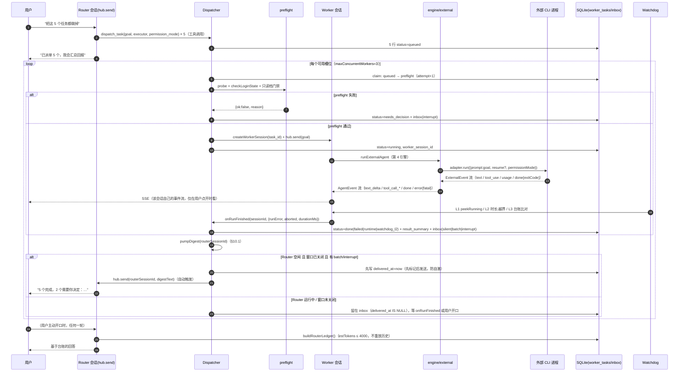

# F-58 设计：Router–Worker 调度层（总管 + 临时工）

> 编号：F-58（用户确认，因另一项目的「AI 小队」已占用前一编号）。
> 状态：已定稿（裁决 r3，2026-11-06）｜ 文件名遵循仓库 `design-fXX-*.md` 约定
> 上游：F-54（会话内后台任务）、F-55/F-56（外部 CLI Agent）、F-15b（Plan 任务租约表）、F-39（专家与团队）
> 输入：用户提供的「DeepSeek 多智能体调度」分享（Router/Worker 分层、结构固化规则、watchdog、云端常驻）
> 范围：**只解决"多个任务之间"的调度**，不改"任务内部"的 DAG 执行（那是 `multi` 模式）

---

## 0. 一句话

把「接待协调」与「独立执行」从**系统结构**上分开：Router 是一个**工具集被收窄到两个调度工具（dispatch_task / task_status）的会话**，Worker 是**每个任务临时创建、任务结束即封存的一个独立会话**；外部 CLI agent 只能当 Worker，不能当 Router。P0 的并行 = 多会话并行，不引入新执行单元、不改消息表、不改 provider 契约。

---

## 1. 先承认 Anthropic 的质疑成立，再精确化

### 1.1 成立的部分

> "不要按公司岗位（产品经理/前端/测试）拆智能体，否则越拆越乱。"

这句话对，而且 delta 现成的反例就在手边：`multi` 模式的 `roles.ts` 是按**角色**派活（planner / executor / reviewer），它能工作的前提是**角色与任务是 1:1 绑定的**——一个 planner 只规划一次，一次 review 只看一份产物。一旦让某个角色**跨任务长期存活**（"前端工程师"智能体一直在），它就必然开始累积不属于当前任务的东西。

### 1.2 精确化：出错的不是"起岗位名"，是这两条

| # | 失效机理 | 具体表现 |
|---|---------|---------|
| M1 | **一个智能体长期承载一个岗位的上下文** | 第 3 个任务开始时，前 2 个任务的探索日志、失败尝试、临时约定全都还在上下文里 → 越聊越乱、token 越滚越多、错误信息互相污染（分享里「三宗罪」第 2 条） |
| M2 | **派单对象是"人/岗位"而不是"任务"** | 派给"前端"意味着"你看着办"，Router 无法定义完成条件 → Worker 不知道何时停（只能靠模型自觉收尾），Router 也无法判定 done/failed |

两条合起来就是 Anthropic 那句话的准确含义：**岗位是"人"的抽象，任务才是"工作"的抽象**。用人的抽象去驱动机器，必然带来 M1（岗位寿命 ⊃ 任务寿命）和 M2（岗位职责 ≠ 可验收条件）。

### 1.3 正确的拆法

| 维度 | 错误做法 | 本设计 |
|------|---------|-------|
| 拆分粒度 | 按岗位 | **按任务**：一个任务一个 Worker 会话，任务终态即封存（不复用、不继承） |
| 上下文边界 | 岗位上下文长期存活 | **一次性上下文**：Worker 的首条用户消息 = `task.goal` 原文，无任何跨任务继承 |
| 派单契约 | "你是前端，去做登录页" | `goal`（做什么）+ `acceptance`（怎么算完）+ `permission_mode` + `executor`（内置/哪个外部 agent） |
| 角色名 | 决定行为 | **只做 UI 标签**（`role_label`），不参与任何引擎分支、不进 Router 的派单指令、不作为工具集依据 |

### 1.4 岗位名的合法位置：只有 UI

- 落库字段 `worker_tasks.role_label TEXT`（可空），取值自由文本（"前端"、"测试"、"调研"）。
- 唯一用途：任务台标签、看板分组、通知文案。
- **禁止**：不进系统提示词、不映射工具集、不映射模型、不映射权限档。校验手段是代码审查 + 一条单测（`dispatcher` 构造 `goal` 时断言 prompt 中不含 `role_label`）。
- 已有可复用载体：F-39 专家团已有 `members[].role: 'lead' | 'member'` 与 `displayName/profession`（`packages/core/src/experts/types.ts:37-43`）。本设计**不复用**该结构做调度（专家团是"一次会话内的多成员委派"，属于任务内部），只在 UI 上让 `role_label` 可以与专家 `profession` 同源取值。

---

## 2. 定位：与既有能力的正交关系

### 2.1 三层不重叠

| 层 | 实现 | 拆什么 | 生命周期 | 会话数 |
|----|------|-------|---------|-------|
| `multi` 模式 | `packages/core/src/engine/orchestrator.ts:18`（配 `roles.ts`/`subtask.ts`/`worker-pool.ts`） | **一个任务内部**的子任务 DAG | 一次 `send()` 之内 | 1 |
| cron（F-22） | `packages/core/src/cron/scheduler.ts:36` + `spawn-executor.ts:60` | **时间维度**（到点触发） | 长驻调度器 + 独立进程 | N（跨进程） |
| 本层（F-58） | 新增 `packages/core/src/router/` | **多个任务之间**（谁先谁后、谁做完了、要不要人管） | 跨会话长驻（靠台账，见 §8） | N（同进程，多会话） |

三者可以叠加：一个 Worker 会话内部可以开 `multi` 模式跑子 DAG；cron 也可以派发一个调度任务而不是直接起进程（P2）。**正交性靠"拆的维度不同"保证，不靠互斥开关。**

### 2.2 关键事实：delta 的一会话一 run 决定了并行形状

- `packages/core/src/server/hub.ts:207`：`private running = new Map<string, { ac: AbortController; startedAt: number }>()` —— 键是 sessionId，**值不是数组**，即单会话单槽。
- `packages/core/src/server/hub.ts:559`：`if (!this.zombieReap(sessionId)) throw new Error('session is already running')`。
- `packages/core/src/session/service.ts:51` + `:77-89`：`activeRuns: Map<string, AbortController>`，`registerRun/unregisterRun` 同为单槽。
- `packages/core/src/server/http.ts:1026`：`if (hub.isRunning(sessionId)) return err(res, 409, 'session is running')`。

结论：**同一会话在运行中物理上无法插入新指令**。这不是缺陷，本设计**不修**它（修它要引入 run 内消息队列，成本远超收益，见 §5.2）。因此：

> **"多任务并行" = "多个会话并行"**，这在 delta 里是零改动的天然结论；「用户同时开 3–5 个任务」的痛点在调度层解决，不在会话层解决。

---

## 3. 决策表

| # | 决策 | 理由与备选 |
|---|------|-----------|
| D1 | Router = **一个 `kind='router'` 的普通会话**，工具集由注册表收窄到 `{dispatch_task, task_status}`，不是提示词约束 | 「无执行能力」必须是结构事实。备选"提示词叮嘱只派单"被否：分享里已实测不稳定，且 delta 的 `restrictRegistry` 现成可用（`packages/core/src/experts/policy.ts:56-61`，`hub.ts:685` 已在用） |
| D2 | Worker = **一个独立会话**，`hub.send()` 全链路复用 | 外部 CLI 只能会话粒度运行（resume 令牌、权限应答都绑会话，`external/types.ts:68-90`）；见 §5 论证 |
| D3 | 新增 `worker_tasks` + `task_inbox` 两张表（v7），**不复用** F-15b `tasks` 表 | `tasks` 是 Plan 节点租约表（PK = sessionId+nodeId，`session/tasks.ts:32,56`），与本层"跨会话的用户级任务"语义不同；合并会污染 `recoverOrphans`（`:195`）。详见 §7.3 |
| D4 | **不引入** one-shot 外部调用 API，**不引入** `messages.run_id` | 两者都是"为并行而并行"的伪需求，成本推 P1/P2 并写明触发条件（§5.2） |
| D5 | Router 冷启动，上下文由**台账**裁剪重建，永不重放历史消息 | `/api/sessions/:id/messages` 全量拉取的 token 成本随任务数线性增长；台账固定预算 4k（§8） |
| D6 | 完成判定 = `done` 到达 + `error{fatal}` 缺席 + 未 abort；外部 Worker 额外需要退出码（P0 给 `AgentEvent.done` 加可选 `exitCode?`） | 外部引擎不产 `subtask_*`/`review_verdict`（`engine/external.ts:12-16`），`subtask_done` 那套判定不可用。现状 `AgentEvent.done` **不带 exitCode**（`shared/src/index.ts:231`）→ 见 §6③ |
| D7 | preflight（探测 + 登录态 + 只读档能力）失败 → `needs_decision`，**禁止静默重试** | 分享里"watch dog 巡检卡壳"的前提是有可靠的启动前置；探测失败属于**配置错误**，重试必然复现，只会烧钱烧时间 |
| D8 | 计费按 Worker（= 会话）聚合，`usage.billing` **复用 v6 既有列**，不改表；改的只是 F-31 报表展示口径 | `usage.billing` 已在 v6（`migrations.ts:184-188`），`recordUsage` 已带参（`session/store.ts:513-527`），外部引擎已置 `subscription`（`engine/external.ts:382`）。真问题是 `UsageStore.summary` 用 `SUM(cost_usd)`（`session/usage.ts:119-127`）把订阅调用算成 $0 |
| D9 | 看门狗三层：L1 存活 / L2 越界（客观事实，立即 kill 不重试）/ L3 偏离（便宜模型判定，默认只标记不 steer） | L3 steer 在本架构下不可实现（§9.2） |
| D10 | 静默三级：silent / batch / interrupt，「没搞定就不打扰」= 成功一律 silent | 对齐 F-33 通知的 `minDurationMs` 防噪思路（`notify/types.ts:10-31`），不新建通道 |
| D11 | Worker 之间**不共享对话上下文，但保留产物单向依赖** | 分享里"彼此隔离不通信"适用于**检索型**任务；交付型任务里 PRD 是开发的输入，绝对隔离会把产物传递退化为人肉复制 |
| D12 | 不为 Router 起常驻进程，不为本层做云端常驻 | 外部 CLI 无长驻 API；云端常驻依赖 jobs 表（尚不存在），P2 且需前置（§11） |
| D13 | 并发上限 `maxConcurrentWorkers`（默认 3），超出的任务 stay `queued` | 对齐"人同时开 3–5 个任务"；无上限会一次拉起 N 个 CLI 进程（外部 agent 每个都是一棵进程树） |
| D14 | **Router 播报由 dispatcher 主动触发**（`pumpDigest`：窗口关闭 + Router 空闲 + 先标记后发送），不等用户开口 | 不主动触发则"任务完成"永远到不了用户，价值主张（注意力不用跟着任务走）直接失效。备选"只靠用户下次开口时台账注入"被否：用户没有理由再开口。——这是 §10.1 的存在理由 |
| D15 | 看门狗 L1 **只用 `hub.peekRunning()`**，不用 `hub.isRunning()` | `isRunning` 内部调 `zombieReap`，会把跑超 30 分钟的会话当僵尸回收（`hub.ts:228-229,249`）——看门狗若调它，等于给自己的 Worker 判了 30 分钟死刑（§9.3） |

---

## 4. 「Router 无执行能力」怎么在 delta 里落地

### 4.1 三层纵深，主机制是第一层

| 层 | 机制 | 落点 | 强度 |
|----|------|------|------|
| **L-结构**（主） | 注册表收窄：Router 会话的 `runRegistry = restrictRegistry(deps.registry, new Set(['dispatch_task','task_status']))` | `hub.ts:685` 现有收窄点加一个 `session.kind === 'router'` 分支 | **物理不可调用**：`react.ts:426-428` 取 `ctx.registry.definitions()`，未在集合内的工具**根本不进请求体** |
| **L-工具**（辅） | Router 允许集里只有两个零副作用工具：`dispatch_task`（落库 + 派会话）、`task_status`（读任务表） | 新增 `tools/builtin/dispatch.ts` | 即使注入成功也做不了执行 |
| **L-权限**（兜底） | Router 会话固定 `plan` 档，UI 置灰不可改（`PATCH /api/sessions/:id/permission` 对 `kind='router'` 返回 400） | `http.ts:925-936` 现有端点加校验 | 第三道，不作主机制。`dispatch_task` 归 `read`（裁决 Q3），故 `plan` 档**不阻断派单**——这正是三层能同时成立的原因 |

### 4.2 为什么 permission 三档**不能**当主机制

`TOOL_CAPABILITY` 里 `read_file / list_dir / glob_search / grep_search / web_fetch` 全是 `'read'`（`tools/permissions.ts:22-45`）。`plan` 档只拒绝 `write`/`exec`，**不拒绝读**。所以：

> 用 plan 档当"Router 不下场干活"的机制，等价于"Router 可以读遍整个仓库、搜遍全文索引、烧掉预算，然后偏题"。

这正是分享里说的"用提示词/配置约束行为不稳定"的同类问题：**约束力度与想要的性质不匹配**。要走结构层。

### 4.3 已验证的两个落地前提

1. **空工具集不会把 provider 打崩**：四个 provider 全部继承 `OpenAICompatibleProvider`（`providers/deepseek.ts:7`、`qwen.ts:7`、`openai.ts:4`），而 tools 字段是有条件写入的：
   - `providers/openai-compatible.ts:92`：`if (req.tools.length > 0) body.tools = convertTools(req.tools);`
   - `providers/anthropic.ts:78`：同上。
   → 即使注册表被收窄到 0 个工具，请求里也不出现 `tools: []`。
2. **收窄工具是一等公民**：`restrictRegistry` 返回 `RestrictedRegistry`，`definitions()` 按 allow 集过滤（`experts/policy.ts:56-61`），且已被 F-39 在 `hub.ts:685` 生产使用。

### 4.4 外部 agent 不能当 Router（硬约束 ①）

外部 CLI 的 Bash/Edit/Read 是它自己进程内的内置工具，delta **无法收窄**（`design-f55 §5.2` 已声明"16 个内置 Function 无法注入"）。因此外部 agent 天然带执行能力，结构上不满足 L-结构层。

**拦截点（三处，缺一不可）**：
1. 创建/改 Router 会话时校验 `model`：`isExternalModel(model)`（`external/registry.ts:36`）为真则 400。
2. `hub.send` 入口：`session.kind === 'router' && isExternal` → 发 `run_error` 拒绝运行（防御性，正常路径进不来）。
3. UI：Router 会话的模型选择器只列内置 provider。

---

## 5. 为什么 Worker = 独立会话是**唯一**兼容外部 CLI 的形状

### 5.1 论证（三条都指向"会话粒度"）

| 事实 | 出处 | 推论 |
|------|------|------|
| 适配器 `run(req)` 的参数里带 `resumeSessionId`，返回值里带 `external_session` 令牌 | `external/types.ts:68-90`、`engine/external.ts:391`（上报）→ `hub.ts:814-820`（`onExternalSession` 持久化到 `sessions.external_id`） | 续跑身份**绑一个 CLI 会话**，天然对应 delta 的一个会话行 |
| Tier A 的权限应答是 `respondPermission(permissionId, decision)`，由 `agent` 实例持有 pending 表 | `external/types.ts:73-78` | 确认流的归属地是"某个正在跑的 CLI 会话"，不是"某个调用" |
| 适配器是**每 run 一个实例**（工厂语义），并发靠实例隔离 | `engine/external.ts:102-107`、`external/registry.ts:26` | 并发本来就设计成"多实例"，不是"一实例多请求" |

再加 §2.2 的内置引擎约束（一会话一 run），两边结论完全同构：

> **Worker = 会话**；`worker_tasks.worker_session_id` 是唯一执行句柄。

### 5.2 由此明确 P0 不做的两件事（含触发条件）

| 不做 | 为什么 P0 不做 | 什么时候才做 |
|------|--------------|-------------|
| **one-shot 外部调用 API**（不建会话、直接 `adapter.run()` 拿结果） | 与 §5.1 三条全部冲突：没会话就没有 resume 令牌的落点、没有权限应答的归属、没有 SSE 通道给用户看进度。收益只是"少一行 sessions 记录"，成本是新一套事件落库 + 新一套权限回填 | 当出现"每分钟上千次、每次 <5s 的探测型调用"（如批量文件摘要、CI 内联检查）时，P2 单独设计 `one-shot` 通道，且明确它**不能**承载需要确认的写操作 |
| **`messages.run_id`**（给消息加 run 归属，支持会话内多 run 并发） | 要改 `hub.running`/`service.activeRuns` 两处单槽注册表、`createDecisionWaiter` 的 key、SSE 事件的 run 归属、`getHistory` 的 turn 切分、前端 `chat.ts` 的游标 —— 6 处核心改动只换来"同一会话内并发"，而本层的并行已经由多会话满足 | 当出现"用户明确要求在**同一个对话**里同时跑两件事"（如"边改边问"）且多会话方案被用户拒绝时，P2 单独立项 |

**这两笔成本被显式推后，是本设计最重要的范围控制。** 它们不影响 AC1–AC9 任何一条。

---

## 6. 外部 agent 作为 Worker 的六类硬约束

| # | 约束 | 解法 / 降级 | 落点 |
|---|------|-----------|------|
| ① | 外部 agent 不能当 Router（工具不可注入） | **拒绝**：`kind='router'` 与 `isExternalModel` 互斥，三处拦截（§4.4） | `http.ts` 新增校验、`hub.send` 防御、UI 过滤 |
| ② | 一任务一会话（不可复用 CLI 会话跑第二个任务） | **接受**：任务终态即封存会话，`worker_tasks.worker_session_id` 单值；重派 = 新建会话 + `attempt+1` | `router/dispatcher.ts` |
| ③ | 外部引擎不产 `subtask_*`/`review_verdict` → 无法用子任务粒度判完成 | **降级为"整轮判定"**：`error{fatal:true}` 缺席 + 未 abort + `done` 到达 = 成功。**本项已确认纳入 P0**：`AgentEvent.done` 增可选 `exitCode?: number`（`shared/src/index.ts:231`），`engine/external.ts:405-437` 收尾处已有 `outcome.exitCode`，一行带出；其余引擎不填 = 老消费端忽略。带出后 `exit≠0 但有产出` 的收尾不再被误判为成功（此前 `external.ts:425-434` 的 `fatal: !produced` 会漏判） | `shared`、`engine/external.ts` |
| ④ | preflight（probe + 登录态）失败必须显式，不得静默重试 | **`needs_decision`**：复用 `probeAgent`（`external/detect.ts:370`，3s 超时 `PROBE_TIMEOUT_MS`）与 `checkLoginState`（`:580`）；失败写 `decision_json` + `inbox(interrupt)`，`attempt` 不递增，任务停住等人 | `router/preflight.ts` |
| ⑤ | 计费口径必须区分 subscription 与 token，否则 F-31 报表把订阅调用算成 $0 | **复用 v6 `usage.billing`**（`migrations.ts:184-188`），按会话（= Worker）聚合天然成立（`usage.session_id`）。真正要改的是 `UsageStore.summary` 的 `SUM(cost_usd)`（`session/usage.ts:119-127`）→ 拆成 `metered_cost_usd` 与 `subscription_tokens` 两列，订阅行不进金额合计 | `session/usage.ts`、`web/src/components/UsageModal.vue` |
| ⑥ | `permission` 只是"请求只读"而非保证（codex 可能拒启动、cursor/opencode 参数为空） | **派单前门禁**：复用既有只读端点 `GET /api/external-agents`（`http.ts:1310`，返回 loginState + 三档支持度）→ 任务要求 `plan` 而目标 agent 不支持只读档 → `needs_decision`，不启动。运行期再由引擎侧启动门禁兜一次（`external.ts:119`，只对 `tier !== 'A'` 且 `permissionArgs.plan` 为空时拒绝） | `router/preflight.ts`（不新增端点） |

> 关于 ⑥ 的准确表述：`tier === 'A'`（ACP）在 `plan` 档下**不**被该门禁拒绝，因为它能逐次拦截 `session/request_permission`——但"能拦截"≠"保证只读"，拦截结果依赖用户在确认流里的选择。所以"只读"在外部 Worker 上是**尽力而为**，UI 文案必须写"已请求只读"而不是"只读"。

---

## 7. 数据模型（v7 迁移）

### 7.1 DDL

`packages/core/src/session/migrations.ts` 追加 **version 7**（`LATEST_SCHEMA_VERSION` 当前 = 6，`:216`；`migrate()` 断言版本从 1 连续递增，`:234-240`，**不得修改历史迁移**）：

```sql
-- v7：F-58 Router–Worker 调度层
-- sessions 增列（skipIf: 三列齐备则跳过 ALTER，但仍需 repairSql 补索引）
ALTER TABLE sessions ADD COLUMN kind TEXT NOT NULL DEFAULT 'chat';        -- 'chat' | 'router' | 'worker'
ALTER TABLE sessions ADD COLUMN role_label TEXT DEFAULT NULL;             -- 仅 UI 标签，不进 prompt
ALTER TABLE sessions ADD COLUMN task_id TEXT DEFAULT NULL;                -- worker 会话反查所属任务
-- Router 会话查找 = project_id + kind 双等值（§14 GET/POST /api/projects/:id/router），
-- 故建复合索引而非单列 kind 索引：现有 idx_sessions_project（:128）只能吃掉 project_id 一个条件，
-- 复合索引让 plan 直接命中两个等值条件
CREATE INDEX IF NOT EXISTS idx_sessions_project_kind ON sessions(project_id, kind);

CREATE TABLE IF NOT EXISTS worker_tasks (
  id                 TEXT PRIMARY KEY,
  project_id         TEXT NOT NULL,
  router_session_id  TEXT NOT NULL,
  title              TEXT NOT NULL,
  goal               TEXT NOT NULL,              -- 派单原文 = Worker 首条用户消息
  acceptance         TEXT DEFAULT NULL,          -- 完成条件（可空＝由 Router 在 title 里写清）
  role_label         TEXT DEFAULT NULL,          -- 仅 UI
  executor           TEXT DEFAULT NULL,          -- NULL = 内置引擎；'cli:xxx' / 'acp:xxx' = 外部
  permission_mode    TEXT NOT NULL DEFAULT 'default',
  status             TEXT NOT NULL DEFAULT 'draft',
  priority           INTEGER NOT NULL DEFAULT 1,
  depends_on         TEXT NOT NULL DEFAULT '[]', -- JSON 数组：task id
  artifacts          TEXT NOT NULL DEFAULT '[]', -- JSON 数组：{kind:'file'|'session'|'note', ref}
  worker_session_id  TEXT DEFAULT NULL,
  result_summary     TEXT DEFAULT NULL,          -- ≤400 字，对齐 expert_delegate_done.summary 口径
  failure_kind       TEXT DEFAULT NULL,          -- preflight | runtime | watchdog_l2 | aborted | canceled
  decision_json      TEXT DEFAULT NULL,          -- needs_decision 的待办内容
  watchdog_flag      TEXT DEFAULT NULL,          -- 'suspect' | NULL（L3 只标记，不改 status）
  attempt            INTEGER NOT NULL DEFAULT 0,
  created_at         INTEGER NOT NULL,
  started_at         INTEGER,
  finished_at        INTEGER,
  updated_at         INTEGER NOT NULL
);
CREATE INDEX IF NOT EXISTS idx_wtasks_project ON worker_tasks(project_id, status);
CREATE INDEX IF NOT EXISTS idx_wtasks_router  ON worker_tasks(router_session_id, status);
CREATE INDEX IF NOT EXISTS idx_wtasks_session ON worker_tasks(worker_session_id);

CREATE TABLE IF NOT EXISTS task_inbox (
  id                INTEGER PRIMARY KEY AUTOINCREMENT,
  router_session_id TEXT NOT NULL,
  task_id           TEXT DEFAULT NULL,           -- NULL = 会话级提示（如用量概览）
  kind              TEXT NOT NULL,               -- task_done | task_failed | needs_decision | digest
  severity          TEXT NOT NULL DEFAULT 'silent', -- silent | batch | interrupt
  payload_json      TEXT NOT NULL,
  created_at        INTEGER NOT NULL,
  delivered_at      INTEGER DEFAULT NULL,        -- NULL = 未送达用户
  ack_at            INTEGER DEFAULT NULL
);
CREATE INDEX IF NOT EXISTS idx_inbox_router ON task_inbox(router_session_id, delivered_at);
```

`skipIf` 用 `hasColumn(db,'sessions','kind') && …('role_label') && …('task_id')`，`repairSql` 写 `'CREATE INDEX IF NOT EXISTS idx_sessions_project_kind ON sessions(project_id, kind);'`——跳过三列 ALTER 时仍要保证索引存在（对齐 v5 的「跳过 → 不能连带漏建索引」写法，`migrations.ts:195-203`；v6 无索引故无 repairSql，`:204-213`）。

**明确不加的列**（避免重复建设）：
- `usage.billing` —— v6 已有。
- `sessions.external_id/external_agent` —— v6 已有；外部 Worker 的 resume 令牌走 F-55 既有机制（`service.ts:196-199`）。
- `worker_tasks.cost_usd` —— 金额从 `usage` 按 `session_id` 聚合，任务表不冗余计费数据（双写必然不一致）。

### 7.2 为什么**不拿 `messages` 当队列**

| 理由 | 证据 |
|------|------|
| 队列条目会被读进上下文 | `service.getHistory(sessionId)`（`session/service.ts:201`）按 `messages` 全量取；Router 冷启动若重放历史，队列项会混进对话 |
| `messages` 是 append-only 对话记录，没有状态机 / 认领 / 幂等 | 表结构见 `migrations.ts:59-67`（`id/seq/role/content_json/tokens/created_at`），无 `status`、无 `lease`、无 `attempt` |
| 队列内容会被全文索引污染 | `messages_fts`（`migrations.ts:139-144`）对全表建索引；把"任务派单"塞进 messages 会让 F-17 检索命中一堆调度噪声 |
| 无法表达并发安全 | 派发需要 `queued → preflight` 的原子认领（对齐 `tasks.ts:98` 的 `claim` 语义），messages 无此能力 |

### 7.3 与 F-15b `tasks` / Plan 节点表的边界

| 维度 | F-15b `tasks` | F-58 `worker_tasks` |
|------|--------------|---------------------|
| 主键 | `sessionId + nodeId`（`session/tasks.ts:32`） | 全局 `id` |
| 归属 | 属于**一个会话内的一个 Plan 节点** | 属于**一个项目 + 一个 Router 会话**，生命跨越多个 Worker 会话 |
| 语义 | 子任务执行的租约/断点恢复（`lease_until`/`heartbeat_at`/`checkpoint_json`） | 用户级任务的生命周期与结论 |
| 谁消费 | `orchestrator` 的 `pendingNodes`（`tasks.ts:224`） | `router/dispatcher` + Web 任务台 |
| 崩溃恢复 | `recoverOrphans` 扫过期租约（`tasks.ts:195`） | `dispatcher.bootstrap()` 扫 `running/preflight` 且会话不存在的行 |

**不复用的硬理由**：若把调度任务写进 `tasks`，每行必须伪造 `plan_revision` 与 `node_id`，`recoverOrphans` 会把调度任务当作 Plan 节点重新入队，`orchestrator` 会试图把它们塞进 DAG——两套状态机互相污染，属于典型的"表复用省一行代码，赔一个月的诡异 bug"。

### 7.4 任务状态机

```
draft ──dispatch──▶ queued ──槽位可用──▶ preflight ──通过──▶ running ──▶ done
                       │                     │                    ├──▶ failed(failure_kind=runtime)
                       │                     │                    ├──▶ failed(watchdog_l2)
                       │                     │                    └──▶ canceled
                       │                     └──▶ needs_decision ──用户裁决──▶ queued(attempt+1) | canceled
                       └──▶ canceled(依赖失败 / 用户取消)

running + L3 判定偏离 ──▶ 状态不变，watchdog_flag='suspect'（只标记，不改状态）
```

- 终态：`done / failed / canceled`，**不可回退**；重做 = 新建任务（保留 `attempt` 血缘）。
- `draft` 只由 Web 手工表单（`POST /api/projects/:id/worker-tasks` 不带 `dispatch:true`）产生，Router 派单一律直接进 `queued`。
- `needs_decision` 是**非终态**，**不占并发槽位**（不跑进程，不计入 `maxConcurrentWorkers`），但会一直占据台账待办桶（§8.2 永不裁剪）。
- 只有**进入终态或进入 `needs_decision`** 时才写 `task_inbox`（severity 按 §10）；`queued → running` 这类高频迁移只写 `worker_tasks.updated_at`，不进 inbox（否则 inbox 会变成日志表）。

### 7.5 `dispatch_task` 参数 → Worker 会话字段的映射（P0 第一步就要定死）

`worker_tasks.executor` 与会话的 `model` 是**同一个值，不做第二套命名**：

| `dispatch_task.executor` | `sessions.model` 落值 | 判定路径 |
|--------------------------|----------------------|---------|
| `'cli:codebuddy'` / `'acp:xxx'` / 任何带 `cli:`、`acp:` 前缀的串 | 原样写入 | `isExternalModel()`（`external/registry.ts:36`）为真 → `hub.send` 走第 4 引擎（`hub.ts:827-830`） |
| `null` / 省略（= 内置引擎） | **Router 会话当前的 `model`**（`GET` Router 会话行的 `model` 列）；若 Router 会话 model 为空串，则退化到 `deps.defaultModel`，再退化到 `defaultModelFor(provider.id)`——与 `hub.ts` 现有默认模型推导链一致 | `isExternalModel()` 为假 → 走 ReAct/Plan/Multi |

三条硬约束（写进 `dispatch_task` 的参数 schema 与校验）：
1. `executor` **不得**指向 `kind='router'` 的会话所用模型之外的外部串乱填：`preflight` 用 `resolveExternalAdapter(executor)`（`external/registry.ts:31`）解析不到 → `needs_decision`，**不建会话**（避免留下一个永远跑不起来的外部会话）。
2. `executor` 一旦写入任务行，**派单后不可变**（改执行后端 = 新建任务，避免 `resume` 令牌与后端不一致）。
3. `executor` 为外部时 `permission_mode` **必须显式给值**（不得依赖默认 `'default'`），因为外部 Worker 的 `plan` 档存在"没有只读档"的启动门禁（`external.ts:119`），默认值会让门禁在不可见处生效。

`createWorkerSession` 因此的最终签名（对齐 `service.ts:137-149` 既有 `createSession(projectId, opts)` 形态）：

```ts
createWorkerSession(projectId: string, opts: {
  title: string;
  model: string;        // = task.executor 解析结果（见上表），恒非空
  taskId: string;       // 写 sessions.task_id，供 worker → task 反查
}): SessionRow          // 内部固定 kind='worker'，不允许调用方指定
```

---

## 8. 台账：Router 冷启动靠什么恢复，以及看门狗拿什么当基准

### 8.1 台账 = `worker_tasks` + `task_inbox` 的**投影**，不是新表

不需要"第 N 轮总结"式的滚动摘要——`worker_tasks` 每行本身就是一条台账记录，`task_inbox` 提供"用户还没被告知的事"。Router 每轮运行前由 `buildRouterLedger()` 现算一个纯文本块，注入动态提示词段。

### 8.2 裁剪算法（固定预算，不随任务数增长）

**`buildRouterLedger()` 返回 `{ text: string; estTokens: number }`**，预算判定只对 `estTokens` 做——**文档与 AC 一律以 token 计，不以字符计**（字符数会随中英混排剧烈漂移，无法作为断言口径）。

`estTokens` 复用项目现成的估算规则（`openai-compatible.ts:14` 注释：**CJK 1 tok/char、latin 3 chars/tok**）。注意 `countTokensOf()` 在 `openai-compatible.ts:29` 与 `anthropic.ts:28` 都是**模块私有**，因此 `router/ledger.ts` 本地实现同一规则约 8 行，而不是为了复用去扩大 `llm/` 的导出面：

```ts
// router/ledger.ts
const CJK = /[\u3400-\u9fff\u3000-\u303f\uff00-\uffef]/;
export function estTokensOf(text: string): number {
  let cjk = 0, latin = 0;
  for (const ch of text) CJK.test(ch) ? cjk++ : latin++;
  return cjk + Math.ceil(latin / 3);
}
```

`budget = 4000 tokens` 对应的字符上限是**推导值**：全中文 ≈ 4000 字符，全英文 ≈ 12000 字符；台账以中文短句为主，实际落在 3500–4500 字符区间。

```
输入：project_id, router_session_id, budget = 4000 (estTokens)

1. 取待办桶（按 priority DESC, created_at ASC）：
   needs_decision（全量，永远不裁）→ running（全量）→ queued（全量）
   每行：[T-<id 前 6 位>] <status> <title>｜goal 前 200 字｜<failure_kind/decision 摘要 100 字>
2. 取完成桶：最近 5 条终态任务，每行 [T-x] done <title>｜result_summary
3. 取 inbox：severity='interrupt' 且 delivered_at IS NULL（全量）
4. 超预算时按序丢弃：完成桶从最旧开始丢 → queued 只留标题（丢 goal）→ running 丢 goal
   needs_decision 与 interrupt 永不丢（宁可超预算，也不让用户错过需要决策的事）
5. 硬上限保险：超 2× 预算（estTokens > 8000）时只输出计数摘要（"另有 12 个排队任务"）
```

**禁止**：读 `messages`（任何会话）、读 `file_changes`、读工具调用明细。这些是 Worker 内部过程，Router 不需要，且会击穿预算。

### 8.3 台账兼任看门狗基准

- L2 越界判据用的是**客观事实**（路径、进程），不查台账 → 台账不是 L2 的基准。
- L3 偏离判据用的是台账里的**两样东西**：
  1. `task.goal`（保留原文，用于判定"是否在做被要求的事"）
  2. 完成桶里最近 5 条的 `result_summary`（用于判定"是否在重做已完成的事"）
- 这就是"台账一份数据、两个用途"：给 Router 的**恢复视图**，也是 L3 的**参照系**。二者口径必须一致，否则会出现"Router 认为任务还没做、看门狗认为在重做"的矛盾。

---

## 9. 看门狗三层

| 层 | 判据 | 动作 | 是否重试 | 判据可靠度 |
|----|------|------|---------|-----------|
| **L1 存活** | **只读**原始运行态：新增 `hub.peekRunning(sessionId)`（**不触发** `zombieReap`，见 §9.3）+ `dispatcher` 每 60s 心跳写 `worker_tasks.updated_at` | 会话已死但任务仍 `running` → 写 `failed(runtime)` 并进 inbox | 否（交人判断） | 高（内核事实） |
| **L2 越界** | **客观事实**，三条：<br>(a) 内置 Worker：`file_changes.path`（F-24，`session/changes.ts`）不在会话 `work_root` 下<br>(b) 外部 Worker：`tool_result`/`tool_use` 事件的 `argsJson` 里出现绝对路径不以 `work_root` 开头（**粗筛，仅作提示**）<br>(c) 会话仍存活但 ≥20 分钟无任何 AgentEvent 产出（静默死循环的典型特征）。阈值必须 < 30 分钟，否则会被既有 zombieReap 先杀掉（§9.3），L2c 永远观察不到 | **立即 `hub.abort(sessionId)` + `failed(watchdog_l2)`**，不重试，inbox `interrupt` | **否**——这是结构性错误，重试必然再犯 | 高（a）/ 中（b，会误报） |
| **L3 偏离** | 便宜模型单次判定（`routeAux('subagent')` 同款降级链，`hub.ts:521` 既有 `routeAux`）：输入 = `goal` + 最近 10 个工具名与路径（不含全文）+ 完成桶摘要 → 输出 `aligned / drifting / done_early` | **只写 `watchdog_flag='suspect'`** + inbox `silent`；任务台打"存疑"角标，**不打断、不终止、不 steer** | 否 | 低（模型判定，必须允许误报） |

### 9.1 为什么 L2 对外部 Worker 只能是"粗筛"

外部 agent 的工具在 CLI 进程内执行，**不经过 delta 的 registry** → 不写 `file_changes`（对比：内置 Worker 的写工具走 F-24 快照）。因此对外部 Worker，"写了什么文件"只有工具事件的 `argsJson` 一个信号，而 `argsJson` 是 CLI 的原始 JSON（F-55 §4 明确"原样不 parse"），字段名随 CLI 版本漂移。

**结论**：外部 Worker 的 L2 只保留确定性最高的两条（时长、无产出），路径越界降级为 L3 的输入信号（打标记而不 kill）。这是能力降级，必须在 `doctor` 与任务台文案里显式写出，不能静默。

### 9.2 为什么 delta 里 L3 **不做 steer**

分享里的 watch dog 能"巡检卡壳/偏离"后接管，前提是它能给运行中的 Worker **追加指令**。delta 做不到，原因是结构性的：

1. `hub.ts:207` 的 `running` 是 `sessionId → {ac}` 单槽，`hub.ts:559` 明确 `throw 'session is already running'`；
2. 引擎主循环 `react.ts` 的输入是**一次 `send()` 的固定 `input`**，运行中没有任何注入点（`createDecisionWaiter` 只能回填"确认/提问/审批"三种预定义决策，不是自由指令）；
3. 要支持 steer 就必须做 §5.2 里被推后的 `messages.run_id` + run 内消息队列——**这正是 L3 不做 steer 的成本原因**。

因此 L3 的合法动作只有三种：**标记**（P0）、**中止后重派**（P1，`abort` + 新任务 + `attempt+1`，有损：半成品与上下文丢弃）、**什么都不做**（当判定不可靠时）。默认必须是"什么都不做 + 标记"，因为 L3 是低可靠度判据，误杀成本远高于放过。

### 9.3 一个必须先知道的坑：`isRunning()` 会顺手杀掉 30 分钟以上的 Worker

这是本设计最容易踩的实现坑，必须在动手前定死。

`hub.isRunning()` 的实现是 `return this.zombieReap(sessionId) ? false : this.running.has(sessionId);`（`hub.ts:228-229`），而 `zombieReap` 的判据是 `entry.ac.signal.aborted || Date.now() - entry.startedAt > 30 * 60_000`（`hub.ts:249`）。也就是说：

> **`isRunning()` 不是纯查询，它带副作用：任何一个已经跑了 30 分钟以上的会话，只要被问一次"你在跑吗"，就会被回收**——`running.delete` + `abort` + 推一条 `run_error`「僵尸运行清理」（`hub.ts:251-258`）。

如果看门狗每 60s 轮询一次 `isRunning()`，那么**任何 Worker 都活不过 30 分钟**，而且死法是"被自己的看门狗盯死"，任务还会被判 `failed(runtime)`。这比 Q4 里说的"误杀率"严重得多。

**P0 选择 (a)：看门狗不调 `isRunning()`。**
- 新增 `hub.peekRunning(sessionId): boolean` = `this.running.has(sessionId)`（纯读，不 reap），只给看门狗用；`isRunning` 保持原语义不动（它对 Web 侧栏「删除门禁 / 运行徽标」是正确行为，不能改）。
- dispatcher 的收敛**主路径是 `onRunFinished` 回调**（§13），L1 只是兜底：`peekRunning === false && task.status === 'running'` → `failed(runtime)`。60s 心跳只写 `updated_at`，不判死。

**但必须同时承认 (b) 的一半事实**：30 分钟硬顶今天已经在生效——Web 侧栏轮询 `GET /api/running-sessions`（`http.ts:402-404`）→ `hub.runningSessionIds()`（`hub.ts:263-268`）对**每个**运行中会话调 `zombieReap`。所以只要用户开着 Web，长任务本来就会在 30 分钟处被回收一次。

因此：
- P0 **不把"跑 >30 分钟的任务"作为可交付场景**，写进已知限制（§18-8）；
- 真正抬阈值属于对既有僵尸回收策略的修改（影响所有会话，不只是 Worker），单独立项，不在本设计里顺手改——顺手改会动到 F-23/PASI-9 的运行态语义。


---

## 10. 静默分级

判定表（`severity` 落 `task_inbox.severity`；写入时机限「进入终态 / 进入 needs_decision / L3 标记 / digest」，对齐 §7.4）：

| 事件 | 级别 | 动作 |
|------|------|------|
| 单个任务 `done` | **silent** | 只写库 + 任务台变绿；**不推送、不通知、不进 Router 上下文**（Router 下一轮从台账看到） |
| `queued → running` | 不入 inbox | 只写 `worker_tasks.updated_at`（高频迁移不建 inbox 行） |
| L3 标记 `suspect` | silent | 角标 |
| 重试中的失败（P1 才有自动重试） | silent | 计数进 digest |
| 一批任务收尾（≥2 条终态，或距上次汇报 >15 分钟） | **batch** | 合成一条 digest 进 inbox，**由 dispatcher 自动触发 Router 播报**（§10.1） |
| 用量/额度概览（订阅 vs 按量） | batch | 随 digest 附带 |
| `needs_decision`（preflight 失败 / 无只读档 / 登录态缺失 / 依赖任务失败） | **interrupt** | 进 inbox 并**立即尝试**触发 Router 播报（§10.1）；`GET /api/projects/:id/inbox?delivered=0` 有 interrupt 项时 Web 任务台红点 |
| L2 kill | **interrupt** | 同 needs_decision（用户需要知道"机器替你做主杀了它"） |
| 用户直接问 Router | 不经 inbox | 走普通对话 |

对齐原则：「**没搞定就不打扰**」的落地读法是——**"搞定了"不打扰，"搞不定且需要人"才打扰**。所以成功是 silent，失败要分"能自愈（silent/batch）"与"不能自愈（interrupt）"。这也是 D10 存在的理由：如果成功也弹通知，用户就会关掉通知，interrupt 就失效了。

**不新增通知通道**：interrupt 复用 F-33 的 `Notifier.notifyDone`（`notify/types.ts:57` 的 `notifyDone` 定义）+ Web 红点。P0 不做系统级推送增强。

### 10.1 谁来触发 Router 播报（本设计的关键机制，缺了它价值主张不成立）

「Router 下一轮开头播报」这句话必须先回答：**下一轮由谁产生？** Router 是普通会话，Worker 完成不会让它自动运行；若只等用户开口，用户就永远不知道任务已经完了——这正好击穿「注意力不用跟着任务走」。因此 P0 必须有一个**主动触发**机制：

**`Dispatcher.pumpDigest(routerSessionId)`**（在 `onRunFinished` 与 60s tick 两处被调用）：

```
触发条件（全部满足才发）：
  C1 存在待播报条目：task_inbox 中 severity IN ('batch','interrupt') 且 delivered_at IS NULL
     （severity='silent' 永不触发——这是"没搞定就不打扰"的硬保障）
  C2 窗口已关闭：
     含 interrupt → 立即（0 延迟）
     仅 batch     → 该 Router 的终态数 ≥ 2，或 now - MAX(delivered_at) > 15min
                    （MAX(delivered_at) 即上次播报时间，不需新增列）
  C3 Router 空闲：hub.peekRunning(routerSessionId) === false（§9.3，不触发 zombieReap）
  C4 防抖：now - MAX(delivered_at) > DIGEST_MIN_INTERVAL_MS (60_000)

动作（顺序不可颠倒）：
  1. 先把本批要播报的 inbox 行的 delivered_at 写成 now  ← **先标记，后发送**
  2. 再 hub.send(routerSessionId, digestText)
     digestText = 「[系统] 任务播报（自动触发，只需简短确认，不要复述全文）」+ 本次条目文本
  3. send 失败（Router 恰好被占用等）→ 回滚 delivered_at=NULL，等下一 tick
```

三个设计要点：

- **先标记后发送（步骤 1 在 2 之前）是防自激循环的关键**。若反过来（发送后标记），`hub.send` 会触发 Router 新一轮 → 本轮结束又触发 `pumpDigest` → 那一批还是未送达 → 无限自我触发。先标记后，即使发送过程中有新条目进来，它们也是**新 id**，不会重复播报。
- **Router 运行中（C3 不满足）不发送，条目留在 inbox**，等两个出口之一：① 本轮结束的 `onRunFinished` → 再跑一次 `pumpDigest`；② 用户主动开口 → `buildRouterLedger` 的第 3 步已把未送达 interrupt 注入（§8.2），Router 天然会看到。
- **digest 消息体只含播报条目，不含历史**，与台账裁剪同一口径；不把 `delivered_at` 的语义扩成"用户读过了"（那是 `ack_at`）。

对应验收见 AC9。


---

## 11. 明确**不照搬**的三处

| 分享里的做法 | 为什么不照搬 | 本设计的替代 |
|-------------|-------------|-------------|
| **Router 常驻在线**（一个长驻进程 + 常驻上下文） | delta 的 Router 是一个会话，会话不运行时不占资源（这是优点）；而"常驻"要解决的问题是**冷启动后上下文丢失**。对内置引擎我们能做到热上下文（会话历史还在），对外部 CLI 无长驻 API 可言（一个 CLI 进程就是一个任务） | **台账重建**（§8）：Router 冷启动花 4k token 现算台账，比常驻进程省一个进程生命周期管理 + 一套心跳 + 一套崩溃恢复 |
| **云端运行**（关掉本地设备任务继续） | 依赖尚不存在的云端 jobs 表与远端执行器；`cron` 的 spawn 执行器是**本机子进程**（`cron/spawn-executor.ts:60`），跨机关机续跑要引入远端沙箱与产物回传 | **P2**，前置条件：① 云端 jobs 表与执行器（另一个特性）；② 产物同步机制。P0/P1 明确写"关掉本地设备任务中断"为已知限制 |
| **Worker 彼此隔离不通信** | 只对**检索型**任务成立。交付型任务里"开发的输入是 PRD"，物理隔离会逼用户人肉复制产物，正是分享想消灭的"人的注意力被占用" | **不共享对话上下文，但保留产物单向依赖**（D11）：`depends_on` + `artifacts`。Worker B 的 `goal` 里由 dispatcher 拼入依赖任务的 `result_summary` 与产物路径，不拼对话历史 |

第三点是本设计与分享最大的实质分歧（裁决见 §19 Q2：**路径 + ≤400 字 `result_summary` 双轨**，不设第三种传递方式）。

---

## 12. 模块改造清单

新增（`packages/core/src/router/`，与 `engine/`、`external/` 平级，互不 import）：

```
core/src/router/types.ts        WorkerTaskRow / TaskStatus / InboxItem / DispatchRequest / PreflightResult
core/src/router/store.ts        WorkerTaskStore + InboxStore（注入 service.store.db，参照 session/tasks.ts 写法）
core/src/router/dispatcher.ts   Dispatcher：dispatch / claimSlot / onRunFinished / pumpDigest（§10.1）/ decide / cancel / bootstrap
core/src/router/preflight.ts    probeAgent + checkLoginState + 三档能力门禁（全部复用 external/detect）
core/src/router/ledger.ts       buildRouterLedger → {text, estTokens}（§8.2 裁剪算法，纯函数）+ estTokensOf
core/src/router/watchdog.ts     Watchdog：tick(L1/L2) + judge(L3)
core/src/router/prompt.ts       Router 派单提示词 + dispatch_task 参数说明（唯一提示词资产）
core/src/tools/builtin/dispatch.ts  dispatch_task / task_status 两个工具实现
```

修改（每条都写"改什么"）：

```
core/src/session/migrations.ts   末尾追加 version 7（§7.1 DDL）；不改历史迁移
core/src/session/store.ts        sessionColumns() 带三个新列；新增 setSessionKind/setSessionTask
core/src/session/service.ts      挂载 workerTasks/inbox 两个 store；新增 createWorkerSession(projectId,{title,model,kind,taskId})
core/src/session/usage.ts        summary() 拆 metered_cost_usd / subscription_tokens（§6⑤）
core/src/server/hub.ts           (a) 685 行收窄点加 kind==='router' 分支；(b) SessionHubDeps 增 dispatcher?
                                 与 onRunFinished?；(c) 935-960 的 finally 里调 onRunFinished（复用已有的
                                 runError / acRef.signal.aborted / durationMs 三个变量，零新增判定）；
                                 (d) 新增 peekRunning(sessionId)（纯读、不 reap，§9.3，供看门狗用）
core/src/server/http.ts          新增 6 个调度端点（§14）；PATCH /permission 与 PATCH session 对 router 加校验
core/src/server/runtime.ts       装配 Dispatcher + Watchdog（单例）+ dispose 时 abortAllWorkers
core/src/engine/external.ts      done 事件带出 exitCode（§6③，1 行）
core/src/tools/permissions.ts    TOOL_CAPABILITY 增 dispatch_task:'read'、task_status:'read'（BUILTIN_TOOL_COUNT +2）
core/src/tools/types.ts          ToolContext.dispatcher?（缺省 = 未装配，工具报 dispatcher_unavailable）
shared/src/index.ts              AgentEvent.done 增 exitCode?；WorkerTaskView / InboxItemView DTO
web/src/api/client.ts            WorkerTaskView / InboxItemView 类型 + 6 个 api 函数
web/src/stores/tasks.ts          轮询 store（2s，完全照 bgTasks.ts 的 watch/refresh/切会话重置模式）
web/src/components/TaskBoard.vue 任务台（状态点 + 结论 + 存疑角标 + 裁决按钮）
web/src/components/TaskDecisionDialog.vue  needs_decision 裁决（重试/取消/接受）
web/src/views/WorkbenchView.vue  侧栏挂 TaskBoard；Router 会话当普通会话打开（零新通道）
```

**不改**（明确记录，防评审反复）：`engine/react.ts`、`engine/orchestrator.ts`、`engine/plan-execute.ts`、`engine/pump.ts`、`external/*`（除 detect 的只读调用）、`session/background-tasks.ts`、`cron/*`、`llm/*`。

**`background-tasks.ts`（F-54）的复用边界**：进程内单例、不落库、与运行 AbortSignal 解耦（`session/background-tasks.ts:56,135`）。它管的是**一个会话内的命令级后台进程**，本层管的是**跨会话的任务**——两者**不复用**，也**不冲突**（一个 Worker 会话内部仍然可以正常使用 `run_in_background`，其任务条照旧在该会话里显示）。**不要**把 `BackgroundTaskManager` 当作调度器的承载物：它没有持久化、没有状态机、没有依赖关系。

---

## 13. 关键时序（外部 Worker 全链路）



`onRunFinished` 的插入点是 `hub.ts:935-960` 的 `finally`：那里已经有 `runError`、`acRef?.signal.aborted`、`durationMs`，**不需要新增任何判定逻辑**，只需把这三个值透传给 `deps.onRunFinished?.(sessionId, {...})`。`hub` 不 import `router/`，依赖方向单向（runtime 装配时注入），避免循环依赖。

---

## 14. API 契约

新增（标「新增」）：

| 方法 | 路径 | 说明 |
|------|------|------|
| POST | `/api/projects/:id/router`（新增） | 取或建 Router 会话（幂等，返回 `{session}`）；不存在则 `createSession` 后 `setSessionKind('router')` |
| GET | `/api/projects/:id/worker-tasks?status=&limit=`（新增） | 任务列表（任务台数据源） |
| POST | `/api/projects/:id/worker-tasks`（新增） | 手工建任务（无 Router 也能用；body 同 `dispatch_task`） |
| POST | `/api/worker-tasks/:id/decision`（新增） | 回填 `{decision:'retry'\|'cancel'\|'accept'}`，`retry` 时 `attempt+1` |
| POST | `/api/worker-tasks/:id/cancel`（新增） | 取消（queued/running/needs_decision 均可） |
| GET | `/api/projects/:id/inbox?delivered=0`（新增） | 未送达条目（红点 + digest 播报） |

复用（零新增）：
- `POST /api/sessions/:id/messages`（`http.ts:1024`）：Router 会话与 Worker 会话的驱动入口。
- `GET /api/sessions/:id/events`（`http.ts:340`）：两边的 SSE。
- `GET /api/external-agents`（`http.ts:1310`）：preflight 的探测与三档支持度。
- `PATCH /api/sessions/:id/permission`（`http.ts:925-936`）：Worker 任务要求 plan 时在此设置（Router 会话拒绝）。
- `POST /api/projects/:id/sessions`（`http.ts:847`）：Worker 会话创建底座（`kind` 由服务端写，不开放给客户端随意指定）。

---

## 15. 验收标准

| # | 验收标准（可验证） | 验证方式 |
|---|------------------|---------|
| AC1 | Router 会话的模型请求体中**不含任何执行类工具**（`run_command`/`write_file`/`edit_file`/`read_file`/`glob_search`/`grep_search` 全部缺席） | fake provider 捕获 `ChatRequest.tools`，断言集合等于 `{dispatch_task, task_status}` |
| AC2 | Worker 运行中，向 Router 发新指令**不返回 409**；向同一 Worker 发指令**返回 409** | 端点集成测试（对齐 `http.ts:1026` 现有语义） |
| AC3 | 以 `cli:*` 外部 agent 派单，任务 `queued → preflight → running → done`，`result_summary` 非空；退出码非 0 且无产出时落 `failed(runtime)` | 假 CLI fixture（复用 F-55 的假 CLI 手法）+ 收敛后 `worker_tasks` 行断言 |
| AC4 | preflight 失败（command 不存在 / 登录态缺失 / 要求 plan 但 agent 无只读档）→ `needs_decision`，`attempt` **不递增**，inbox 有 1 条 `interrupt`，无任何 CLI 进程被拉起 | 单测 + 进程计数断言 |
| AC5 | 一次派 10 个任务，任一时刻 `running` 数 ≤ `maxConcurrentWorkers`，其余保持 `queued`（顺序按 priority） | dispatcher 单测（fake hub 计数） |
| AC6 | 连续 20 个任务后，Router 首轮注入的台账 `estTokens ≤ 4000`（`buildRouterLedger` 自报，口径见 §8.2），且 `text` **不含任何 `messages` 表内容** | `buildRouterLedger` 纯函数单测（断言 `estTokens` 与文本内容）+ fake provider 断言 prompt |
| AC7 | 内置 Worker 写 `work_root` 之外路径 → `failed(watchdog_l2)` + 会话被 abort + **不重试**；外部 Worker 同场景只打 `suspect` | L2 单测（两条判据分别验） |
| AC8 | 单个任务成功完成**不产生** `interrupt` 条目；≥2 条终态触发 1 条 `batch` digest；`needs_decision` 与 L2 kill 必为 `interrupt` | inbox 表断言 |
| AC9 | **单任务成功不自动触发 Router 运行**（`hub.send` 调用次数 = 0）；≥2 条终态且 Router 空闲时**恰好触发 1 次**（重复调用 `pumpDigest` 4 次仍只发 1 次）；Router 运行中时**不触发**，条目留 `delivered_at IS NULL` | fake hub 计数 `send` 次数 + inbox 行状态断言（含 `pumpDigest` 幂等/防自激用例） |

> 分享里的「20 任务 / 12.5 分钟」数据**不进 AC**（口径不明、硬件与模型未知，只能作趋势参考）。

---

## 16. 测试策略

- **store 单测**：迁移 v7（空库直达 / v6 旧库升级 / 列已存在重放 skipIf+repairSql）、状态机非法迁移拒绝、`attempt` 语义、inbox 送达标记。
- **ledger 纯函数单测**：预算裁剪顺序（needs_decision 永不裁）、超 2× 预算降级为计数、不含 messages。
- **dispatcher 单测**（fake hub）：槽位抢占、onRunFinished 收敛（done/failed/aborted 三分支）、依赖未满足不派发、`retry` 递增 attempt、`cancel` 幂等。
- **pumpDigest 单测**（fake hub，AC9 的主力）：四条件逐条单变量测试（C1 silent 不触发 / C2 窗口未关闭不触发 / C3 Router 运行中不触发只留 inbox / C4 60s 防抖）；**幂等**（同批条目连调 4 次只 send 1 次）；**防自激**（先标记后发送：send 期间新插入的条目不被本轮重复播报）；send 失败 → `delivered_at` 回滚为 NULL。
- **preflight 单测**（fake detect）：三种失败原因分别落 needs_decision 且不拉起进程。
- **watchdog 单测**：L1（`peekRunning` 为 false 且任务仍 running）、**L1 不得在 30 分钟处杀掉活着的 Worker**（用超过 30 分钟的伪 startedAt + `peekRunning`，断言任务仍 running）、L2a（路径越界）、L2c（时长）、L3（fake 便宜模型三分支，断言只写 flag）。
- **端点单测**：6 个新端点的正常/404/409/router 校验；任务未装配时 501（对齐 F-54 的"能力未装配"口径）。
- **Web store 单测**：切项目重置、过期响应丢弃、interrupt 红点计数（照 `bgTasks.test.ts` 结构）。
- **回归重点**：`multi` 模式与外部会话既有用例全绿（本层不改引擎）；`hub.send` 的 finally 改动不得影响 `notifyDone` 与 Stop 钩子；`isRunning` 语义不得改动（`zombieReap` 行为对所有会话保持一致）。

---

## 17. 分期与人日

标尺：F-55 的实施计划为 15 个任务 / 5 期（`docs/plans/2026-11-04-f55-external-cli-agents.md`），其 P0 为 6 个任务，含协议适配与假 CLI。本层 P0 **无协议适配**、无新引擎，但多一张表 + 一个调度状态机 + 一个 Web 面板，量级相当或略小。

| 期 | 内容 | 任务数 | 人日 | 出口标准 |
|----|------|-------|------|---------|
| **P0** | v7 迁移 + store；dispatcher（含 pumpDigest）+ preflight + hub 收窄 + peekRunning + onRunFinished；两个调度工具；6 个端点；台账；TaskBoard；AC1–AC9 | 6 | **7** | AC1–AC9 全绿；`multi`/外部会话回归零失败；`pnpm typecheck && pnpm test` |
| **P1** | L3 判定的 steer 替代方案（abort + 重派，含 `attempt` 血量与人工确认）；L3 判据调优；CLI 只读子命令 `delta tasks`；自动重试策略（仅 `runtime` 类失败，上限 2 次） | 3 | 3–4 | 重派不产生"任务循环"（同任务 attempt ≤3 硬上限） |
| **P2** | 云端常驻（依赖 jobs 表，前置特性）；one-shot 外部调用通道；cron 派发调度任务 | 3 | 5–8（含前置） | 关掉本地设备任务继续 |

依据说明：P0 的 6 个任务按"表 + 调度核心 + 工具 + 端点 + Web + 测试收尾"划分；人日取 7 是因为**调度状态机与 preflight 的边界情况**（外部 agent 三档能力、登录态、exitCode 判定）预计吃掉 2 人日，**另加 1 人日给 `pumpDigest` 的防自激与幂等**（这类"异步自我触发"逻辑的测试成本远高于代码量），与 F-55 的 P1（两个任务，ACP 客户端 + 权限桥接）同量级。

> **实施计划已就位**：`docs/plans/2026-11-06-f58-router-worker.md`（6 个任务 / 11 次提交）。该计划把 P0 重估为 **8 人日**（+1：看门狗 L1/L2 在本节被隐含进"调度核心"而实际是独立 tick + 4 类判据，+0.5；T5b 的 Web 联调余量，+0.5），**以计划的人日为准**，本节表格保留为初始估算留痕。

---

## 18. 已知限制

1. **关掉本地设备任务中断**（无云端常驻，§11）：`serve` 退出即停所有 Worker；重启后 `bootstrap()` 把 `running/preflight` 标 `failed(runtime, '进程退出')`，**不自动续跑**（外部会话有 resume 令牌，P1 可试续跑）。
2. **L3 只标记不纠偏**（§9.2）：结构决定，非偷懒。
3. **外部 Worker 的路径越界不可靠**（§9.1）：无 `file_changes` 落点，只能粗筛。
4. **Router 无跨项目视图**：一个项目一个 Router（P0），跨项目汇总需 P2。
5. **订阅制任务的金额不可知**：`billing='subscription'` 行只统计 token；F-31 报表必须显式分栏，否则用户会以为"免费"。
6. **并发上限是静态配置**：不做基于内存/CPU 的自适应（外部 CLI 的进程树开销无法在启动前得知）。
7. **`needs_decision` 不占槽位但占人**：若用户不裁决，任务永久挂着；无超时自动取消（避免"机器替人做决定"）。
8. **>30 分钟的 Worker 任务不是可交付场景**（§9.3）：本层的看门狗不会杀它们（用 `peekRunning`），但既有的僵尸回收仍在生效——Web 侧栏轮询 `GET /api/running-sessions`（`http.ts:402-404`）→ `hub.runningSessionIds()`（`hub.ts:263-268`）会对每个运行中会话调 `zombieReap`，跑超 30 分钟即被回收并推「僵尸运行清理」。这是**全产品既有行为**（不只 Worker），抬阈值会改动 F-23/PASI-9 的运行态语义，需单独立项；P0 只在任务台展示"已运行 X 分钟"作为提示。
9. **Router 播报有最坏 60s 延迟**（§10.1 的 `DIGEST_MIN_INTERVAL_MS`）：为避免自激循环付的代价，用户可能看到任务已完成但 Router 还没开口；任务台（轮询 2s）比 Router 更快，两者数据同源不会矛盾。

---

## 19. 裁决记录（2026-11-06，用户已确认）

本节是评审后落定的结论，**设计正文一律按此执行，不保留备选分支**。六条议题均已裁决，无一项推翻原建议。

| # | 议题 | 裁决（已确认） | 落点 |
|---|------|--------------|------|
| Q1 | Router 会话的 `kind` 可变性 | **不可变**。建后不可改回 `chat`；需要普通对话请新建会话。理由：改回去等于把执行工具还给一个已积累调度上下文的会话 | `PATCH /api/sessions/:id`（`http.ts:913-923`）**只接受两个字段**：`:917` `body.model` → `service.setSessionModel`、`:918` `body.title` → `service.renameSession`——**没有第三个写入点**。Q1 的落地要求就是「不新增 `kind`/`role_label`/`task_id` 的写入口」；`setSessionKind` 只在服务端建会话时调用（`service.ts:137-150` 的 `createSession`，其 opts 也不含 `kind`） |
| Q2 | 交付型任务的产物传递边界 | **路径 + `result_summary`（≤400 字）双轨**，不设第三种（不传对话摘要、不传产物全文） | §7.1 `artifacts` 字段、§11 第三行、`dispatcher` 拼 `goal` 处 |
| Q3 | `dispatch_task` 的 `danger` / `TOOL_CAPABILITY` 归类 | 归 **`read`**；**Router 固定 `plan` 档，不得改 `default`**；工具描述写明「派单不执行，仅落库并创建 Worker 会话」 | §4.1 三层纵深全部成立、§12 `permissions.ts`、`hub.ts:685` 收窄 |
| Q4 | 30 分钟僵尸回收阈值 | **不在本特性改 `zombieReap`**；`>30min` 作为**不可交付场景**写入 §18-8；日后要做长任务另立专项（会动 F-23/PASI-9 的运行态语义） | §9.3 方案 a、§18-8、AC9 不变 |
| Q5 | 外部 Worker 的只读措辞 | **保留 `permission_mode` 三档命名**（`plan`/`default`/`yolo`，不引入 `read_requested`）；UI 与任务台文案写「**已请求只读**」 | §6⑥ 注、`TaskBoard.vue` 文案 |
| Q6 | `task_inbox.delivered_at` 由谁写 | **由 dispatcher 写**（`pumpDigest` 的「先标记后发送」，§10.1）；`task_status` 保持**纯只读**，不承担 ack 副作用 | §10.1 步骤 1、`tools/builtin/dispatch.ts` |

---

## 20. 价值主张（不是"跑得更快"）

**本设计的收益是"注意力不用跟着任务走"，不是"任务完成得更快"。**

- 不快在哪：Agent 的执行速度由模型与 CLI 决定，调度层一行都优化不了；任务多了之后，机器总吞吐受并发上限与设备资源约束，**峰值速度不会提升**。
- 快在哪：人的**上下文切换成本**归零——5 个任务不需要 5 个窗口、不需要记住各自进度、不需要自己判断"这个是不是卡住了"。Router 的台账替人记住"什么在跑、什么完了、什么要你决定"。
- 因此度量应该是**人的指标**：单日可推进任务数、需要人工介入的次数（越少越好）、从"任务完成"到"人知道"的时延（由 batch digest 决定），而**不是**端到端时长。
- 分享里「20 个任务平均 12 分半 / 传统近半小时」这组数据：口径不明（是否含人工切换时间、模型档位、任务难度分布均未知），**只能作趋势参考，不进 AC、不进验收、不写进对外材料**。

---

## 21. 实施记录（2026-11-07，T6 回写）

实施期发现的偏差与裁决性口径，**只增不改**——正文与 §19 裁决记录仍按原文执行。

### 21.1 措辞张力三处（均以实施计划/实现为准）

1. **§12 `watchdog.ts: tick(L1/L2) + judge(L3)` vs P0「L3 只落标记接口」**：P0 的 `watchdog.ts` 只有 `watchdogTick`（L1 存活 + L2a/L2c）与 `Dispatcher.markSuspect`（`watchdog_flag='suspect'` + silent inbox），**不接便宜模型、不判偏离**——`judge(L3)` 的模型判定随 P1「steer 替代方案（abort + 重派）」一起实现。§12 清单中的 `judge(L3)` 字样读作「该文件的 P1 扩位点」，不是 P0 交付项。
2. **§6⑤ / §12 `session/usage.ts summary()` 拆分推 P1**：`metered_cost_usd` / `subscription_tokens` 拆分与 `UsageModal.vue` 分栏**不进 P0**——AC1–AC9 无一覆盖计费展示，且该改动与调度链路零耦合（不依赖任何 F-58 端点/store）。**触发条件**：用户在订阅制 agent 上跑 Worker 后查看 F-31 报表，出现「订阅用量被计入按量成本」的歧义时启动。
3. **§10 表格「一批任务收尾（≥2 条终态）→ batch 合成一条 digest」vs 实现口径**：`task_done` 收敛一律落 **silent**（永不进播报文本），失败收敛（runtime/aborted）落 **batch**；`pumpDigest` 的 C1 只认 batch/interrupt 条目，C2 的「终态数 ≥2」窗口仅在存在 batch 条目时生效。因此**纯成功批次零播报**（「搞定了不打扰」的落地读法），混合批次（≥2 条终态且含失败）触发 1 条 digest 且文本只含失败/待决策条目。设计稿 §10 表格第二列的「batch」读作「失败收敛的条目级别」，不合成针对成功任务的播报行。

### 21.2 实施期补上的装配缝（T6 e2e 串联发现）

**hub 未把 Dispatcher 注入 toolContext**：`dispatch_task` / `task_status` 的 `ToolContext.dispatcher` 在真实 serve 链路恒为空（两工具报 `dispatcher_unavailable`）——此前只有 HTTP 端点（runtime 直注）与手工构造 ctx 的单测覆盖，Router 会话→调度工具这条主链路无测试经过。修复：`SessionHubDeps` 增 `resolveDispatcher?`（与 `onRunFinished` 同款延迟解析闭包，runtime 以 `() => dispatcher` 注入），hub 构造 `toolContext` 时透传。hub 对 `router/` 仍零运行时依赖（type-only 引用，与 `tools/types.ts` 先例同款）；`test/router-ac.e2e.test.ts` 的 AC1 用例是该缝隙的永久回归守卫。

### 21.3 外部 Worker 路径越界粗筛的接线状态（§9.1 L2(b)）

P0 的 `watchdogTick` 对 `executor !== null` 的任务**跳过 L2a**（外部 CLI 写操作不经 delta registry，无 `file_changes` 落点）；「tool_use/tool_result argsJson 含界外绝对路径」的自动扫描**未接线**——越界信号降级为 L3 输入信号，由 `markSuspect` 标记接口承接（P0 为手动/后续接入点，AC7 外部分支用例钉住「不 kill + 降级出口可用」）。自动粗筛随 P1 的 L3 判定一起实现；`doctor` 与任务台文案（「已请求只读」）维持 §19 Q5 口径。

### 21.4 真实三档能力手工 smoke（风险 1 结果）

2026-11-07，开发机（macOS，PATH 探测 + `ensureExternalAdapters` 注册 + `runPreflight` 三档逐个调用），结果：

| agent | tier | plan | default | yolo |
|-------|------|------|---------|------|
| cli:claude-code | A | OK | OK | OK |
| cli:codex | B | **plan_unsupported** | OK | OK |
| cli:codebuddy | A | OK | OK | OK |
| cli:cursor-agent | A | OK | OK | OK |
| cli:opencode | B* | OK | OK | OK |
| cli:dsh | B | **plan_unsupported** | OK | OK |

结论：Tier A（claude-code/codebuddy/cursor-agent）三档全通；codex 与 dsh 无只读档，plan 档任务正确停在 `needs_decision`（`plan_unsupported`），与 §19 Q5「UI 文案：已请求只读，实际尽力而为」及 AC4 的降级语义一致。*opencode 命中本机 external.json 缓存条目（二进制已不在 PATH，缓存探活仍过）——缓存优先于 PATH 探测是 F-55 既有行为，不是本特性引入。

### 21.5 验收勾选（§15 收尾口径）

AC1–AC9 全绿：单点行为由 `router-store/dispatcher/digest/preflight/watchdog/hub/tools/ledger/http` 九个单测文件钉住；真实链路串联（hub→工具→Dispatcher→外部/内置 Worker→收敛→播报→台账注入）由 `router-ac.e2e.test.ts` 覆盖。`multi` / 外部会话 / F-54 后台任务既有用例零失败；`bootstrap()` 僵尸收敛有 e2e 等价用例（重启模拟：新 Dispatcher + `peekRunning()=>false`）。全量门禁 `pnpm typecheck && pnpm test && pnpm smoke && pnpm smoke:web` 通过。
