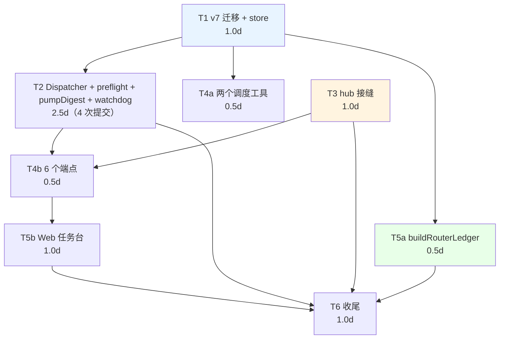

# F-58 Router–Worker 调度层 实施计划（P0）

> **For Claude:** REQUIRED SUB-SKILL: Use superpowers:executing-plans to implement this plan task-by-task.

**Goal:** 让 delta 支持「一个总管 + 每个任务一个临时 Worker」的多任务调度，Worker 可以是内置引擎，也可以是外部 CLI agent（F-55），并把结果主动播报回 Router——用户不需要在多个窗口间来回切换。

**Architecture:** 不引入新执行单元。Router = `kind='router'` 的普通会话，工具集被 `restrictRegistry` 收窄到 `{dispatch_task, task_status}`（结构上无执行能力，`hub.ts:685` 现有收窄点）；Worker = 每个任务临时创建的独立会话，复用 `hub.send()` 全链路。新增 `packages/core/src/router/`（dispatcher / preflight / ledger / watchdog / store），在 `hub.send` 的 `finally`（`hub.ts:935-960`）挂 `onRunFinished` 回写任务状态。并行 = 多会话并行，不动消息表、不动 provider 契约、不动任一引擎。

**权威设计：** `docs/design-f58-router-worker.md`（已定稿 r3，含 15 条决策、v7 DDL、AC1–AC9、§19 裁决记录）。**实施中与设计稿不符时，以设计稿 §19 的裁决为准；裁决未覆盖的，停下来问，不要自行发挥。**

**Tech Stack:** TypeScript / vitest / better-sqlite3 迁移 **v7** / Pinia + Vue3（Web 任务台）/ Mermaid 无关。

**分支：** `feat/F-58`（自 master 切出）。提交格式 `类型(模块): 描述`；docs 与代码分开提交。

> **修订 r2（2026-11-06）**：交叉评审发现两处与设计稿的缺口，已修——① AC3 依赖的 `done.exitCode`（§6③）无落点，`shared/src/index.ts` + `engine/external.ts` 并入 T4；② §6⑤ usage 口径拆分显式推 P1 并留痕（见 T5）。

**门禁（每个 Task 收尾必跑）：** `pnpm typecheck && pnpm test`（改动涉及的 package 全量）；T5 结束加 `pnpm smoke:web`；T6 加 `pnpm smoke`。

---

## P0 总表

| 任务 | 标题 | 人日 | 依赖 | 覆盖 AC |
|------|------|------|------|---------|
| **T1** | v7 迁移 + `WorkerTaskStore` / `InboxStore` + `sessions` 三列读写 | 1.0 | — | AC3/AC6 的基础（无独立 AC，被后续全部任务依赖） |
| **T2** | `Dispatcher` 状态机 + `preflight` 门禁 + `pumpDigest` 播报 + 看门狗 L1/L2（**拆 4 次提交**） | 2.5 | T1 | AC4、AC5、AC7、AC9 |
| **T3** | hub 接缝：Router 注册表收窄 + `peekRunning` + `onRunFinished` | 1.0 | T1 | AC1、AC2 |
| **T4** | 两个调度工具 + 6 个 HTTP 端点 | 1.0 | T1、T2（接口）、T3（注入点） | AC1、AC2、AC4、AC5 |
| **T5** | `buildRouterLedger` 台账 + Web 任务台（`pumpDigest` 已由 T2 提供） | 1.5 | T1、T4（端点） | AC6、AC8 |
| **T6** | 测试收尾 + 全量回归 + 文档回写 | 1.0 | T1–T5 | AC1–AC9 全绿 |
| | | **8.0** | | |

> 合计 **8.0 人日**，比设计稿 §17 的 7 人日多 1 人日，两处差异都写在明处：
> ① **+0.5**：看门狗 L1/L2 在 §17 里被隐含进"调度核心"，实施层面它是一次独立的 60s tick 实现 + 4 类判据（含"L1 不得在 30 分钟处杀掉活 Worker"这条防回归），不得不单列（T2d）；
> ② **+0.5**：T5b 的 Web 侧联调余量（轮询 store + `smoke:web` 首次接入的返工概率）。
> 若必须压回 7 人日，建议从 P1 挪走"L3 判据调优"，而不是压缩 T2c/T2d 的测试面。

**提交总数：11 次**（T1 ×1 / T2 ×4 / T3 ×1 / T4 ×1 / T5 ×2 / T6 ×2），每个 Phase 只在 `pnpm typecheck && pnpm test` 全绿后才开下一个任务。

---

## 依赖图与并行判断

**可真正并行的两对：**

1. **T2 ∥ T3**——这是本计划唯一无争议的并行。T3 只改 `hub.ts`（注册表收窄分支、`peekRunning`、`finally` 里的回调透传），T2 只写 `router/` 目录下的新文件 + 测试用的是 fake hub。两者文件零交集，接口只有一个 `SessionHubDeps.onRunFinished?` 的签名，先在 T2 里按约定类型写死即可。
2. **T4a ∥ T5a**——调度工具（`tools/builtin/dispatch.ts` + `permissions.ts` + `types.ts`）与台账纯函数（`router/ledger.ts` + 单测）都只依赖 T1，文件零交集。

**不能并行的一对（重要）：** **T4（端点）与 T5（TaskBoard）不能并行**。TaskBoard 的数据源就是 T4 的 `GET /api/projects/:id/worker-tasks` 与 `GET /api/projects/:id/inbox`；两者共用 store 不构成并行理由，反而端点形状未定就写 store 会返工。因此把 T5 拆成 **T5a（台账，可与 T4 并行）** 与 **T5b（Web 任务台，必须等 T4b）**。

---

## 任务粒度校验（标尺：一个任务 = 半天到一天）

| 任务 | 估算 | 是否达标 | 处置 |
|------|------|---------|------|
| T1 | 1.0d | ✅ | 不拆 |
| T2 | 2.5d | ❌ **超 1 天** | **拆 4 次提交**（T2a 状态机 0.8d / T2b preflight 0.5d / T2c pumpDigest 0.7d / T2d 看门狗 0.5d），**任务号仍为 T2** |
| T3 | 1.0d | ✅ | 不拆（(a)–(e) 五处改动都在 `hub.ts` 同两个区域，拆开会产生多次 merge 冲突） |
| T4 | 1.0d | ✅ | 内部再分 T4a（工具）/ T4b（端点），各 0.5d |
| T5 | 1.5d | ❌ **超 1 天** | 拆 **T5a**（ledger 0.5d）/ **T5b**（TaskBoard 1.0d） |
| T6 | 1.0d | ✅ | 不拆 |

**T2 为何不拆成独立任务号**：T2a/T2b/T2c/T2d 四者共用同一套 fake-hub + 临时 SQLite 测试脚手架（`test/helpers/fake-hub.ts`、内存库迁移）。拆成四个顶层任务会让脚手架的搭建/维护重复 4 次，反而比串行做完更慢——这是"按可验证单元拆分"而非"按文件拆"的反例，故只在提交粒度上拆。

**T5b 为何不并回 T5a**：T5a 是纯函数（零 IO、零 UI、可 TDD），T5b 是 Vue 组件 + Pinia store + 轮询（需要 `smoke:web` 门禁）。两者的验证手段完全不同，串在一起会让"台账裁剪对不对"被"页面渲染对不对"掩盖。

---

## T1：v7 迁移 + `WorkerTaskStore` / `InboxStore` + `sessions` 三列读写

**依赖：** 无（第一个任务）

**Files:**
- Modify: `packages/core/src/session/migrations.ts`（`MIGRATIONS` 数组末尾追加 `version: 7`，`LATEST_SCHEMA_VERSION` 随之变 7；**不得修改 v1–v6**）
- Modify: `packages/core/src/session/store.ts`（`sessionColumns()` 带 `kind`/`role_label`/`task_id`；新增 `setSessionKind` / `setSessionTask`）
- Modify: `packages/core/src/session/service.ts`（挂载 `workerTasks` / `inbox` 两个 store，与既有 `tasks`/`memory`/`changes` 同一装配风格，`service.ts:41-56`）
- Create: `packages/core/src/router/types.ts`（`TaskStatus` / `WorkerTaskRow` / `InboxItem` / `DispatchRequest` / `PreflightResult`，DTO 侧另出 `WorkerTaskView`）
- Create: `packages/core/src/router/store.ts`（`WorkerTaskStore`：`create/get/list/claimSlot/transition/setResult/setDecision/countRunning/listTerminalSince`；`InboxStore`：`append/listUndelivered/markDelivered/unmarkDelivered/lastDeliveredAt`）
- Test: `packages/core/test/migrations-f58.test.ts`、`packages/core/test/router-store.test.ts`

**完成判据：**
1. 空库直跑迁移到 v7 后，`sessions` 有 `kind`(NOT NULL DEFAULT `'chat'`)/`role_label`/`task_id`，`worker_tasks` 与 `task_inbox` 两表存在且 4 个索引存在；
2. 由 **v6 旧库**（v1–v6 全跑完）升级到 v7：历史行 `kind='chat'`、`role_label IS NULL`；
3. `user_version` 被外部改小后重放 v7：`skipIf` 命中跳过 ALTER，`repairSql` 仍建出 `idx_sessions_project_kind`（对齐 `migrations.ts:195-203` 的 v5 写法）；
4. `claimSlot` 是**单条 UPDATE ... WHERE status='queued'** 的原子认领（并发两次只有一次 `changes===1`）；
5. `InboxStore.markDelivered` 幂等（重复调用不报错、`delivered_at` 不被覆盖）。

**红线：** 金额不入 `worker_tasks`（裁决：金额从 `usage` 按 `session_id` 聚合，禁止双写）；`worker_tasks.role_label` 与 `sessions.role_label` 只是 UI 标签，store 层不得据此做任何过滤/分支。

**Commit:** `feat(core): F-58 迁移 v7——worker_tasks/task_inbox + sessions.kind/role_label/task_id`

---

## T2：`Dispatcher` 状态机 + `preflight` 门禁 + `pumpDigest` 播报 + 看门狗 L1/L2

**依赖：** T1（store）

**Files:**
- Create: `packages/core/src/router/dispatcher.ts`（`Dispatcher`：`dispatch` / `claimSlot` / `onRunFinished` / `decide` / `cancel` / `bootstrap` / `pumpDigest` / `tick`）
- Create: `packages/core/src/router/preflight.ts`（`preflight(task, deps)`：复用 `probeAgent`（`external/detect.ts:370`）+ `checkLoginState`（`:580`）+ `resolveExternalAdapter`（`external/registry.ts:31`）+ 只读档能力门禁）
- Create: `packages/core/src/router/watchdog.ts`（`watchdogTick(dispatcher, deps)`：L1 / L2a / L2c；**L3 只落"标记接口"，P0 不接便宜模型**，`watchdog_flag` 字段由 T1 建好）
- Create: `packages/core/src/router/prompt.ts`（`buildDispatchToolPrompt()`：`dispatch_task` 的参数说明文本，**唯一提示词资产**）
- Test: `packages/core/test/helpers/fake-hub.ts`（本任务建，后续 T5 复用）、`packages/core/test/router-dispatcher.test.ts`、`packages/core/test/router-preflight.test.ts`、`packages/core/test/router-digest.test.ts`、`packages/core/test/router-watchdog.test.ts`

**拆 4 次提交（T2c/T2d 挂在同一个 60s tick 循环上）：**

**T2a —— 状态机（0.8d）**
`dispatch()`（写行 → `queued`）、`claimSlot()`（受 `maxConcurrentWorkers` 约束，默认 3）、`onRunFinished(sessionId, outcome)` 收敛、`decide()`、`cancel()`、`bootstrap()`（启动时把 `running/preflight` 且 `peekRunning===false` 的行标 `failed(runtime)`）。
判据：设计稿 §7.4 状态机的每一条边都有用例；非法迁移（如 `done → running`）抛错；`needs_decision` 不占并发槽位；依赖未满足（`depends_on` 有未终态项）不派发。

**T2b —— preflight 门禁（0.5d）**
三条失败路径各落 `needs_decision` 且**不建会话、不拉进程、`attempt` 不递增**：① `executor` 解析不到 adapter；② `probeAgent` 失败/超时（`PROBE_TIMEOUT_MS=3000`）；③ 任务要求 `plan` 但目标 agent 三档不支持只读（用 `GET /api/external-agents` 同源数据，见设计稿 §6⑥）。
判据：三条路径各 1 个用例 + "进程数为 0" 断言（fake detect）。

**T2c —— `pumpDigest` 播报（0.7d，**本任务风险最高的一段**）**
按设计稿 §10.1 实现四条件（C1 有 batch/interrupt 未送达 → C2 窗口关闭 → C3 `peekRunning===false` → C4 60s 防抖），**先写 `delivered_at` 再 `hub.send`**，`send` 失败回滚为 `NULL`。
判据：4 个条件各 1 个单变量用例 + 幂等（连调 4 次只 send 1 次）+ 防自激（send 期间注入新条目不被本轮重复播报）+ 失败回滚。

**T2d —— 看门狗 L1/L2（0.5d）**
与 T2c 共用 `tick()`（60s）。L1：`peekRunning(workerSessionId) === false && status === 'running'` → `failed(runtime)`；L2a：内置 Worker 的 `file_changes.path` 越出 `work_root` → `hub.abort` + `failed(watchdog_l2)` + **不重试** + inbox `interrupt`；L2c：≥20 分钟无任何 AgentEvent 产出（阈值必须 <30 分钟，否则会先被既有 `zombieReap` 杀掉，见设计稿 §9.3）。L3 只留 `markSuspect(taskId)` 空实现与 `watchdog_flag` 写入点，**不接模型、不判偏离**（P1）。
判据：**AC7** 两条判据分别验 + **"L1 不得在 30 分钟处杀掉活着的 Worker"** 防回归用例（伪 `startedAt` 超 31 分钟 + `peekRunning===true` → 任务仍 `running`、`running` 表未被清理、未推 `run_error`）；L2a 用 `path.relative` 判 `..`，含 Windows 盘符大小写用例。

**Commit 序列：** `feat(core): F-58 Dispatcher 任务状态机` → `feat(core): F-58 preflight 门禁（探测/登录态/只读档）` → `feat(core): F-58 pumpDigest 主动播报（先标记后发送）` → `feat(core): F-58 看门狗 L1/L2（peekRunning + 路径越界）`

**红线：** dispatcher **不 import `server/`**（依赖方向：`runtime` 装配时注入 `{ send, peekRunning, isRunning }` 三个函数），否则 `router/` 与 `server/` 循环依赖。

---

## T3：hub 接缝——Router 注册表收窄 + `peekRunning` + `onRunFinished`

**依赖：** T1

**Files:**
- Modify: `packages/core/src/server/hub.ts`：
  - (a) `hub.ts:685` 收窄点加分支：`session.kind === 'router'` → `restrictRegistry(deps.registry, new Set(['dispatch_task','task_status']))`（与 F-39 专家收窄取交集，不得覆盖）；
  - (b) 新增 `peekRunning(sessionId): boolean`（= `this.running.has(sessionId)`，**纯读，不调 `zombieReap`**）；
  - (c) `SessionHubDeps` 增 `onRunFinished?: (sessionId, outcome: { runError?: string; aborted: boolean; durationMs: number }) => void`；
  - (d) `hub.ts:935-960` 的 `finally` 里调 `deps.onRunFinished?.()`，**复用现有的 `runError` / `acRef?.signal.aborted` / `durationMs` 三个变量，零新增判定**；
  - (e) `send` 入口防御：`kind==='router' && isExternalModel(session.model)` → 发 `run_error` 拒绝运行。
  - **注**：`PATCH /api/sessions/:id` 与 `/permission` 的 Router 校验属 `http.ts`，放到 T4 一起改（同一文件不跨任务改，避免 merge 冲突）。
- Test: `packages/core/test/router-hub.test.ts`

**完成判据：**
1. **AC1**：Router 会话跑一轮，fake provider 捕获的 `ChatRequest.tools` **集合等于** `{dispatch_task, task_status}`（`run_command`/`write_file`/`read_file`/`glob_search` 等全部缺席）；
2. **AC2**：Worker 运行中向 Router 发消息不 409；向同一 Worker 发消息仍 409（`http.ts:1026` 语义不变）；
3. `peekRunning` 不产生副作用：用一个 `startedAt` 超过 31 分钟的伪 entry，`peekRunning` 返回 `true` 且 `running` 表**未被清理**、未推 `run_error`（这是 §9.3 的核心回归）；
4. `onRunFinished` 在 done / failed(异常) / aborted 三条路径都被调用且参数正确（用 spy 断言）；
5. **`isRunning` 行为零变化**（与 `zombieReap` 的既有测试一起回归）。

**红线：** 不得修改 `isRunning` / `zombieReap` / `runningSessionIds` 的语义（那会动 F-23/PASI-9 的运行态语义，裁决 Q4 明确不在本特性做）。

**Commit:** `feat(core): F-58 hub 接缝——Router 工具收窄 + peekRunning + onRunFinished`

---

## T4：两个调度工具 + 6 个 HTTP 端点

**依赖：** T1（store）、T2（`Dispatcher` 接口，可用 fake 实现先写测试）、T3（`ToolContext` 注入点 + 收窄生效）

**Files:**
- Create: `packages/core/src/tools/builtin/dispatch.ts`（`dispatch_task` / `task_status`；`dispatch_task` 的 `description` 必须写明「**派单不执行**，仅落库并创建 Worker 会话」——裁决 Q3）
- Modify: `packages/core/src/tools/permissions.ts`（`TOOL_CAPABILITY` 增 `dispatch_task: 'read'`、`task_status: 'read'`，`BUILTIN_TOOL_COUNT` +2）
- Modify: `packages/core/src/tools/types.ts`（`ToolContext.dispatcher?`，缺省 = 未装配）
- Modify: `packages/core/src/server/http.ts`：6 个新增端点 + 两处既有端点校验（裁决 Q1/Q3：`PATCH /api/sessions/:id` 不新增 `kind`/`role_label`/`task_id` 写入口；`PATCH /api/sessions/:id/permission` 对 `kind='router'` 返回 400）
  - `POST /api/projects/:id/router`（取或建 Router 会话，幂等）
  - `GET /api/projects/:id/worker-tasks?status=&limit=`
  - `POST /api/projects/:id/worker-tasks`（手工建任务，body 同 `dispatch_task`）
  - `POST /api/worker-tasks/:id/decision`（`retry`/`cancel`/`accept`）
  - `POST /api/worker-tasks/:id/cancel`
  - `GET /api/projects/:id/inbox?delivered=0`
- Modify: `packages/core/src/server/runtime.ts`（装配 `Dispatcher`，注入 `{send, peekRunning, isRunning}`；`dispose` 时 `abortAllWorkers`）
- Modify: `packages/shared/src/index.ts`（`AgentEvent.done` 增可选 `exitCode?: number`，设计稿 §6③——AC3 的判定依赖此字段，**修订补充：原计划漏列**）
- Modify: `packages/core/src/engine/external.ts`（收尾处把 `outcome.exitCode` 带进 `done` 事件，1 行；同时修 `fatal: !produced` 的漏判——`exit≠0 且无产出` 才判 `error{fatal}`，`exit≠0 但有产出` 走非致命 `runError`，§6③）
- Test: `packages/core/test/router-tools.test.ts`、`packages/core/test/router-http.test.ts`

**完成判据：**
1. 未注入 `dispatcher` 时两个工具报 `dispatcher_unavailable`（对齐 F-26 `task_unavailable` / F-54 的"能力未装配"口径），定义仍可见；
2. `dispatch_task` 落库后返回 `{task_id, status:'queued'}`，**不创建会话**（创建发生在 dispatcher 的 `claimSlot`，可测）；
3. 6 个端点：正常路径 + 404 + 409 + `kind='router'` 校验 + 未装配时 501（对齐 F-54 的 501 口径）；
4. `runtime` 装配后 `dispose()` 会 abort 所有运行中 Worker 且不留孤儿任务（`running` 行全部收敛为 `failed(runtime)` 或 `canceled`）；
5. **AC5**：一次派 10 个任务，`running` 数恒 ≤ 3，其余 `queued`（fake hub 计数）；
6. `exitCode` 通路：外部引擎 `done{exitCode: 非0, 无产出}` → `onRunFinished` 收敛为 `failed(runtime)`；`exit≠0 但有产出` → 非致命（任务可 `done` 但 `run_error` 有值），用 fake adapter 断言（AC3 判定核心，见设计稿 §6③）。

**Commit:** `feat(core): F-58 dispatch_task/task_status 工具 + 调度端点 + runtime 装配`（含 shared `exitCode` 与 `engine/external.ts` 带出，同一提交——两处合计 ≈3 行，不值得拆分）

---

## T5：`buildRouterLedger` 台账 + Web 任务台

**依赖：** T1（store）、T4（端点：T5b 硬依赖）；`hub.ts` 的台账注入点须排在 **T3 合入之后**（同一文件串行，见风险 7）

**Files:**
- Create: `packages/core/src/router/ledger.ts`（`buildRouterLedger() → { text, estTokens }`、`estTokensOf()`）
- Create: `packages/core/test/router-ledger.test.ts`
- Modify: `packages/core/src/server/hub.ts`（`buildPrompt` 的动态段拼入台账；**只在 `kind==='router'` 时**）
- Modify: `packages/web/src/api/client.ts`（`WorkerTaskView` / `InboxItemView` 类型 + 6 个 api 函数）
- Create: `packages/web/src/stores/tasks.ts`（轮询 store，2s；**完全照 `bgTasks.ts` 的 watch/refresh/切会话重置模式**）
- Create: `packages/web/src/components/TaskBoard.vue`（状态点 + 结论 + 存疑角标 + 裁决入口）
- Create: `packages/web/src/components/TaskDecisionDialog.vue`（`needs_decision` 裁决）
- Modify: `packages/web/src/views/WorkbenchView.vue`（侧栏挂 `TaskBoard`）
- Test: `packages/web/src/stores/tasks.test.ts`

**T5a —— 台账（0.5d，可与 T4 并行）**
**AC6**：连续 20 个任务后 `estTokens ≤ 4000`；`text` 不含任何 `messages` 内容；裁剪顺序按设计稿 §8.2（`needs_decision` 与未送达 `interrupt` 永不裁；超 2× 预算降级为计数摘要）。
判据：纯函数单测覆盖裁剪 5 步 + 预算边界 + 永不裁项；`estTokensOf` 与 `openai-compatible.ts:29` 同规则（CJK 1 tok/char、latin 3 chars/tok）的用例（中文 100 字 → 100）。

**T5b —— Web 任务台（1.0d）**
**AC8**：单个任务成功只产生 `silent` 条目、不产生 interrupt；≥2 条终态触发 1 条 `batch`；`needs_decision` / L2 kill 必为 `interrupt`（红点）。
判据：store 单测（切项目重置、过期响应丢弃、interrupt 计数）+ 组件渲染三类状态 + `pnpm smoke:web` 通过。

**红线：** 任务台只是展示层，**不得**在组件里做派单/裁决的乐观状态机（裁决必须等端点返回后 refresh）；`role_label` 只作为标签渲染。

**显式推 P1（修订补充，防实施时被当遗漏）：** 设计稿 §6⑤/§12 的 `session/usage.ts` `summary()` 拆 `metered_cost_usd` / `subscription_tokens` + `UsageModal.vue` 分栏，**不进 P0**——AC1–AC9 无一覆盖计费展示，且该改动与调度链路零耦合（不依赖任何 F-58 端点/store）。推后理由与触发条件（用户在订阅制 agent 上跑 Worker 后看 F-31 报表）记入 T6 的设计稿 §21 回写。

**Commit:** `feat(core): F-58 Router 台账裁剪（estTokens≤4000）` → `feat(web): F-58 任务台 + 裁决弹窗（轮询 store）`

---

## T6：测试收尾 + 全量回归 + 文档回写

**依赖：** T1–T5 全部合入

**Files:**
- Modify: `packages/core/test/router-watchdog.test.ts`（T2d 已建；本任务补 **AC7 的外部 Worker 分支**：外部无 `file_changes` 落点 → 路径越界降级为 `suspect` 标记，不 kill；这条用例在 T2d 里无法写，因为要等 T4 的 fake CLI 派单链路通）
- Test: `packages/core/test/router-ac.e2e.test.ts`（AC1–AC9 的端到端串联：一对 fake hub + fake provider + fake detect，跑完整「派单 → 完成 → 播报」一轮）
- Modify: `docs/design-f58-router-worker.md`（回写实施期发现的偏差，追加「§21 实施记录」段落，**不改已裁决内容**。修订补充：§21 需同时记录三条——① §12 模块清单 `watchdog.ts: tick(L1/L2) + judge(L3)` 与 P0 实际「L3 只落标记接口」的措辞张力（以本计划为准）；② §6⑤ usage 拆分推 P1（见 T5）；③ 真实三档能力手工 smoke 的结果（风险 1））
- 全量：`pnpm typecheck && pnpm test && pnpm smoke && pnpm smoke:web`

**完成判据：** AC1–AC9 逐条勾选通过（见下「收尾验收核对」）；`multi` / 外部会话 / F-54 后台任务既有用例零失败；服务重启后 `bootstrap()` 正确收敛僵尸任务（手工验证一次）；`pnpm smoke` 与 `pnpm smoke:web` 全绿。

**为什么 T6 不再实现业务代码：** P0 的实现面已在 T1–T5 全部落地，T6 只做「跨任务串联 + 全量回归 + 文档回写」。若在 T6 发现需要新增业务逻辑，说明前面某个任务的完成判据写漏了，应回到那个任务补测试而不是在收尾任务里加实现。

**Commit:** `test(core): F-58 AC1–AC9 端到端串联 + 外部 Worker 越界降级用例` 与 `docs: F-58 实施记录回写`

---

## 收尾验收核对（对照设计稿 §15）

- [ ] **AC1** Router 请求体工具集 = `{dispatch_task, task_status}`，执行类工具全部缺席
- [ ] **AC2** Worker 运行中 → Router 可继续接指令；同一 Worker 仍 409
- [ ] **AC3** `cli:*` 派单 `queued → preflight → running → done`；`exit≠0 且无产出` → `failed(runtime)`（依赖 `done.exitCode`）
- [ ] **AC4** preflight 三路失败 → `needs_decision`，`attempt` 不递增，inbox 1 条 interrupt，零进程
- [ ] **AC5** 10 个任务并发下 `running ≤ maxConcurrentWorkers`，其余 queued
- [ ] **AC6** 20 任务后台账 `estTokens ≤ 4000` 且不含 messages
- [ ] **AC7** 内置 Worker 越界 → `failed(watchdog_l2)` 不重试；外部 Worker 同场景只打 `suspect`
- [ ] **AC8** 成功静默 / 2 条终态 1 条 digest / needs_decision 与 L2 kill 必 interrupt
- [ ] **AC9** 单任务成功不触发 Router；2 条终态且 Router 空闲恰好触发 1 次；Router 运行中不触发只留 inbox

---

## 风险与前置检查

**1. preflight 的真实性：CI 不装真 CLI。**
`probeAgent` / `checkLoginState` 的单测**全部走 fake detect**（注入 `runner`），CI 不依赖本机装有 codebuddy/cursor/opencode。真实三档能力的验证只在手工 smoke 里做一次，结果回写设计稿 §21。若某 agent 的 `--version` 探测在 CI 环境意外成功（PATH 里恰好有同名二进制），测试必须用显式 `env` 覆盖隔离 HOME 与 PATH——对齐 F-55 的 `DELTA_EXTERNAL_<ID>_PATH` 手法。

**2. v7 迁移不可回滚。**
`migrate()` 在 `from > LATEST_SCHEMA_VERSION` 时直接抛错（`migrations.ts:242-246`），且**发布后不得修改 v7 的 SQL**。开发期要改表结构：删掉本地 `~/.delta/agent.db` 重跑，而不是"改迁移内容 + 手改 user_version"（后者会在升级路径上留下无法复现的库）。T1 必须同时覆盖「空库直达」与「v6 库升级」两条路径，这是唯一能提前发现问题的护栏。

**3. Windows 测试守卫。**
本层绝大多数测试用 fake hub、不 spawn 进程；但 **AC3 的假 CLI fixture 用例**会真启子进程，Windows 上按仓库既有口径加 `skipIf(win32)` / `itPosix`（对齐 F-54 `spawn` 语义测试的 `skipIf(win32)`）。另外 **L2a 路径越界判据必须用 `path.relative(workRoot, p)` 判 `..` 前缀**，不能用字符串 `startsWith`（`C:\` vs `c:\`、`/` vs `\` 会误判为越界或漏判）。

**4. 自激循环是 T2c 的头号风险。**
`pumpDigest` 会调 `hub.send` 让 Router 运行，而 Router 运行结束又会触发 `onRunFinished → pumpDigest`。唯一防线是「先写 `delivered_at` 再发送」+ 60s 防抖。**不允许"看代码觉得对"就合并**——必须有"连调 4 次只 send 1 次"的断言。

**5. 不要动 `isRunning` / `zombieReap`。**
裁决 Q4 已定：`>30min` 作为不可交付场景（设计稿 §18-8），本特性不改僵尸策略。谁在实现中"顺手把阈值调大"，就等于改了所有会话的运行态语义，必须回评审。

**6. 依赖方向。**
`router/` 不 import `server/`；`hub` 不 import `router/`。两边只通过 `runtime.ts` 注入的函数与 `SessionHubDeps.onRunFinished?` 这一个回调类型耦合。一旦发现需要反向 import，说明接缝选错，停下来重新评审（与 F-55 的"`react.ts` 不许改，改了说明接缝选错"同一条纪律）。

**7. 同一文件的串行约束（并行时的冲突源）。**
`hub.ts` 被 T3（收窄/peekRunning/onRunFinished）与 T5a（台账注入 `buildPrompt` 动态段）先后修改；`http.ts` 被 T4 独占；`dispatcher.ts` 被 T2 建、被 T5a 只读调用。并行的 T2 ∥ T3 与 T4a ∥ T5a 都刻意避开了同文件；**若某个并行分支不得不改同一文件，改为串行合入，不要靠 rebase 解决**（`hub.ts` 的 finally 块与 buildPrompt 相隔很近，冲突解决错一行就会静默丢状态回写）。

**8. 一致性自检时机。**
T3 合入后立刻做一次"三分钟检查"：`grep -n "peekRunning" packages/core/src` 应只有 hub 定义 + dispatcher/watchdog 调用；`grep -rn "isRunning" packages/core/src/router` **必须为空**（看门狗误用 `isRunning` 是本设计最贵的 bug，见设计稿 §9.3）。
