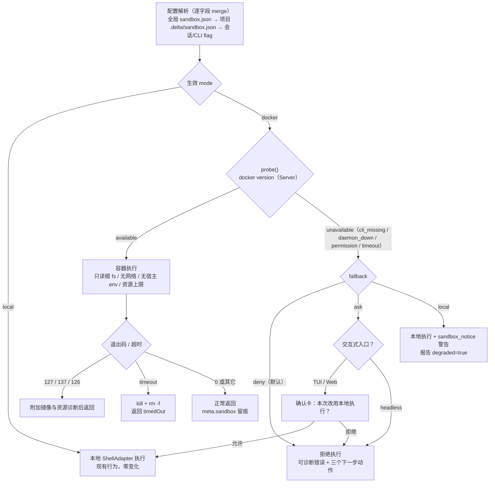

# F-30 容器级沙箱 —— 增量 PRD

> 版本：v0.1 ｜ 日期：2026-10-23 ｜ 状态：待评审
> 上游：docs/PRD.md P2 需求池 F-30 ｜ 本文只描述**相对现有系统的增量**，不重复整体产品定义

---

## 1. 一句话定位与背景

**一句话**：给 `run_command` / `run_tests` 增加一个可选的 **Docker 执行后端**——命令跑在一次性 Linux 容器里（只挂载项目工作区、默认无网络、无宿主环境变量、CPU/内存/进程数受限），作为现有「白名单 + 确认流 + 路径沙箱」之外的**第三层物理隔离**，用于执行来源不可信或不放心在宿主机跑的命令。

**背景**：当前 `run_command`（`packages/core/src/tools/builtin/exec.ts`）直接经 `ShellAdapter` spawn 宿主 shell，安全手段只有三层**逻辑**防护——`resolveInSandbox`（路径不出项目根）、`COMMAND_WHITELIST`（27 个常用 bin）、`danger:'confirm'` + F-23 权限模式（plan/default/yolo）。逻辑防护有两个绕不过去的洞：

1. **白名单只校验首 token**：`git` 白名单放行，`git -c core.pager='rm -rf ~' log` 照样能执行任意 shell；`node`/`python3`/`make` 本身就是任意代码执行入口。白名单的实际含义是「首词可信」，不是「行为可信」。
2. **确认流依赖人**：default 模式每命令一确认，长任务里用户会退化成交付式盲批；yolo 下非白名单命令仍确认，但白名单命令已经全放行。一旦模型被提示词注入诱导，宿主机的 `~/.ssh`、`~/.delta/models.json`（Provider Key 加密文件）、`~/.delta/agent.db` 全在射程内。

容器把「信任判断」从**字符串匹配**换成**内核边界**：即使命令完全恶意，能碰到的也只有挂进去的项目目录。

**必须正面回答的现实约束（已确认事实）**：本机 **Docker CLI 28.5.1 已安装，但 daemon 当前未运行**。所以本特性的第一条产品红线不是「怎么跑容器」，而是「**Docker 不可用时系统怎么表现**」——任何需要用户先启动 Docker 的设计都必须给出可执行、可理解的失败路径，不能把「首次使用体验」变成一个看不懂的报错。

**存量代码零改动的承诺**：默认生效模式为 `local`，即不配置任何沙箱设置时，`run_command` 的行为、提示词、确认卡、超时口径、输出截断**与今天逐字节一致**。

---

## 2. 目标与非目标

### 2.1 产品目标（三条，互相正交）

| # | 目标 | 衡量方式 |
|---|------|----------|
| G1 | **可隔离**：让用户能在一个可信边界内执行不放心在宿主跑的命令，且隔离强度不依赖命令字符串的形态 | 容器内 `rm -rf /`、`curl` 外传、读 `~/.ssh` 全部无效；路径逃逸用例 100% 被拒 |
| G2 | **可预期**：执行环境永远明确可查——用户在确认卡上、工具卡片上、报告里都能看出这条命令跑在哪里 | 100% 的 exec 类工具调用在 UI/报告中带执行环境标识；不存在「静默降级」 |
| G3 | **不添堵**：Docker 的缺失、冷启动、镜像拉取、网络受限都不应制造无法自救的死路 | 每种失败都给出「下一步怎么做」的具体指令；未启用沙箱的用户感知不到本特性存在 |

### 2.2 关键产品决策速览（12 问 12 答）

> 每条结论后括注展开章节。**这是本 PRD 的主干**，架构师读这一张表即可掌握全部姿态。

| # | 决策点 | 结论 | 理由（一句话） |
|---|--------|------|----------------|
| 1 | 默认开还是关 | **默认关**（`mode = local`）；容器是**显式启用**的加固，不是默认护栏 | 存量用户行为不能突变；Docker daemon 随时可能不在（本机当前即如此），默认开会把首次体验变成错误路径。但提供**项目级强制开启**（`.delta/sandbox.json` 设 `mode: docker`）与 `status` 检测到可用时的一行推荐提示，让团队能一键为新成员默认加固（§4.4） |
| 2 | 开关粒度与作用域 | 三级覆盖，与 F-10 一致：全局 `~/.delta/sandbox.json` < 项目 `.delta/sandbox.json` < 会话/单次（CLI flag、Web 会话设置）；**逐字段 merge**，非整体替换 | sandbox 是多字段配置（镜像/网络/资源），整体替换会让「项目只改镜像」意外丢掉全局的资源上限（§4.4、§6） |
| 3 | 执行模式枚举 | 用户可见枚举只有两个值：**`local` / `docker`**。`auto` 不是模式，只是「降级判定算法」的内部概念，不落盘、不出现在配置里 | 两值即可穷尽；引入 `auto` 会让「这条命令到底跑在哪」变成不可预测，测试面与用户心智双输 |
| 4 | 是否按命令自动切换 | **不做**。不存在「危险命令自动进容器、安全命令留本地」的智能路由。`yolo`/`plan` 也不改变 mode | 自动切换=不可预期=不可测；且判据（命令危险度）本质不可靠——`node xxx.js` 到底是危险还是安全取决于文件内容，静态无法判断。策略必须由人定，不能由启发式定（§2.3 非目标） |
| 5 | Docker 不可用时 | **默认硬失败（fail-closed，`fallback: 'deny'`）**：拒绝执行 + 可诊断错误，不静默降级。提供 `fallback: 'deny' │ 'ask' │ 'local'` 三档供用户显式选择；`ask` 在 TUI/Web 弹一次「本次改用本地执行？」确认卡，**headless 下 `ask` 等价 `deny`** | 静默降级＝安全承诺失效＋用户不知道隔离没生效，这是安全事故的经典形态。`deny` 是唯一「说到的隔离就是隔离」的语义。放弃的可用性用「错误文案必须可直接照做」补回来（§4.5） |
| 6 | 镜像策略 | 默认镜像 **`node:22-bookworm-slim`**（固定到 minor 线、跟随安全补丁，不锁 patch）；全局/项目/单次均可覆盖 `image`；工作区**读写挂载** + 容器**根文件系统只读** + `/tmp` 与 `HOME` 走 tmpfs；首次执行**懒拉取**（进度旁路到用户侧，不进模型上下文），另提供 `delta sandbox pull` 预热 | 默认镜像必须能跑 `pnpm`/`node`——即 delta 自身与绝大多数目标项目；只读根 fs 是「不能改系统、只能改工作区」的最强单条加固；lock patch 会让 CVE 滞留，跟随 minor 更稳（§4.3、§7） |
| 7 | 工作区挂载 | 只挂 `projectRoot`（经 `realpath`）→ 容器 `/workspace`；容器内 cwd = `/workspace/<相对 cwd>`；`cwd` 参数仍先过 `resolveInSandbox`；**明确禁止挂载 `docker.sock`、`~`、`/var/run`，配置项校验时直接拒绝** | 路径沙箱在容器内**继续生效且叠加**：宿主侧校验决定「允许挂什么」，内核边界兜底「挂进去之后碰不到别的」。挂 docker.sock = 容器内 root ≈ 宿主机 root，等于白做（§4.6） |
| 8 | 网络策略 | 默认 **`--network none`**；可 `bridge`（全局/项目/单次）。命中「疑似需要网络」的安装类命令时**不自动放行**，而是返回带解决方案的失败说明；一次性网络放行确认留 P1 | 默认放行网络等于把供应链与数据外传重新打开；但 `pnpm install` 是高频场景，所以「不自动放行」必须配「立刻告诉你怎么办」，否则用户只会觉得工具坏了（§4.7） |
| 9 | 隔离边界与凭据 | **零继承宿主环境变量**（不是黑名单排除 `*_KEY/*_TOKEN`，而是默认一个都不传，仅注入 `LANG`/`TZ`）；加固基线：`--read-only` + `--cap-drop ALL` + `--security-opt no-new-privileges` + `--user 1000:1000`（仅默认镜像）+ `--memory 2g` + `--cpus 2` + `--pids-limit 512`。项目级可选 env **名称白名单**（P1） | 黑名单是「漏一个就完蛋」，白名单是「漏一个就等于没配」——两者不对称，安全设计只能选白名单。全部加固项默认开启、可配降级，让「默认即最安全」成立（§7） |
| 10 | 与权限模式的关系 | **容器不改变 F-23 的任何判定结果**，只改变「判定为 allow 之后的执行环境」。plan 下 exec 仍直接 deny（容器不构成豁免理由）；default 下仍逐次确认；yolo 下白名单命令仍放行。**唯一强制新增**：确认卡与工具卡片必须标注执行环境 | 把「容器」当免确认许可证是错误类比——容器降的是**影响半径**，不是**意图风险**：一个在容器里执行错误的 `git push --force` 一样毁事。分开两件事，both 才能各自演进（§4.8） |
| 11 | 超时与输出 | 命令超时口径**完全沿用**（默认 120s / 上限 600s）；**镜像拉取不计入命令超时**（独立 `pullTimeoutMs` 默认 300s）；输出沿用 20k stdout / 4k stderr 截断；docker 自身的 pull/kill 噪声**不进模型上下文**，只走用户侧事件。残留清理：`--rm` + `finally` 里 `docker rm -f` + label 标记 + `delta sandbox gc` | 超时口径分裂会让模型对同一个参数产生两种语义预期；拉取计入超时必然导致「首次执行永远超时」的假故障（§4.9） |
| 12 | 可观测性与审计 | 工具结果 meta 附 `sandbox:{mode,image,containerName,network,exitCode,durationMs,pulled}`；新增 `sandbox_notice` 事件（降级/拉取/清理提示）；`--debug` 记全量 docker 参数。**不进 F-31 用量与费用统计**：headless `--json` 报告新增独立 `sandbox` 段，`usage.cost_usd` 分文不加 | 容器不消耗 token，混进费用口径会污染 F-31 刚建好的「钱＝模型调用」语义；但「这条命令跑了多久、在哪个镜像里」必须留痕，否则事后无法复盘（§4.10） |

### 2.3 非目标（Out of Scope，本期明确不做）

- **不做自建隔离运行时**：不引入 gVisor / Firecracker / nsjail / seatbelt / rootless 自定义 runtime，全部依赖本机 Docker 的既有能力
- **不做 Windows 容器**：只跑 Linux 容器（Windows 用户经 Docker Desktop 的 Linux 引擎）
- **不做远程 Docker host**：不支持 `DOCKER_HOST` 指向远端/CI runner，只连本机 daemon
- **不做镜像矩阵与自动推断**：不根据项目技术栈自动选镜像（默认单一 node 镜像 + 用户自定义），不做 python/rust/go 预置镜像
- **不做 compose 编排与依赖注入**：不启动数据库/缓存等 sidecar 服务；需要多容器的场景请用户自行用 hook 实现
- **不做命令级自动切换**：没有「危险命令自动进容器」的启发式路由（见 §2.2 #4）
- **不做任意挂载点配置**：挂载目标固定 `/workspace`，挂载源固定 projectRoot，`docker.sock` 永久拒挂
- **不做容器持久化环境**：容器一次性，退出即销毁；`node_modules` 等落在工作区（可用），宿主 `~/.npm` 缓存不复用
- **不改 F-24 变更管理语义**：checkpoint / diff / rollback 仍基于宿主机工作区（容器内改动经 bind mount 自然落盘，无需新机制）
- **不做容器资源用量进 F-31 报告**：不进 cost/token 口径
- **不给模型新增工具参数**：`run_command` 的 schema 不变，容器策略完全由用户/项目配置决定（模型可控参数会削弱策略保证，见 §4.8 末尾）

---

## 3. 用户故事

| 编号 | 角色 | 故事 | 验收标准 |
|------|------|------|----------|
| US-30-1 | 谨慎的开发者 | 我要跑一段从网上抄来的脚本/一个来源不明的 `postinstall`，但我不想让它在我的机器上跑 | 项目配置 `mode: docker` 后，`run_command` 在容器内执行；脚本尝试写 `~/x`、读 `~/.ssh`、`curl` 外传均失败；工作区内的预期产出正常落盘 |
| US-30-2 | 团队负责人 | 我要让团队里所有人的 agent 默认在容器里跑命令，防止有人被提示词注入搞坏机器 | `.delta/sandbox.json` 提交进仓库（`mode: docker` + `enforce: true`），新人 clone 后无需任何操作即在容器内执行；`enforce` 下任何会话级/单次降级尝试被拒绝并说明原因 |
| US-30-3 | 长任务用户 | 我要跑一个 20 分钟的构建，中途 Ctrl-C 时我不想留下 5 个僵尸容器 | 中断后容器被 kill + 删除；`delta sandbox status` 显示残留 0；即使宿主进程被 SIGKILL，`delta sandbox gc` 也能按 label 清理干净 |
| US-30-4 | 没装 Docker / 忘开 Docker 的用户 | 我配了容器模式但 Docker 没起来，我要一眼知道为什么、下一步点哪里 | 失败信息包含：daemon 不可用的判定依据（`docker info` 退出码）、三条可选动作（启动 Docker Desktop / 临时改 `local` / 设 `fallback:'ask'`）；不出现裸的 `spawn docker ENOENT` |
| US-30-5 | CI / 自动化用户 | 我要在流水线里跑容器隔离的命令，并要机器可读的结果 | `delta run "任务" --sandbox docker --json` 的报告含 `sandbox.{mode,image,runs[],degraded}`；`--sandbox docker` 而 Docker 不可用时**退出码非 0**（配置错误 1 或 2），绝不静默改用本地 |
| US-30-6 | 首次使用者 | 我只想跑起来，不想先读一篇文档 | 不配置任何东西 → `mode=local`，行为与今天完全一致；`delta sandbox status` 检测到 Docker 可用时打印一行「可用，运行 `delta sandbox enable` 可将命令隔离到容器（推荐）」 |

---

## 4. 需求拆解

### F-30.1 执行后端抽象：`SandboxExecutor`（P0）

把「命令在哪里跑」从 `exec.ts` 里抽出来，`run_command` 与 `run_tests` 共用同一后端选择逻辑。

- 接口语义（三件事）：`resolveMode()` 解析生效模式、`probe()` 探测 Docker 可用性、`run(command, {cwd, timeoutMs, signal})` 执行并返回 `{code, stdout, stderr, timedOut, sandbox}` 
- `local` 实现 = 现有 `runShell`（`ShellAdapter`）+ `trimOutput`，**代码路径零变化**（保证默认行为不变）
- `run_tests` 探测到测试命令后同样经后端执行——不能出现「`run_command` 进容器、`run_tests` 在宿主跑」的口径分裂
- 并发语义不变：`run_command` 全局并发上限 2 继续在 registry 层生效（容器模式无需另设上限，容器名随机化即可）

**验收要点**：默认配置下 `run_command`/`run_tests` 的 result 文本与现有 22 例 exec 单测逐字符一致；`mode=docker` 时同一命令的 `code`/`stdout`/`timedOut` 语义一致。

### F-30.2 Docker 可用性探测（P0）

- 探测方式：`docker version --format {{.Server.Version}}`（**必须打到 Server 而非 Client**——本机 CLI 28.5.1 存在但 daemon 未运行，只测 Client 会误判为可用）
- 返回 `{available: boolean, serverVersion?, reason?: 'cli_missing'|'daemon_down'|'permission_denied'|'timeout'}`
- 缓存：**会话内 30 秒**，避免每命令一次 200ms 探测；`fallback` 为 `ask` 时用户点「启动好了，重试」强制刷新
- `reason` 必须区分三类，因为它们对应三种完全不同的用户动作：`cli_missing`（去装 Docker）、`daemon_down`（去启动）、`permission_denied`（加 docker 组 / 修 socket 权限）
- 探测**不阻塞启动**：不在 CLI 启动/TUI 首屏做探测，只在首次需要时探测（否则未用沙箱的用户白付 200ms×每次）

**验收要点**：daemon 停止时 `status` 准确报 `daemon_down` 而非 `cli_missing`；探测超时（3s）不悬挂主循环；缓存过期后能感知 daemon 状态变化。

### F-30.3 容器执行与参数组装（P0）

按 §7 的加固基线组装参数，跑一次性容器。关键行为约束：

- **工作目录**：容器内 `--workdir /workspace/<相对 cwd>`；相对 cwd 由 `resolveInSandbox` 在宿主侧解析后取相对路径，逃逸用例在**进入容器前**就被拒（不依赖容器报错）
- **环境变量**：默认 `-e` 一个都不传，只注入 `LANG=C.UTF-8` 与 `TZ`（来自宿主，非敏感）。**不传 `PATH`**（用镜像默认，避免宿主 PATH 里的本地 bin 泄漏到容器）
- **标签**：`--label delta.session=<sid>`、`--label delta.project=<pid>`、`--label delta.created=<iso>`，提供 gc 的可靠抓手
- **命名**：`delta-<sid 前 8 位>-<随机 6 位>`，便于 `status`/`gc` 与人工排查
- **退出码透传**：容器退出码即命令退出码（`docker run` 默认行为）；`ok`/`fail` 判定与本地一致（`code === 0 && !timedOut`）
- **诊断增强**（P0，非常重要的体验细节）：
  - `exit 127` → 追加「命令在镜像 `node:22-bookworm-slim` 中不存在（容器内只有 node/pnpm/npm 等）；如需该命令请在 `.delta/sandbox.json` 换 `image`，或临时用 `--sandbox local`」
  - `exit 137` → 追加「疑似超出内存上限（2g）被 OOM kill；可调 `sandbox.memoryMb`」
  - `exit 126` → 追加「权限不足（可能被只读根文件系统或 `--user` 限制）」

**验收要点**：`pwd` 落在 `/workspace`；`ls ~` 看不到宿主 home；`env` 输出无任何宿主 Key；`echo $HOME` 指向容器内 tmpfs；127/137 的提示文案出现在 result 中。

### F-30.4 配置体系与三级覆盖（P0）

沿用现有 per-domain JSON 的既有惯例（`mcp.json` / `hooks.json` 两级文件），新增 `sandbox.json`：

- 全局 `~/.delta/sandbox.json` **<** 项目 `.delta/sandbox.json` **<** 会话/单次（CLI flag / Web 会话设置），**逐字段覆盖**（未声明的字段继承下层）
- 字段校验：非法值（未知枚举、负资源值、非字符串镜像）**降级为该字段默认值 + 一条 stderr 告警**，不 throw（配置文件写错不该让整个 agent 起不来）
- 安全校验（硬拒，不降级）：`mounts` 若包含 `docker.sock` 或工作区外的源路径 → 整体拒绝加载该项目配置并明确报错（这是唯一「宁可失败」的字段）
- `enforce: true`（项目级）时：会话级/单次 flag 只能**更严**不能更松（可以把 `network` 从 `bridge` 收到 `none`，不能反向；不能把 `mode` 从 `docker` 改成 `local`），违者拒绝并说明「项目策略已强制容器执行」

**验收要点**：只有项目文件时全局默认仍生效（逐字段 merge 而非覆盖）；`enforce` 下的降级尝试被拒且错误可读；坏 JSON 与非法值都不导致启动失败。

### F-30.5 降级策略 `fallback`（P0）

Docker 不可用 / 容器启动失败（镜像拉取失败、daemon 中途挂掉）时的三档策略：

| `fallback` | TUI / Web（交互式） | headless（`delta run`） | 语义 |
|---|---|---|---|
| `deny`（默认） | 拒绝执行，返回可诊断错误 | 同左；若为显式 `--sandbox docker`，任务以退出码 2 终止 | fail-closed，隔离承诺不打折 |
| `ask` | 弹一次确认卡「Docker 不可用，本次改用本地执行？」，用户选择后继续；**同会话内记住该决定** | 等价 `deny`（非交互不能问，对齐 F-29） | 可用性优先但需人点头 |
| `local` | 直接本地执行 + 打印一行 `sandbox_notice` 警告 | 同左，报告 `sandbox.degraded=true` | 明确接受风险的自选姿态 |

**错误文案标准**（P0 验收项，三条信息缺一不可）：判定依据 + 后果 + 三个可执行动作。示例：

```text
[sandbox] Docker 不可用：daemon 未运行（docker version 退出码 1）
  命令未执行——容器隔离在本次不可用，已按 fallback=deny 拒绝。
  下一步任选其一：
    1) 启动 Docker Desktop 后重试（可用 delta sandbox status 复查）
    2) 本次临时改用本地执行：delta run ... --sandbox local
    3) 长期允许降级并询问：.delta/sandbox.json → {"fallback":"ask"}
```

**验收要点**：四种不可用原因（cli 缺失 / daemon down / 权限 / 启动超时）各自文案正确；`ask` 选择「允许」后本次会话不再重复询问；headless 下 `ask` 行为与 `deny` 完全一致。

### F-30.6 工作区挂载与路径语义（P0）

- 挂载：`type=bind, source=<realpath(projectRoot)>, target=/workspace`（**唯一挂载**）
- 路径沙箱**不因容器而放宽**：`resolveInSandbox` 仍是第一道闸；容器只挂 `/workspace` 是第二道。两道校验的对象不同（前者管参数合法性，后者管真实的资源可见性），不能省任何一道
- `realpath` 前置：macOS 上 `/var/folders/...` → `/private/var/...` 的软链差异必须用 realpath 抹平，否则 Docker Desktop 挂载会静默失败（`--mount` 对不存在路径容错差）
- 反例用例必须明确拒绝并在错误中提到「sandbox 配置不允许」：`/`、`~`、`/var/run/docker.sock`、任何 projectRoot 外的绝对路径

**验收要点**：软链项目根能正常挂载；`../` 逃逸在容器启动前被拒（不产生 docker 调用）；容器内 `ls /` 看不到宿主目录。

### F-30.7 网络策略（P0 基础 + P1 增强）

- 默认 `--network none`；`network: 'none' | 'bridge'` 可全局/项目/单次配置
- **可诊断失败**（P0）：`network=none` 且命令首 token 命中安装类集合（`pnpm|npm|yarn|pip|pip3|cargo|go|bun` 且带 `install|add|fetch|download|i` 子命令）时，**照常执行**（不做预判拦截——预判会误杀离线本地包），但若失败且 stderr 含网络关键字（`ENOTFOUND|ECONNREFUSED|network|registry`），在结果末尾追加：
  `[sandbox] network=none 下网络不可达。若该命令确需联网，请加 --sandbox-network bridge 或设置 .delta/sandbox.json {"network":"bridge"}`
- **一次性网络放行确认**（P1）：交互式入口在上述场景弹确认卡「本次允许联网重试？」，允许则仅本次以 bridge 重跑，不落盘策略
- 项目级可配置：是（团队可以为一个必须联网的项目固定 `bridge`，同时保留容器隔离）

**验收要点**：`none` 下 `curl` 失败且提示可操作；`bridge` 下安装命令成功；`enforce` 时单次 flag 无法把 `none` 放宽到 `bridge`。

### F-30.8 权限模式与确认流集成（P0）

明确三条不变 + 一条新增：

- **不变 1**：`plan` 模式下 exec 类工具仍**直接 deny**，容器不构成豁免（plan 是只读语义，不是「安全执行」语义）
- **不变 2**：`default` 模式下 `run_command`/`run_tests` 仍逐次确认；allowlist 命中与「本会话不再询问」仍免确认（容器是加固，不该因此加码确认）
- **不变 3**：`yolo` 下白名单命令放行、非白名单仍确认——容器模式不改变这条
- **新增 1（强制）**：所有 exec 类确认卡与工具结果卡片必须显示**执行环境徽标**：`[local]` 或 `[docker:node:22-bookworm-slim] [network:none]`。理由：用户必须知道自己在给哪个环境授权——「我以为它在我本机跑」和「我以为它被隔离了」都是危险的误判
- **不给模型新增参数**：`run_command` schema 保持 `{command, cwd, timeout}`。模型若需要「换镜像/放网络」，只能通过失败提示转述给用户由人操作。P2 再评估命令级 override（需先解决 `enforce` 下的绕过问题）

**验收要点**：plan 模式容器配置下仍 deny 且 reason 文案不变；确认卡渲染含环境徽标；`delta run` 的 `denied_confirmations` 结构不变。

### F-30.9 超时、中断与残留清理（P0）

- 命令超时：沿用 `min(600_000, args.timeout ?? 120_000)`，**不计入**冷启动与镜像拉取
- 镜像拉取：独立 `pullTimeoutMs`（默认 300s）；拉取期间向用户侧输出一行进度（不进入模型上下文）
- 正常路径：`docker run --rm`，退出即自删
- 超时路径：先 `docker kill delta-xxx`，再 `docker rm -f delta-xxx`（`--rm` 在 kill 后不保证删除）
- 中断路径（`ctx.signal` abort / Ctrl-C）：`finally` 块统一 `rm -f`；**finally 必须用同步可控的短超时调用**，不能因清理阻塞退出
- 兜底：`delta sandbox gc` 按 label 前缀 `delta.` 清理所有残留；`status` 展示残留数量并提示 gc
- 崩溃兜底：宿主进程被 SIGKILL 无法执行 finally → 下次 `status`/首次执行时提示「发现 N 个残留容器，建议 gc」

**验收要点**：超时（kill 一个 `sleep 999`）后 `docker ps -a` 无残留；Ctrl-C 后无残留；模拟 SIGKILL 后 `gc` 能清空；清理失败只警告不阻塞。

### F-30.10 三端入口（P0 核心 / P1 完整）

**CLI（P0）**

- `delta sandbox status`：Docker CLI 版本 / daemon 状态 / 生效 mode 与来源（哪一层配置决定）/ 生效镜像与是否已在本地 / 网络策略 / 残留容器数 / `enforce` 是否开启
- `delta run --sandbox local|docker`、`--sandbox-image `、`--sandbox-network none|bridge`（会话级覆盖，受 `enforce` 约束）
- TUI 内 `/sandbox` 查看状态（对齐 `/image` `/search` 的既有 slash 命令形态）

**CLI（P1）**

- `delta sandbox pull [--image x]`：预热镜像，显示进度；`delta sandbox gc`：清理残留
- `delta sandbox enable|disable`：改写全局配置的便捷糖（避免用户手编 JSON）

**Web（P1）**

- SettingsView 新增「执行沙箱」区块：当前状态卡片（含 daemon 状态与原因）+ 开关 + 镜像/网络/fallback/资源上限 + 「检测 Docker」「预热镜像」按钮
- ChatView 会话头部显示执行环境徽标（P0 只读展示即可，P1 才给切换）
- 新增 `GET /api/sandbox/status`、`POST /api/sandbox/pull` —— 沿用 `api/<resource>/...` 手写路由与 127.0.0.1 无鉴权形态（对齐 F-12）

**headless（P0）**

- flag 同 CLI；`fallback:'ask'` 等价 `deny`
- `--json` 报告新增 `sandbox` 段：`{mode, image, network, enforced, degraded, runs:[{command_head, exit_code, ms, container}]}`；**不含** cost/token（§4.11）

**验收要点**：`status` 在 daemon 停止/运行两种状态下均准确；headless 显式 `--sandbox docker` 且不可用时退出码非 0；Web 状态接口与 CLI `status` 同一数据源。

### F-30.11 可观测性与提示事件（P0）

- 工具结果 `meta.sandbox = {mode, image, containerName, network, exitCode, ms, pulled}`（复用现有 `ok(text, meta)` 通道）
- 新增事件 `sandbox_notice { kind: 'degraded'|'pulled'|'unavailable'|'gc_suggest', detail }`，CLI 打一行 NOTICE、Web 经既有 SSE 桥转 toast；**仅用户可见，不写进消息历史**
- `--debug` 输出完整 docker 参数向量（排查挂载/权限问题必需），但**必须对环境变量取值打码**（防止把 Key 写进日志）
- 不进 `usage` 表、不进 F-31 报告（§2.2 #12）

**验收要点**：debug 日志中 Key 打码；`meta.sandbox` 在 TUI 卡片与 Web 卡片可见；`sandbox_notice` 不进模型上下文。

---

## 5. 交互与状态机

### 5.1 执行环境解析与降级链



### 5.2 降级决策表（与 §5.1 等价的表格视图，便于测试用例设计）

| 生效 mode | Docker | fallback | 入口 | 结果 |
|---|---|---|---|---|
| local | — | — | 任意 | 本地执行（与现状一致，**不探测 Docker，零开销**） |
| docker | 可用 | — | 任意 | 容器执行 |
| docker | 不可用 | deny | 任意 | 拒绝；交互式给卡片提示，headless 退出码 2（若显式 `--sandbox docker`） |
| docker | 不可用 | ask | TUI/Web | 确认卡一次 → 允许则本地执行并留痕 |
| docker | 不可用 | ask | headless | 等价 deny |
| docker | 不可用 | local | 任意 | 本地执行 + NOTICE + `degraded=true` |
| docker | 可用但启动失败（拉取失败等） | 任意 | 任意 | 同「不可用」分支处理（不重复拉取，本会话内标记该镜像不可用） |
| docker + `enforce` | 不可用 | 任意 | 任意 | **只允许 deny**（`ask`/`local` 降级被禁用，配置校验时即报错） |

### 5.3 用户可见的三处标识（G2 的落地形态）

| 位置 | 形态 | 内容 |
|---|---|---|
| 确认卡 | 徽标行 | `执行环境：docker · node:22-bookworm-slim · 网络 关闭` |
| 工具结果卡片 | 小徽标 | `docker` / `local`；悬浮显示容器名与耗时 |
| headless `--json` | 字段 | `sandbox.mode/image/network/degraded/runs[]` |

---

## 6. 配置项清单

**作用域**：`G` = 全局 `~/.delta/sandbox.json`｜`P` = 项目 `.delta/sandbox.json`｜`S` = 会话/单次（CLI flag / Web 会话设置）。所有字段逐层覆盖。

| key | 作用域 | 默认值 | 说明 |
|---|---|---|---|
| `mode` | G/P/S | `local` | `local` ｜ `docker`。唯一执行模式真值源（不设 `enabled`，避免双真值源） |
| `enforce` | P | `false` | `true` 时会话/单次只能更严不能更松；且强制 `fallback=deny` |
| `fallback` | G/P | `deny` | `deny` ｜ `ask` ｜ `local`；headless 下 `ask` ≡ `deny` |
| `image` | G/P/S | `node:22-bookworm-slim` | 固定到 minor 线；自定义镜像时 `user` 自动置空 |
| `network` | G/P/S | `none` | `none` ｜ `bridge` |
| `memoryMb` | G/P | `2048` | `--memory`；OOM 时结果附 137 诊断 |
| `cpus` | G/P | `2` | `--cpus` |
| `pidsLimit` | G/P | `512` | `--pids-limit`，防 fork bomb |
| `readOnlyRoot` | G/P | `true` | 根 fs 只读；`false` 仅用于调试自定义镜像 |
| `user` | G/P | `1000:1000` | 默认镜像下的 `node` 用户；自定义镜像默认置空（用镜像默认） |
| `tmpfs` | G/P | `["/tmp","/home/node"]` | 可写临时区，随容器销毁（HOME 不污染宿主） |
| `pullTimeoutMs` | G/P | `300000` | 镜像拉取独立超时，不计入命令超时 |
| `env` | G/P | `[]` | **宿主环境变量名称白名单**（P1）；默认零继承；命中项在 UI 标注「已透传 N 个变量」 |
| `keepContainer` | G/P | `false` | 调试用：失败时保留容器便于 inspect；`status` 会提示残留 |
| `cacheVolume` | G/P | `null` | （P2）可选的持久包缓存卷，用于加速 `pnpm install` |

**会话/单次覆盖（不做成 JSON 字段，走入口参数）**：`--sandbox <local|docker>`、`--sandbox-image `、`--sandbox-network <none|bridge>`、`--sandbox-fallback <deny|ask|local>`（受 `enforce` 约束）。

**明确不受配置控制（硬编码安全项）**：挂载点固定 `/workspace`；`docker.sock` 永久拒挂；`--cap-drop ALL` 与 `--security-opt no-new-privileges` 不可关闭（配置项都不提供，避免「配一下就没了」）。

---

## 7. 容器运行参数基线（加固默认值）

> 架构师实现基线；所有「可配」项见 §6，「不可配」项为硬编码。

| 加固项 | 默认 | 可配 | 作用 |
|---|---|---|---|
| 根文件系统 | `--read-only` | 是 | 除工作区与 tmpfs 外不可写，挡掉「改系统 / 落持久后门」 |
| 临时区 | `--tmpfs /tmp --tmpfs /home/node` | 是 | 提供必要可写空间，且随容器销毁 |
| 能力 | `--cap-drop ALL` | **否** | 容器内无任何 Linux capability |
| 提权 | `--security-opt no-new-privileges` | **否** | 阻断 setuid/setgid 提权路径 |
| 用户 | `--user 1000:1000` | 是 | 非 root 运行（默认镜像的 node 用户；自定义镜像自动置空） |
| 网络 | `--network none` | 是 | 默认断网 |
| 内存 | `--memory 2g`（无 swap 上限，`--memory-swap` 同值） | 是 | 挡内存炸弹 |
| CPU | `--cpus 2` | 是 | 挡算力滥用 |
| 进程数 | `--pids-limit 512` | 是 | 挡 fork bomb |
| 环境 | 仅 `LANG` / `TZ` | 是（名称白名单） | 阻断 Key 泄漏 |
| 挂载 | 仅 projectRoot → `/workspace`（读写） | **否** | 最小暴露面 |
| 生命周期 | `--rm` + 随机名 + label + finally `rm -f` | 是（`keepContainer`） | 无残留 |

> **跨平台注记**：macOS / Windows 均经 Docker Desktop（Linux 引擎），bind mount 由 VirtioFS/gRPC-FUSE 做 UID 映射，`--user 1000:1000` 对工作区写入通常可用；Linux 原生 docker 下 UID 不同会导致属主异常——**Linux 不在 F-13 承诺范围**，文档中注明即可，不做适配。挂载 I/O 在 macOS 上明显慢于原生，`pnpm install` 可能从 20s 变 90s，需在文档与 `status` 提示中说明（这是用户最容易误判为「沙箱很慢」的原因）。

---

## 8. 验收标准（AC）

| 编号 | 验收项 | 通过条件 |
|---|---|---|
| AC-30-1 | 默认零影响 | 不配置任何沙箱 → `run_command`/`run_tests` 全量现有单测通过；不产生任何 docker 进程；无额外延迟（探测不发生） |
| AC-30-2 | 隔离有效性 | 容器内 `rm -rf /workspace/../`、写 `~/x`、读 `~/.ssh`、`curl` 外传、`cat ~/.delta/models.json` 全部失败；工作区内预期文件正常落盘且属主可读写 |
| AC-30-3 | 凭据不泄漏 | 设置 `ANTHROPIC_API_KEY`/`OPENAI_API_KEY`/`DASHSCOPE_API_KEY` 后，容器内 `env` 与 `/proc/self/environ` 均不含这些值 |
| AC-30-4 | 路径沙箱叠加 | `cwd` 传 `../..`、绝对路径、软链逃逸均在 docker 调用发生**之前**被拒（断言无 docker 调用） |
| AC-30-5 | 降级四分支 | `deny`/`ask`（交互允许、交互拒绝、headless）/`local` 六个场景行为与 §5.2 表逐格一致 |
| AC-30-6 | 错误可诊断 | 四种不可用原因（cli 缺失 / daemon down / 权限 / 超时）文案含判定依据 + 后果 + ≥2 个可执行动作；不出现裸 `ENOENT` |
| AC-30-7 | 无残留 | 超时、Ctrl-C、镜像拉取失败三种路径结束后 `docker ps -a` 无 `delta-*`；SIGKILL 后 `gc` 可清空 |
| AC-30-8 | 三级覆盖 | 全局 `memoryMb=1024` + 项目只设 `image` → 合并后 memory 仍 1024；`enforce` 下 `--sandbox local` 被拒且原因可读 |
| AC-30-9 | 权限不变 | plan 下仍 deny（容器配置下同样）；allowlist 命中仍免确认；yolo 非白名单仍确认 |
| AC-30-10 | 三端留痕 | 确认卡徽标、TUI/Web 工具卡片徽标、headless `--json` 的 `sandbox` 段三处都有值；`usage.cost_usd` 与未启用沙箱时完全一致 |
| AC-30-11 | 网络策略 | `none` 下安装类命令失败后提示含 `--sandbox-network bridge`；`bridge` 下安装成功；`enforce` 无法放宽 |
| AC-30-12 | 诊断增强 | 127/137/126 三种退出码各出现对应提示（用 `nope` / 内存炸弹 / 只读根写入三个 fixture 验证） |

**测试策略建议**：docker 相关用例默认 `skip`（CI 与大多数开发机无 daemon），用环境变量 `DELTA_TEST_DOCKER=1` 显式开启；参数组装逻辑（真实用力的部分）通过注入「假 docker 命令 + 断言参数向量」纯单测覆盖，不依赖真实 daemon。

---

## 9. 待确认问题（3 条，需拍板）

> 其余 9 个决策已在 §2.2 自行定论并给出理由。以下 3 条属**安全姿态**选择，影响面超出工程判断，需你决定。

| # | 问题 | 推荐 | 若不选推荐的代价 |
|---|------|------|------------------|
| 1 | 默认镜像用 `node:22-bookworm-slim`（≈150MB，自带 node/pnpm/npm，对 delta 自身与 JS 项目开箱可用）还是更通用的 `debian:bookworm-slim`（≈80MB，更小更中立，但跑不了 `pnpm test`）？ | **node:22-bookworm-slim**：默认镜像必须能跑本项目自身（pnpm monorepo），否则「开启沙箱」在自家仓库里立刻不可用，产品第一印象崩掉 | 选 debian 会让 Node 项目用户在建容器后第一条 `pnpm install` 就失败，需要立刻二次配置 `image` |
| 2 | `fallback` 默认取 `deny`（安全优先，Docker 没起来就干不了活）还是 `ask`（可用性优先，每次弹卡问一次）？ | **deny**：容器模式的唯一承诺是「隔离真的存在」，静默/半自动降级会让这个承诺变成话术。且本机当前 daemon 未运行，正好是「deny 的文案质量」被真实检验的场景 | 取 `ask` 会让「隔离」变成一次可点掉的确认，长期会退化成肌肉记忆式放行 |
| 3 | 网络默认 `none` 会不会给日常开发造成过多摩擦（`pnpm install` 是高频动作）？是否接受「可诊断失败 + 手动 `--sandbox-network bridge`」的交互？ | **接受 `none`**：断网是容器价值的一半（供应链与数据外传）；摩擦用一句可复制的放行指令补。P1 再做一次性放行确认卡把摩擦降到一次点击 | 默认 `bridge` 等于把容器降级成「只防误删不防外传」，安全收益大幅缩水 |

---

## 10. 与现有能力的衔接说明

- **工具层（exec.ts / registry.ts）**：`SandboxExecutor` 作为 `run_command`/`run_tests` 的执行后端插入，`ToolContext` 增加可选 `sandbox` 运行时（缺省 = local，与 `permissions`/`changes`/`hooks` 的既有「可选注入、缺省退化为历史行为」模式完全一致）
- **权限体系（F-23 / permissions.ts）**：`PermissionState.check()` 零改动——容器不进权限判定，只进执行阶段。这样两级职责清晰：**谁能执行（权限）** 与 **在哪执行（沙箱）** 互不纠缠
- **路径沙箱（sandbox.ts）**：`resolveInSandbox` 零改动，直接复用；新增的只是「解析后如何映射到 `/workspace`」
- **ShellAdapter（engine/shell.ts）**：`local` 后端原样复用；容器后端不经过 ShellAdapter（用 `docker run ... /bin/sh -c "<command>"`，容器内 shell 固定 sh，与宿主 shell 无关——这点要写进文档：**容器内是 POSIX sh，不是 zsh/pwsh**，PowerShell 语法的命令在容器内会失败）
- **配置体系（F-10）**：`sandbox.json` 沿用 `mcp.json`/`hooks.json` 的「全局 + 项目两级 JSON merge」既有惯例，不引入新配置框架；`.delta/settings.json` 目前尚未落地，本特性**不依赖**它
- **事件与三端（AgentEvent / hub / TUI / headless）**：新增一个 `sandbox_notice` 事件与 `meta.sandbox` 字段，消费端按既有 `budget_alert` 的处理方式增量接入，三端各自一行渲染
- **F-29 headless**：`ask` → `deny` 的映射复用既有「非交互需确认即拒绝」语义；报告新增 `sandbox` 段而非改动 `usage`
- **F-31 用量报告**：**不接入**。容器不产生 token，混入会污染「钱＝模型调用」口径；仅在 `--json` 报告里并列一个 `sandbox` 段
- **F-24 变更管理**：容器内写入经 bind mount 落到宿主工作区，checkpoint/diff/rollback 机制不变，无需新增
- **依赖**：零 npm 依赖新增（直接 spawn `docker` CLI，不引 dockerode——避免原生依赖与 daemon socket 直连带来的额外攻击面与跨平台编译问题）

---

## 11. 风险与对策

| 风险 | 影响 | 对策 |
|---|---|---|
| Docker Desktop 未运行/未安装是**常态** | 功能大半时间不可用 | `deny` + 强文案（§4.5）；`status` 常驻可见；`local` 仍是完全可用的默认路径 |
| macOS bind mount I/O 慢（pnpm install 20s → 90s） | 用户误判「沙箱很慢」，弃用 | 文档与 `status` 明示；P2 评估 `cacheVolume`；不承诺性能对齐本地 |
| 容器内无宿主工具链（`python3`/`cargo` 不在 node 镜像） | 命令 127，用户困惑 | 127 诊断提示 + 自定义镜像指引；`status` 展示当前镜像 |
| 容器内是 POSIX sh，非 zsh/pwsh | PowerShell/特定 shell 语法失败 | 文档明示；失败时 stderr 直接可见，无需额外诊断 |
| 镜像拉取首次耗时长（数百 MB） | 首次执行看似挂住 | 独立 `pullTimeoutMs` + 用户侧进度输出 + `delta sandbox pull` 预热 |
| 残留容器堆积 | 磁盘与 ps 输出污染 | label + 随机名 + `--rm` + finally 清理 + `gc` + `status` 计数提示 |
| 自定义镜像本身不可信（用户自己写 Dockerfile） | 隔离质量不可控 | 责任边界在用户；`status` 与确认卡显示镜像名；不因自定义而放宽任何加固项（`cap-drop ALL` 等不可配） |
| 用户以为「容器安全＝免确认」 | 误判风险、批量化授权 | §4.8 的三条不变 + 确认卡强制环境徽标；文档明确「沙箱降影响半径，不降意图风险」 |
| docker CLI 参数在版本间差异（如 `--cpus` 取值格式） | 部分版本报错 | 只使用长期稳定参数子集（`--memory/--cpus/--pids-limit/--cap-drop/--security-opt/--read-only/--tmpfs/--mount/--network/--user/--label/--rm/--workdir`），不碰实验性参数 |
