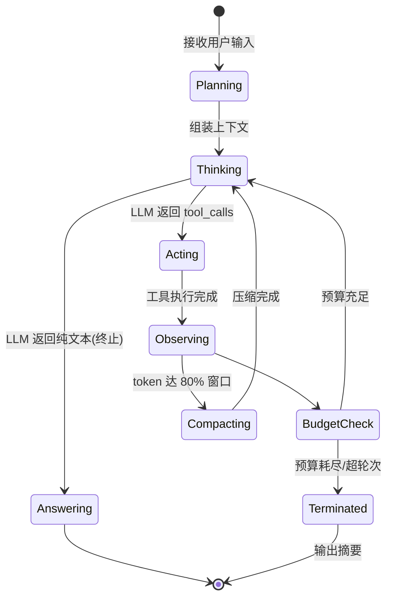
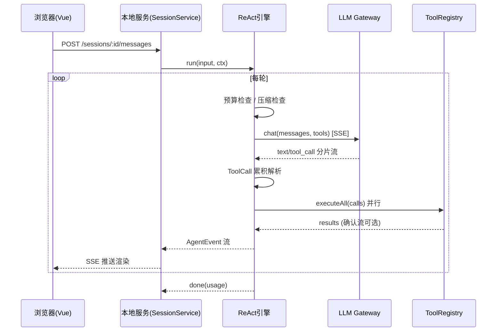

# y-zero-agent 技术方案设计

> 版本：v1.0 ｜ 日期：2026-10-21 ｜ 对应 PRD：v1.0

---

## 1. 总体架构

### 1.1 Monorepo 结构（pnpm workspace + turborepo）

```
y-zero-agent/
├── apps/
│   └── web/                    # Vue 3 Web 控制台
├── packages/
│   ├── core/                   # Agent 核心（与运行环境无关）
│   │   ├── src/engine/         # ReAct 主循环 / Plan / Multi-Agent
│   │   ├── src/llm/            # 多模型接入层（SSE / ToolCall 解析）
│   │   ├── src/tools/          # 11 个内置工具
│   │   ├── src/mcp/            # MCP 客户端与工具桥接
│   │   ├── src/prompts/        # 7 层提示词组装
│   │   ├── src/context/        # 预算管理 + 上下文压缩
│   │   ├── src/skills/         # Skills 系统
│   │   └── src/session/        # 会话/项目模型 + 持久化
│   ├── cli/                    # CLI 入口，命令名 `yzero`（commander + ink TUI）
│   └── shared/                 # 共享类型 / 协议定义（core ↔ web）
├── pnpm-workspace.yaml
└── turbo.json
```

### 1.2 技术选型

| 层 | 选型 | 理由 |
|----|------|------|
| 语言 | TypeScript 5.x（Node ESM） | 全栈类型贯通，shared 包共享协议类型 |
| 运行时 | Node.js ≥ 20 | 原生 fetch / SSE 支持，跨平台 |
| Web | Vue 3.5 + Vite + Pinia + TS | 用户指定 Vue；组合式 API 管理复杂会话状态 |
| Web 通信 | 本地 HTTP + SSE（服务端由 core 复用） | 与模型接入层同一套 SSE 基建 |
| 存储 | SQLite（better-sqlite3） | 多项目多对话可检索；WAL 模式保证原子写 |
| MCP | `@modelcontextprotocol/sdk` | 官方 SDK，stdio + SSE transport |
| 搜索 | ripgrep（二进制分发） | grep_search 性能保障 |
| 测试 | Vitest + Playwright | 单测 + Web E2E |

### 1.3 分层架构图

```
┌─────────────────────────────────────────────────────┐
│  apps/web (Vue3)          │  packages/cli (终端)      │
│  项目/会话管理 · 对话可视化    │  REPL · 命令 · TUI        │
└──────────────┬──────────────┴────────────┬────────────┘
               │   SessionService (HTTP/SSE)│
┌──────────────▼────────────────────────────▼──────────┐
│                  packages/core                        │
│  ┌───────────── Agent Engine ──────────────┐          │
│  │ ReActLoop │ PlanExecute │ MultiAgent    │          │
│  └─────┬──────────────────────────┬────────┘          │
│        │                          │                    │
│  ┌─────▼──────┐   ┌──────────────▼──────────────┐     │
│  │ LLM Gateway │   │ Context Manager             │     │
│  │ (SSE/ToolCall│  │ (Budget · Compressor 70-80%)│     │
│  └─────┬──────┘   └─────────────────────────────┘     │
│        │                                              │
│  ┌─────▼───────────┐  ┌──────────┐  ┌───────────┐     │
│  │ ToolRegistry     │  │ Prompt    │  │ Session    │     │
│  │ 11内置+MCP+并行   │  │ Assembler │  │ Store(SQLite)│   │
│  └─────────────────┘  │ (7层/3级)  │  └───────────┘     │
│                       └──────────┘                     │
└──────────────────────────────────────────────────────┘
```

---

## 2. ReAct 主循环引擎

> Plan-and-Execute / Multi-Agent 模式、Worker Pool 编排与后台任务恢复的完整设计见 `docs/agent-modes-design.md`；本节聚焦 ReAct。

### 2.1 状态机



### 2.2 核心接口

```typescript
// packages/core/src/engine/types.ts
interface AgentEngine {
  run(input: RunInput, ctx: RunContext): AsyncIterable<AgentEvent>;
}

interface RunContext {
  sessionId: string;
  projectId: string;
  mode: 'react' | 'plan-execute' | 'multi-agent';
  budget: BudgetState;          // 双层预算
  maxTurns: number;             // 默认 50
  signal: AbortSignal;          // 用户中断
}

type AgentEvent =
  | { type: 'turn_start'; turn: number }
  | { type: 'thinking_delta'; text: string }
  | { type: 'text_delta'; text: string }
  | { type: 'tool_call_start'; call: ToolCall }
  | { type: 'tool_result'; call: ToolCall; result: ToolResult; ms: number }
  | { type: 'compact_start' | 'compact_done'; saved: number }
  | { type: 'budget_warning'; usedPct: number }
  | { type: 'done'; usage: UsageSummary }
  | { type: 'error'; error: AgentError };

// 主循环骨架
async function* reactLoop(ctx: RunContext): AsyncIterable<AgentEvent> {
  while (!ctx.signal.aborted && ctx.turn < ctx.maxTurns) {
    const guard = budget.check(ctx);            // 轮前预算检查
    if (guard.exceeded) { yield summary(); return; }

    if (context.tokens() > WINDOW * 0.8) {      // 自动压缩（目标 55%）
      yield { type: 'compact_start' };
      const saved = await compressor.compact(ctx);
      yield { type: 'compact_done', saved };
    }

    const stream = llm.chat(messages, tools);   // SSE 流式
    const { text, toolCalls } = await accumulateToolCalls(stream);

    if (toolCalls.length === 0) { yield { type: 'text_delta', text }; return; }

    const results = await toolRegistry.executeAll(toolCalls); // 并行
    for (const r of results) yield r.event;
    ctx.turn++;
  }
}
```

### 2.3 自愈与容错

| 异常 | 策略 |
|------|------|
| ToolCall JSON 解析失败 | 尝试修复（截断补全/JSON5 宽松解析）；仍失败则将错误作为 Observation 回喂模型自纠 |
| 工具执行超时 | 默认 120s 超时，结果标记 `timeout` 回喂，不中断主循环 |
| 工具连续失败 ≥ 3 次 | 同一工具熔断本轮，提示模型换思路 |
| SSE 断流 | 指数退避重连（最多 3 次），已累积分片保留 |
| 用户中断 | AbortSignal 传播到 LLM 流与工具子进程；已产生变更写入会话日志 |

---

## 3. 多模型接入层（SSE）

### 3.1 Provider 抽象

```typescript
interface LLMProvider {
  id: string;                            // 'anthropic' | 'openai-compatible' | 'deepseek' ...
  chat(req: ChatRequest): AsyncIterable<StreamEvent>;
  listModels(): Promise<ModelInfo[]>;
  estimateTokens(messages: Message[]): number;
}

// 统一事件模型 —— 各厂商 SSE 差异在此抹平
type StreamEvent =
  | { type: 'text_delta'; text: string }
  | { type: 'tool_call_delta'; index: number; id?: string; name?: string; argsDelta: string }
  | { type: 'usage'; input: number; output: number }
  | { type: 'done' | 'error' };
```

### 3.2 ToolCall 分片累积解析（关键难点）

流式响应中 tool_call 以 delta 分片到达（`id`/`name` 通常在首片，`arguments` JSON 分散在多片）。解析器按 `index` 维护累积器：

```typescript
class ToolCallAccumulator {
  private buf = new Map<number, { id: string; name: string; args: string }>();

  ingest(ev: StreamEvent): ToolCall[] {     // 返回本次"完成"的调用
    if (ev.type === 'tool_call_delta') {
      const cur = this.buf.get(ev.index) ?? { id: '', name: '', args: '' };
      if (ev.id) cur.id = ev.id;
      if (ev.name) cur.name = ev.name;
      cur.args += ev.argsDelta;
      this.buf.set(ev.index, cur);
    }
    // done 时统一 JSON.parse + schema 校验
    // 解析失败 → 宽松修复(补引号/截尾) → 仍失败降级为文本消息回喂
  }
}
```

厂商差异适配表：

| 差异点 | Anthropic | OpenAI 兼容 | 处理 |
|--------|-----------|-------------|------|
| 分片命名 | `content_block_delta` (input_json_delta) | `tool_calls[].function.arguments` | 各自 Provider 内归一化为统一事件 |
| 多工具序号 | content block index | tool_calls[].index | 统一 `index` 语义 |
| 思考流 | thinking delta | 无/Reasoning 字段 | 归一化为 `thinking_delta`，无则不发 |

### 3.3 SSE 基建复用

`packages/core/src/llm/sse.ts` 提供通用 SSE 解析（逐行解析 `data:` 帧，处理 `[DONE]`、多行 data、CRLF），同时服务于：
- 模型接入（客户端消费厂商 SSE）
- Web 控制台（服务端向浏览器推送 AgentEvent，同一套事件类型定义在 `packages/shared`）

---

## 4. 工具体系

### 4.1 ToolRegistry

```typescript
interface AgentTool {
  name: string;
  description: string;              // 进入 L4 工具提示词层
  schema: JSONSchema;               // 参数校验（ajv）
  danger: 'safe' | 'confirm' | 'yolo-only';
  execute(args: object, ctx: ToolContext): Promise<ToolResult>;
}

class ToolRegistry {
  registerBuiltins();               // 11 个内置
  async attachMcp(server: McpServerConfig);   // MCP 工具桥接为 AgentTool
  async executeAll(calls: ToolCall[]): Promise<ToolResult[]>;
  // 并行执行：Promise.allSettled，read 类并发无限制，
  // write 类互斥队列（同文件串行），run_command 全局并发上限 2
}
```

### 4.2 并行执行与安全策略

- **并行**：单轮多个 tool_call → `Promise.allSettled` 并行，结果按 call 顺序回填 messages。
- **互斥**：`write_file`/`edit_file` 按文件路径加锁；`run_command` 全局并发 ≤ 2。
- **沙箱**：所有路径参数经 `path.resolve` 后校验必须在项目根内（防 `../` 逃逸）；`run_command` 默认白名单（node/npm/pnpm/git/ls/cat 等），白名单外需用户确认。
- **确认流**：`danger: 'confirm'` 的调用**默认每次确认**（2026-10-22 决议），先挂起，经 CLI/Web 推送确认请求，用户批准后执行；CLI 侧以 **ink TUI 选择卡**呈现（↑↓ 选择：允许 / 拒绝 / 编辑参数，M1 实现）；"本会话不再询问"白名单属 P2（F-23 权限模式体系）

### 4.3 MCP 动态扩展

```typescript
// stdio: 子进程启动; SSE: 直连 URL
const client = new McpClient(transport);
await client.initialize();
const tools = await client.listTools();       // 动态发现
tools.forEach(t => registry.register(wrapMcpTool(client, t)));
// 注册后触发 PromptAssembler 增量重组装（L4 层变化）
// 连接断开：自动重连 ×3，期间工具标记不可用并在提示词中摘除
```

配置：`~/.y-zero/mcp.json`（全局）与 `.y-zero/mcp.json`（项目级）合并。

### 3.4 大模型配置管理（Provider Registry）

```typescript
// ~/.y-zero/models.json —— 明文部分；API Key 单独存系统钥匙串（win: Credential Manager / mac: Keychain），
// 无钥匙串环境降级为 AES-256-GCM 加密文件（密钥派生自机器标识）
interface ProviderConfig {
  id: string;                    // 用户可读 id，如 'anthropic-main'
  type: 'anthropic' | 'openai-compatible' | 'deepseek' | 'qwen';
  name: string;                  // 显示名
  baseUrl: string;               // 支持代理/中转地址
  defaultModel: string;
  params: { temperature?: number; maxTokens?: number; topP?: number; maxTurns?: number };
  enabled: boolean;              // 启停开关（停用不在下拉列表出现）
  order: number;                 // 下拉排序
}

interface ProviderRegistry {
  list(): ProviderConfig[];                    // 不含 key 明文
  upsert(cfg: ProviderConfig, key?: string): void;
  remove(id: string): void;
  setKey(id: string, key: string): Promise<void>;     // 写入钥匙串/加密文件
  async test(id: string): TestResult;          // 连通性测试：列模型 + 1-token 探测请求
  resolve(id: string): LLMProvider;            // 实例化运行时 Provider（注入 key）
}
```

- 双入口：CLI `agent models add/test/use/remove` 与 Web 设置页共享同一 ProviderRegistry。
- 生效范围：切换/修改配置仅对新对话生效，进行中的会话保持原 Provider（保证事件流一致性）。
- 项目级覆盖：`.y-zero/models.json` 可覆盖全局默认 Provider（复用三级覆盖机制）。

### 3.5 输入框隐形 Markdown 支持

原则：**输入端零成本（保持纯 textarea），渲染端完整生效**。

| 项 | 方案 |
|----|------|
| 输入端 | 普通 textarea（CLI 直接读终端行；Web 复用同一组件），无工具栏/无预览按钮；Markdown 语法（`**粗**`、行内码、``` 代码块、列表、引用、链接）按自然方式输入 |
| 渲染端 | 消息流展示时 `markdown-it` + `highlight.js` 渲染，`DOMPurify` 消毒；代码块右上角复制按钮；表格/任务列表支持 |
| @文件引用 | 输入 `@` 触发文件补全弹层（复用 glob 索引），插入为内部 token（不与 Markdown 冲突） |
| 提交协议 | 消息体携带 `{ raw: markdown 原文 }`，渲染层只负责展示，保证 CLI/Web 多端渲染一致性 |

---

## 5. 7 层系统提示词组装 + 三级覆盖

> 静态/动态 Prompt 分工、缓存复用双层策略、Prompt Builder（组装/去重/裁剪/格式化）与模式提示词的完整设计见 `docs/prompt-design.md`。

```typescript
interface PromptLayer {
  id: 'identity' | 'environment' | 'project' | 'tools' | 'skills' | 'memory' | 'session';
  build(ctx: AssembleContext): PromptSection;
}

class PromptAssembler {
  private layers: PromptLayer[] = [
    new IdentityLayer(), new EnvironmentLayer(), new ProjectLayer(),
    new ToolsLayer(), new SkillsLayer(), new MemoryLayer(), new SessionLayer(),
  ];

  assemble(overrides: OverrideSet): SystemPrompt {
    // 三级覆盖：builtin < project(.y-zero/) < session(runtime)
    // 规则：字符串 section 后者覆盖；对象深度合并；数组并集去重
    // Identity 层标记 locked=true，覆盖请求直接忽略并告警
  }
}
```

性能策略：组装结果按 `(层内容 hash)` 缓存，会话中途工具/MCP/Skill 变化时仅重组装受影响层。

**静态/动态分工与模式切换**（详见 memory-design.md §7）：
- 静态 Prompt（L1 Identity / L2 Environment / L3 Project / L4 Tools）稳定可缓存——hash 命中直接复用组装结果，并对齐 Provider 的 prompt cache 前缀以降低费用与首字延迟
- 动态 Prompt（当前时间/模型信息/L2 记忆召回 Top-K/Skill 索引）每轮注入
- 模式提示词（Plan / ReAct / Multi-Agent）在 Prompt Builder 输出后**最后追加**，切换模式不动缓存前缀

---

## 6. 上下文压缩引擎（与记忆系统协作）

### 6.1 触发与流程

```
触发条件：conversation tokens ≥ 模型窗口 × 80%（可配；token 估算：中文 1 token/字、英文 3 chars/token）
目标：压缩后控制在窗口 55% 左右；为系统与回复预留 1024 token 安全空间
流程：
1. 冻结新增消息
2. 分区：保留区（system + 最近 6 轮原文，按消息边界切割不截半轮）
         压缩区（更早历史）
3. 压缩区处理：
   a. 工具结果折叠：大体积工具输出（>4000 字）截断后替换为"调用签名+结果摘要+关键行"
   b. 滚动摘要：与既有摘要合并重写（不重复堆叠），生成结构化摘要
      （目标/已完成步骤/关键决策/当前状态/遗留问题）
   c. 重复信息去重（多次相似 Observation 保留最新）
4. 重组 messages：[system] + [滚动摘要块] + [保留区原文]
5. 校验：压缩后窗口占用 ≈ 55%；未达标则缩小保留区 K 重压
6. 持久化压缩事件（可回溯原文，原始消息永不删除）
```

> 单次压缩比 ≈ (80−55)/80 ≈ 31%；长会话经多轮滚动摘要累计，等效压缩率 70%–80%。
> 压缩的同时触发记忆自动提炼（memory-design.md §4）：从被压缩历史中提取值得长期保存的经验进"待确认"队列。

### 6.2 分层折叠示例

```
压缩前 (~10,000 tok):
  [tool_result] read_file src/engine/loop.ts (400 行) ...
  [tool_result] grep_search "budget" (120 行匹配) ...

压缩后 (~2,200 tok):
  <summary>
  ## 任务目标: 修复预算检查时机
  ## 已完成: 定位 loop.ts:42 预算检查在 LLM 调用之后（bug 点）
  ## 关键事实: BudgetState 含 session/task 两层; 窗口 80% 触发压缩
  ## 当前状态: 准备将 check 前移至轮首
  </summary>
  [最近 6 轮原文]
```

---

## 7. Skills 系统（已升级为分层体系，详见 agent-modes-design.md §7）

> 本节为 MVP 简化版；完整设计（三层覆盖 / SKILL.md+references+scripts 包结构 / 两阶段按需加载 / 匹配评分）以 `docs/agent-modes-design.md` §7 为准。

```yaml
# .y-zero/skills/commit-review/skill.yaml
name: commit-review
description: 审查当前未提交变更并生成规范 commit message
triggers: ["审查提交", "review commit"]
tools_allowlist: [read_file, glob_search, grep_search, run_command]
prompt: ./prompt.md          # 注入 L5 Skills 层
```

- 加载：项目级 `.y-zero/skills/` + 全局 `~/.y-zero/skills/` 合并，同名项目级优先。
- 触发：显式（`/skill commit-review`）或自动（trigger 词匹配后询问用户）。
- 隔离：Skills 只能声明工具白名单子集，不能新增危险能力。

---

## 8. 会话与项目管理（多项目 × 多对话）

### 8.1 数据模型

```sql
projects   (id, name, root_path, created_at, settings_json, deleted_at DEFAULT NULL)
sessions   (id, project_id, title, mode, model, status, created_at, updated_at, deleted_at DEFAULT NULL)
messages   (id, session_id, seq, role, content_json, tokens, created_at)
compactions(id, session_id, before_tokens, after_tokens, summary_json, created_at)
usage      (id, session_id, turn, input_tokens, output_tokens, cost_usd)
```

> 软删除约定：`deleted_at` 非空即视为已删除，所有列表/检索/上下文恢复查询自动过滤；物理清除由回收站过期任务（默认 30 天）异步执行。

### 8.2 服务接口（core ↔ web 共享）

```typescript
interface SessionService {
  listProjects(): Project[];
  createProject(root: string): Project;
  listSessions(projectId: string): Session[];
  openSession(projectId, sessionId?): SessionHandle;  // 无 id 则新建
  send(sessionId, input): AsyncIterable<AgentEvent>;  // SSE 推送给 Web
  resume(sessionId): void;                            // 历史恢复进上下文
  searchSessions(q: string): Session[];

  // ── 移除能力 ──
  removeSession(sessionId, opts?: { hard?: boolean }): void;
  // 软删除（默认）：置 deleted_at；运行中的会话先 abort 再删；
  // hard: 物理清除 messages/compactions/usage 及会话本体

  removeProject(projectId, confirmName: string, opts?: { hard?: boolean }): void;
  // 二次确认：confirmName 必须与项目名完全一致（Web/CLI 双端校验）
  // 级联软删除项目下全部会话；项目级 MCP/Skills 配置一并停用；
  // 项目目录内文件（.y-zero/、源码）不删除，仅解除注册
  restore(kind: 'project' | 'session', id): void;      // 回收站恢复
  listTrash(kind?: 'project' | 'session'): TrashItem[]; // 回收站列表
  purgeExpired(): number;                                // 清理超期软删除（默认 30 天）
}
```

**移除安全策略**：
- 运行中的会话删除前必须 `AbortSignal` 中止主循环并等待工具子进程退出，避免半写状态。
- 物理删除（hard）在事务内执行且先做一次临时备份文件，异常可回滚。
- 项目移除仅解除注册，**绝不触碰用户源码目录**；`.y-zero/` 项目级配置目录保留（由用户自行决定是否删除）。

Web 控制台（Vue 3 + Pinia）**纯本地部署**（2026-10-22 决议）：Vue 构建产物作为静态资源内嵌 CLI npm 包，CLI `agent serve` 启动本地 server（默认 `127.0.0.1:7900`，仅监听回环地址）调用 SessionService，AgentEvent 以 SSE 推送到前端渲染；不做远程部署形态。

---

## 9. 跨平台方案（Windows / macOS）

| 差异点 | 方案 |
|--------|------|
| 路径分隔符 | 全部使用 `path`/`path.posix` API，禁止字符串拼 `/` |
| Shell 差异 | win 下优先 PowerShell，检测失败降级 cmd；macOS 默认 zsh；`run_command` 抽象 ShellAdapter |
| ripgrep 分发 | 按平台二进制随包分发（`@vscode/ripgrep`） |
| 键盘中断 | win: SIGINT 模拟（ctrl+c 监听）；macOS: 标准 SIGINT |
| 配置目录 | 统一 `~/.y-zero`（win 展开为 `%USERPROFILE%`），经 `os.homedir()` |
| 换行符 | 文件读写尊重原文件 EOL；日志统一 LF |
| CI | GitHub Actions matrix: `windows-latest` + `macos-latest`，双平台跑同一套 E2E 冒烟 |

---

## 10. 关键时序（Web 控制台发起任务）



---

## 11. 测试策略

| 层 | 手段 |
|----|------|
| ToolCall 解析 | 录制三家厂商真实 SSE 分片 fixture，回放断言（含乱序/截断/坏 JSON 用例） |
| ReAct 引擎 | Mock LLM 脚本化响应（正常/工具失败/死循环/预算耗尽），快照断言事件流 |
| 压缩引擎 | 构造不同长度会话，断言压缩率区间与保留区完整性 |
| 工具沙箱 | 逃逸用例（`../`、软链接、绝对路径）全部拒绝 |
| 跨平台 | 双平台 CI + 路径/Shell 专项用例 |
| Web E2E | Playwright：多项目切换、多对话、SSE 渲染、确认流 |

---

## 12. 风险与对策

| 风险 | 对策 |
|------|------|
| 厂商 SSE 格式变动导致解析失败 | fixture 回放测试 + Provider 版本探针；宽松解析兜底 |
| 压缩丢失关键信息 | 原始消息永不删除，支持"展开压缩段"回看；保留区可调 |
| better-sqlite3 原生编译在 win 失败 | 预编译二进制 + 失败时降级 JSON 存储 |
| MCP Server 质量参差 | 工具 schema 校验 + 超时熔断 + 用户显式启用 |
| run_command 安全风险 | 白名单 + 确认 + 沙箱 + 全量审计日志三重防护 |
